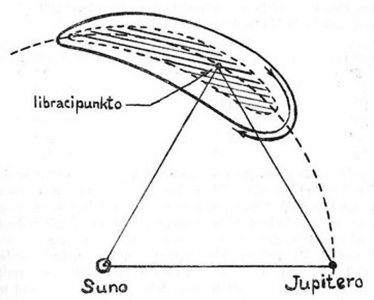

<!--
LA TROJANOJ — INTERESA GRUPO DE PLANEDETOJ
De Bruno THÜRING, Karlsruhe i.B. (Germanujo).
-->

En la jaro 1907 la planedeto 588 estis fotografe eltrovata en la observatorio de [Heidelberg]{.maldense}. Oni nomis ĝin "[Achilles]{.maldense}" kaj ĝi estis la unua membro
de speciala grupo de planedetoj el kiuj 15 hodiaŭ estas konataj. La du
lastaj estas eltrovitaj en la jaroj 1949 kaj 1950. Ĉiuj membroj de la grupo
havas nomojn de herooj de la trojana milito kaj pro tio ili estas nomataj
ankaŭ "trojanoj“. Inter la ĉirkaŭ 1500 planedetoj hodiaŭ konataj la trojanoj
havas la plej grandan distancon de la suno kaj la plej malgrandan diurnan
moviĝon, escepte de la speciala planedeto 944 [Hidalgo]{.maldense}. Estas tre grave, ke
iliaj diurnaj moviĝoj estas preskaŭ egalaj al tiu de Jupitero, kiu havas la
plej grandan mason inter la planedoj de la sunsistemo. Sekve la trojanoj
rivoluas ĉirkaŭ la suno preskaŭ en la sama tempo kiel Jupitero, nome en 11,8
jaroj. Krome ili kuradas preskaŭ en la sama orbito kiel Jupitero, 10 el ili
ĉiam antaŭ ĝi, la ceteraj ĉiam malantaŭ ĝi. Sed inter ili kaj Jupitero la
angula distanco estas pli granda ol 25°. Pro ĉi tiuj kaŭzoj oni nomas ilin
ankaŭ "la planedoj de la jupitergrupo".

Tuj post la eltrovo de [Achilles]{.maldense} la problemo ekestis, ĉu la simileco de
la orbitoj de la trojanoj kaj de Jupitero estas nur hazarda kaj nelongtempa.
Jam laŭ la ĝenerala mekaniko periodaj moviĝoj akcelataj egaldirekte kaj egalperiode ofte estas treege perturbataj. Oni nomas tiajn fenomenojn mekanika
resonanco. Pro la granda simileco de la moviĝoj de Jupitero kaj trojanoj oni
povis atendi pli grandajn perturbojn de la trojan-moviĝoj ol ĉiuj ĝis nun konataj perturboj de la planedoj. Sed aliflanke oni sciis per la esploradoj de
[Lagrange]{.maldense}, Franca astronomo de la 19-a jarcento, ke teorie ekzistas du
konstelacioj de planedeto kuranta egalorbite kun Jupitero, en kiuj ĝi ne estas
perturbata de Jupitero. La kondiĉo por tio estas, ke la tri korpoj — suno, Jupitero kaj la planedeto — troviĝu en la verticoj de egallatera triangulo. Ili
restas tie. eĉ se la orbitoj estas elipsaj. Tamen, en tiu ĉi kazo la angula
distanco de la perihelioj devas esti precize ± 60°.

{#bld-1}\
Spirala kaj reno-forma libraciorbito kaj neenkurebla spaco (ombrostrekita)
ĉirkaŭ la libracipunkto. Ili rilatas al observanto restanta en egala situo rilate
al la suno kaj Jupitero. La larĝoj de la orbito kaj de la neenkurebla spaco
estas desegnitaj 7-oble tro grandaj. Ankaŭ la distancoj inter la orbito kaj la
limkurbo estas desegnitaj 25-oble tro grandaj direkte al kaj for de Jupitero.
La orbito do reale ĉirkaŭvolvas la neenkureblan spacon multe pli malvaste.

Estas rimarkinde, ke ĉiuj eltrovitaj trojanoj troviĝis proksime al unu el
la menciitaj triangul-punktoj. Kiel nun ĉi tiuj planedoj moviĝos?

[Charlier]{.maldense}, Sveda astronomo en [Lund]{.maldense}, pruvis antaŭ 50 jaroj, ke la
moviĝo de korpo preskaŭ cirkle turniĝanta ĉirkaŭ la suno proksime al
triangul-punkto estas tre simila al la movado de pendolo senfrota. Sed unu pendolperiodo daŭras 148 jarojn. Cetere la orbitoj de ĉiuj planedetoj, se ili estas
rigardataj el triangulpunkto, estas elipsoj tre longe streĉitaj ĉirkaŭ tiu punkto kiel centro. Ilia elcentreco estas 0,98. La pli grandaj aksoj kuŝas en la
orbito de Jupitero ĉirkaŭ la suno. Sekve la trojanoj dum la 148-jara "*libracio*"
elkuras nur malmultege el la Jupiter-orbito kaj dum la unua duona daŭro
de la libracio ili havas iomete malpli grandan, dum la alia iomete pli grandan
orbit-akson ol Jupitero.

Certe jam per la 20-jara komparado de ĉi tiu teoria libracio kun la observita orbito de speciala trojano (659 [Nestor]{.maldense}) grandaj diferencoj aperis
kaj la penso estiĝis, ke simile al pendolmovado de granda amplitudo ankaŭ
la periodoj de la libracioj devas pligrandiĝi kune kun pligrandiĝo de la svingamplitudoj. Nova teoria pritraktado de la problemo fare de l' aŭtoro en
1929 konfirmis ĉi tiun supozon. La sekvanta tabelo montras, kiel ege la periodoj dependas de la grandeco de la amplitudo. Ekzemple al la planedeto 1437
[Diomedes]{.maldense}, libracianta el la triangulpunkto (aŭ "libracipunkto") pli ol 24°
al Jupitero, periodo de 160 jaroj estas atribuenda.

|Amplitudo en la direkto al Jupitero|Periodo = daŭro de la libracio| Amplitudo en la direkto for de Jupitero|
|---:|:---|---:|
| 5°|148,2 jaroj| 5°|
|10°|149,0 "  |11°|
|20°|153,9 "  |30°|
|30°|172,6 "  |60°|
|35°|215,7 "  |90°|
|36°|294,0 "  |110°|

Sed rezultis ke la grandamplitudaj libraciorbitoj ankaŭ estas tre malsimilaj
al la elipsaj orbitoj laŭ [Charlier]{.maldense}. Jam [E. Brown]{.maldense}, usona astronomo
mortinta antaŭ malmultaj jaroj, teorie esplorante kaj kalkulante la spacojn
enkureblajn de la planedetoj de la sunsistemo, ricevis la rezulton, ke ĉirkaŭ
la triangulpunktoj troviĝas po unu spaco neenkurebla, varie granda por
diversaj trojanoj. Ĝia amplekso ĉirkaŭ la libracipunkto en la direkto al Jupitero
estas malpli granda ol en la kontraŭa direkto. Nesimetrio konforma rezultis ankaŭ rilate al la libraciorbitoj mem. Sekve la daŭroj, dum kiuj trojano
troviĝas en la sunproksima kaj sunmalproksima partoj de sia orbito estas
malegale longaj. La libraciorbitoj sekve montriĝis reno-formaj, kiel oni vidas
el la figuro kaj la tabelo. Kune kun tio rezultis ankaŭ la amplitudo plej
granda de 36,1° direkte al Jupitero kaj la supra kaj malsupra limoj de
diurnaj moviĝoj de 322 kaj 276 arksekundoj. Nur planedetoj kun diurnaj
moviĝoj inter ĉi tiuj limoj apartenas al la trojan-grupo kaj libracias ĉirkaŭ
unu el ambaŭ triangul-punktoj.

Estas rimarkinde ke la diurnaj moviĝoj de ĉiuj trojanoj hodiaŭ konataj estas
tre malproksime de ĉi tiuj limoj kaj ke ankaŭ ekstere troviĝas nenia planedeto
proksime al ili. La planedetoj najbaraj al la trojangrupo estas: direkte al
la suno 279 [Thule]{.maldense} (diurna moviĝo 405\"), direkte al Saturno 944 [Hidalgo]{.maldense},
la planedeto plej distanca de la suno (diurna moviĝo 255\"). Pro tio la trojanoj dokumentiĝas kiel "amaso" da korpoj disigita de la aliaj.

Laŭ la ĝisnunaj teoriaj esploradoj estas ankoraŭ nepre ne certe, ĉu la
ekvilibro de triangulkonstelacio Jupitero-suno-trojano estas stabila aŭ nestabila. Preciza nombra kalkulo rilate al speciala kazo fare de la aŭtoro montris,
ke la libraciorbito ne estas fermita kurbo, sed ke la planedeto troviĝas post
la libracio en iomete pli granda distanco de la libracipunkto ol antaŭe.

Sed hodiaŭ estas nedecidite, ĉu ĝenerale la libraciorbitoj spirale kuras
*eksteren*, kiel montriĝis ĉe la menciita speciala kazo. Tamen, se orbito sub
specialaj kondiĉoj spirale kuras *internen*, oni povas diri, ke la jam menciitaj
neenkureblaj spacoj, enhavantaj la libracipunkton, limigos tian tendencon
ĉiokaze. Sed *eksteren* oni ne povas doni konforman limon.

Fine tabelo montru, kiel la libraciorbitoj de 13 trojanoj dissituas en la
ĉirkaŭaĵo de la libracipunktoj. La du ceterajn oni ne povas ĝis nun enordigi
tiamaniere.

|Amplitudo en la direkto for de Jupitero|Nombro de trojanoj|
|:---:|---:|
|0° - 5°   |0|
|5° - 10°  |4|
|10° - 15° |3|
|15° - 20° |2|
|20° - 25° |1|
|25° - 30° |1|
|30° - 35° |0|
|35° - 40° |2|

La tabelo montras la nombrojn de la trojanoj kies amplitudoj troviĝas en
la indikitaj kvingradaj intervaloj. Laŭ hodiaŭa scio neniu planedeto troviĝas
en la plej proksima ĉirkaŭaĵo de la libracipunktoj, sed ili amasiĝas en la
amplitudintervalo de 5° ĝis 10° direkte for de Jupitero.

Ni esperu, ke estontece la eltrovo de novaj trojanoj kaj la evoluado de
la teorio de ilia moviĝo akcelos la esploradon de ĉi tiu interesa grupo de
planedetoj.

# Literaturo.

[C. V. L. Charlier]{.maldense}: Lehrbuch der Himmelsmechanik II, p. 117, (1907).

[A. Wilkens]{.maldense}: Sitzungsberichte der Heidelberger Akademie der Wissenschaften, 16. Abhandlung (1918).

[E. Brown]{.maldense}: Transactions of the Astron. Obs. of Yale Univ. 3 1, 81 (1923 - 1925). Monthly notices, 71.

[B. Thüring]{.maldense}: Astronomische Nachrichten, 235 17 (1929); 238 357 (1930);
243 181 (1931), 279 kajeroj 5/6 (1951).
