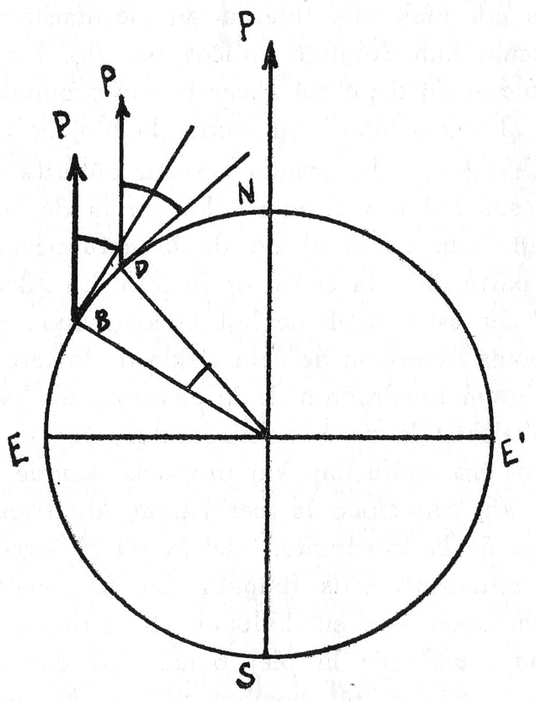
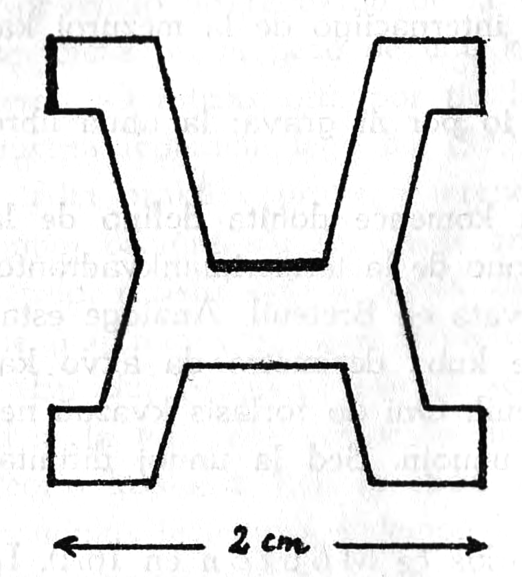

<!--
KIEL ESTIĜIS LA METRA SISTEMO
de Prof. D-ro H. SIRK
Prelego farita en I.S.U, Zagreb 1953.

-->

```{=html}
<style>
    .duono {
        width: 50%;
    }
</style>
```


Jam de pratempoj regis ĉie granda konfuzo en la mezuroj de longo,
volumeno kaj pezo. Ĉiu urbo en Germanujo, ĉiu ŝtato en Italujo, ĉiu kantono
en Svislando havis siajn proprajn mezurojn kaj ofte tia politika memstarulo
havis eĉ por samnoma grando diversajn unuojn. Ekzemple la svisa kantono
Valdo (france [Vaud]{.maldense}, germane [Waadt]{.maldense}) havis 8 diversajn pezunuojn nomitajn
funto kaj 31 mezurunuojn por volumenoj[^1]. Vi povas do facile imagi, kia
kaoso regis tiam en la mezuroj kaj kia estis tiam la malhelpo por ĉiaj komerco
kaj trafiko. Estis simila kaoso, kia ĝis nun regas en la lingvoj!

La provoj de la francaj reĝoj starigi almenaŭ por la tuta Francujo unuecajn
mezurojn ne havis daŭran sukceson, ĉar ili volis sen iu motivo altrudi la
parizajn mezurojn al la tuta lando. Sed tiuj mezuroj havis neniajn kvalitojn,
kiuj pravigus tian privilegion. Simile la diversaj provoj altrudi al la homaro
nacian lingvon kiel internacian ĉiam malsukcesas.

Rilate al la internacia mezursistemo oni dum la jarcentoj iom post iom
ekkonis, ke la savo el tiu plago povas nur veni de la scienco.

Eble unu el la unuaj tiaj provoj estas tiu, kiun mi trovis trastudante la
historion de la viena universitato[^2]. Tie oficis en la dua duono de la deksesa
jarcento la eminenta humanisto [Blotius]{.maldense} kiel profesoro de retoriko. De
1575 ĝis 1608 li estis ankaŭ direktoro de la imperiestra biblioteko. Li projektis muzeon, kie estu kreata instituto por efektivigo de internaciaj unuoj
por longo kaj pezo. Tion li intencis efektivigi tiel, ke oni rilatigu ĉiujn ekzistantajn mezurunuojn al la antikvaj latinaj kaj per tio venu al internaciaj
unuoj. Ni do vidas la influon, kiun havis tiam la humanismo sur la mensojn.
Analoge Zamenhof revis en sia infaneco pri renovigo de la klasikaj lingvoj
por ricevi internacian lingvon.

[^1]: Ch. Ed. Guillaume: Unités et Etalons. Pakis. Gauthier-Villans, 1883. p. 11

[^2]: J. Aschbach: Geschichte der Wiener Universität, 3, Wien. 1888 p. 367.

Estas rimarkinde, ke preskaŭ samtempe kun [Blotius]{.maldense} en 1554 estis en la
viena universitato profesoro de greka kaj araba lingvoj,
[Guilhelmus Postellus]{.maldense}, kiu alvokis la eŭropajn princojn al paco kaj konkordo. Ĝenerala
mondlingvo, kiun li povus konstrui, helpu al tiu celo. Jen montriĝas interesa
paraleleco inter la metra sistemo kaj la internacia lingvo, kiun ni pli poste
ĉiam denove observos.

Je la fino de la 17-a jarcento, unu jarcenton post tiuj nebulecaj antaŭsignoj,
aperis ĉe la gvidantaj natursciencistoj genia ideo, kiu paŝo post paŝo post
longa laboro estis kondukonta al la internacia metra mezursistemo. Tiu genia
ideo konsistas en jeno:

Oni devas krei tute novan longunuon prenante bone determinitan grandon
el la naturo mem. Se la prototipo konstruota por praktikaj celoj estus detruita, ekzemple per iu naturkatastrofo, oni povus rekonstrui ĝin mezurante
denove la grandon troveblan en la naturo.

Inter tiuj antaŭbatalantoj por natura mezursistemo estas jenaj eminentuloj:
[Christopher Wren]{.maldense} (1632 - 1723), la angla arkitekto kiu konstruis la katedralon de S-ta Paŭlo en Londono. Li estis ankaŭ granda natursciencisto, kio
estas malpli konata ol liaj meritoj artistaj. [Gabriel Mouton]{.maldense} (1618 - 1694),
fama franca matematikisto kaj astronomo; [Jean Picard]{.maldense} (1620 - 1682), fama
franca geodeziisto kaj la nederlandano [Hugenio]{.maldense} (nederlande [Huygens]{.maldense})
(1629 - 1695), la fizikista klasikulo.

[Wren]{.maldense} kiel la unua, certe antaŭ 1667, proponis naturmezuron, nome la
longon de la sekundpendolo. Tio estas pendolo, kiu oscilas unufoje en ĉiu
sekundo. Kelkajn jarojn poste [Mouton]{.maldense} en sia libro:
[Observationes diametrorum solis et lunae]{.maldense} (Observoj pri la suna kaj luna diametroj) proponis
uzi la longon de unu arkminuto de ĉefa cirklo de la terglobo. Tiun unuon li
nomis "[milliare]{.maldense}" kaj devenigis el ĝi subunuojn laŭ dekuma sistemo, por kiuj
li proponis latinajn nomojn. Jen do jam aperas gravaj principoj de la metra
sistemo! Ĉar la mezurado de arko sur la terglobo necesigas longedaŭrajn,
ampleksajn kaj komplikajn mezuradojn, li proponis ligi la proponitajn longunuojn ankaŭ al alia konstanta kaj pli facile reproduktebla longo kaj denove
projektis kiel tian la longon de la sekundpendolo kiel kontrolilon. Ni vidos
poste, ke li tiel anticipis ideon, kiu ludas gravan rolon en la plej moderna
evoluo de la metra sistemo.

[Picard]{.maldense} rimarkis la grandajn ŝanĝiĝojn de la longo, kiujn suferis la prototipo de la franca longunuo, la klafto (france [toise]{.maldense}), kiun li uzis por siaj
famaj geodeziaj mezuradoj de meridianparto en Francujo. Ĉe ili li kiel la
unua uzis lornon kun fadeno por la triangulado. Li kalkulis poste la grandon de la tero kaj publikigis en 1671 siajn laborojn en la verkon:
"[Mesure de la Terre]{.maldense}" (termezurado). Ĉar li devis esprimi sian gravan rezulton en
unuoj, kies konstanteco ne estis garantiita, li volis uzi kiel kontrolilon naturmezuron kaj proponis kiel [Wren]{.maldense} la longon de la sekundpendolo. Nur parenteze li aldonis, ke oni povus uzi tiun longon kiel novan longunuon kun la
nomo "[rayon astronomique]{.maldense}", kies triono estu la "[pied universel]{.maldense}". Ideo pri
internacieco do ankaŭ ĉe [Picard]{.maldense} mankis preskaŭ tute. Li jam suspektis ke la
longo de la sekundpendolo varias kun la latitudo, sed tamen oni havus, li
diris, senŝanĝan unuon en ĉiu loko.

Similaj estis la ideoj de [Hugenio]{.maldense}. En sia klasika verko
"[Horologium oscillatorium]{.maldense}" (La pendolhorloĝo) aperinta en 1673, li proponis la longon
de la sekundpendolo por ricevi konstantan longunuon. Trionon de ĝi li volis
nomi "[pes horarius]{.maldense}" (futo horloĝa).

Tiaj estis je la fino de la 17-a jarcento la ideoj de la gvidantaj spirituloj
pri naturmezuroj, kiuj ĉefe celis la konstantecon kaj nur parte la pliraciigon
kaj nur tre malmulte la internaciigon de la unuoj.

Estas interese observi kiuj ideoj pri la lingvo internacia ĝermis en tiuj
kapoj kaj konstati, kiom dense tiu ideo estis interplektita kun la ideo pri
unuecaj mezuroj. En 1668 aperis angla libro pri artefarita lingvo de la fama
[John Wilkins]{.maldense} (1614 - 1672), unu el la plej eminentaj tiamaj sciencistoj.
Temis pri t.n. filozofia lingvo, praktike ne uzebla kaj ne uzita. Tiu libro havis
tre grandan influon sur [Leibniz]{.maldense}, kiu daŭrigis la klopodojn de [Wilkins]{.maldense}.
En tiu libro [Wilkins]{.maldense} klare mencias la klopodon de [Wren]{.maldense} krei naturan mezursistemon. Kontraŭe, la libro de [Wilkins]{.maldense} estis konata al [Hugenio]{.maldense}, kiu legis
ĝin kun intereso kaj aprobis ĝian tendencon krei artefaritan lingvon, sed
rimarkis, ke por la enkonduko de la lingvo necesus la aprobo de la nacioj.

Tiaj estis la unuaj ĝermoj de du mondampleksaj ideoj je la fino de la
17-a jarcento. Oni do hezitis inter la sekundpendolo kiel longunuo kaj longunuo el terdimensio. Ĉe [Mouton]{.maldense} oni jam trovas la dekuman subdividon de la
unuo. Tre malrapide kreskis tiaj ĝermoj dum la sekvonta, la 18-a jarcento.

Preskaŭ okdek jaroj pasis ĝis [La Condamine]{.maldense} (1701 - 1774), fama
franca geodeziisto donove ekkaptis la ideon. En 1747 li publikigis en la
Franca Akademio sian proponon sub la titolo:
"[Nouveau projet d'une mesure invariable propre de servir de mesure commune à toutes les nations]{.maldense}" (Nova
projekto de senŝanĝa mezuro taŭga por servi kiel mezuro komuna al ĉiuj
nacioj). La vorto "internacia" mankis ankoraŭ tiam en la franca kaj aliaj
vortaroj, tial la peza stilo. Tamen [La Condamine]{.maldense} bone komprenis la esencon
de la internacieco. Li konstatis, ke la tiama longunuo franca, la klafto estis
la plej fama el ĉiuj naciaj longunuoj, ĉar ĝi estis uzita ĉe grandaj geodeziaj
mezuroj sur la ekvatoro, en mezaj latitudoj kaj en la malproksima nordo kaj
ĝia prototipo estis bone konservata de la Franca Akademio. Sed tamen ekkonis [La Condamine]{.maldense}, ke la franca klafto ne povas esti proponata kiel komuna
mezurunuo, ĉar la aliaj nacioj ne akceptus ĝin. Li montris tiel pli bonan
komprenon pri internacieco ol la berlina Akademio, kiu premiis en 1784
disertacion de la akademiano [Rivarol]{.maldense} proponanta la francan lingvon kiel
internacian. [La Condamine]{.maldense} do proponis naturmezuron pro ĝia internacieco kaj
volis denove uzi kiel tian la longon de la sekundpendolo. Konante ĝian variadon laŭ la latitudo li proponis ĝian longon sur la ekvatoro. Je la praktika
efektivigo li intencis interkonsiliĝon kun eksterlandaj akademioj.

Ni vidas do, kiel la ideo de internacieco gajnas terenon en la demando
de la mezurunuoj ĉe la eminentuloj de la mezo de la 18-a jarcento.

Observante paralelon kun Esperanto ni vidas, ke en la plej fama literatura
verko de tiu epoko, la Granda Enciklopedio, redaktita de [Diderot]{.maldense} kaj
[D'Alembert]{.maldense}, eldonita en 1765, aperas la ideo pri lingvo internacia en
konkreta formo. Tie publikigis [Faiguet]{.maldense}, franca financoficisto, projekton
de artefarita lingvo kiel internacia, kiu similis en kelkaj detaloj al la nia.

Por praktika efektivigo ankaŭ li proponis internacian kunlaboron de la akademioj sub direkto de la registaroj.

Post la propono de [La Condamine]{.maldense} denove ripozis la ĝermoj dum pli ol
kvardek jaroj. Ni do vidas, kiom granda estas la diferenco inter teorio kaj
praktiko, ne nur en la demando pri lingvo internacia, sed ankaŭ en la demando pri internaciaj mezurunuoj! Por ke la grandaj ideoj pri la mezuroj
donu praktikajn rezultojn, necesis grava politika evento, kiu kvazaŭ bruliganta fajrero ardigas al praktika efektivigo de la ideoj la homojn jam preparitajn per la laboroj de la sciencistoj! Tiu granda evento estis la Franca
Revolucio.

Kiel sciate la Nacia Kunveno eklaboris en 1789 kaj, devigate per la urĝa
bezono pri unuecigoj de la francaj mezuroj, akceptis jam en la sekvinta jaro,
do en 1790, proponon de [Talleyrand]{.maldense}, la pli poste tre konata politikisto,
pri unuecigo de mezuroj kaj pezoj. En tiu propono la geniaj ideoj de la
scienculoj komencis jam ricevi praktikajn konsekvencojn. Konkrete li proponis krei novan mezursistemon bazitan sur la naturo, por ke ankaŭ ĉiuj aliaj
nacioj povu adopti ĝin. Li proponis la longon de la sekundpendolo sub la
latitudo de 45°. Li ankaŭ klare ekkonis, ke interkonsento de la francoj kun
aliaj nacioj necesos por efektivigi internacian mezursistemon kaj pensis, ke
kunlaboro de Francujo kun Anglujo sufiĉas por tio. En la tiamaj cirkonstancoj li pravis. La francaj deputitoj akceptis lian proponon kaj montris tiel,
ke ili "same fidelaj al hejma altar\'" sin sentis "la filoj de l\' tuta homar\'".

Nun la Franca Akademio, la granda scienca aŭtoritato, estis demandata
pri sia opinio. Ĝi estis ludonta gravan rolon en la demando pri la mezursistemo. Ni vidis ĝis nun ĉe la elekto de la naturmezuro hezitadon inter
sekundpendolo kaj parto de ĉefa cirklo de la tero. La Akademio malakceptis
la sekundpendolon, ĉar estus malbone ligi la longunuon al hazarde elektita
tempunuo, kaj proponis kvaronon de ĉefa cirklo de la tero kiel fundamenton.
Inter la du eblecoj preni kvadranton de la ekvatoro aŭ kvadranton de meridiano la Akademio elektis la meridiankvadranton, ĉar la geodeziaj mezuroj
sur la ekvatoro estus tro malfacilaj, kaj proponis denove mezuri inter Dunkerko ([Dunkerque]{.maldense}) kaj Barcelono la meridianon, kiu tranĉas Francujon, do
proksimume dekonon de la kvadranto. Tiel la pli ol jarcenta hezitado inter
sekundpendolo kaj termezuro estis finigata. La Akademio ankaŭ pritraktis
la demandon, kiel la unuo estu subdividata. Ĝi deklaris, ke per si mem la
subdivido dekduuma estus eble la plej bona. Sed ĉar tiu teorie perfekta
subdivido necesigus ŝanĝon de nia nombra sistemo, kiu estas jam internacia
kiel dekuma, ĝi rekomendis la dekuman sistemon por la subdivido de la
longunuo. Per tio la Akademio montris sciencan akuratecon kaj socian
saĝecon. La samon ĝi montris insistante, ke la meridiano, kies longo en
Francujo jam estis konata el antaŭaj mezuroj, estu denove mezurata, ĉar
por entrepreno kiel la starigo de unuecaj mezuroj, "kiu ampleksos la tutan
homaron kaj akcelos la internacian fratecon, oni devas celi al perfekteco".

La Akademio ankaŭ proponis ligi la unuojn por volumenoj al la longunuo per kubo, kies eĝo egalas al la longunuo. La unuojn de la pezo oni
ligu al tiu de la volumenoj per fluidaĵo de konata denseco. Kiel tian ĝi proponis distilitan akvon.

La 30-an de marto 1791 la Nacia Kunveno aprobis la proponojn de la
Akademio, akceptis do male al siaj unuaj decidoj la meridiankvadranton
kiel fundamenton de la mezursistemo kaj ordonis la geodezian mezuradon
de la meridiano inter Dunkerko kaj Barcelono. Tio estis la unua paŝo en la
praktikon!

Mi nun skizu per kelkaj vortoj la ofte menciitan determinon de la meridiankvadranto. Fig. [1](#bld-1) estas ebena tranĉo laŭ la akso de la terglobo. Ĝia
norda poluso estas en N, ĝia suda en S. La terakso celas la ĉielan poluson
P, La du punktoj E kaj E\' apartenas al la ekvatoro; ĝia ebeno estas orta
al la terakso. Do [NE]{.maldense} estas la kvadranto determinota. Oni determinas astronomie kiom da gradoj ampleksas la meridianarko inter D kaj B (Dunkerko
kaj Barcelono). La longon de tiu meridianarko [DB]{.maldense} oni mezuras poste geodezie.

{#bld-1 .duono}\
fig. 1

Ĉe la astronomia determino oni mezuras en D kaj B la "altecon de la
ĉiela poluso". Tio estas la angulo, kiun faras la paralelo al la terakso, do
la direkto al la ĉiela poluso P en D resp. B, kun la horizonto, do kun la
tanĝanto al la meridiano en tiuj punktoj. Tiu alteco de la poluso estas en D
pli granda ol en B. Ilia diferenco, la angulo inter la tanĝantoj en D kaj B
estas pro geometriaj kaŭzoj (egaleco de anguloj kun lateroj ortaj unu sur
la alia) egala al la angulo, kiun faras la radio de la terglobo al D kaj B,
kies arko en gradoj estas la meridianparto, kies longon oni poste geodezie
mezuras per triangulado.

El tio oni kalkulas la longon de la tuta meridiankvadranto.

La planitajn mezurojn kaj aliajn organizajn laborojn komencis nun la
plej kompetentaj fakuloj de la Akademio, kiu ellaboris nun detalajn planojn
por la nova mezursistemo. La Akademio nun decidis en dua ekspertizo,
ke dekmiljonono de la kvadranto estu la longunuo, kiun oni nomu "metro“.
Ĉar la bezono de novaj mezuroj en Francujo mem estis tre urĝa por meti
finon al la reganta kaoso kaj ĉar la projektita nova mezurado de la meridiano postulus tro da tempo, la Akademio uzis le geodeziajn mezurojn de
[La Caille]{.maldense} el la jaro 1740 kaj esprimis la longon de tiu "provizora" metro
en la tiamajn francajn mezurunuojn. Ĝi sumiĝis je 3 futoj 11,44 linioj.

Speciale interesa por ni esperantistoj estas alia demando studita de la
Akademio, nome la nomenklaturo de la novaj mezurunuoj. Ekstaris do antaŭ
la natursciencistoj kaj matematikistoj en la Akademio lingva demando, nome
la farado de novaj vortoj por la novaj unuoj. La jam menciita vorto [mètre]{.maldense}
estis prenita el la greka lingvo. Por la aliaj nomoj la Akademio ne solvis
la demandon, sed ellaboris du proponojn. Unu propono uzis la latindevenajn
prefiksojn [déci-]{.maldense}, [centi-]{.maldense}, kaj [milli-]{.maldense} por dekonoj, centonoj kaj milonoj kaj diris
[décimètre]{.maldense}, [centimètre]{.maldense} kaj [millimètre]{.maldense} kaj montris tiel la ĝustan vojon, preskaŭ
mi dirus la esperantisman vojon por la nomenklaturo. Tiu propono staras en
la unua kolono de la tabelo[^3]. La oblojn oni ankoraŭ ne signis per prefiksoj. Tial longo de mil metroj nomiĝas [milliaire]{.maldense}. Ĉe la volumenoj en tiu
nomenklaturo, kiun la Akademio nomis metoda, la kuba metro ricevis la
nomon "[muid]{.maldense}" laŭ la nomo de antikva franca mezurgrando, kiu ampleksis
en Parizo 1,8 kubajn metrojn. La projekto ne kuraĝis proponi "[millimuid]{.maldense}"
por la kuba decimetro kaj akceptis la verŝajne tre popularan "[pinte]{.maldense}". Ĉe la
pezoj la projekto nomis la pezon de kuba decimetro da akvo "[grave]{.maldense}", tiel
ke ekzemple "[milligrave]{.maldense}" respondas al unu gramo. La alia nomenklaturo (kolono dua) uzis krom "[mètre]{.maldense}" nur vortojn prenitajn el la franca lingvo. Tiun
nomenklaturon la Akademio nomis "simplaj nomoj". Ni nomu ĝin simple
"nacia nomenklaturo". La Akademio inklinis al la nacia nomenklaturo, do
eraris en la lingva demando.

[^3]: G. Bigourdan: Le Système métrique des poids et mesures. Paris 1901 p. 80.

La Nacia Konvento, sekvinto de la Nacia Kunveno, akceptis la proponojn
de la Akademio la unuan de aŭgusto 1793, sed forĵetis la nomenklaturon
nacian kaj akceptis la nomenklaturon metodan, la nomenklaturon esperantisman, kun kelkaj modifoj videblaj el la tria kolono. Anstataŭ "[muid]{.maldense}" oni enkondukis "[cade]{.maldense}", Anstataŭ "[milligrave]{.maldense}" oni enkondukis "[gravet]{.maldense}", kio permesis derivi: "[déci-]{.maldense}", "[centi-]{.maldense}" kaj "[milligravet]{.maldense}". Por la pezo de kuba metro
da akvo ni trovas "[bar]{.maldense}", vorton prenitan el la greka lingvo kun la subunuoj
"[déci-]{.maldense}' kaj "[centibar]{.maldense}", Tiel la reprezentantoj de la franca popolo montris
denove plenan komprenon por internaciismo, ankaŭ laŭ lingva vidpunkto.


```{=html}

<table class="instrukcioj">
<thead>
<tr>
    <th colspan="2">Akademia propono</th>
    <th rowspan="2">Leĝo de  1793</th>
    <th rowspan="2">Leĝo de 1795</th>
    <th rowspan="2">Konsula decido 1800</th>
    <th rowspan="2">Valoro</th>
</tr>
<tr>
  <th>Metoda</th>
  <th>Nacia</th>
</tr>
</thead>  
<tbody>
<tr><th colspan="6">Longo</th></tr>
  <tr>
    <td>..........</td>
    <td>Poste</td>
    <td>..........</td>
    <td>Miriamètre</td>
    <td>Lieu</td>
    <td>10 000 metroj</td>
  </tr>
  <tr>
    <td>Milliaire</td>
    <td>Mille</td>
    <td>Milliaire</td>
    <td>Kilomètre</td>
    <td>Mille</td>
    <td>1 000 -''-</td>
  </tr>
  <tr>    
    <td>..........</td>
    <td>Stade</td>
    <td>..........</td>
    <td>Hectomètre</td>
    <td>..........</td>
    <td>100 -''-</td>
  </tr>
  <tr>
    <td>..........</td>
    <td>Perche</td>
    <td>..........</td>
    <td>Décamètre</td>
    <td>Perche</td>
    <td>10 -''-</td>
  </tr>
  <tr>
    <td>Mètre</td>
    <td>Mètre</td>
    <td>Mètre</td>
    <td>Mètre</td>
    <td>Mètre</td>
    <td>1 -''-</td>
  </tr>
  <tr>
    <td>Décimètre</td>
    <td>Palme</td>
    <td>Décimètre</td>
    <td>Décimètre</td>
    <td>Palme</td>
    <td>0,1 -''-</td>
  </tr>
  <tr>
    <td>Centimètre</td>
    <td>Doigt</td>
    <td>Centimètre</td>
    <td>Centimètre</td>
    <td>Doigt</td>
    <td>0,01 -''-</td>
  </tr>
  <tr>
    <td>Millimètre</td>
    <td>Trait</td>
    <td>Millimètre</td>
    <td>Millimètre</td>
    <td>Trait</td>
    <td>0,001 -''-</td>
  </tr>
<tr><th colspan="6">Volumeno</th></tr>
  <tr>
    <td>Muid</td>
    <td>Tonneau</td>
    <td>Cade</td>
    <td>Kilolitre</td>
    <td>Muid</td>
    <td>Kuba metro</td>
  </tr>
  <tr>
    <td>Déci-muid</td>
    <td>Setier</td>
    <td>Décicade</td>
    <td>Hectolitre</td>
    <td>Setier</td>
    <td>..........</td>
  </tr>
  <tr>
    <td>Centi-muid</td>
    <td>Boisseau</td>
    <td>Centicade</td>
    <td>Décalitre</td>
    <td>Velte</td>
    <td>..........</td>
  </tr>
  <tr>
    <td>Pinte</td>
    <td>Pinte</td>
    <td>Pinte</td>
    <td>Litre</td>
    <td>Pinte</td>
    <td>Kuba decimetro</td>
  <tr>
  <tr>
    <td>..........</td>
    <td>..........</td>
    <td>..........</td>
    <td>Décilitre</td>
    <td>Verre</td>
    <td>..........</td>
  </tr>
  <tr>
    <td>..........</td>
    <td>..........</td>
    <td>..........</td>
    <td>Centilitre</td>
    <td>..........</td>
    <td>..........</td>
  <tr>
  <tr>
<tr><th colspan="6">Pezo</th></tr>
  <tr>
    <td>Millier</td>
    <td>Millier</td>
    <td>Bar</td>
    <td>..........</td>
    <td>Millier</td>
  </tr>
  <tr>
    <td>..........</td>
    <td>Quintal</td>
    <td>Décibar</td>
    <td>..........</td>
    <td>Quintal</td>
  </tr>
  <tr>
    <td>..........</td>
    <td>Décal</td>
    <td>Centibar</td>
    <td>Miriagramme</td>
    <td>..........</td>
  </tr>
  <tr>
    <td>Grave</td>
    <td>Livre</td>
    <td>Grave</td>
    <td>Kilogramme</td>
    <td>Livre</td>
  </tr>
  <tr>
    <td>Déci-grave</td>
    <td>Once</td>
    <td>Décigrave</td>
    <td>Hectogramme</td>
    <td>Once</td>
  </tr>
  <tr>    
    <td>Centi-grave</td>
    <td>Drâme</td>
    <td>Centigrave</td>
    <td>Décagramme</td>
    <td>Gros</td>
  </tr>
  <tr>
    <td>Milli-grave</td>
    <td>Maille</td>
    <td>Gravet</td>
    <td>Gramme</td>
    <td>Denier</td>
  </tr>
  <tr>
    <td>..........</td>
    <td>Grain</td>
    <td>Décigravet</td>
    <td>Décigramme</td>
    <td>Grain</td>
  </tr>
  <tr>
    <td>..........</td>
    <td>..........</td>
    <td>Centigravet</td>
    <td>Centigramme</td>
    <td>..........</td>
  </tr>
  <tr>
    <td>..........</td>
    <td>..........</td>
    <td>Milligravet</td>
    <td>Milligramme</td>
    <td>..........</td>
  </tr>
</tbody>  
<table>
```

La sciencistoj, kiuj laboris ĝis nun pri la metra sistemo, eniris post dissolvo de la Akademio en komisionon, kiu dum diversaj personaj ŝanĝoj
daŭrigis la laboron kaj finfine la 7-an de aprilo 1795 la Komitato de la
Publika Instruado prezentis al la Nacia Konvento leĝproponon, kiu temis
pri diversaj organizaj aferoj, inter ili pri farado kaj konservado de prototipo
de la metro el plateno, farata laŭ la jam menciitaj geodeziaj mezuradoj. Plue
pri la distribuo de ĝiaj kopioj en Francujo kaj en la eksterlando kaj denove
pri la nomenklaturo, kio nin speciale interesas. La nomenklaturo fariĝis pli
racia per la apliko de pure esperantismaj principoj. Kiel vi vidas el la
kvara kolono oni enkondukis la prefiksojn [déca-]{.maldense}, por la dekoblo, [hecto-]{.maldense} por
la centoblo, [kilo-]{.maldense} por la miloblo kaj [miria-]{.maldense} por la dekmiloblo. Krome estis
enkondukata por la unuo de volumeno la volumeno de unu kuba decimetro
sub la momo "[litre]{.maldense}", vorto ĉerpita el la greka lingvo, tiel, ke la kilolitro
anstataŭis "[cade]{.maldense}", la kuban metron. Por la unuo de pezo estis nun uzata la
pezo de unu kuba centimetro da akvo, nomita "[gramme]{.maldense}", ankaŭ el la greka
lingvo, do la antaŭa "[grave]{.maldense}" fariĝis kilogramo. Kaj jam la tuta nun internacie uzata nomenklaturo staras antaŭ niaj okuloj en sia esperantisma klareco
kaj simpleco! La proponitaj vortoj "[miriamétre]{.maldense}", kaj "[miriagramme]{.maldense}" ne vivantiĝis, eble la natura evoluo tute forigos ilin pro nebezono. La 7-an de
aprilo 1795 tiu leĝpropono estis sendiskute akceptata de la Nacia Konvento,
kiu tiel pruvis, ke ĝi jam en 1793 voĉdonis por bona nomenklaturo.

Kompreneble la stultuloj kritikaĉis kaj mokis. Oni trovis, ke nomoj kiel
centimetro kaj milimetro pensigus erarige pri cent metroj kaj mil metroj.
Oni ridis pri la prefiksoj "[hecto-]{.maldense}" kaj "[kilo-]{.maldense}", fremdaspektaj por nekonantoj
de la greka lingvo. Oni diris ke tiuj novaj nomoj, nekompreneblaj por la
plimulto de la civitanoj, ne estas necesaj por la ekzisto de la Respubliko.
Se ni esperantistoj rememorigas niajn personajn spertojn kun kontraŭuloj,
ni ekkonas, kiom ofte la historio ripetiĝas!

Estas mirinde, ke en tiuj jaroj, dum kiuj Francujo en milito kontraŭ preskaŭ la tuta Eŭropo luktis por sia ekzisto, troviĝis en ĝi kapoj, kiuj povis
sin okupi pri tiuj abstraktaj demandoj kaj plua miraklo estas, ke ili sukcesis
kun siaj ideoj!

Sekvante nun nian paralelon kun Esperanto ni vidas ke en la sama jaro
1795 la civitano [Delormel]{.maldense} proponis al la Nacia Konvento projekton de
lingvo internacia en france skribita libro:
"[Projet d'une langue internationale présenté al la Convention National par le citoyven Delormel]{.maldense}". Li deziris ligi
la homojn kaj popolojn per la dolĉa ligo de fratamo helpe de internacia,
logika, regula lingvo. Temis pri filozofia lingvo, kie la dekuma klasifiko de
la ideoj ludis gravan rolon, eble sub influo de la metra sistemo. Cetere la
lingva projekto de [Delormel]{.maldense} vekis nenian intereson kaj estas nur menciata
en la historio de la mondlingvo.

Sed ni revenu al la metra sistemo. En la grava, jam menciita kunsido de
la Nacia Konvento ĝi konfidis la daŭrigon de la sciencaj laboroj al sciencistoj,
kiuj jam antaŭe estis okupitaj pri ili. Tiu komisiono rapide efektivigis el
kupro la prototipon de la jam en 1793 decidita "provizora metro" de 3 futoj
11,44 linioj kaj transdonis ĝin la 6-an de julio 1795 al la instrukomitato. Poste
ili daŭrigis la geodeziajn mezurojn sur la meridiano kaj determinis la pezon
de unu kuba decimetro da akvo. Ili projektis la prototipon el plateno laŭ la
nova mezurado de la kvadranto. Ĉe la finaj laboroj 10 eksterlandaj sciencistoj
kunlaboris kun la komisiono, invititaj de [Talleyrand]{.maldense}, la tiama franca ministro
por eksterlandaj aferoj.

Nun oni konstatis, ke la dekmilionono de la kvadranto estas iom pli mallonga ol la provizora metro. Ĝi estis nur 3 futojn 11,296 liniojn longa, do
montris diferencon sensignifan por la praktika uzado ĉe la publiko. Tamen
la postulo akademia je perfekteco estis plenumita. Tiu metro poste estis
nomata "definitiva metro" kaj eternigata en la platena prototipo. Same oni
konstruis laŭ novaj mezuroj de la pezo de unu kuba decimetro da akvo
prototipon de la kilogramo el plateno.

La 22-an de junio 1799 delegacio de la Nacia Instituto, la granda tiama
scienca aŭtoritato en Francujo, prezentis, kune kun la eksterlandaj sciencistoj kunlaborintaj, la prototipojn de la metro kaj de la kilogramo al la
tiamaj reprezentantoj de la franca popolo, nome la Konsilantaro de la Aĝuloj kaj la Konsilantaro de la Kvincent. Poste ĝi deponis la du prototipojn
en la ŝtatarkivoj de la franca respubliko, kie ili restis konservataj. Tial ili
nomiĝas ankaŭ "prototipoj de la Arkivoj". Per la leĝo de la 10-a de decembro 1799 la uzo de tiu metro kaj de tiu kilogramo estis enkondukata en
Francujo kaj samtempe dediĉita al la tuta mondo per la devizo: "por ĉiuj
tempoj, por ĉiuj popoloj".

Tiel ĉio estis preparita por la venko, por la internaciigo de la metra
sistemo. La prototipoj estis konstruitaj, la nomenklaturo taŭga por internaciigo estis verkita, la kontakto kun la eksterlando komencita.

Sed nun venis en Francujo politika reakcio. Napoleono estis farinta je
la 9-a de novembro 1799 la ŝtatan renverson kaj tio estis la prakaŭzo de
atenco kontraŭ la metra sistemo.

La 4-an de novembro 1800 aperis konsula decido, kiu permesis la uzadon
de francaj nomoj por la novaj mezuroj. Vi vidas tiujn nomojn en la kvina
kolono de la tabelo. Reviviĝis la naciaj nomoj, kiujn la Nacia Konvento estis
forĵetinta jam en 1793. La atenco kontraŭ la metra sistemo komencis per
lerta intrigo kontraŭ la lingva flanko, kie la internacieco estas plej facile,
plej okulfrape vundebla. Tiu agado flatis la stultajn kritikantojn de la metra
sistemo, kiujn mi jam menciis. Du jarojn antaŭe (en 1798) ekzistis en
Francujo ankoraŭ parlamenta vivo kaj publika diskuto estis ebla en la
Konsilantaro de l' Kvincent. Kontraŭulo de la internacia nomenklaturo atakis
tie (la 22-an de junio) la novajn nomojn kaj la "barbarecon de la grekaj
prefiksoj". En la diskuto oni pruvis al li, ke liaj riproĉoj venis nur el tio,
ke li ne estis studinta la sistemon, kiun dekunu-jara infano povis lerni dum
unu tago en du lecionoj. Sed en 1800 tia diskuto ne plu eblis kaj la atako
kontraŭ la metra sistemo mem povis esti komencata per tiu konsula decido.
Post kelkaj jaroj, je la 12-a de februaro 1812 post kiam la intrigo jam efikis,
aperis imperiestra dekreto, kiu anoncis ke "la ministro por internaj aferoj
igos fari por la uzo de la komerco instrumentojn por pezado kaj mezurado
kun frakcioj kaj multobloj de la metro, kiuj estas plej multe uzataj en la
komerco kaj akomoditaj al la bezono de la popolo". Kelkajn semajnojn pli
poste, la 28-an de marto 1812, aperis la decido de la ministro, kiu enkondukis denove la "[toise]{.maldense}", nun kiel unuon ampleksantan du metrojn. Ĝi estis
subdividita en ses "[pieds]{.maldense}" (futoj). Ĉar ekzemple la "[toise]{.maldense}" kun alia longo
ol du metroj estis ankoraŭ en uzado ĉe la popolo, oni havis du mezurojn kun
la sama nomo. Ĉe la pezunuoj estis enkondukataj la unuoj "[livre“]{.maldense}, "[once]{.maldense}",
"[gros]{.maldense}" kiel laŭvolaj frakcioj de la kilogramo, en kontraŭdiro kun la antaŭa
leĝo de 1800. Do ankaŭ la uzado de la dekuma sistemo estis forigata. Tio
signifis la pereon de la metra sistemo, la maleblon de ĝia internacia disvastigado!

La ekkono de tiu atenco kontraŭ la metra sistemo pensigas nin denove al
nia paralelo de Esperanto kaj ni trovas facile analogion, se ni rememoras
la paroladon, kiun faris nia [Lapenna]{.maldense}, antaŭ tri jaroj en Parizo. Mi citu
laŭvorte:

"Ne estas hazardo, geamikoj, ke ĉiuj tiranecaj kaj despotecaj reĝimoj levis
sin kontraŭ Esperanto, malpermesis la lingvon, persekutis la esperantistojn!
Se Esperanto estus infanludilo, se pere de ĝi oni ne povus interkompreniĝi, se
ĝi havus nenian idean signifon, kredu al mi, ke ili grandskale propagandus
ĝin. Sed ĉar la Internacia Lingvo havas grandegan spiritan forton, ĉar ĝi
troviĝas ĉepinte de universalismo kaj tuthomeco, ĝi estis kaj estas atakata
de ĉiuspecaj ŝovinistoj."

En la tempo de Napoleono oni povis nek intrigi nek atenci kontraŭ Esperanto, sed oni intrigis kaj atencis kontraŭ la metra sistemo, la tiama plej elstara reprezentanto de la universalismo.

Baldaŭ post tiu atenco Napoleono malaperis de la scenejo, sed la malutilo de li kaŭzita restis. Dum multaj jaroj ĉia progreso de la metra sistemo
malebliĝis. Sed ĉar temis pri bona afero, ĝi reaperis. Ĉiu propagandisto de
Esperanto, kiu vivis sub despoteca reĝimo, sentas la analogion kun nia
lingvo.

Per la leĝo de la 4-a de julio 1837, kiun voĉdonis la franca parlamento,
la imperiestra dekreto de 1812 estis nuligata kaj la mezuroj difinitaj de la
Nacia Konvento en 1795 restarigitaj kun uzo de la metro de la Arkivoj.
Nun la internacia propagando, komencita jam ekde la origino de la metra
sistemo, povis rekomenci. La franca registaro sendis prototipojn de la metro
en la eksterlandon.

En la dua duono de la 19-a jarcento la internaciaj ekspozicioj sentigis
draste la bezonon de internaciaj mezuroj. Ekzemple la juĝantaro de la
Universala Ekspozicio de la Industrio en Parizo en 1853 akceptis rezolucion
favoran al la metra sistemo. En la jaro 1864 la uzado de la metra sistemo
estis permesata en Anglujo, en 1866 en Usono en 1868 la Nordgermana Federacio decidis la enkondukon de la metra sistemo kaj en 1869 jam 12 ŝtatoj
estis enkondukintaj la metran sistemon. Ĉe la pariza ekspozicio en 1867 la
delegitoj de landaj reprezentantoj formis komitaton pri pezoj kaj mezuroj
okupantan sin pri unuformeco de pezoj kaj mezuroj. En 1869 la akademioj
pariza kaj petersburga proponis starigon de internacia komisiono, kiu efektivigu internaciajn prototipojn de la metro kaj kilogramo.

La 1-an de septembro 1869 la franca registaro invitis ĉiujn ŝtatojn, kiuj
intencis ricevi prototipojn komparitajn al tiuj de la Arkivoj, sendi sciencistajn
kunlaborantojn en internacian komisionon. Grupo da francaj sciencistoj estis samtempe nomita por la franca sekcio de tiu komisiono. Tiu franca sekcio decidis, preparante por la komisiono, ke la prototipo internacia estu egala
al la prototipo de la francaj Arkivoj, ke ĝi estu el alojo de plateno kun 10%,
da iridio. Ĝi estu mezurilo kun strekoj, kontraŭe al la prototipo de la Arkivoj,
kiu estas mezurilo je fino. Tio estas stango, kies frontfacoj distancas difinite.
La mezurilo kun strekoj estas stango pli longa ol la indikita longo, Tiu ĉi
estas la distanco inter tre delikataj, mikroskope observeblaj transversalaj strekoj sur ĝia surfaco. Por kompari tiajn strekhavajn prototipojn oni bezonas
paron da mikroskopoj starigitaj sur aparta stablo en konstanta distanco. Oni
observas la du strekojn per la du mikroskopoj, kovrigante la fadenon de la
okulario mikroskopa kun la streko sur la prototipo. Post tio oni anstataŭas
la prototipon per la komparenda ekzemplero. La tutan aparaton oni nomas
*komparilo*. Tiu metodo de komparado uzata ĉe la mezuriloj kun strekoj
ebligas pli grandan precizecon kaj neniel difektas la prototipojn.

La 8-an de aŭgusto 1870 estis kunvenontaj la delegitoj de 24 ŝtatoj en
Parizo kiam eksplodis la milito francgermana. La delegitoj de la germanaj
ŝtatoj Prusujo, Bavarujo kaj Vurtenbergo ne povis veni. Tial la kunveno
faris nur proponojn kaj prokrastis post kvin kunsidoj sian laboron ĝis postaj
tempoj. Do denove malhelpo al la progreso!

En septembro 1872 kunvenis denove la internacia komisiono kun 51
delegitoj reprezentantaj 30 ŝtatojn. La delegito de Germanujo, la astronomo
[Foerster]{.maldense}, estas por ni Esperantistoj speciale interesa: li fariĝis 30 jarojn pli poste fervora Esperantisto, al kiu nia movado en sciencaj rondoj ŝuldas multan dankon. En la tagoj de la Ido-krizo, kiu precipe inter
germanaj scienculoj regis, li montris socian saĝecon. Kaj ankaŭ la komisiono en Parizo en la jaro 1872 montris socian saĝecon. Ĉar ĝi konfirmis
la antaŭajn decidojn, ke la internacia prototipo estu egala al la franca
metro de la Arkivoj, kvankam oni jam sciis tiam per novaj geodeziaj mezuroj,
ke ĝi ne estas la dekmilionono de meridiankvadranto. Sed la socian postulon
ĝi plenumis, nome ke ĝi estas internacie akceptita. La komisiono decidis
gravajn detalojn pri la formo de la prototipo. Ĝi estu mezurilo kun strekoj
kaj havu transversan profilon kiel en fig. [2](#bld-2), tiel nomitan X-profilon, sur kies
supra faco (en la figuro pli dike desegnita)
la neŭtrala fibro, estu gravuritaj la strekoj.

{#bld-2 .duono}\
fig. 2

Tiu formo, strangeta por mezurilo, havas
gravan avantaĝon. En la komparilo la prototipo kuŝas sur du turneblaj cilindroj. Ni
supozu nun, ke la prototipo estus trabo kun
rektangula profilo. Per la influo de la pezo
ĝi iom fleksiĝas. Tial la distanco inter du
disaj punktoj sur la malsupra faco pligrandiĝas, dum la distanco inter du punktoj
sur la supra faco plietiĝas. Ekzistas do inter la supra kaj malsupra faco neŭtrala fibro, kies punktoj ne ŝanĝas sian distancon
pro tiaj fleksiĝoj. Tiu X-formo prezentas
tiun neŭtralan fibron por fiksi sur ĝin la
finstrekojn de la metro.

Ankaŭ ĉe la kilogramo la Komitato montris socian saĝon akceptante senŝanĝe la kilogramon de la Arkivoj, kvankam la novaj mezuradoj montris,
ke ĝi ne estas laŭ la plej ekzaktaj mezuradoj la pezo de unu kuba decimetro
da akvo ĉe la plej granda denseco.

Ĉe la efektivigo de la kilogramprototipo oni decidis, ke ĝi ankaŭ estu el
alojo de plateno kun 10% da iridio. Elektinte 12-membran komitaton -- inter
ili estis nia [Foerster]{.maldense} -- la komisiono disiris.

En la jaro 1875 la franca registaro invitis konferencon de diplomatoj
akompanataj de fakuloj. Ili faris en la nomo de siaj registaroj kontrakton,
la t.n. Konvencion de la Metro. Per ĝi la 24 kontraktantaj ŝtatoj decidis
krei internacian sciencan oficejon por pezoj kaj mezuroj, kies sidejo estu en
Parizo. Ĝi laboras sub la direktado de internacia komitato por pezoj kaj
mezuroj, estrata de ĝenerala konferenco konsistanta el reprezentantoj de la
kontraktantaj registaroj. Tiu Ĝenerala Konferenco estas la plej supera instanco, ĉar ĝiaj decidoj estas devigaj por la ŝtatoj de la Metra Konvencio
en ĉiuj aferoj koncernantaj la metran sistemon.

La Internacia Scienca Oficejo por Pezoj kaj Mezuroj ricevis bonege
ekipitan laboratorion en [Breteuil]{.maldense} apud Parizo. Ĝi havis interalie la taskon
kontroli la preparon de la prototipoj de la metro kaj kilogramo, egaligi ilin
al tiuj de la Arkivoj, elekti la internaciajn prototipojn, konservi ilin kaj
kompari kun ili la naciajn prototipojn.

Pro la malfacila preparo de la alojo de plateno kaj iridio tiuj laboroj
daŭris ĝis 1889. Tiam okazis en Parizo universala ekspozicio. Samtempe
okazis la unua kunveno de la Ĝenerala Konferenco. La prototipoj estis aprobataj. La ekzempleroj elektitaj kiel internaciaj prototipoj estis deklarataj kiel
reprezentantaj la metron kaj la kilogramon. Ili estis deponataj en la laboratorio de la Internacia Komisiono en [Breteuil]{.maldense}.

Tiel efektiviĝis la en 1790 oficiale decidita internaciigo de la mezuroj kaj
pezoj preskaŭ unu jarcenton pli poste.

Du jarojn antaŭ tiu historia evento okazis io por ni grava; la unua libro
de D-ro Esperanto aperis.

Kiel vi jam rimarkis dum mia prelego, la komence donita difino de la
metro ŝanĝiĝis. Komence ĝi estis la dekmilionono de la termeridiankvadranto.
Sed nun ĝi estas la longo de mezurilo konservata en [Breteuil]{.maldense}. Analoge estas
kun la kilogramo, unue difinita kiel pezo de kuba decimetro da akvo kaj
pli poste kiel la pezo de la prototipo en [Breteuil]{.maldense}. Oni do forlasis kvazaŭ nerimarkite la originan intencon krei naturajn unuojn. Sed la unuoj difinitaj
per la prototipoj fariĝis internaciaj.

Kaj nun reviviĝas la ideo, kiun ni jam rimarkis ĉe [Mouton]{.maldense} en 1670. Li
volis kontroli sian unuon prenitan el terdimensio per la longo de la sekundpendolo. Nun oni intencas kontroli la longon de la prototipoj per alia rimedo
sendependa de la situo sur la terglobo kaj pli precize reproduktebla. Tio
estas la longo de lumondo de difinita frekvenco, kiun oni trovas en la linioj
de la emisiaj spektroj de gasoj. Tia lumondo uzata en la *metrologio* devas
havi kiel eble plej difinitan frekvencon, alivorte ĝia lumo devas esti kiel
eble plej monokromata. Ne ĉiu spektra linio respondas sufiĉe al tiu postulo.
Kun tiu intenco oni jam fine de la pasinta jarcento studadis la tri ĉefajn
liniojn de la kadmia spektro, kiuj ne perfekte kontentigis la postulojn de la
metrologio. Poste oni trovis, ke la verda linio de taliumo kaj la ruĝa linio
de zinko estas pli monokromataj. Sed la progreso de la kemio alportis novan
lumon al tiu demando: la naturaj kemiaj elementoj estas miksaĵoj de izotopoj. Tio malbone influas la monokromatecon de la spektraj linioj. Tial
oni volas nun uzi la liniojn de elementoj konsistantaj el nur unu izotopo, de
*monobaraj* elementoj, kiujn oni nun povas prepari, kvankam malfacile[^4].
Oni nun esploras la kripton-izotopojn 84 kaj 86 kaj la hidrarg-izotopon 198.

[^4]: J. Stulla-Götz: Fortschritte der Metrologie. Wissen der Zeit, 3 Nr. 5.

Pri tio diskutos septembron 1953 internacia komisiono por ellabori proponon
por la Ĝenerala Konferenco por Pezoj kaj Mezuroj, kunvenonta denove en
1954, La sciencisto, kiu donis al mi tiujn informojn kaj kiu mem partoprenos
en la komisiono en Parizo, atentigis min, ke tie diskuto estos nur tiom ebla,
kiom permesos la lingva diverseco.

Alia demando, kiu aktualiĝis iom post iom sekve de la progreso de la
fiziko, temas pri la uzado de la vorto "pezo". Vi aŭdis min ĉiam paroli pri
pezo kaj la fizikistoj inter vi rimarkis, ke tio ne estas korekta, ĉar temis
ĉiam pri maso. Tion deklaris la unua Ĝenerala Konferenco por Pezoj kaj
Mezuroj kaj la tria konferenco en 1903 aldonis: "La vorto pezo signifas
grandon de sama speco kiel forto." Do la kilogramo estas ekskluzive unuo
de maso. Tiu decido de la Konferenco iniciatis ĉe la membroŝtatoj de la
Konvencio novredakton de la koncernaj leĝoj. Tio necesigas novan nomon,
se temas pri la pezo de unu kilogramo, pri la forto, per kiu ĝi estas tirata
teren. Oni uzas ofte por tio la terminon "kilopondo", kiel ekzemple en la
aŭstria federacia leĝo de 1950. Eble tiu termino internaciiĝos.

Alia praktike gravega tereno por la metra sistemo estas la elektro. Ĝiaj
unuoj baziĝas sur ĝi. Ĝuste en la determino de elektraj unuoj por kurento,
tensio, rezisto ktp. la metra sistemo montris evolukapablon ne antaŭsentitan
de ĝiaj fondintoj. Sed pritrakti tion postulus specialan prelegon.

En tiuj progresoj sur la scienca kampo ni vidas denove, kion ni vidis
dum la tuta historio de la metra sistemo, nome pli rapidan evoluon de la
teorio kompare kun la socia praktiko. Kvankam jam 56 ŝtatoj devige enkondukis la metran sistemon kaj 33 apartenas al la Konvencio de la Metro,
kaj kvankam anglaj sciencistoj plej multe kontribuis al la apliko de la metra
sistemo en la elektroscienco, tamen ankoraŭ mankas la deviga enkonduko de
la metra sistemo en la Brita Imperio kaj en Usono. Ĝia triumfo do ne jam
estas perfekta kaj ne tute plenumiĝis la fiera devizo de ĝiaj fondintoj:

*Por ĉiuj tempoj, por ĉiuj popoloj.*
