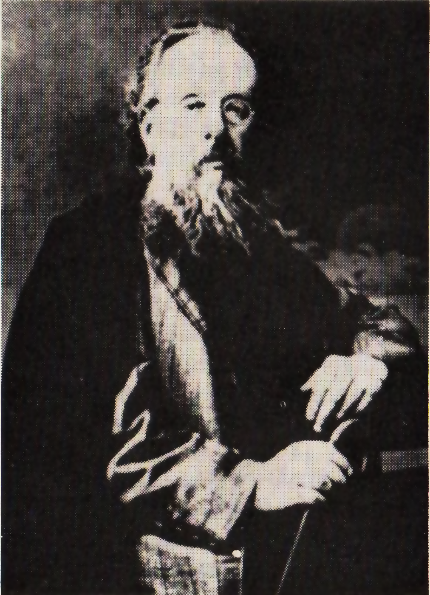
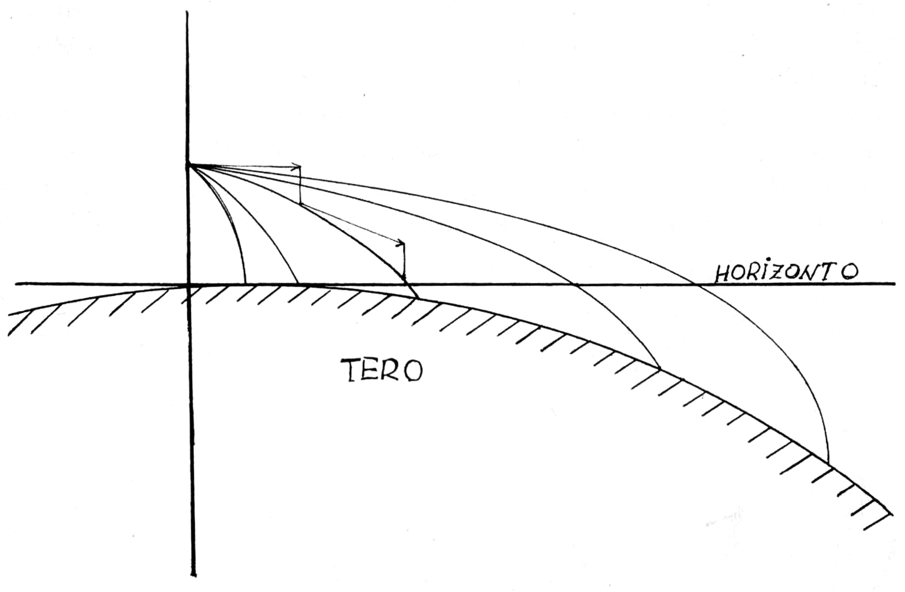
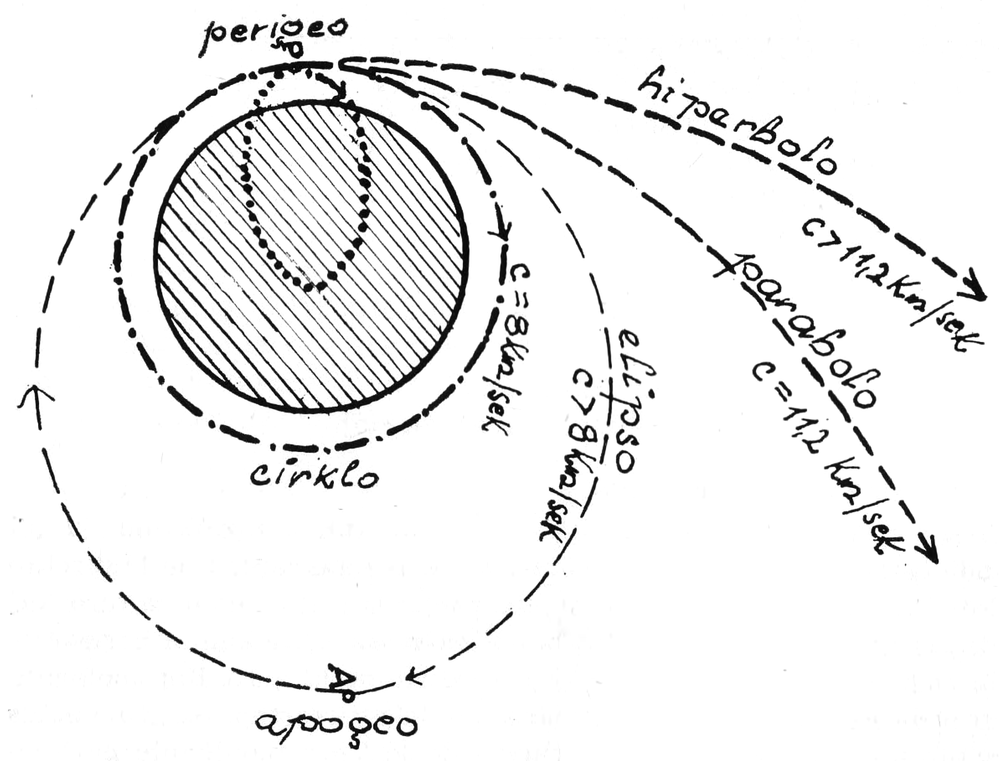
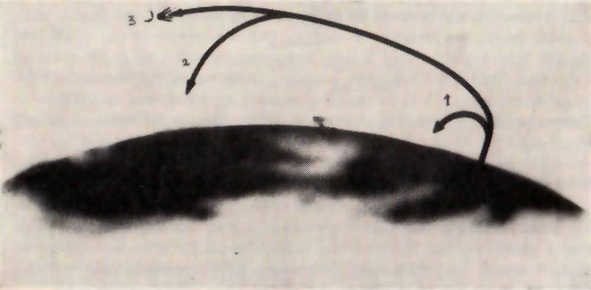
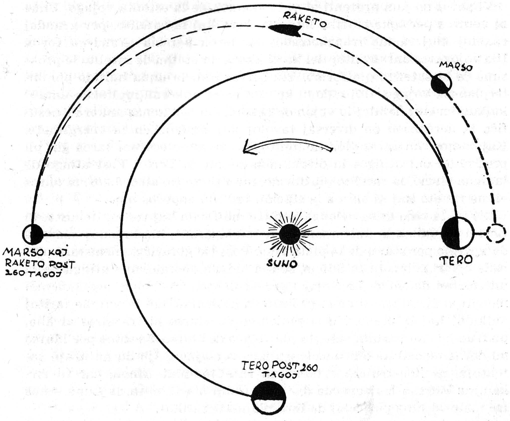

<!--

EBLOJ KAJ MALFACILAĴOJ
POR INTERPLANEDA VOJAĜO
de prof. B. POPOVIĈ

Prelego farita en I.S.U., Varsovio, 1959
-->

## Enkonduko

La 4-a de oktobro 1957 estos por longa tempo gravega dato en historio de naturaj sciencoj. Ĉi tiun tagon okazis granda triumfo de homa
spirito, de la tutmonda scienco kaj tekniko. Ĉi tiun tagon la unua artefarita objekto ekturniĝis ĉirkaŭ la Tero, kiel la Luno turniĝas jam
milionojn da jaroj. Unu el grandegaj kaj aŭdacaj sonĝoj de la homaro,
la sonĝo flugi ne nur tra la aero, tra la Tera atmosfero, sed ekflugi
ekster ĝi, tra senlimaj ĉielaj profundaĵoj, komencis efektiviĝadi.

La evento venis surprize, neatendite por milionoj da homoj tra la
tuta mondo. Sed ĉu vere tute neatendite? Ne. Homoj kiuj atente sekvis
la evoluon de tiurilataj esploroj, atendis la sateliton, nur eble ne tiel
baldaŭ, eble post 1, 2, 3 jaroj. Eble ili ne atendis ĝin ĝuste el Sovetunio, el kiu ne multaj voĉoj aŭdiĝis pri tiuj esploroj, sed ili tamen
atendis ĝian ekflugon. La bazo por tia sukceso estis starigita per granda
evoluo de la raketa tekniko en ĉi tiu jarcento. Kaj ĝuste
en Sovetunio ekzistis scienca tradicio (almenaŭ la tradicio!)
pri raketa teorio, ĉar tie vivis kaj laboris [Ciolkovski]{.maldense}, kiu la unua donis al la homaro la ideon pri raketa tekniko kaj pri la interplaneda vojaĝo. Kio koncernas la praktikan vidpunkton, ni devas memori precipe la grupon de entuziasmaj pioniroj el
Germanujo, kun [Verner Braun]{.maldense} kiel la plej inteligenta aktivulo. Precipe en la persono de [Braun]{.maldense} estis koncentrigitaj:
bonega teoria eruditeco, senlaca eksperimentemo (kun la
sopiro al ĉiama pliperfektigo de raketoj) kaj fanatika entuziasmo por la estonta interplaneda vojaĝo nepre neceŝaj
kondiĉoj por grandaj sukcesoj.

[Bildo 1]{#bld-1}: [Ciolkovski]{.maldense}, fondinto de raket-scienco

Ni povas nur bedaŭri ke la fortoj de germanaj pioniroj estis utiligataj por militaj celoj de faŝistoj, kaj ke nur pro tiu celo oni disponigis
al ili grandegan esploran bazon, sed pro tio ilia merito por la homaro
ne devas esti malpli granda. Sendepende de klopodoj de siaj antaŭuloj
(precipe [Goddard]{.maldense} en Usono kaj [Oberth]{.maldense} en Germanujo) ili sukcesis realigi la unuan raketon kiu penetris la dikajn aertavolojn ĉirkaŭ la Tero.

Post la dua mondmilito la germanaj pioniroj forfuĝis (aŭ estis forkondukataj) al Usono kaj al Sovetunio. Al Usono foriris pli gravaj
esploristoj, sed tiuj kiuj foriris al Sovetunio aldonis siajn spertojn al
jam bone laborantaj tieaj esploristoj. Pro tio oni povis ambaŭflanke
daŭrigi la esploradon kun grandega sukceso. Kiam temas pri la tiama
raketa stato en Sovetunio, oni kutime pensas nur al teoriaj verkoj de
[Ciolkovski]{.maldense}, kiu jam antaŭ realigo de aviadilo, komence de ĉi tiu
jarcento, revis teorie pri raketaj flugiloj kaj pri vojaĝoj al aliaj planedoj. Sed ni devas ne forgesi ke multo de tio estis ankaŭ realigita en
Sovetunio antaŭ kaj dum la Dua mondmilito. Ĉu ni jam forgesis „katjuŝojn”, kiuj kun sufiĉe granda precizeco trafadis tersupraĵon de kelkaj kvadratkilometroj? Ili fakte estis moviĝantaj direktigiloj por raketoj, ne tre fortaj, sed tamen semantaj morton multe pli ol grandaj
kanonoj.

Aliflanke la nepra bazo por kreo de artefaritaj satelitoj, *sputnikoj*,
kuŝis en granda evoluo de *ĉielmekaniko*, scienca branĉo komuna al
astronomio kaj matematiko. Jam pli ol du jarcentojn ĝi esploradis moviĝon de ĉielobjektoj, precipe de planedoj, planedetoj kaj satelitoj. Oni
ne povas ne konsenti kun [E. L. Martin]{.maldense}, direktoro de la astronomia
observejo en Triesto, kiu tuj post ekflugo de la unua sputniko, skribis
ke la radikoj por tiu sukceso devenas jam de [Kopernik]{.maldense}, [Kepler]{.maldense},
[Newton]{.maldense}, [Galilei]{.maldense}, [Laplace]{.maldense} kaj de multaj aliaj ĉielmekanikaj
sciencistoj en la tuta mondo. Sed por ne tre malpligrandigi la meritojn
de la sovetuniaj sciencistoj, li tuj aldonas ke parto de la sukceso apartenas ankaŭ al la tiea sociordo, kiu ebligis grandegan koncentrigon de
homaj kaj de materiaj fortoj por ke la preskaŭ senindustria lando, la
lando kun same primitiva terkulturado kaj kun loĝantaro kies duono
estas analfabeta, fariĝu jam post 40 jaroj la unua efektiviginto de la
artefaritaj satelitoj. (Mi nur, kune kun [Martin]{.maldense}, konstatas la faktojn, mi ne propagandas por ilia sociordo. Se mi dezirus propagandi, mi
havas pli proksime mian landon, en kiu oni konstante klopodas kunigi
socialismon kun demokratio, sed ĉiu lando laŭ siaj bezonoj kaj ebloj!).

Post la unua saltego venis kelkaj novaj paŝoj antaŭen: unuflanke du
novaj sputnikoj el Sovetunio estis multe pli pezaj ol la unua, kaj aliflanke kelkaj sputnikoj el Usono atingis pli grandan distancon de la
Tero, kun iomete pli perfektaj instrumentoj por esplorado de la altaj
aertavoloj. Ilia forsendo jam ne plu estis tiom sensacia, sed ilia signifo
ne estas malpli granda, kaj por evoluo de la raketa tekniko (speciale
por plifortigo de la energiaj fontoj) kaj por pli bona ekkono de la tavoloj ĉirkaŭantaj la Teron. Multaj tre perfektaj instrumentoj sendadis
teren al la scienculoj gravajn informojn pri denso de la aero, pri elektrofortoj ekzistantaj tie, pri magnetaj fortoj, pri diversaj radioj, pri
trapasado de etaj meteoroj, ktp.

Nova saltego al la Universo venis denove el Sovetunio -- estis forsendita la unua artefarita planedeto,
kiu tute forlasis la Teron kaj daŭrigis per turniĝado ĉirkaŭ la Suno.
\[Luna 4 je la 4a de Jan. 1959 maltrafis la lunon kaj tiel neplanite atingis sunan orbiton, red.\]
Ĝin ne sekvis aliaj tiaj forsendoj,
ĉar estas ankoraŭ frue por tio, ankoraŭ ne ekzistas vera bezono por
tiaj artefaritaĵoj, sed ili plenumis sian deziron esti ankaŭ tie la unuaj.
Klopodoj esti ĉie la unua, normale rigardate, estas malsanaj. Sed ĉi
tie la „malsano” estas utila por la homaro; la grandskala konkurenco
en tiu direkto alportas novajn grandajn sukcesojn de sciencoj.

Kia estas signifo de la nova saltego? Por klarigi tion mi devas unue
montri la diferencon inter la artefarita satelito kaj la artefarita planedeto.

[Bildo 2]{#bld-2}: Falado kun diversaj rapidoj

## Tekniko de la satelit-elsendo

Vi scias ke ĵetita objekto falas teren des pli malproksime ju pli
granda estis ĝia komenca rapido. Sed tio dependas ankaŭ de la direkto
en kiu oni ĵetas ĝin. Imagu ke ni supreniras tre alte super la tero kaj
de tie per granda forto ni elĵetas la objekton, paralele kun la horizonto.
Ĝi falas pro altiro de la Tero kaj pro rezisto de la aero. Por momento
forgesu la aerreziston kaj konsideru nur la altirforton. Se ĝi ne estus
ekzistanta, la ĵetita objekto forflugus de la Tero moviĝante en konstanta direkto. Sed pro la Tero ĝi estas konstante falanta. Pro tio ĉio,
ĝia kunigita moviĝo estos komponaĵo de du rapidoj: rekte antaŭen
kaj al la tercentro. Aliel dirite, la altirforto de la Tero konstante kurbigas la rektan linion kiun la objekto havus, se la Tero ne altirus ĝin
(bildo [2](#bld-2)). Kiam la rekta rapido estas nesufiĉe granda, la rapido al
la tercentro venkas kaj la objekto post iu tempo falas teren.

Sed oni povas atingi iun ekvilibron inter tiuj du rapidoj: kiom la
objekto malproksimiĝas de la Tero (pro propra rapido), tiom la Tero
altiras ĝin (per sia altira forto). Tiam la objekto ne falos sed ĝi akiros cirklan orbiton ĉirkaŭ la Tero; ĝi fariĝas satelito de la Tero. Sed
pro la aerrezisto ĝia propra rapido nemulte malpligrandiĝas, la ekvilibro detruiĝas, kaj post iu tempo la objekto tamen falos. Ĝia vivdaŭro dependas de la aerdenso en la tavoloj kie ĝi flugas kaj eterne flugadi ĝi povas nur tute ekster nia atmosfero. Ja la Luno tiamaniere turniĝas ĉirkaŭ la Tero; ĝi estas nia satelito -- nur ne artefarita, sed nature ekestinta en malproksimega pasinteco!

Por atingi tian staton oni devas havi sufiĉan forton, kiu donos al la
ĵetita objekto la rapidon de ĉ. 8 km en sekundo, aŭ ĉ. 29000 km hore.
Tiun rapidon oni nomas la *unua universa rapido*. Kiel vi vidas, ĝi ankoraŭ ne signifas plenan liberiĝon de la Tera altirforto, sed tamen ĝi
signifas la venkon de la altirforto, per starigita ekvilibro.

Kio okazos se ni pligrandigos la rapidon de la ĵetata objekto? Nenio
eksterordinara -- la objekto denove turniĝos ĉirkaŭ la Tero. Nur ĝia
vojo ne plu estos cirkla; nun ĝi estos elipsa (bildo [3](#bld-3)). La elipso estos
des pli longigita, ekscentra, ju pli granda estas la komenca rapido. La
samo okazos se ni ne ĵetis la objekton paralele al la horizonto, sed je
iu angulo. Ĉiuokaze la orbito estos elipso, kun sia plej proksima loko
-- *perigeo* -- kaj sia plej malproksima loko -- *apogeo*. Ĉiu elipso havas du
fokusojn kaj, laŭla *unua Keplera leĝo*, en unu el ili troviĝas la Tero
(en la fokuso proksima al la perigeo - bildo [3](#bld-3)).

[Bildo 3]{#bld-3}: Diversaj orbitoj ĉirkaŭ la Tero

Nun estas la tempo por diri ke neniu satelito estas realigita per komenca supreniro al granda alteco kaj posta ĝia forsendo en horizontala direkto, sed ĉi tion oni faras kombinante ĉi tiujn du moviĝojn, en
kunligo kun la aera rezisto. Nome pro la aerrezisto la preskaŭ vertikala linio ĉiam pli kliniĝas al la horizonto. Kutime oni faras tion per
plurgrada raketo. La unua grado penetras la plej dikajn malsuprajn
aertavolojn kaj post perdo de sia energio ĝi elĵetas la duan gradon. La
motoroj de duagrada raketo ekfunkcias kaj la raketo daŭrigas la vojon
kun negranda kurbiĝo de la vojo, dum de la unua grado la vojo kurbiĝas
pli forte pro la aerrezisto. Post nelonga vojo la unua grado (sen interna mova forto) atingas maksimuman altecon kaj ekfalas teren
(v. la bildon [4](#bld-4)). La dua grado post perdo de sia energio en tre maldensaj aertavoloj elsendas la triagradan raketon kaj la dua grado mem
post iu tempo ekfalas teren (ĉar ĝi ne atingis la unuan universan rapidon). Nur la tria aŭ la kvara grado atingas la bezonatan rapidon de
pli ol 8 km/sek kaj ĝis tiam ĝi ricevas pro konstanta kurbiĝo preskaŭ
horizontalan direkton (bildo [4](#bld-4)).

Sed se la rapido estas tre granda, la elipso disŝiriĝos, ĝi ne plu estos
fermita je ambaŭ flankoj -- do ĝi fariĝos parabola orbito (bildo [3](#bld-3)). Tiuokaze la ĵetita objekto ne plu revenos al la Tero, ĝi fakte liberiĝos de
la tera altirforto. La rapido bezonata por tio estas ĉ. 11,2 km/sek aŭ
ĉ. 40800 km/hore -- la *dua universa rapido*. Kompreneble la samo okazos ankaŭ se la atingita rapido estas pli granda ol la dua universa rapido -- nur la orbito estos ankoraŭ pli larĝa, pli malfermita -- oni nomas
ĝin hiperbola orbito. Tia rapido de la ĵetita objekto sufiĉas por daŭre
venki la ĉiam malpligrandiĝantan altirforton de la Tero (pro pli granda
distanco).

[Bildo 4]{#bld-4}: Forsendo de satelito per trigrada raketo

Kaj kio tiam okazos plu al nia objekto? Kien ĝi perdiĝos kaj kie ĝi
pereos? Verdire, ĝi ne daŭrigas la vojon sen altiro de la Tero. Eĉ pli,
ĝin altiras ankaŭ aliaj planedoj kaj la Suno. Sed la altiraj fortoj obeas
la leĝon de [Newton]{.maldense} -- ili estas proporciaj al la masoj de la altiraj korpoj
kaj inverse proporciaj al la kvadratoj de la distancoj inter la korpoj.
Nia objekto estas nun malproksime de ĉiuj planedoj kaj iliaj fortoj ne
sukcesas altiri ĝin -- nur la Suno, kies maso estas kelkcentmiloble tiel
granda kiel tiu de la Tero, sukcesas regi la pluan moviĝon de nia objekto. Nun ĝia moviĝo konsistas el la moviĝo pro ĝia propra rapido kaj
el konstanta falado al la Suno. Ekestas nova ekvilibro inter du moviĝoj kaj nova turniĝado -- nun ĉirkaŭ la Suno, Nia objekto havos tiam
vojon similan al la vojo de la Tero mem -- ĝi fariĝas nova planedo, kompreneble ege malgranda kompare kun aliaj planedoj. Ĉu ĝia vojo estos
preskaŭ cirkla aŭ ĝi iros laŭ tre longa elipso -- tio dependas de la direkto en kiu ĝi flugis tiam kiam ĝi liberiĝis de la Tera altirforto. Nur
la direkto ne rajtas esti al la Suno, ĉar tiuokaze nia objekto finos sian
ekziston en varmega ĉirkaŭaĵo de la Suno.

Jen tio estas la ĉefaj principoj por kreo de artefarita planedeto. Principe ni ne rajtas diferencigi ĝin de naŭ planedoj konataj al ĉiuj: Merkuro, Venuso, Tero, Marso, Jupitro, Saturno, Urano, Neptuno, Plutono. Sed ne ĉiuj scias ke ĉirkaŭ nia Suno turniĝas ankoraŭ miloj da
planedetoj, kies orbitoj troviĝas preskaŭ ĉiuj tute inter tiuj de Marso
kaj Jupitro. Astronomoj konas bone la orbitojn de preskaŭ 1700 inter
ili. Kaj aliajn malgrandajn oni ofte observas nur 1 - 2 foje, kaj poste oni
ne vidas ilin, pro kio oni ne povas koni iliajn orbitojn. La plej grandaj
el ili havas kelkajn centojn da kilometroj en diametro, sed la plej malgrandaj havas nur dekojn da metroj. Laŭ sia grandeco nia planedeto
apenaŭ apartenas al tiuj lastaj, sed kompreneble por ni ĝi estas la
plej kara, ĉar homoj kreis ĝin, homoj nun vivantaj kaj homoj jam delonge mortintaj -- ekde la unuaj paŝtistoj kiuj nombris la stelojn en
diversaj grupoj kaj tiel komencis konatiĝi kun la mondo ĉirkaŭanta
nin.

## Interplaneda vojaĝo

Kaj jen ĉi tiu planedeto montris praktike ke la vojaĝo al aliaj planedoj estas vere ebla. Ĝia orbito troviĝas inter la orbitoj de Tero kaj de
Marso (bildo [5](#bld-5)). Oni bezonas nur ankoraŭ iom pli grandan komencan
rapidon kaj la plej malproksima punkto de la planedeta orbito, la 
*afhelio*, proksimiĝos al la orbito de Marso. Nia tasko poste estos nur
antaŭzorgi ke ni atingu la orbiton de Marso ĝuste kiam Marso troviĝos
en tiu parto de sia orbito. La kalkulo ne estas tre malfacila, kaj oni jam
faris ĝin por kelkaj datoj. Grandaj elektronaj kalkuliloj permesos al
estontaj vojaĝorganizantoj eluzi bonege la teoriajn rezultatojn de ĉielmekaniko kaj ĉion kalkuli tre facile. La raketa tekniko ankaŭ jam
ebligis efektivigon de tiel grandaj rapidoj -- nur oni devas prizorgi la
necesajn financajn rimedojn (por kio ekzistas la sola eblo: forigi la
atombombojn kaj utiligi la elspezojn por konkero de la ekstertera universa spaco). Ĉi tie mi aldonu ke la antaŭkalkuloj de la orbitoj, se estis
konsideritaj ĉiuj gravaj influoj al ili, montriĝis en plena akordo kun
la veraj satelitaj orbitoj. Tio estas ankaŭ nova triumfo de ĉielmekaniko, kiu jam foje montris sian ĝustecon kiam danke al ĝiaj rezultatoj
oni malkovris la okan planedon (Neptuno).

[Bildo 5]{#bld-5}: Vojaĝo de Tero ĝis Marso

Por la estontaj vojaĝoj oni devos forsendi multe pli grandan mason
ol estis la unua planedeto. Sed aliflanke, kiam venos la tempo ke la
unua universa veturilo ekiru, ĝi ne ekveturos senpere de la Tero sed
ekde granda satelito, turniĝonta ĉirkaŭ la Tero. Tiam oni ne devos
atingi la tutan duan universan rapidon, 11,2 km/sek, sed nur la diferencon inter la dua kaj la unua rapido, do nur ĉ. 3,2 km/sek, ĉar ni
estos sur la granda satelito, kiu jam havos la unuan universan rapidon.
Krome ankoraŭ pli grava estos la fakto ke ni ne plu devos penetri la
atmosferon, ĉar la satelito estos ekster la atmosfero. Pro tio estos tre
facile „eksalti” de la satelito kaj daŭrigi la vojon al aliaj planedoj.

Tio ja estos facila nur de la energia vidpunkto -- pri aliaj malfacilaĵoj
mi parolos poste.

Vi povos do jam prezenti al vi la skemon de la estonta vojaĝo. Unue
ni veturos per loka trafiko inter la Tero kaj la satelito, per grandaj
raketoj kiuj rapide trapenetrados la aeron per sia grandega forto.
Ilia vojo estos antaŭvidita tiel ke ili akiros la staton de satelito ie proksime ĉe la satelita platformo, kiu servos kiel la unua haltejo por interplaneda vojaĝo. (Mi aldonu ke nun estas ankoraŭ malfacile antaŭkalkuli en ĉiuj detaloj la vojon de raketo, ĉar oni konas ankoraŭ nesufiĉe la aerdenson en diversaj tavoloj kaj ŝanĝojn en la energifonto.
Kaj tamen oni faras tion kontentige -- en estonteco oni faros ĝin pli
precize aŭ oni utiligos la direktadon de sur la Tero). Post atingo de
la unua stacio, la satelito-platformo, nia raketo tie albordiĝos, ni eliros
el nia raketo kaj ni eniros la stacion (aŭ oni enpuŝos nin).

Ĝis tie la vojo estos nelonga, sed tre malfacila kaj tre multekosta. Ĉi
tie oni organizos la universan ŝipon (aŭ ŝiparon), kiu bezonos nemulte
da energio por starti de la platformo. Post tio ĝi fariĝos memstara planedeto, ĉirkaŭiranta la Sunon, sen ia aldona energio, nur utiligante la
altirforton de Suno. La vojaĝo per ĝi daŭros tre longe, preskaŭ naŭ
monatojn ĝis ni venos en la proksimon de Marso, laŭ la antaŭe faritaj
kalkuloj kaj la plano. En la proksimo de Marso ni transiros al alia,
pli frue jam konstruita satelita platformo de Marso. Speciale por Marso
mi devas mencii ke oni tiucele utiligos verŝajne ĝiajn du naturajn satelitojn, ne konstruinte artefaritan sateliton-platformon, ĉar ili ĉirkaŭiras Marson je negranda distanco (dum nia satelito, la Luno, estas
tre malproksima por celoj de interplaneda trafiko).

De la Marsa satelito ni ekveturos por „almarsiĝi”, ĉirkaŭirante
kelkfoje Marson kaj konstante pliproksimiĝante. Tio ja ne estos tre
facila, ĉar trapasante la atmosferon de Marso nia rapido tre kreskos
(pro kresko de la altirforto kaj pro maldenseco de la atmosfero ĉirkaŭ
Marso). Tamen tio estos multe pli facila ol reveni al Tero, ĉar la atmosfero de Tero estas multe pli densa kaj ekzistas reala danĝero pro
ekestanta varmego.

Tiel ni alvenas al la unua granda malfacilaĵo, la unua el la gravaj,
ankoraŭ nesolvitaj problemoj -- problemo de la reveno. Antaŭ la sciencistoj staras la tasko organizi unue la unuan stacion (ĉu sur la artefarita satelito, ĉu eble tamen sur la Luno) kaj la lokan trafikon kun ĝi -tien kaj reen.

## Ĉefaj malfacilaĵoj

Ni revenu al la ekveturo. Por venki reziston de la aero oni devas ekveturi kun granda rapido. Grandaj raketaj motoroj donos al ĝi akcelon multe pli grandan ol la altirforto de Tero. Jam ĉe rapida ekveturo de aŭtomobilo homo ne fartas tre bone, ĉar li povas elteni akcelon
nur ĝis iu grado kaj por nelonga tempo. Kioma estas tiu grado kaj sub
kiuj kondiĉoj homo povas plej facile elteni grandan akcelon? Multaj
sciencaj laboratorioj klopodas krei la kondiĉojn kiel eble plej similajn
al la kondiĉoj kiujn oni havos dum la raketveturado kaj tiel oni esploras la eblojn de homa korpo. Sed nur la realaj kondiĉoj donos la
definitivan respondon. Ĝuste pro tio oni sendas bestojn organe similajn
al la homo, por vidi kiel ili eltenos ĉion. La esploroj faritaj per simioj
kaj hundoj estas tre esperigaj. Mi bedaŭras ke la tempo ne sufiĉas por
eniri la detalojn pri funkciado de homa korpo dum la ekveturo kaj pri
preparataj solvoj por ebligi pli facilan eltenon de tiaj kondiĉoj, kaj ni
transiru al aliaj problemoj.

Post granda akcelo venas ia ekvilibro, sed kiam la raketaj motoroj
ĉesas funkcii kaj ni akiris la unuan universan rapidon, venas tute kontraŭa stato -- manko de ia ajn akcelo, ĉar nia rapido nuligis la senton
pri la Tera altirforto, senton pri nia pezo. Tio estas tiel nomata *senpeza stato*. Ekzistas eĉ la timo ke tia stato multe malutilos al funkciado de diversaj homaj organoj, al nia nutrado, al la digestado, kaj precipe al la nerva sistemo. Ankaŭ ĉi-koncerne la laboratoriaj esploroj pri
homoj, same la perraketaj kaj persatelitaj esploroj pri bestoj, jam solvas parte la problemon, tiom kiom oni bezonos por unuaj veturadoj.
Poste la personaj spertoj plibonigados la solvojn.

Post rapida alveno al la satelita platformo, homo devos vivi. Pro tio
sur ĝi oni devos havi kondiĉojn similajn al tiuj sub kiuj ni vivas. Unue
oni devos havi tie artefaritan aeron, kun la sama aerpremo kiel sur
Tero. Pro tio ĝi devas esti bone fermita, ĉar se ne, la aero rapide elflugos el ĝi. Se la platformo konsistos el artefarita satelito, oni faros ĝin
el malpeza, sed forta materialo, kunligota el partoj sendotaj per pluraj raketoj. Por ĉiu eliro eksteren oni devos havi apartan vestaĵon,
kiu protektos nian haŭton kontraŭ disŝiro pro nia interna premo, krome
ni devos esti ligitaj kun la oksigen-botelo (kaj ĝenerale ni devos esti
ligitaj al la platformo, ĉar ĉiu salteto disigus nin por ĉiam de la platformo kaj ni mem fariĝus aparta satelito).

La vivo dum senpeza stato estas ankaŭ problemo. Eble homoj povos
alkutimiĝi al tia stato -- tion montros la estontaj spertoj. Sed se tio ne
eblos, tiam oni devos efektivigi alian antaŭviditan solvon. Nome al la
satelito-platformo (bildo [6](#bld-6)) oni povas doni (per du kontraŭflankaj raketetaj pafoj) artefaritan rotacion ĉirkaŭ akso perpendikla al la platformo.

Du aliaj gravaj demandoj koncernas la ekziston de la platformo kaj
la vivon sur ĝi.

La unua problemo estas la meteoroj. Ili vagadas ĉie tra la universa

\[...mankas du paĝoj...\]

de la usona aviadilo X-15, sed bedaŭrinde oni prokrastas ĝian ekflugon jam plurajn monatojn. La aviadilo X-15, kun unu el la plej lertaj
kaj spertaj pilotoj en la mondo, devas praktike montri kion homoj povas fari en tiaj cirkonstancoj. Se la homo, pro granda alteco, rapideco
kaj preskaŭ senpeza stato, ne perdos siajn normalajn agojn, li certe
revenigos la aviadilon aŭ la raketon al tero. Sed se li perdos sian plenan kapablon? Tiam ni havos la unuan viktimon de interplaneda vojaĝo. Ĉiuokaze iu devas riski foje. Nur estas la demando kun kiom da
risko kaj kiom da certeco, akirita per antaŭaj esploroj, oni ekflugos.

## Perspektivoj

Antaŭ fino, mi devas ne preterlasi mencion ke la platformo-satelitoj
estos ne nur la unuaj stacioj por interplanedaj vojaĝoj, sed ili estos
ankaŭ grandaj laboratorioj por sciencaj esploroj. Jam per la raketoj
la homo plilongigis sian manon tre alte, sed la raketaj esploroj estas
ligitaj je nur unu loko kaj je tre mallonga tempo. La satelitoj estas
jam, kaj ili fariĝos pli kaj pli, moviĝantaj sciencaj laboratorioj, per
kiuj sciencisto kvazaŭ trapasas grandegajn spacojn super la atmosfero.
Precipe ili estos utilaj por astronomiaj esploroj, al kiuj multe ĝenas la
atmosfero, ne tiom per siaj nuboj, kiom per kurbigo de la alvenantaj
lumradioj. Krome la platformoj ebligos detalan esploron de supraj
atmosferaj tavoloj, kiuj havas grandan influon al nia meteorologia situacio, al disvastiĝo de radio-elsendoj, de televido, ktp.

Kiel vi vidas, la starigo de la satelita platformo havas tre grandan,
unuarangan signifon por la interplanedaj vojaĝoj. Post ĝia starigo
la problemo pri la forveturo al aliaj planedoj ne restos granda. Ni jam
vidis ke oni bezonas nur malgrandan energion por eksalti de la satelita platformo en la antaŭe kalkulita direkto kaj en antaŭe kalkulita
momento, por eniri nian propran orbiton ĉirkaŭ Suno (bildo [5](#bld-5)). La
orbito nin kondukos al Marso (aŭ al Venuso, se ni eksaltos malantaŭen). Tien ni vojaĝos longe, sen ia ajn aldona energio, utiligante la
altirforton de Suno. Sed se ni kunportos iun kvanton da energilivera
materialo, ni povos plirapidigi nian vojaĝon, ankaŭ esti iom malpli
dependaj de la antaŭkalkuloj pri la loko kie ni renkontiĝos kun Marso
aŭ Venuso.

Post alveno en la proksimon de Venuso aŭ de Marso, ilia altirforto
fariĝos pli granda ol altirforto de Suno kaj nia universa ŝipo povas
facile fariĝi satelito de la planedo. Problemo pri la surmarsiĝo aŭ pri
la survenusiĝo estas la sama kiel pri la surteriĝo, sed ĉe Marso multe
pli facila, ĉar ĝi estas malpli granda kaj ĝia atmosfero estas malpli
densa. Kompreneble nia unua universa ŝipo, aŭ pli ĝuste la ŝiparo, devas esti sufiĉe forta por kunporti ĉion bezonatan por la vivo en tiaj
kondiĉoj kaj por la reveno (de Marso ĝis ĝia satelito, de ĝi al nia satelito).

Fine, vi certe demandas: ĉu homo iam realigos ĉi tiajn fantaziaĵojn?
Kaj se jes, kiam? Al la unua demando mi povas doni nur jesan respondon. Se iu ne kredas, bonvolu ekpensi nur al lastaj 60 jaroj. Unuaj
aviadiloj aĝas nur iom pli ol duonon de jarcento kaj nun oni jam intencas starigi komfortan rektan aertrafikon Moskvo -- Vaŝingtono en
malpli ol 12 horoj! Post tio venis filmoj, unue senvoĉaj, pure
nigro-blankaj, poste voĉaj, post tio koloraj, kaj nun tridimensiaj! Kaj kion
diri pri la radio-elsendoj kiuj jam ne havas terlimojn kaj nun alkondukas nin jam al la kolora televido!? Pro tio oni povas diri kun plena
konvinko: jes, homoj vojaĝos al aliaj planedoj, sub nur unu kondiĉo
-- se ili ne pereos en unu nova mondmilito!

Al la dua demando mi ne povas respondi tiel fikse, ĉar tio dependas de
multaj cirkonstancoj: de la rezultatoj de farotaj esploroj, de disponeblaj financaj rimedoj, de kunlaboro inter diverslandaj sciencaj institucioj, ktp. Sed por doni tamen partan respondon, mi tralegu kalendaron faritan antaŭ kelkaj jaroj (1953) pri konkero de la interplaneda spaco:

-   en la jaroj 1957-58: forsendo de la unua artefarita satelito, plej simpla, sen instrumentoj;
-   1958-60: forsendo de la unua aŭtomatigita satelito, kun iuj instrumentoj kaj kun elektro-energio, peza 15-50 kgr;
-   1961-65: kreo de loĝigitaj satelitoj -- interplanedaj stacioj;
-   1975-80: konstruo de interplanedaj ŝipoj kaj unuaj flugoj al Luno kaj al aliaj planedoj.

La kalendaron kunmetis plej altaj fakuloj. Sed vi vidas ke ĝiaj unuaj
du punktoj estis realigitaj jam multe pli frue ol oni antaŭvidis tion.
Pro tio ni rajtas esperi ke ankaŭ aliaj punktoj de la supra kalendaro
realiĝos pli frue ol la fakuloj antaŭvidis tion antaŭ kelkaj jaroj. Restas
nur espero ke ni ĝisvivos tion.
