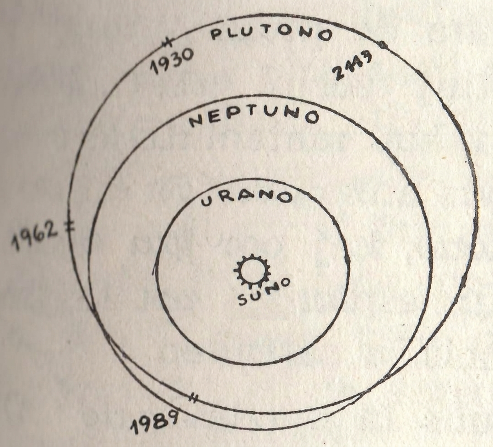

<blockquote>
(El la »Listener« de la 29-a de
marto 1962, kun permeso de la verkinto kaj de la redaktoro, tradukita
de T. L. C. Bluett.)
</blockquote>

Plutono, la naŭa planedo, kaj la, plej malprokisma membro de la suna sistemo,
ne estas videbla per senteleskopa okulo, aŭ eĉ per malgranda teleskopo;
ĝi estas treege malhela, kaj eĉ kiam oni ĝin observas per
la plej grandaj reflektaj teleskopoj en la mondo,
ĝi ne ŝajnas io pli grava ol malhela, flaveta stelo. Tamen,
kvankam ĝi estas ne facile rimarkebla, Plutono ricevis de astronomoj
multe da atento. Konstante ek de la tempo, kiam oni ĝin eltrovis en la
en la jaro 1930, ĝi prezentis enigmon post enigmo, kaj eĉ nuntempe ĝia efektiva
naturo restas treege necerta.

Kvin planedoj (Merkuro, Venuso, Marso, Jupitero kaj Saturno) estas
konataj, kaj ĉiuj estas brilaj astroj facile videblaj per senteleskopa
okulo. Ĉi tiuj planedoj, kune kun la Suno kaj la Luno konsistigas tutaĵon
de sep astroj de la Suna Sistemo; kaj ĉar sep estis la magia nombro
de la antikvuloj, oni konsideris la sistemon kompleta. Do oni miris,
kiam en la jaro 1781 la tiam nekonata Hanovera amatora astronomo loĝanta
en Anglujo [William Herschell]{.maldense}, eltrovis novan planedon, kiun oni
nuntempe konas per la nomo Urano. Kvankam Urano estas giganto, kun
diametro de ĉirkaŭ 30.000 mejloj (48.000 km), ĝi estas nur apenaŭ videbla
per senteleskopa okulo.

Post ne longe evidentiĝis, ke Urano moviĝas en neatendita maniero.
Ŝajnas kvazaŭ ia nekonata forto tiras ĝin el la antaŭdirita pozicio kaj iu
pastro [T. J. Hussey]{.maldense} sugestis, ke la kaŭzo eble estas alia planedo, vojaĝanta
ĉirkaŭ la Suno je distanco eĉ pli granda. Studento en [Cambridge]{.maldense}
[J. C. Adams]{.maldense} kaj Franca astronomo [U. J. J. Le Verrier]{.maldense} sendepende
entreprenis sin okupi pri la afero. La rezultoj de iliaj esploroj estis preskaŭ identaj; bazintaj iliajn kalkulojn sur la devojiĝoj de
Urano, ili eltrovis kie la nova planedo devus troviĝi. En la jaro 1846
_Galle_ kaj _d'Arett_ en Berlino entreprenis serĉi en la parto de la ĉielo, kiun
indikis _Le Verrier_, kaj preskaŭ tuj la planedo eletroviĝis. Neptuno, kiel oni ĝin nomis, estas, kiel oni eltrovis, giganto de la sama speco kiel Urano.

Oni tuj rekalkulis la orbiton de Urano, kaj la diferencoj inter la
teorio kaj la observoj malaperis. Tamen post multe da jaroj evidentiĝis ke
ankoraŭ restas kelkaj etaj neregulaĵoj, kaj oni sugestis, ke la kaŭzo
eble estas la ekzisto de naŭa planedo. _P. Lowell_ kaj _W. H. Pickering_, kiuj
ambaŭ loĝis en Usono, provis trovi la pozicion de tiu astro en la sama
maniero, kiel jam faris _Adams_ kaj _Le Verrier_ je Neptuno.

_Lowell_ estas piej ofte memorata pro siaj observoj pri la »kanaloj« 
sur Marso; li konvinkiĝis ke Marso estas loĝata de progresintaj
vivuloj kaj ke la »kanaloj« estas artefaritaj. Ĉar tiuj teorioj estas ĝenerale malkredataj, oni ofte forgesas ke _Lowell_ estis ankaŭ 
matematikisto unuaranga, kiu plenumis tre gravan laboron. Li havis ankaŭ sufiĉe da energio
por starigi observatorion ĉe _Flagstaff_ en Arizono, kaj por ĝin ekipi per 
bonegaj teleskopoj. Tuj kiam li jam finis siajn esplorojn pri la pozicio
de la »Planedo X«, kiel li ĝin nomis, li komencis la serĉadon.

Oni eble supozus ke la »Planedo X« influus la moviĝon de Urano
kiel ankaŭ de Neptuno, sed la kalkuloj de _Lowell_ estis bazataj sur la
moviĝoj de Urano — kiu estis eltrovita en la jaro 1781, pli ol cent
jarojn antaŭe — kaj Neptuno ankoraŭ ne finis eĉ duonon de sia vojaĝo
ĉirkaŭ la Sunon, de post kiam oni eltrovis ĝian pozicion sur la ĉielo en
la jaro 1846. Unuflanke la tasko de _Lowell_ estis pli malfacila ol la
tasko de _Galle_, ĉar oni kredeble supozus ke la »Planedo X« estus pli
malhela ol Neptuno. Aliflanke _Lowell_ povis uzi almenaŭ la fotografion, kaj _Galle_ devis fidi nur je la okula observado, kio necesigis kontroladon de ĉiu nebnila stelo en konsiderinda parto de la ĉielo.

_Lowell_ ne sukcesis en la serĉado. La »Planedo X« rifuzis sin montri,
kaj ĝi estis ankoraŭ ne trovita en la tempo, kiam _Lowell_ subite kaj 
neatendite mortis en la jaro 1916. Provizore oni ĉesigas la serĉadon en _Flagstaff_. Dume _Pickering_ jam bazinte siajn kalukulojn sur la moviĝojn de Neptuno, konkludis simile, kaj jam efektivigis la kalkuladon de la 
supozataj pozicioj de pluraj eblaj trans-Neptunaj planedoj. En la jaro 1919
_Milton Humason_ en la observatorio sur la monto _Wilson_ efektivigis
serĉadon, sed kiam tiu ankaŭ estis senrezulta, oni lasis dormi la tutan aferon.

En la jaro 1928 la astronomoj en la observatorio ĉe _Flagstaff_ decidis
daŭrigi la laboron, kaj komencis konstrui novan fotografan teleskopon
kun objelktiva lenso 13 colojn (32,5 cm) larĝa — speciale por ĉi tiu tasko.
Oni konfidis la taskon al juna astronomo, kiu nomiĝis _Clyde Tombaugh_, kaj antaŭ la jaro 1929 ĉio estis preta, _Tombaugh_ estis tre entuziasma;
li ne preterlasis la okazon, kiam ajn la ĉielo estis sennuba
dumnokte, kaj ŝajnis kvazaŭ, se la planedo x efektive ekzistus ĝi apenaŭ
ne povus ne kaptiĝi per la fotografa reto.

La fotografado mem estis laborplena, sed tio estis nur parto de la
laboro. La steloj estas tiel malproksimaj, ke por la plejmulto da
praktikaj celoj oni povas malatenti iliajn individuajn aŭ proprajn moviĝojn;
la stelaroj videblaj de ni estas nur malmulte malsamaj ol tiuj, kiujn
vidis la reĝo Kanuto, Julio Cezaro aŭ eĉ Homero. El tio rezultas, ke se
oni fotografas la saman areon de ĉielo post intertempo de pluraj tagoj,
semajnoj aŭ eĉ jaroj, la bildoj estas identaj; se oni metas la fotografion
unu sur alian, la bildoj de ĉiu stelo troviĝas ĉe la precize sama loko.
Tamen planedo percepteble moviĝas en tre mallonga tempo, kaj tiel
evidentigas sian efektivan naturon.

Uzante genian elpensaĵon, kiu nomiĝas »palpebruma mikroskopo«,
_Tombaugh_ povis ekzameni du platojn pri la sama stelplena parto de la
ĉielo unu tuj post la alia, tre rapide movante sian rigardon de unu al la
alia. Se li trovus stel-similan punkton, kiu jam moviĝas, ĝi ŝajnus
»salti«. Tio, kion li devis fari estis trovi astron, kiu »saltis« precize je la ĝusta kvanto. Estis teda afero: oni devis malatenti agace erarigajn 
asteroidojn, kaj la afero estis des pli malfacila ĉar la pozicio, kiun indikis _Lowell_, troviĝis en la konstelacio _Gemini_, kie malforte brilaj steloj ja ja estas tre multnombraj.

En februaro 1930 _Tombaugh_ ekzamenis plakojn pri la areo apud la
stelo _Delta Geminorum_, kiam li subite eltrovis astron, kiu ŝajnis tre
promesplena. Ĝi »saltis« je la ĝusta kvanto; la distanco, tra kiu la
astro ŝane moviĝis inter la du eksponoj estis precize tiu, tra kiu ŝajne
moviĝus planedo, se ĝi estus je 1000,000000 mejloj (1800,000000 km) pli
malproksime ol Neptuno. Kiam li kontrolis tiun observon, uzante aliajn
plakojn kaj trovis bildojn de la sama astro, li certigis, ke la longa
serĉado jam finiĝis. Oni daŭrigis la observadon de la planedo dum pluraj
semajnoj, kaj tiam en marto 1930, oni anoncis la eltrovon. La preter —
Neptuno planedo ja ekzistas, kaj oni nomis la planedon X de _Lowell_, per
la nomo Plutono.

La Suna Sistemo ŝajne estis denove kompleta. La kredo de _Lowell_
plene praviĝis, kiel ankaŭ de _Pickering_. Kiam oni denove ekzamenis la
plakojn faritajn de _Humason_ ĉe la observatorio sur la monto _Wilson_ en
la jaro 1919, oni eltrovis ke Plutono estis dufoje registrita. En la unua
okazo la bildo de Plutono troviĝis tiel proksime al la bildo de stelo, ke
oni ne povis distingi ilin; en la alia okazo la stel-simila punkto troviĝis
ĉe makuleto sur la plako. La malsukceso de _Humason_ estis kaŭzita
de la plej eble neevitebla malbonŝanco.

Bedaŭrinde kelkaj strangaj faktoj baldaŭ evidentiĝis. Precipe la
fakto, ke Plutono estas multe pli malgranda kaj malpi brila, ol atendis
_Lowell_. Ĝi tute ne egalas Uranon aŭ Neptunon, kaj laŭ unuaj taksoj
la diametro estas malpli ol 10.000 mejloj (16.000 km), dio oni devas
konsideri Plutonon ter-simila kaj ne giganta planedo. Poste en la jaro
1950 _G. P. Kuiper_, uzante la reflektan teleskopon sur la monto _Palomar_,
mezuris la grandecon pli precize, kaj trovis, ke Plutono estas eĉ pli
malgranda, ol oni supozis: _Kuiper_ taksis la diametron je nur 3700 mejloj,
(5920 km) — malpli ol la diametro de Marso. Oni faris diversajn aliajn
taksojn, sed ĉiuj taksoj estas preskaŭ samaj.

El tio rezultas stranga aferstato. Se oni supozus, ke ĝi havas nur nor man mandensecon, astro pli malgranda ol Marso ne povus influi aŭ Uranon 
aŭ Neptunon, — tamen per tiaj devojigoj oni eltrovis Plutonon. Ĉu estas eble, ke nur per hazardo okazis, ke la kalkuloj estis ĝustaj? Estas
malfacile tion kredi ĉar _Pickering_, esplorante sendepende, konkludis simile
pri la pozicio. Alternative estas eble, ke la mezuroj de la diametro
estas malĝustaj; Plutono estas tiel malproksima, ke nur la reflekta
teleskopo sur la monto _Palomar_ povas montri percepteblan diskon. Oni
proponis plurajn solvojn de tiu problemo:

1. ke Plutono tute ne estas la »Planedo X« de _Lowell_, kaj ke la e
    fektiva X ankoraŭ restas eltrovota. Tio implicus plurajn strangajn koincidojn, sed ĝi ne estas malebla, Efektive _K. Schütte_ kaj liaj kolegoj jam komencis serĉi planedon trans Plutono. 

2. Ke Plutono estas nur la plej brila en ringo de malproksimaj
    asteroidoj. Tio eble estas vera; sed ĝi ne estas verŝajna, kaj en ĉiu 
    okazo, ĝi ne solvus la enigmon.

3. ke Plutono efektive estas multe pli granda, ol tio, kion indikas
    la mezuroj faritaj de _Kuiper_, kaj ke la malgranda mezuro de la
    diametro konstatita per la observoj en _Palomar_ estas kaŭzita de spegula reflekto.

Estas vere, ke Plutono ŝajnas en multaj rilatoj malsimila al normala
planedo. Ĝi havas strangan orbiton relative tre *?eksentrian?* kaj kun inklino
de deksep gradoj. Kiam ĝi estas en la perihelia parto de sia orbito,
ĝia distanco for de la Suno estas nur 2 766 000 000 mejloj
(4 425 600 000 km); je tiu distanco ĝi estas pli proksima de la suno ol
Neptuno iam estas. Ĝi estos plej proksima en la jaro 1989; poste ĝi
denove formoviĝos, ĝis ĝi atingos afelion, kiam la distanco estas
4 566 000000 mejloj (8 219 000 000 km.)

Tamen ĉar la orbito de Plutono tiel multe inklinas al la orbito de
Neptuno, rezultas, ke ne ekzistas ia danĝero, ke ĝi koliziu kun Neptuno. _Kuiper_ eĉ sugestis, ke Plutono estas nur antaŭa satelito de Neptuno, kiu liberigis sin kaj formoviĝis laŭ sendependa vojo; kaj estas 
signifoplena, ke la grandeco de Plutono ŝajne egalas la grandecon de Tritono, 
kiu  estas la plej granda el la du restantaj satelitoj de Neptuno. 

Tamen se ni akceptus la takson de _Kuiper_ pri la diametro, kaj
supozus, ke la maso de Plutono estas sufiĉe granda por klarigi la devojiĝojn
de Urano kaj Neptuno, ni devus akcepti takson, pri la denseco, kiu
estas nekredeble granda. Ĝi estus almenaŭ sesdekfoje pli granda ol la
denseco de akvo. Se tio estus  vera, Plutono ja estus rimarkinda, ĉar la
gravita forto ĉe ĝia supraĵo estus grandega; sed tio ŝajnas ege ne-verŝajna.

Do se ni akceptus la supozon, ke la devojiĝoj estas efekive kaŭzataj
de Plutono, ni devus malakcepti la takson de _Kuiper_ pri la diametro,
kaj tio allogas nin al la ideo pri spegula reflekto, kiun unue proponis
_A. C. D. Crommelin_. Li sugestis, ke Plutono eble havas glatan brilan
supraĵon, en tiu okazo ĝi montrus brilan makulon apud la centro de sia
disko kaŭzata de la reflekto de la Suno, — tial eble _Kuiper_ mezuris
nur tiun areon, kaj ne la plenan diametron de la planedo.

La malforta flanko de tiu teorio estas, ke Plutono havas nur malfortan
albedon (aŭ reflektan potencon), kaj estas malfacile kompreni kiel la
supraĵo povus esti brila; ekzemple ĝi ne povus ne esti kolektinta grandan
kvanton da  aerolita polvo. Ni devas konfesi, ke ĝis nun la problemo
restas nesolita, kaj ni ne povos ĝin solvi, ĝis ni ricevos pli fidindan
mezuron aŭ de la maso aŭ de la diametro.

Plutono estas nuntempe percepteble pli brila, ol ĝi estis kiam _Tombaugh_ trovis ĝian pozicion en la jaro 1930. Laŭ la plejmulto de la lernolibroj
ĝia »bril-mezuro« (*magnitudo*) estas 15; sed laŭ miaj propraj observoj
i estas nur 12,9. En ĉiu okazo la planedo estas nuntempe facile
videbla per modere larĝa teleskopo.

Oni apenaŭ bezonas diri, ke neniu povas esperi vidi iajn detalojn sur
ĝia supraĵo, kaj eĉ kiam ĝi estas rigardata per gigantoj teleskopoj, Plutono
simpe aspektas kiel malforte brila flaveta stelo. Antaŭ la jaro
2113 ĝi estos atinginta sian afelion, kaj dum duono de jarcento antaŭ
kaj post tiu dato ĝi estos treege nebrila. Pasante mi menciu, ke ĝi troviĝas
en parto de la ĉielo, kiu ne estas videbla en Britujo, sed nur en
pli sudaj regionoj ĝi aperos super la horizonto. Tamen nuntempe ĝi ankoraŭ
troviĝas en la konstelacio de Leono, kaj ĝia ŝajna moviĝo estas
nur unu grado kaj duono ĉiujare.

Oni ne povis trovi ian atmosferon, kaj la temperaturo de la supraĵo
estas tiel malalta, (proksimume minus 400 gradoj F., t. e. -240° C.), ke
nenia atmosfero simila al la atmosfero de la Tero povus ekzisti tie en gasa 
stato. Ni ne bezonas malŝpari tempon diskutante pri la ebleco, ke la 
vivo povus ekzisti tie, kaj eĉ la plej optimisma spac-vojaĝanto ne emus fari detalajn planojn por sendi al ĝi rakedon.

Tamen unu problemon oni entreprenis solvi — kun kuraĝiga sukceso.
Observinte regulajn variaĵetojn ĉe la brileco de Plutono, 
_M. P. Walker_ kaj _R. Hardie_ en _Flagstaff_ kalkulis, ke la rotacia periodo estas
ses tagoj kaj naŭ horoj. Ĉe tiu kalkulo oni supozis, ke unu parto de la
supraĵo reflektas lumon pli bone ol alia. Ni ne povas pruvi ke la rezulto
de la kalkulo estas ĝusta, sed ĝi ŝajnas reala, kaj ja estas vere, ke
ni povas pli firme fidi pri la rotacia periodo de Plutono, ol pri la rotacia
periodo de la kompare pli proksima planedo Venuso.

Plutono ne povas ne esti malgajega mondo. Se ĝi havas marojn, ili
estas maroj de metano aŭ de ia simila substanco, — certe ne akvo. La
suno aspektus kiel eta lumpunkto, kvankam ĝi tamen aspektus multe
pli brila, ol por nie aspektas la plena luno. El la planedoj nur Neptuno
estus iom elstara ĉe la Plutona ĉielo; Urano estus videbla en favoraj
okazoj, sed la Teron kaj ĝiajn najbarojn oni povus neniam vidi. Mapoj
pri la suna sistemo ofte donas erarigan impreson, pro kio estas notinda
ke la orbito de Urano estas proksimume dounovoje inter la Tero kaj
Plutono.

Kiam _Lowell_ unue komencis serĉi tion, kion li nomis »Planedo X«,
li kredeble apenaŭ povus kompreni, kiom multe da diskutoj li per tio
kaŭzos. Kvankam Plutono estas tiel malhela kaj malproksima, ĝi estas
interesega; kaj ĝis nun ni ne povas pretendi, ke ni solvis iujn el la ĉefaj
misteroj, kiuj akompanas ĉi tiun solecan mondeton ĉe la ekstrema limo
de la regno de la Suno.
