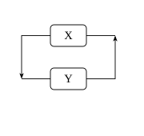
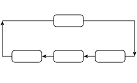
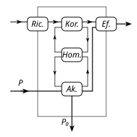
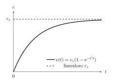
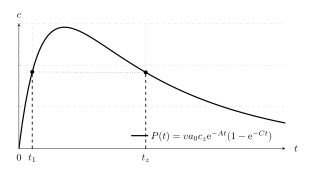
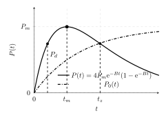
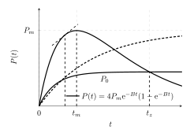

<!--
CIBERETIKAJ PROBLEMOJ DE LA VIVPROCEZO
 (Prof. d-ro M. Mazur, Varsovio)

 El la pola tradukis
mag. inĝ. K. Siwicki

vd. ankaŭ pli ampleksan trakton en (pollingve)
https://physicsoflife.pl/bibliografia/books/marian_mazur-cybernetyka_i_charakter-jf.pdf

-->

<blockquote>
El la cibernetika vidpunkto estas priparolitaj la ideoj
pri regado kaj strukturo kaj klarigitaj la diferencoj inter aŭtomatoj de
unu flanko kaj aŭtonomoj de la alia. Estas prezentita la koncepto de la
cibernetika skemo de organismo. Sur la bazo de elementaj procezoj de
la egaligado de potencialoj estas klarigitaj kvalitaj kaj kvantaj faktoroj
de la egaligado de viviprocezo, kiu estas konsiderata kiel procezo de la
potenco en funkcio de tempo. La aŭtoro eksplikas kalkajn problemojn,
ligitajn kun energetikaj kaj informaj faktoroj en la konduto de
organismo
</blockquote>

## 1. Enkonduko

Apero de la artikolo sub la supra titolo en iu revuo povus ĝis
antaŭ nelonge impresi kiel ia miskompreno. Hodiaŭ tia danĝero jam
ne estas minacanta. De kelke da jaroj de ekzistado de la cibernetiko
kiel apartigita sciencofako, ĝi kaŭzis malproksime irantajn aliformiĝojn en la opinioj pri la temo de la scienco kiel tuto. Almenaŭ oni jam
scias hodiaŭ, ke biologiaj procezoj estas trakteblaj kiel regadprocezoj.

Se evoluo de la cibernetiko reduktiĝus al teknikaj problemoj,
tiam anstataŭ pri cibernetiko oni priparolus verŝajne pri certa evoluostadio de la aŭtomatiko. Montriĝis tamen ke regadprocezoj je rilate
alia grado de malsimpligo, ne estas io karakteriza por la tekniko.
Ili aperas ankaŭ en organismoj kaj tial interesiĝas pri ili biologio, fiziologio, psikologio ktp, kaj krome -- en socioj, do ili rilatas al sociologio, ekonomio ktp. Se krom tio oni konsideras la rolon,
kiun ludas matematiko kaj logiko en cibernetikaj problemoj, tiam
facile eblas kompreni, kiel larĝa estas la atingokapablo de la cibernetiko. Apero de la cibernetiko kaŭzis ke eĉ la divido de sciencoj je
matematikaj humanistaj estiĝis senobjekta. La ĝisnuna apartigo
de la humanistaj sciencoj estis bazata sur la premiso ke la funkciado
de homa organismo, precipe en pensadolimoj diferenciĝas principe de
la funkciado de maŝinoj. Nune, kiam maŝinoj eblas traduki de unu
lingvo en alian, komponi muzikajn verkojn, ŝakludi ktp, tiuspeca apartigo perdis sian motivon.

Cirkonstanco, ke ĉiun procezon de regado eblas trakti kiel la
trakuron de informoj, permesas klarigi la diferencon inter aŭtomato
kaj cibernetika maŝino. Servu nin pro tia la sekvonta figura ekzemplo.
Surozu ke iu ordonis al sia subulo aĉeti certan varon en la certa
butiko. En tiu ĉi kazo plenumanto disponas pri ĉiuj necesaj informoj;
plenumante ricevitan taskon li agas kiel aŭtomato. Se taman aŭdiĝus
la ordono ke li devu aĉeti certan varon je plej malgranda prezo, tiam
la ricevitaj informoj estus nekompletaj. La plenumanto mem devus
akiri la mankantajn informojn, nome li devus viziti ĉiujn butikojn,
demandi pri prezoj, kaj poste kompari ilin por eltrovi la plej malgrandan prezon; ĝuste tiam li ekscius, en kiu butiko oni devas aĉeti
la varon: en tiu ĉi kazo la plenumanto agadus kiel la cibernetika
maŝino.

Ideala cibernetika maŝino estas la maŝino dotita nur per la
kapableco de distingado, kio por ĝi estas "bona" kaj kio estas "malbona";
ĉiujn aliajn informojn ĝi devus mem por si akiri.

Ĝuste sur tia principo funkcias organismoj. Post la naskiĝo organismo estas kapabla nur distingi plezuron kaj malagrabalaĵon; aliajn
informojn ĝi ĉerpas el la sperto, riĉiĝanta dum trakuro de la vivo.

Mekanismo jam forĵetita de scienco, kiu celas al la traktado de
la organismo kvazaŭ ĝi estus iuspeca mekanismo, trompis ekspertojn
ĝuste per tio ke ĝi interpretis — kiel aŭtomaton, ne kiel cibernetikan sistemon.

## 2. Regado

Kiel eni scias, la cibernetiko estas difnita kiel scienco pri regado.
Vicsekve, oni povas difini la regadon kiel dezirindan influadon sur
laŭvolajn fenomenojn. El la cibernetika vidpunkto la regado estas ekzemple la regulado de rapideco en teknikaj aranĝoj, agado de glandoj en
organismo, ŝanĝoj de prezoj en ekonomio ktp.

La regado efektiviĝas ĉiam sur la principo de rekoplo, t. e. de
influado de elirprocezoj sur enirprocezojn. Tamen, ĉar enirprocezoj -- laŭ
propra esenco de ili -- influas sur elirprocezojn, do la regado estas la
procezo de reciproka reagado. Se la sistemo X regas la sistemon Y,
tiam ne nure X inluas Y-on, sed ankaŭ Y influas X-on (fig. [1](#bld-1)). 

{#bld-1}\
fig. 1. Ĝenerala skemo de la turna koplado

Ne nure ŝoforo influas aŭtomobilon, sed ankaŭ
aŭtomobilo inflaus ŝoforon. Kiam elektra forno
estas regata per la regulilo de temperaturo, tiam
ankaŭ bone oni povas diri ke la regulilo de
temperaturo estas regata per la forno. Se ni
kutime diras pri la regado de forno per la regulilo, do nur tial ke el praktika vidpunkto
ĝuste temas pri la forno, ne pri la regado de la
regulilo per la forno. Tiun ĉi reciprokecon de
la procezoj de regado preteratentas ofte eĉ
cibernetikuloj. Oni povas reprezenti la sistemon de regado ĝenerale
kiel sur la fig. [2](#bld-2). 

{#bld-2}\
fig. 2. Sistemo de gerado en cibernetika koncepto

Ŝanĝoj en la regata objekto estas malkovrataj per
la ricevilo kaj taksataj en la korelatilo, kio sekvigas ifluon de la
efektivigilo sur la regatan objekton
kaj tiamaniere fermiĝas la procezo
de la regado. Ekzemplojn de tia
procezo eblas renkonti en ĉiuj fakoj; ŝanĝoj en elektra forno estas
eltrovataj pere de temperaturodetektilo, kio-konforme al la agado
de la temperaturo-regulilo -- igas la
agadon de la ŝaltilo kaj la certigon
aŭ la ĉesigon de la fluo de elektra
energio al la fornon. La deklinoj de
la bastono, kiun ni volas teni vertikale sur la pinto de fingro, estas
malkovrataj per la okulo kaj pritaksataj per la cerbo, sekve de kio
estiĝas la movoj de la mano, agantaj
kontraŭ la deklinoj de la bastono el la vertikala direkto; ŝanĝoj en la
varomovado estas observataj pere de reportantoj, kiuj transdonas la
informoj pri ili al registaro, kiu entreprenas la decidojn pri la prezoj la decidojn poste plenumataj per vendistoj kaj tiamaniere influantaj
la varomovadon.

Regadprocezojn eblas trakti kiel la transsendon de informoj. Precipe
oni povas konsideri ke de la ricevilo al la korelatilo estas transsendataj informoj pri la stimuloj, tio estas pri la ŝanĝoj de la stato de
regata objekto, kaj de la korelatilo (sekve de la transformado de informoj
en la korelatilo) al efektivigilo estas transsendataj la informoj (ordonoj)
pri la reagoj, alivorte pri la ŝanĝoj, kiuj devas esti kaŭzotaj en la
stato de la regata objekto.

## 3. Strukturo

Jam delonge ni estas kutimigitaj al la traktado de ĉiu fizika
sistemo el la vidpunkto de energio kaj materio. Estiĝas la demando,
ĉu tiuj ĉi faktoroj sufiĉe difinas la sistemon. Por respondi tiun ĉi
demandon, konsideru iun sistemon kiu transformas energion, ekzemple
simplan akvoturbinon.

Se mankas nenio, nek rilate al energio, nek al materio, la turbino
ne povas funkcii, se la rado estis lokita renverse, se la platoj de la
rado estas direktitaj neĝuste. En tiu ĉi kazo ŝanĝiĝis la tria faktoro
kaj nome la *strukturo*, t. e. la maniero alligi energion kaj materion.

Al samaj konkludoj oni alvenus konsiderante aliajn sistemojn;
ekz-e regula funkciado de radioelektra aparato ĉesas en kazo de foresto
de la elradiado de la radiostacio (energio), en kazo de foresto de iu
elemento (materio), aŭ en kazo de falsa starigo de elementoj, ekz-e
de elektronaj tuboj (strukturo). 

Do, ĉe la konsiderado de fizikaj sistemoj, oni devas atentigi tri
faktorojn, kiuj estas: energio, materio, strukturo.

La metodoj de la kvanteca determinado de energio kaj materio 
estas jam delonge konataj. Estiĝas la demando, ĉu oni eblas ankaŭ
paroli pri la "kvanto de la strukturo". Ĝi povas esti surprizanta, sed
eble nur kaŭze de eksterordinareco de la dirformo. En realeco la
scienca problematiko en la plej granda grado rilatis la kvantecan pritakson de la strukturo, kvankam pere de alia terminologio, konforme
al la vidpunkto, el kiu la strukturo estas pritaksata. Tiaj konceptoj

kiel efiko, efikivo, kreterio de la simileco, kvociento de la inteligenteco
profiteco, rilata pliĝo de la loĝantaro ktp. estas nur formoj de la
kvanta pritakso de la strukturo.

Se oni enkondukos en la sistemon certan energikvanton — konforme al la leĝoj de energikonservado -- ĝi povas esti nek malpliigita nek
pliigita; povas ŝanĝ\[iĝ\]i nur formo aŭ dislokado de l' energio. Samo rilatas
la kvanton de la materio; povas sekvi nur la transformiĝo de unu
substanco en alian aŭ la ŝanĝo de la dislokado.

Kiel unusola faktoro, sur kiu eblas influi, restas nur la strukturo
(transformiĝo de energio aŭ materio, aŭ ŝanĝo de ilia dislokado estas
ĝuste rezultato de ŝanĝoj de la strukturo), el kio sekvas, ke la regado
baziĝas sur la ŝanĝoj de la strukturo.

Restas nur klarigi, kiel en la difino de la regado oni devas kompreni la "dezirindan" influon sur la fenomenoj. Dezirinda-por kiu? Evidente por la homo, ĝis kiam oni parolas pri la utiligo de maŝinoj.
Anstataŭ memregadi maŝinojn, homo faciligas al si problemon kaj konstruas maŝinojn memregatajn.

La esprimo "memregata maŝino" postulas certan komentarion. La formo ekipita per la regegulilo de temperaturo estas memregata nur tiom,
ke ĝi subtenas por si mem la temperaturon fiksiton sur la regulilo, sed
kiu starigas tiun ĉi temperaturon sur la regulilo? Faras tion homo, uitliganta la fornon. Oni eblas verdire konstrui memstariĝantan regulilon, alivorte -- dependigi aŭtomatan starigon de la temperaturo en regulilo de ia alia fizika grando, tamen tio ĉi signifas enkondukon de aldona organo, kiun laŭvice devos instali homo ktp. Kiel oni vidas, povas esti maŝinoj
de diveraj gradoj da memregado, do -- pri pli malgranda aŭ pli granda partopreno de la homo. Maŝinoj de tiu speco estas *aŭtomatoj*.
La plej alta grado de meregeco aperas en la sistemoj, kiuj regiĝas pro sia afero, t.e. zorgas ekskluzive pri la propra sekureco kaj evoluo. Maŝinoj de tia speco ja ne estas ankoraŭ konstruataj, tamen ekzistas organikaj memstaraj strukturoj kaj nome *organismoj*.

## 4. Organismo kiel memstara strukturo 

Abstraktante de la fiziologio, do ekz-e de la distingado de procezo
digestuma, sangokonduka ktp, eblas konsideri organismon el la vidpunkto
de regaj procezoj (fig. [3](#bld-3)).

{#bld-3}\
Fig. 3. Cibernetika skemo de organismo

Traktante organismon kiel regantan sistemon kaj medion en kiu organismo estadas, kiel regatan sistemon kaj konsiderante la skemon
montritan sur la fig. [2](#bld-2), oni povas distingi en la organismo *informan vojon*, kiu konsistas
el: riceviloj (sentumaj organoj), korelatilo (cerbo) kaj efektivigilo (movaj muskoloj). Tuj kiam la reago de
medio sur organizmon aperas en la
formo de impulsoj sur la eniro de la
informa vojo, tiam la reago de la
organismo sur la medion aperas en 
la formo de reago sur la eliro de la
informa vojo. Krom tio oni povas distingi *energetikan* vojon, kiu
konsistas el akumulilo kaj efektivigilo. Ĉe la eniro de tiu ĉi vojo aperas
*totala potenco* (P) ricevata per la organismo de la medio.

Por ke organismo povu eldonadi energion en arbitra tempo, sendepende de tio kiam ĝi ĝin ricevas, estas necesa en organismo akumulado
de energio. La komplekson de organoj kiuj plenumas tiun ĉi taskon ni
determinas en tiu ĉi kazo kiel akumulilo (fig. [3](#bld-3))

En organismo kiel en ĉiu transformilo de energio, estiĝas perdoj
de energio rilate al medio (plejparte kiel perdoj de varmo). La potencon
por kompensi perdojn ni nomos *potenco neaga*. Restintan potencon la organismo disponas por la plenumado de ordonoj transsendataj el korelatilo al efektivigilo, ni nomos ĝin *potenco dispona*.
Ĝi estas alkondukata de la akumulilo al efektivigilo, ĝi estiĝas ĉe la
eniro de la energetika vojo. Oni vidas, ke efektivigilo estas komuna
organo por la informa kaj energetika vojoj.

Por subteni la firmecon de parametroj (ekz-e de temperaturo, premo, humideco ktp), de kiuj dependas daŭreco de organismo, servas reguligaj procezoj nomataj "homeostazio"; komplekson da organoj, dank'
al kiuj estiĝas tiuj ĉi procezoj, ni markis sur la fig. [3](#bld-3) kiel "homeostato",
Homeostato eblas influi menciitajn parametrojn, pere de la pligrandigo
aŭ malpligrandigo de la neaga potenco (ekz-e defendo de organismo
kontraŭ trovarmigo baziĝas sur la intensa emanado kaj vaporiĝado de
ŝvito kiu pligrandigas varmajn perdojn); laŭcele, homeostato estas koplita kun akumulilo. Krome, homeostato estas koplita kun korelatilo,
dank' al kio sur la informan vojon estas enigita kriterio de la profito
de organismo (kriterio de la pritakso, kio por organismo estas "bona"
kaj kio "malbona").

Do, oni povas distingi en la organismo tri ĉefajn reagajn koplojn:
1) akumulilo-homeostato, 2) homeostato-korelatilo, 3) korelatilo-medio.

### 5. Procezo de la vivo

La konsideradon de la vivprocezoj de organismo ni komencos per
la demando, kio okazas al arbitra nesamrega strukturo kun la forkuro
de la tempo.

Tion ĉi difinas la principo de [Maupertuis]{.maldense}, kiu konstatas ke
la diferenco de arbitraj potencialoj, se ĝi ne estas subtenata per eksteraj faktoroj, malgrandiĝas laŭ la esprimo

[(1)]{.fno #e-1} $V=V_0\cdot \mathrm{e}^{-kt}$

ĉe kio $V$ -- diferenco de potencialoj arbitra momento, $V_0$ -- komenca
diferenco de potencialoj, $k$ -- estingiĝo, $t$ -- tempo, $\mathrm{e}$ -- bazo de naturaj logaritmoj.

Laŭ tia trakuro estiĝas la malvarmiĝado de varmigitaj korpoj,
malŝargado de elektraj kondensiloj ktp. La diferenco de potencialoj
malgrandiĝas asimptote ĝis nulo, kiam estiĝas elfluo de energio al
medio.

Nevivigita naturo celas tiamaniere al la egaligo de potencialoj, kio
estas difinita kiel la grandigo de entropio. La libera malgrandiĝado de
la diferenco de potencialoj estas la senĉese progresanta malorganizado
de la strukturo. La kontraŭstariĝo al la kreskado de entropio estas
neceso de ĉiu organizaĵo.

Ĉiu ekstere regata strukturo devas posedi organizanton, kiu regas
ĝin pro sia propra profito. La memstara strukturo regiĝas pro sia propra profito; ĝi estas sia propra organizanto.

Se organismo ne memregiĝus, tiam ĉiuj diferencoj de potencialoj
en ties ĉi ĉeloj malgrandiĝadus laŭ la principo de [Maupertuis]{.maldense}, la
organismo ĉiam pli submetiĝadus al la malorganizado.

La konstato, ke la strukturo submetiĝas al la malorganizado kaŭze
de la egaligado de potencialoj, signifas ke malgrandiĝas en ĝi fizika
kvanto, kiu ludas rolon de potencialo. Rilate organismojn ni difinu tiun
ĉi kvanton kiel *econ de organika substanco*. Konforme
al la esprimo ([1](#e-1)) oni povas reprezenti tiun ĉi kvanton per la ekvacio.

[(2)]{.fno #e-2} $a=a_0\cdot\mathrm{e}^{-At}$

en kiu: $a$ — eco de organika substanco en arbitra momento, $a_0$ — komenca eco de organika substanco, $A$ — koeficiento de maljuniĝo,
$t$ — tempo, $\mathrm{e}$ — bazo de naturaj logaritmoj.

La kurbo esprimita per tiu ĉi ekvacio havas trakuron kiel ĉe 
la ekv. ([1](#e-1))

La potencialo en iu ajn loko povas esti pli alta ol en alia nur
dank' al tio, ke en tiu ĉi loko estiĝas koncentrado de energio. Kiam
malgrandiĝas la diferenco de potencialoj, tiam malgrandiĝas ankaŭ la
koncentrado de energio, kion akompanas la forfluo de energio eksteren.

Organismo kiel memstara strukturo, diferenciĝas de la nevivigitaj
strukturoj per tio ke ĝi luktas kontraŭ la propra dezorganizado, kaj
pro tio ĝi devas kontraŭagi al la forfluo de la energio. Tiun ĉi celon:
organismo povas atingi nur per la ricevado de energio elekstere. Por
tio estas bezonaj konvenaj organoj kaj ĉar organismo estas la strukturo
memstara, do ĝi devas tiajn ĉi organojn konstrui memstare. Oni bezonas
ankaŭ konsideri cirkonstancon ke ricevata energio devas posedi adekvatan formon. Por ke oni povu transformi la ricevatan energion en la
bezonatan formon, organismo devas ankaŭ konstrui por si mem konvenajn organojn. La evoluado de organismo estas do nepreco de la bataloj 
de organismo kontraŭ la propea malorganizaĵo.

Rapido de la evoluado de organismo estiĝas per tio ke la plimalbonigo de la eco de organika substanco estas por organismo perturbo;
al la forigado de tiu ĉi plimalbonigo celas la homeostato, kiu evoluigas 
organismon konforme al aktuala stato de organika substanco. Se do
malorganizaĵo estiĝas rapide, tiam organismo evoluas rapide; se malorganizaĵo trakuras malrapide, tiam organismo evoluas pli malrapide.
Tiel la evoluadon de la organismo t. e. la *kvanton* de la organika
substanco oni povas esprimi per la ekvacio

[(3)]{.fno #e-3} $c=c_z(1-\mathrm{e}^{-Ct})$

kie: $c$ — kvanto de la organika substanco en la difinita momento, $c_z$
ekstrema kvanto de la organika substanco, $C$ — koeficiento de evoluo
$t$ — tempo, $\mathrm{e}$ — bazo de naturaj logaritmoj.

La kurbo esprimata per tiu ĉi ekvacio havas la trakuron montratan per la fig. [4a](#bld-4a)

{#bld-4a}\
Fig. 4a. Evoluado de organismo

Kiel oni vidas, en organismo estiĝas distigebla kombinaĵo inter la
faktoroj kvalitaj kaj kvantaj: kiam
plimalboniĝas la kvalito de la organika substanco, tiam kvanto estas
levigita pligrandiĝi.

Konsiderante organismon kiel transformilon de energio, eblas operacii
per la esprimo de la potenco de organismo. La potenco de organismo
(totala potenco P de la ĉapitro 4)
estas des pli granda, ju pli bona
estas eco de  la organika substanco,
kaj ju pli granda estas ĝia kvanto $c$. Per la enkonduko de la koeficiento de la proporcieco $v$ oni povas difini la potencon de organismo
per ekvacio

[(4)]{.fno #e-4} $P=vac$

kaj post la konsidero de la ekvacioj [2](#e-2)) kaj [3](#e-3))

[(5)]{.fno #e-5} $P=va_0c_z\mathrm{e}^{-At}(1-\mathrm{e}^{-Ct})$

La kurbo esprimita per tiu ĉi ekvacio havas la trakuron kiel sur
la fig. [4b](#bld-4b).

{#bld-4b}\
Fig. 4b. Potenco de la organismo

En ĝenerala kazo la koeficiento de evoluo $C$ povas esti pli granda
aŭ pli malgranda ol la koeficiento de maljuniĝo $A$.

Estas interesa la nombra difino de la potenco de organismo. Oni
povas tion ĉi atingi per konsidero ke reproduktivo de organismo komencas en certa tempo $t_1$, kaj finiĝas en certa tempo $t_z$, ĉe kio la potenco
de organismo ne devas esti pli malgranda ol ia necesa por tio valoro
(fig. 4b). Oni scias ke por la homa organismo tiuj ĉi tempoj egalas proksimume $t_1 = 14{...}17$ jarojn kaj $t_2 = 50{...}60$ jarojn (la malsupraj
valoroj rilatas principe virinojn, la superaj — virojn), sekve $t_1:t_2=1:3{,}5$. Sufiĉus do eltrovi sur la kurbo [4b](#bld-4b) du tiajn punktojn ĉe egala
potenco, kiuj plenumas supran kondiĉon, por ebli difini la funkcio
$P = f(t)$ per la nombro.

Por simpligi la matematikan flankon de la problemo, akceptu ke
koeficiento de evoluo egalas koeficienton de maljuniĝo, t.e. $C=A=B$.
ĉe kio ni enkondukis la signon $B$ por substreki, ke rilatas nure tiun ĉi
specialan kazon.

Sekve do la esprimo ([5](#e-5)) alprenas formon

[(6)]{.fno #e-6} $P=vas_0c_z\mathrm{e}^{-Bt}(1-\mathrm{e}^{-Bt})$

Egaligante la unuan derivaton de tiu ĉi funkcio al nulo

[(7)]{.fno #e-7} $\displaystyle \frac{dP}{dt}=0$

ni ricevas por la maksimumo de tiu ĉi funkcio la kondiĉon

[(8)]{.fno #e-8} $\displaystyle \mathrm{e}^{-Bt_m}=0{,}5$

kie: $t_m$ esas tempo en kiu estiĝas la maksimuma potenco de organismo. Enkondukante la esprimon ([8](#e-8)) en la esprimon ([6](#e-6)) ni ricevas la esprimon por la maksimuma potenco

[(9)]{.fno #e-9} $\displaystyle P_m=\frac{va_0c_z}{4}$

al kiu respondas la kurba $P$ sur la fig. [5](#bld-5).

[(10)]{.fno #e-10} $\displaystyle P=4P_m \mathrm{e}^{-Bt}(1-\mathrm{e}^{-Bt})$

Sur la bazo de la trakuro de ĉi tiu kurbo facile estas konstati, ke la
kondiĉio $t_1:t_2 = 1 : 3{,}5$ estas plenumita ĉe la potenco $= 0{,}82 P_m$. Do
la potenco de homa organismo devas esti egala plie ol 82% de sia maksimuma potenco, por ke organismo povu kapabli por la reproduktado.
En la periodo de $t_1 = 20{...}25$ jaroj ĝis la $t_2 = 40{...}50$ jaroj la potenco de organismo transpaŝas eĉ 95% de sia maksimumo. Kiel oni vidas
la maturo(?) postulas de la organismo egan potencon koncerne la plimultiĝado. Krom tio la cirkonstanco, ke la potenco de homa organismo dum
la frua(?) periodo de sia matureco tiel malmulte diferenciĝas de la maksimuma potenco, eksplikas kiamaniere estiĝas en tiu ĉi periodo la ekesto(?) de neŝanĝiĝanta vivpoveco.

Pro tio ke la kurbo $P$ proksimiĝas asimptote la abscison, estiĝas la
demando, ĉu la vivo, eĉ kiam la vivpotenco de organismo kontinue malgrandiĝas, povus daŭri eterne.

La respondo al tiu ĉi demando estas facila, se oni konsideras estiĝadon de la neaga vivpotenco de organismo. Oni povas akcepti ke la
neaga vivpotenco estas proporcia al la kvanto de substanco organika $c$.
La fiziologio ankaŭ tion ĉi konfirmas; estas konstatite ke la neaga vivpotenco de organismo je 1 kg egalas ĉirkaŭ 1 kcal/h, do la neaga vivpotenco de organimso je ĉirkaŭ 70 kg egalas ĉirkaŭ *P*~0~ = 70 kcal/h. Por
komparo aldonu ke la totala vivpotenco de homa matura organismo
estas ĉirkaŭ *P* = 125 kcal/h (se oni akceptas ke por la nutrado de organismo oni bezonu ĉirkaŭ 3000 kcal je tagnokto).

El tio ĉi rezultas ke la trakuro de neaga potenco $P_0 = f(t)$ similas la trakuron $c=f(t)$ laŭ esprimo ([3](#e-3)) kaj fig. [4a](#bld-4a). La kurbo de neaga
potenco $P_0=f(t)$ sekcas la kurbon de totala potenco $P=f(t)$ en iu
momento $t_z$ (fig. [5](#bld-5))

Ĉiumomente la totala potenco devas egali la sumon de akumulita
potenco, neaga potenco kaj disponebla potenco. Akumulita potenco baziĝas de unu nutraĵo al alia, kaj praktike oni povas akcepti ke ĝi
egaliĝas en tagnokta ciklo. Se oni operacias per la mezaj valoroj en
periodo de unu ciklo, la akumulita potenco ne estas prezenta en la
ekvacio de la potenco, oni eblas do skribi:

[(11)]{.fno #e-11} $\displaystyle P=P_0+P_d$

{#bld-5}\
Fig. 5. Totala potenco, neaga potenco kaj dispozicia potenco de la organismo

do, la vojo de la kurbo $P_0 = s(t)$ sur la fig. [5](#bld-5) dividas la totalan potencon $P=f(t)$ je potenco neaga $P_0$ kaj potenco disponebla $P_d$. Kiel
oni vidas sur la grafikaĵo, laŭmezure kiel proksimiĝas la momento $t_z$,
la dispozicia potenco pli kaj pli malgrandiĝas kaj en la momento $t_z$
egaliĝas nulon; tio ĉi signifas ke en la momento $t_z$ la totala vivpotenco
de organismo kompensas ekskluzive bezonojn de neaga potenco. Post la
trapaŝo de momento $t_z$ totala potenco ne sufiĉas eĉ por la kompenso
neaga potenco. Per tio, homeostato perdas la eblecon kontraŭbatali perturbojn rezultantajn el maljuniĝado, organismo subiĝas do al malorganizaĵo. Tempo $t_z$ estas la momento de morto de la organismo.

Esplorinte la trakuron de la kurboj estas konstatite ke la neaga
potenco atingas la maksimumon pli frue ol la totala potenco de organismo (fig. [6](#bld-6)). Tio ĉi ne estas por la organismo utila, kaj homeostato
kontraŭstariĝas al la malgrandigo de la deklivo de kurbo $P = f(t)$.

{#bld-6}\
Fig. 6. Haltigado de la evoluo de organismo

Ĉar neaga potenco $P_0$ estas proporcia al la kvanto de organika
substanco $c$, do la agado de homeostato konsistas en la haltigo de la
evoluado de organismo. Alie dirante, la evoluado, necesa komence por
kontraŭstarigi la maljuniĝon, estiĝas je trakuro de la vivo pli kaj pli
malvalora. Konformiĝante al situacioŝanĝoj laŭ tia rilato, homeostato
malgrandigas la rapidon de la evoluo de organismo ĝis ĝia kompleta
haltigo en la malfrua periodo de la vivo ne cedas eĉ malgrandiĝadon de
la kvanto de organika substanco, kio manifestiĝas kiel tn. maljunuma
marasmo kaj tiamaniere forigas la momenton $t_z$ (fig. [6](#bld-6)).konduto. Tio 

Kontraŭ supra rezonado oni povus elŝovi la riproĉon, ke dum la
haltigado de evolueco malgrandiĝas ankaŭ la totala potenco konforme
al esprimo ([4](#e-4)), kio supozeble kontraŭagas forŝovadon de la momento
$t_z$. Analizo de cititaj esprimoj permesas konstati ke tiu ĉi supozo estas
ĝusta, ne rilate al la valoro $t$, sed al la valoro $Bt$. Eblas pruvi
senkonsidere trakuron de la kurbo $P = f(Bt)$, punkto de ĝia intersekco kun la kurbo $P = f(Bt)$ koincidas kun la sama valoro $Bt_z$

Malgraŭ tio, la valorao $t_z$ estos pli granda, ĉar la valoro $B$ estas
pli malgranda, pri kio oni povas sin konvinki konsiderante la rilaton
$t_1:t_2$ (fig. [4b](#bld-4)) ĉe modifita (koncerne la haltigadon de evoluo), trakuro de
la kurbo de totala potenco $P$.

La profito de organismo dank' al haltigado de evoluo, kiu komencas ???iĝi ankoraŭ antaŭ la punkto $t_z$, konsistas en tio, ke la energio ?????ita en daŭro de tuta vivo de organismo, kaj konforma
al disponebla potenco, estos pli granda. Organismo regiĝas laŭ maniero ??? la plenumon de la kondiĉo:

$$\int_0^{t_z}p_d \mathrm{d}t = \mathrm{max}$$

??? ordinare organismo celas la plejgrandan "ĝuon de vivado".

## 6. Energetikaj kaj informaj faktoroj en la konduto de organismo

La serĉado de ekzaktaj regulecoj en la konduto de homa organismo estas sendube frapanta afero, provokanta diversajn demandojn.

La traktado de organismo kiel cibernetika sistemo, kondukas al la
???o de la determinismo de ĝia konduto. Tio ĉi estas kontraŭa al la
opinioj de partianoj de t.n. "libera volo", t.e. de la indeterminismo en
la agado de homo. En la defendo de siaj vidpunktoj ili starigas la argumentadon, ke ja identaj stimuloj povas estigi diversajn reagojn de homo. La erareco de tia motivado rezultas en la preterlasado de cirkonstanco, ke korelatilo (cerbo) ne estas nur kanalo en kiu el la informo
pri la stimulo estiĝas la informo (ordono) pri sekvonta reakcio sed ankaŭ la akumulilo de antaŭaj informoj, ekestantaj el la ĝis nun akirita
sperto(?) de organismo. Tiuj antaŭaj informoj estas tiel multaj, ke la informoj enkondukataj en korelatilon rilate al aktuala stimulo prezentas
proverban "guton en maro". La reakcio estas rezulto de la sumo de
pasintaj kaj estantaj informoj, kaj ĉar la nunaj informoj estas sensighifa parto de tiu ĉi sumo, ne estas do mirinda ke ĉe diversaj stadioj de
la registrado de antaŭaj informoj, la reakcioj diferenciĝos eĉ en kazo
de sama aktuala impulso. La diverseco de la reakcio ne signifas do la
neadon de la determinismo.

Personoj kutimiĝantaj al la dualisma komprenado de la homo, t.e. 
al diferencigo de la "korpo" kaj "spirito" estas incitiĝemaj pro la nura
fizika interpreto de la konduto de organismo. Kiel argumento oni starigas en tiu ĉi kazo, itner aliaj, la ekzemplon, ke multaj scienculoj atingas la kulminojn de sia agado malfruaĝe, je multe malfrue ol tio ĉi
??? el la pozicio de maksimuma potenco sur la kurbo de la potenctrakuro de organismo. Tia motivigo estas rezultato de miskompreno.
Ĉiu travivaĵo enkondukas informojn registratajn en la korelatilo, dank'
al ĉio pligrandiĝas la “provizo de informoj registritaj en la korelatilo,
eĉ kiam la potenco de organismo estas malgrandiĝanta. Informaj procezoj postulas verdire konsumi energion, temas tie ĉi tamen pri la rega
potenco, do pri la potenco ege pli malgranda ol la potenco aga-objekto
bone konata ne nur el la cibernetiko, sed pli frue ankoraŭ el la aŭtomatiko. Pro tio, la malpligrandigo de la potenco de organismo ne malhelpas al maljuna scienculo krei valorajn konceptojn kaj foruzi por tio
malgrandan disponeblan potencon, evidente ĝis la momento kiam-mallonge antaŭ la morto -- forestos al li eĉ tia malgranda potenco.

De mil jaroj ĝis antaŭnelonge oni sin imagis ke la pensado ne postulas konsumi energion nek tempon kaj pro tio oni konsideris ĝin je
io "nemateriala" (tio signifas "nefizika"); sur tiu ĉi fono estiĝis koncepto de la "spirito" kiel kontraŭstarigo de la "materio".

Tiuj sentas sin kvazaŭ konfuzitaj per la traktado de homo kiel
cibernetika sistemo kaj esprimas timojn ke tio ĉi eblas konduki al la.
malriĉigo de homaj travivaĵoj. Tiuj ĉi timoj estas tute senbazaj. Homo
tiel restas kiel restadis, sendepende de tio kiel oni lin inetrpretas, simile kiel la eltrovo de [Kopernik]{.maldense} ne ĉesigis la sunleviĝon kaj sunsubiron nek senigis ilin je poezieco. Cibernetikaj konsideradoj povas
alporti nur utilon kontribuante al la pli bona kompreno de la homa
naturo.
