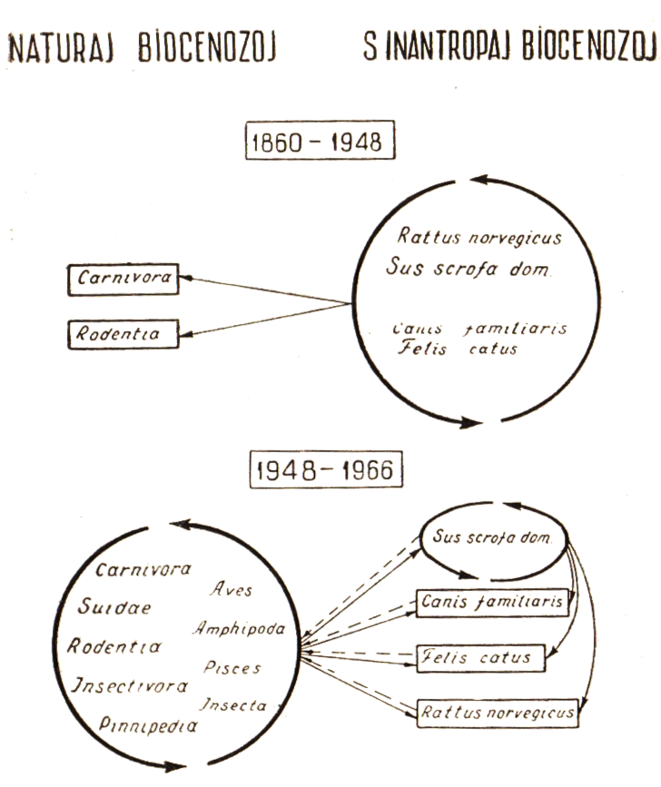

<!--
SCIENCA REVUO, eldono de Internacia Scienca Asocio
Esperantista, Vol. 18. n-ro 1 (1967)

576.89 : 577.4 «- 591.5 (Trichinella spiralis)

PRI LA CIRKULADO DE TRIĤHINELOJx)
(S. Boev, Alma-Ata, Kazaĥstano, U. S. S. R.)
-->

<blockquote>
Mallongigita teksto de lekcio prelegita dum la internacia seminario pri helmintozoj, aranĝita de la Tutmonda San-Organizaĵo
([World Health Organisation]{.maldense}) en [Alma-Ata]{.maldense} la 25 - 29 de majo 1966.
</blockquote>

Inter malsanoj komunaj al la homo kaj animaloj antaŭ ĉio
oni devas nomi triĥinelozon. Ĝi estas helmintozo[^1], kiun kaŭzas Triĥinelo spirala ([Trichinella spiralis]{.maldense}) — tre malgranda ronda parazita
vermo (1 - 4 mm longa). En la seksmatura stadio triĥinelo [^2] parazitas
en intestoj de homoj aŭ diversaj mambestoj, kiel larvo en muskola
histo de siaj mastroj. Oni infektiĝas, kiam oni manĝas viandon de
triĥineloza animalo.

## Triĥinelozo kaj sano de l'homo

Triĥinelozo estas tre danĝera, sed en la nunaj tempoj ne tre
ofta malsano. Tamen ĝi renkontiĝas preskaŭ en ĉiuj landoj de la
terglobo. Triĥinelozo povas havi sensimptoman, subklinikan kaj klinikan formojn. Dum la klinika formo oni observas jukan ekzantemon,
altiĝon de la temperaturo, egajn muskolajn kaj ventrajn dolorojn,
ostajn dolorojn, stomak-intestajn misdigestojn, malfortecon, vizaĝedemon.

Ĝenerale triĥinelozo similas akran infektan malsanon kun alergiaj [^3] fenomenoj kaj diversaj komplikiĝoj (difuza miokardito, fokusa
pneŭmonio, meningo-encefalito), pro manko de specifaj simptomoj ĝi
estas kiel regulo malĝuste diagnozata, kaj la veran diagnozon oni
ekkonas ofte nur sur la sekca tablo.

Dum la antaŭaj jarcentoj triĥinelozo atakis homon en formo de
epidemioj, nun ĝi montras sin kiel grupa aŭ familia malsano. La
morteco atingas 5 - 11% kaj pli da procentoj. Sed ne nur turmentoj
kaj morto de la malsanuloj difinas rolon de triĥinelozo en patologio
de la homo. Kiom da laborkapablo perdas personoj,
kiuj havas subklinikan aŭ eĉ sensimptoman formojn de tiu-ĉi helmintozo! Ekzeple nur en Usono milionoj da homoj (16 - 32% da la loĝantaro — laŭ [Gould]{.maldense}, 1945) estas infektitaj de triĥineloj (pro uzo
de ne triĥineloskopiita porka viando[^x].

[^x]: En Usono oni ne praktikas triĥineloskopiadon (Mikroskopan esploron je triĥineloj) de porka viando, kiu estas laŭlege deviga en
eŭropaj landoj kaj en Sovet-Unio.

Oni devas ankaŭ konsideri, ke ĝis la lastaj jaroj medicino ne
havis efikajn rimedojn por kuraci triĥinelozon. Tial ĉe la severaj
kazoj kuracistoj ne povis savi la malsanulojn. Nun oni komencas
apliki patogenezan terapion (per tiel nomataj steroedaj[^4] hormonoj),
kiu donas tre bonajn rezultojn. Laŭ la lastaj literaturaj informoj, ĝis
nun ne atingeblaj muskolaj triĥineloj pereas post apliko de tiabendazolo[^5]. Tio promesas solvon de la malfacila problemo pri parazitocida[^6] terapio de tiu-ĉi helmintozo.

La supredirito difinas gravan rolon de tiu-ĉi malsano inter aliaj
malsanoj de la homo.

## La antaŭjaj konceptoj

Por sukcese batali kontraŭ iu ajn infekta malsano oni devas
bone koni vojojn de la cirkulado de ties elvoka agento en la ekstera
medio. Konceptoj pri la cirkulado de triĥineloj ege ŝanĝiĝis ekde
tiu tempo, kiam oni ekkonis triĥinelozon kiel malsanon ([Zenker]{.maldense}, 1860).

En la XIX kaj la unuaj dekjaroj de la XX jarcento oni supozis,
ke triĥineloj cirkuladas nur en homaj loĝlokoj ĉe hejmbestoj kaj sinantropaj[^7] roduloj. En tiaj tiel nomataj sinantropaj fokusoj de la
malsano homoj infektiĝas pri triĥinelozo, kiam ili manĝas infektitan
porkan viandon, en kiu estas infektkapablaj triĥinelaj larvoj (tre
malgrandaj — 1 mm longaj). Tio okazas, kiam porkaĵo ne estas sufiĉe
kuirita.

Laŭ [Leuckart]{.maldense} (1860), en sinantropa fokuso la unuan rolon en disvastigado de la malsano ludas cirkulado de triĥineloj inter ratoj kaj la
duan — inter porkoj, kiuj infektiĝas manĝinte triĥinelozajn ratojn.
Laŭ [Zenker]{.maldense} (1860), male la unua rolo apartenas al porkoj kaj la
dua — al ratoj, kiuj infrektiĝas manĝinte restaĵojn de triĥineloza porka
viando (vidu la sekmon).

Ĝis la kvardekaj jaroj de la nuna jarcento daŭris diskutado
inter adeptoj de »la rata« kaj de »la porka« teorioj de triĥinelozo
Kelkaj aŭtoroj ([Gruber]{.maldense}, 1926) komencis atentigi ke krom ratoj kaj
porkoj en la disvastigado de triĥinelozo kulpas hundoj, katoj kaj
sovaĝaj animaloj. Tamen ĉiuj tiuj sciencistoj opiniis - ke triĥinelozo
ekzistas nur en sinantropaj fokusoj; en la sovaĝan naturon ĝi trafas
nur tiam, kiam sovaĝaj animaloj hazarde riucevas de la hejmaj animaloj tiun-ĉi helmintozon.

Karaktera ilustraĵo por tiamaj konceptoj povas esti la jena
cito el [Zelenski]{.maldense} (1929): „Kondiĉoj kaj vivmaniero en homaj loĝlokoj
ege difinas kiel malproksimen en animala mondo povas esti al alportita
triĥinozo for de lokoj (ekzemple, for de rubejoj ktp.), kie troviĝas
infektaj forĵetaĵoj" (p. 368). Do, tiam eĉ ne suspozis pri sendependa
ekzistado de triĥinelozo en la sovaĝa naturo. 

## La modernaj konceptoj

En la lastaj dekjaroj en la faka literaturo aperadis ĉiam pli
kaj pli multe de informoj pri la ega disvastiĝo de triĥinelozo ĉe
sovagaj animaloj. Oni komencis distingi "arbaran" (angle — [sylvatic]{.maldense})
aŭ "sovaĝan" (angle — [ferral]{.maldense}) triĥinelozon kaj sinantropan triĥinelozon ([Witenberg]{.maldense}, 1964). Fama sovetia parazitologo akademiano 
[E. N. Pavlovski]{.maldense} en la 1948. jaro supozeble alkalkulis tiun-ĉi malsanon al "la
natur-fokusaj" (li proponis tiel nomi homajn malsanojn, kies agentoj
depratempe kaj tute sendepende de la homo cirkuladas inter sovaĝaj
animaloj, en la sovaĝa naturo). Kaj efektive esploroj de multnombraj
sciencistoj montris natur-fokusecon de la menciita helmintozo.

La bazaj argumentoj por tio estas la jenaj:

1. tre vasta rondo de sovaĝaj animaloj, kiuj estas rezervantoj de triĥineloj
2. pli alta procento de triĥinelozo ĉe sovaĝaj ol ĉe hejmaj animaloj;
3. ĉiuloka, disvastiĝo de la nomitaj parazitoj en la sovaĝa naturo, kontraŭe en homaj loĝlokoj ili renkontiĝas ne ĉie.

Nun oni pentras jenan bildon pri la cirkulado de triĥineloj
(vidu la skemon).

La naturaj fokusoj de la malsano dominas ĉe la sinantropoj. La
parazito cirkuladas precipe ĉe karnomanĝuloj ([Carnivora]{.maldense}) kaj pinipedoj ([Pinnipedia]{.maldense}), poste ĉe diversspeciaj porkoj ([Suidae]{.maldense}), roduloj
([Rodentia]{.maldense}), insektomanĝuloj ([Insektivora]{.maldense}). Tiuj ĉi animaloj estas
ĉefaj mastroj de triĥineloj. Krom tio kiel transitaj mastroj, t. e. kiel
mekanikaj transdonantoj de la infekto, en la cirkulado partoprenas
birdoj ([Aves]{.maldense} — laŭ [Merkuŝev]{.maldense}, 1960), amfipodoj ([Amphipodes]{.maldense} — 
[Fav Francis]{.maldense}, 1960; [Britov]{.maldense}, 1962), fiŝoj ([Pisces]{.maldense} — [Britov]{.maldense}, 1962), kaj insektoj
([Insecta]{.maldense} — [Beliaeva]{.maldense}, 1960; [Merkuŝev]{.maldense}, 1960).

## Kiel infektiĝas tiuj-ĉi animaloj?

Karnomanĝuloj infektigas, kiam la pli forta rabbesto atakas kaj
manĝas la pli malfortan, ekz., lupo — vulpon, krome ili infektiĝas
dank' al la kanibalismo kaj nutrado per la kadavraĵo.

Ĉe porkoj, roduloj, insektomanĝuloj la infektiĝo okazas, kiam
ili manĝas la infektitan kadavraĵon. Ĉe kelkaj roduloj (ekz., ratoj)
kulpas ankaŭ la kanibalismo.

Ĉe pinipedoj vojoj de la cirkulado de triĥineloj ne estas bone
esploritaj. Oni supozas ke rosmaroj infektiĝas manĝante fokojn. Siavice la lastaj (same kiel rosmaroj) ricevas la infekton dum nutrado
per amfipodoj. La amfipodoj infektiĥas, kiam ili sin nutras per kadavroj de mambestoj. Pinipedoj kaj amfipodoj povas infektiĝi ankaŭ
per fekaĵoj de maraj birdoj (precipe de mevoj), kiuj manĝis kadavraĵon de triĥinelozaj animaloj ([Abs and Schmid]{.maldense}, 1954). Tiom komplika cirkulado ekzistas ĉe la "natura" triĥinelozo.

La sinantropaj fokusoj aperas kutime kiel rezulto de penetro
de la parazito el la naturaj fokusoj. La supre menciitaj sovaĝaj
animaloj — ĉefaj mastroj transdonas triĥinelojn al hejmaj bestoj
(porkoj, hundoj, katoj) kaj al sinantropaj roduloj (ratoj kaj musoj).

La infektiĝo okazas, kiam tiuj ĉi lastaj estis manĝintaj la infektitajn
kadavrojn de sovaĝaj bestoj (ekz., la alportitajn hejmen de ĉasistoj).

La homo ankaŭ povas ricevi la infekton el la naturo, se li
manĝis viandon de la infektita urso, apro, melo ktp.

Vere sinantropaj fokusoj, kie la cirkulado okazas meze inter
hejmbestoj Kaj sinantropaj roduloj, renkontiĝas ne ofte.

Tiaj sinantropaj fokusoj (samtempe kun la naturaj) estas en
Usono. Ili ekzistas tie dank' al kutima nutrado de porkoj per viandaj
restaĵoj el porkbuĉejoj. Ĉi kaze oni observas la internospecian cirkuladon de triĥineloj: de porko al porko. Ian rolon tie ludas verŝajne
hundoj, katoj kaj musoj.

Ke en tiu ĉi kazo temas pri la vera sinantropa triĥinelozo,
pruvas jena fakto. Kiam en Usono oni leĝe devigis nutri porkojn nur
per termike prilaboritaj viandrestaĵoj, tiam procento de triĥinelozaj
porkoj komencis malaltiĝi. Ciferoj de la malsaniĝo ĉe homoj ankaŭ
malkreskis ([Schwartz]{.maldense}, 1960).

Certe la parazitoj penetras ne nur el la naturaj fokusoj al la
sinantropaj, sed iufoje ankaŭ male — al la unuaj el la duaj. Tio okazas, ekzemple, kiam lupo atakis kaj manĝis la infektitajn hejmbestojn
aŭ ties kadavrojn.

Kial do, malgraŭ ĉiuloka disvastiĝo de triĥinelozo en la sovaĝa
naturo, sinantropaj fokusoj de tiu ĉi helmintozo ekzistas ne ĉie?

Tiu ĉi fakto estas klarigebla per la sekventaj kaŭzoj:

1. ne ĉie oni bredas porkojn — la ĉefan fonton de triĥinelozo en la
    sinantropaj fokusoj;
2. kondiĉoj de porkbredado en diversaj lokoj ne estas egalaj: en unuj
    lokoj ili helpas al la infektiĝo (nutrado de porkoj per la viandrestaĵoj
    ne prilaboritaj termike; libera vagado de porkoj aŭ ties paŝtado sur
    arbaraj paŝtejoj, nutrado per kadavroj de sovaĝaj bestoj, akiritaj de
    ĉasistoj), en aliaj lokoj ne ekzistas kondiĉoj por la infektiĝo.

Memkompreneble ke la homo povas esti nur "biologia senelirejo" por triĥineloj kaj en cirkulado de tiuj ĉi parazitoj ne partoprenas.
(ĉar lin neniu manĝas).

Procento de triĥinelozo ĉe homoj kaj nivelo de la malsaniĝo dependas de la lokaj vivmaniero kaj moroj de la loĝantaro: rilate al
specioj de animaloj, uzataj por manĝo (ĉu povas aŭ ne ili esti rezervantoj tiu-ĉi parazito kaj servi kiel fonto de la infektiĝo) kaj rilate
al manieroj por preparado de viando por manĝaĵoj.

<!-- Klarigo de la terminoj -->

[^1]: helmintozo — malsano kaŭzata de helmintoj (parazitaj
vermoj)

[^2]: nun en zoologio anstataŭ nomo "triĥino" oni uzas nomon "triĥinelo"

[^3]: alergio — aliiga reagiveco de la organismo

[^4]: steroedoj — grupo de organikaj substancoj, estiĝantaj en
plantaj kaj animalaj organismoj. 

[^5]: tiabendazolo — kontraŭhelminta medikamento (thiabendazole - angle)

[^6]: parazitocida — pereiga por parazitoj

[^7]: sinantropaj animaloj — tiuj kiuj loĝas en aŭ apud homaj
loĝlokoj kaj kies vivo estas intime ligita kun la homo (musoj, paseroj,
blatoj ktp.)

