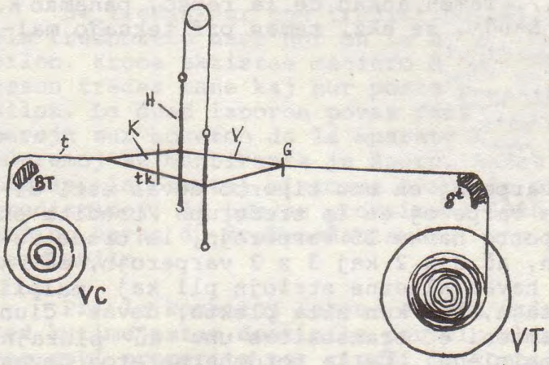
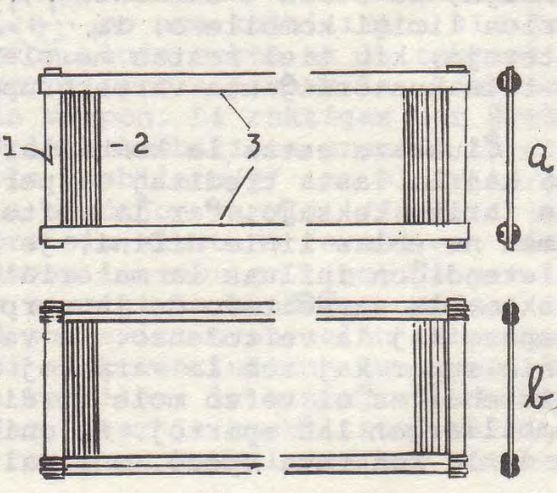

<!-- 
SCIENCA REVUO de
Internacia Scienca
Asocio Esperantista
BEOGRAD,Jugoslavio

El Vol. 23
n-ro 3 (95)
25.6.1972.

LA TEKSOKOMBILO
JM.Bartovska, Frydek-Mistek, Ĉeĥoslovakio;
-->

En la teksindustrio oni prave akcentas la gravecon de la teksokombilo. Krom ĝia teĥnika tasko necesas ne malatenti la influon
de la kombilo kaj de la varperordigo en ĝi je aspekto de la teksaĵo, ĝian influon je akcentigo de diversaj laŭlongaj ornamoj kaj
la influon je la tuta maŝinkapacito.

La teksokombilo similas ordinaran kombilon, konsistante el
vico da kombileroj, sed ĝi estas ambaŭflanke fermita. Inter la kom
bilerojn oni tredas varperojn unuope aŭ plurope, regule aŭ malregule, laŭ tio, kiel ĝin preskribas la estonta aspekto de la teksaĵo.

La teksokombilo tenas la varperojn en la destinita denso, garantias la destinitan larĝon de la teksajo, prezentas la malantaŭan parieton de, la ĵetkanalo, subtenante tiamaniere la trakurantan navedon, alpremas la unuopajn vefterojn al la preta teksaĵo
kaj ebligas diversdensajn striojn laŭlonge de la teksaĵo.

Ĝi estas apud la harneso la plej grava teksmaŝinero. La teksokombilon devas respekti multaj teksindustriaj laborantoj, komencante kiel modeldesegnisto kaj finante kiel teĥnika estro de teksejo.

La desegnisto destinas taŭgan denson de kombilo kaj la tredon; se la kombilo ne povas la desegnon akcenti, do ĝi almenaŭ
ne malakcentu ĝin. Elektante denson, devas la desegnisto atenti
ne nur la denson de la varperoj, sed ankaŭ ilian dikon, ofte ankaŭ ilian ŝirrezistecon kaj (mal)regulecon de ilia diko.

La estro de tredejo respektas destinitan denson de kombilo,
sed ĝiajn dimensiojn li elektas laŭ farota teksaĵo, t.e. li pripensas krom la varpo ankaŭ la dikon kaj denson de la vefto, dimensiojn de la navedoj kaj de la veftobobenoj ktp.

La varpoenmetisto fiksas la kombilon en la teksokadron, atentante ĝian situon koncerne la navedvojon kaj la navedujojn. La kombilon oni devas precize munti en la teksokadron, ĉar eĉ milimetra forkliniĝo de la ebeno inter la malantaŭaj naveduj-parietoj kaŭzas malfacilaĵojn, precipe se ĝi pli proksimas al la preta teksaĵo. En kazo de malĝusta enmunto de la kombilo la navedo devojiĝas kaj disŝiras la varpon, aŭ ĝi gratas la kombilerojn, kiuj poste
frotŝiras la varperojn; katastrofeton kaŭzas navedo, se ĝi, tuŝante tro teksokombilon, perdas rapidecon, ne atingas ĝustatempe
la kontraŭan navedujon kaj detruas la kombilerojn, kiuj alpremis
ĝin al streĉilo. Memkompreneble io simila ne povas okazi en la teksmaŝinoj sennavedaj (ajutaj), tamen ankaŭ tie necesas enmunto preciza.

La teksokombiloj evoluadis simile kiel la aliaj partoj de la
teksmaŝino. Verŝajne la kombilo naskiĝis en tiu tempo, kiam oni
komencis fari teksaĵojn. Oni povas kaj povis teksi sen navedo, sed
teksadon sen teksokombilo oni ne povas imagi. Certe ĝi longe aspektis kvazaŭ ordinara kombilo.

Memkompreneble oni iam fabrikadis la kombilojn mane. La ĉefa materialo por la kombiloj estis kano, kion ankaŭ pruvas la ĉeĥa, pola kaj germana nomoj de kombilero: [třtina]{.maldense}, [trzcinka]{.maldense}, [Rohr]{.maldense}.
Ekzistas ankaŭ kombiloj lignaj aŭ el fiŝostoj aŭ alia materialo.
La kanaj kombileroj ne povis esti maldikaj kaj limigis tiel la
densecon de la kombilo kaj ĝian uzeblon por delikataj, densaj teksaĵoj belaspektaj. La kanaj tekskombiloj estis kutimaj ankoraŭ
meze de la deknaŭa jarcento, sed nun oni povas ilin vidi nur en
muzeoj aŭ teksindustriaj lernejoj. Tamen en malpli progresintaj
landoj oni vendadis ilin dum semajnaj foiroj ankoraŭ antaŭ la dua
mondmilito.

La kanon por la teksokombiloj oni ĥemie preparadis interesmaniere: En la veturiloj, kiuj transportadis salon tra la tuta Mezeŭropo, sub la salo kuŝis kano, kiu post certa tempo tiamaniere
gajnis bonajn ecojn por iĝi materialo por teksmaŝinaj kombiloj.
Post la ĥemia preparo oni purigis la kanon, tranĉis ĝin je pecoj
tiel longaj, kiel altaj devis esti la kombiloj. La tranĉitan kanon oni fendis per tranĉiloj stelforme fiksitaj al stangeca tenilo. La mombron de la tranĉiloj destinis la dezirata larĝo de la
kombileroj. Tiujn kombilerojn oni poste laŭbezone prirabotis. La
preparitajn kombilerojn oni metadis inter duojn de duoncilindraj
stangetoj (ĉe ambaŭ finoj de la kombileroj), kiujn oni post ĉiu
kombilero ĉirkaŭvolvis per ŝnuro. Diko de la ŝnuro destinis la
denson de la kombileroj. Per specialaj nodoj ĉirkaŭ la kombileroj oni fiksis 1lin tiel bone, ke la kombilo bezonis nenian pluan prilaboron. Tramen pli ofte oni ĉirkaŭvolvis la stangetojn simple kaj poste trempis ilin en fanditan peĉon kaj gluis sur ilin
paperstrion.

Nun oni jam uzas nur kombilerojn ŝtalajn: taŭgan cilindran draton oni platigas per cilindroj je ĝusta diko, rektigas ĝin, tranĉas je ĝusta larĝo, forfajlas la akrajn eĝojn kaj poluras ĝin, por
ke la kombileroj ne difektu la varperojn, kiuj pasus dum la teksado inter ili.

Ankaŭ la ŝtalajn kombilerojn oni metadis inter similajn lignajn stangetojn kaj peĉadis la bindaĵon. Tiajn kombilojn oni uzadas ankoraŭ nun, kvankam malofte. Sed la modernaj kombiloj havas
kombilerojn binditajn inter stangetoj ŝtalaj, ĉirkaŭvolvitaj per
dratoj, trempataj en fanditan stanon anstataŭ en peĉon. La bindaĵo de ĉiu rando konsistas el kvar duoncilindraj ŝtalvergoj. Ĉe
iuj kombiloj, precipe la silkindustriaj, anstatŭas la ekstremajn
vergojn ŝtalbendoj, simple alstanitaj, nevolvitaj per drato. Malofte anstataŭas plumbo la stanon en la bindaĵo.

Memkompreneble oni faras nun teksokombilojn per maŝinoj, kiuĵ
la kombilerojn mem tranĉas el proviza drato. Ĉe la ekstremaĵoj de
la kombilo kun ŝtalaj kombileroj oni metas kolonetojn el platfero, kiuj firmigas la alton kaj sur kiuj oni ĉizostampas la denson kaj longon de la teksokombilo.

La ŝtalaj kombileroj permesas fabriki kombilojn por plej diversaj celoj, laŭ kiuj oni elektas iliajn dimensiojn kaj denson.
La plej maldensaj kaj fortikaj kombiloj servas por teksaĵoj drataj, plue por tapiŝoj, la plej subtilaj kaj densaj estas destinitaj por silko kaj la ceteraj filament-materialoj. La denso de
la kombiloj varias inter 10 gis 600 kombileroj en 10 cm. Ilia laboralto inter la bindaĵoj mezuras 4 cm por silko ĝis 22 cm por
pluŝoj, kiujn oni teksas per du navedoj en duetaĝa ĵetkanalo. Iam
oni elektas pli altan kombilon, por ke la kombileroj pli facile
cedu antaŭ neregulaĵoj de la ŝpinaĵo. Por tia celo ekzistas ankaŭ
kombiloj, en kiuj ĉiu dua kombilero situas en dua vico; la duvicaj kombiloj taŭgas precipe por teksaĵoj speciale densaj. La kombileroj estas larĝaj 2½ mm aŭ pli, laŭ la teksaĵo kaj laŭ la
forto, necesa por alpremi novan vefteron al la teksaĵo. La kombiloj por juto havas la kombilerojn 4 mm, por tapisoj 6, 8 eĉ pli
da mm larĝajn.

## Skemo de teksmaŝino

VT - varpotrabo,
gt - glittrabo,
G - varpergardiloj,
V - varpo,
H - harneso,
tk - teksokombilo,
K - ĵetkanalo,
t - teksaĵo,
BT - brustotrabo,
VC - varcilindro, teksaĵcilindro

a. teksokombilo kun bindaĵo peĉa,
    1. koloneto
    2. kombileroj
    3. bindaĵoj
b. teksokombilo kun bindaĵo stana

La denso ne estas ĉiam en la tuta kombilo egala, sed ĝi por
vas esti diversa, por fari striojn. Eblas teksi ankaŭ per kombiloj, en kiuj grupoj da kombileroj estas supre densaj kaj malsupre maldensaj, inter kiuj estas grupoj malaj, supre maldensaj kaj
malsupre densaj. Se tia kombilo moviĝas malrapide supren kaj malsupren, aperas en la teksaĵo ornamaj "kavaĵoj".

Ideala tredo en la tekskombiloj estas po unu fadeno en unu
intero, tamen ĝi estas ebla nur por teksaĵo maldensa kaj varpo
glata; por varpo densa kaj dika ĝi kaŭzas troan frotadon kaj ŝiradon. Tial oni kutime tredas la varpon en malpli densan kombilon po du ĝis kvin varperoj. Tiuokaze necesas elekti tian tredon
kaj kombilon, kiu ne malplivalorigas la teksaĵon, ĉar la kombileroj kaŭzas post ĉiu varpergrupo eskaleton. Ĉi eskaletojn oni parte
forigas per ĝusta munto de la teksmaŝino: la pendolanta glitotrabo devas esti muntita sufiĉe alte kaj la ĵetkanalo devas ekkreiĝi ĝustatempe, t.e. momenton antaŭ ol la kombilo alpremas la vefteron ĵetitan en la pasintan kanalon. Malgraŭ tio oni devas tre
atente elekti la tredon precipe por teksaĵoj kun pli komplikaj
plektoj, ekz. atlaso (sateno), laŭvarpa repso, panamao kaj la ĵakardaj teksaĵoj; aŭ oni per ĝusta tredo la desegno-interspasojn
akcentas (repso, panamao), aŭ la kreadon de la interspasoj konsekvence evitas (sateno k.a.). Tamen ankaŭ ĉe la repso, panamao
k. s. oni devas iam la tredon ŝanĝi, se ekz. temas pri teksaĵo maldensa. La tredon influas do

1. denso de la varpo,
2. diko de la varperoj,
3. plekto.

Ĉiam la nombro de la varperoj en unu riporto devas esti dividebla per la nombro de la varperoj en la tredgrupo (tredita en
unu intero); se ekz. la riporto havas 15 varperojn, la tredo devas havi aŭ 5 × 3 varperojn, aŭ 3 × 2 kaj 3 × 3 varperojn,
aŭ 3 × 5 varperojn. Se la teksaĵo havas alterne striojn pli kaj malpli
densajn, aŭ striojn samdensajn, sed kun alia plekto, devas ĉiun
strion limigi kombilero; iam oni eĉ transsaltas unu aŭ plurajn
interojn, kiu tiel restas malplenaj. Ĉe la tordoharneseroj devas
la tuta kuntordiĝanta varpergrupo trairadi la saman interon.

Ĉiuokaze estas la kombillarĝo, t.e. la distanco inter la unua kaj la lasta treditaj varperoj, pli granda ol la larĝo de la
Ĵus farita teksaĵo, ĉar la vefto ŝrumpas kaj densigas la varpon.
Tamen ne eblas linie difini, je kiom da % la vefto kuntiriĝos. La
maletendiĝon influas la materialo de la vefto, la varpodenso, la
plekto, la streĉiteco de la varpo kaj vefto, parte ankaŭ la varpospeco kaj la veftodenso. La vefteroj en la teksaĵo situas ondlinie super kaj sub la varperoj kaj vefto pli tordita ankaŭ pli
maletendiĝas ol vefto mole tordita. Plej ofte oni preskribas la
kombillarĝon laŭ spertoj. Se oni posedas peceton da kruda teksaĵo de la konkreta speco, oni malteksas el ĝi kelkajn vefterojn kaj,
streĉinte ilin, oni konstatas la necesan diferencon. Sed oni devas atenti ankaŭ la fakton, ke en la mezo de la teksaĵo la vefto
ŝrumpas malpli ol ĉe la randoj, do la procento de la kuntiriĝo
en larĝa teksaĵo samspeca ne estas tiom alta, kiom en la teksaĵo
mallarĝa. Do faronte ekzemple teksaĵojn por kusenoj kaj plumonoj
(90 cm kaj 140 cm) oni povas por la pli larĝa uzi kombilon pli densan.

La varpon oni tredas en la harneson kaj kombilon aŭ samtempe
aŭ sinsekve, mane aŭ maŝine. La varpotrabon kun la ŝliĥtita varpo oni lokigas en speciala stablo super la harneso kaj kombilo aŭ
ekster la stablo. Ĉiuokaze oni la varpon fiksas en premstango por
garantii paralelecon de la varperoj; por tiu celo ankaŭ servas la
paperstrio, gluita sur la varpon antaŭ ol oni prenis la plenan varpotrabon el la ŝliĥtmaŝino.

Dum la mana tredo povas labori samtempe du tredist(in)oj aŭ
unu sola; en la unua maniero unu persono (tiristino) ŝovas taŭge
longan hoketon (tredhoketon), unu-, du- aŭ trioblan (kun unu, du
aŭ tri hoketoj en unu tenilo), tra la varperingoj kaj la dua persono (metistino) ĉe la kontraŭa flanko de la harneso metas sur la
hoketon po unu aŭ pli da varperoj (laŭ la teĥnologia preskribo); poste la tiristino retiras la hoketon kaj la tratiritajn varperojn
ŝi metas en alian hoketon, ragantan el la tekskombilo. Se en ĉi
tiu hoketo (kombiltredilo) estas jam la nombro de la varperoj preskribita por unu kombil-intero, ŝi tratiras ĝin per la maldekstra
mano kaj ŝovas la malplenan kombiltredilon en pluan interon.

Se tredas nur unu tredistino, ŝi tredas la varpon per unuobla tredhoketo unue nur en la harneson kaj poste en la teksokombilon. Krome ekzistas maniero duonmeĥanika, dum kiu oni en la harneson tredas mane kaj nur poste per speciala aparato en la kombilon. La duan laboron povas fari nur unu persono, metante la varperojn sur hoketon de la aparato kaj movante la meĥanismon per piedpremoj aŭ mantirante je ŝnuro. Ankaŭ aŭtomatoj tredmaŝinoj ekzistas, laborantaj minimume kvaroble pli rapide ol bona duo da
tredistinoj; ĝi tredas proksimume 5000 varperojn dum unu horo. La
maŝino havas du ŝraŭbmeĥanismojn, unu por la harneso kaj alian por
la kombilo.

Pri la kombiloj zorgas en ĉiu uzino almenaŭ unu kombilisto,
sed kutime estas destinita por ĉiu ekipo unu kombilisto, kiu devas esti preparita por ripari la kombilojn rekte en la teksmaŝinoj. Por plenumi la laboron, la kombilisto elprenas la kombilon
el la teksokadro kaj malstreĉas la varpon. Li rektigas per ŝraŭbilsimila rektigilo aŭ (kaj) per plata kombilista prenilo la difektitajn kombilerojn. Iam estas la kombilero(j) iom eltirita(j)
el la bindaĵo kaj tiam li devas la bindaĵon varmigi (fandeti la
stanon), por ke la kombilero(j) pro sia elasteco revenu en sian
ĝustan pozicion; ofte oni tamen devas la revenon instigi per la
rektigilo aŭ per la prenilo. Por varmigi la bindaĵon uzadas la
kombilistoj alkohollampeton, sed por eviti eventualan ekbrulon
de la teksaĵo, estas pli utile uzi elektran lutilon kun speciale
formita kupropeco, en kiun oni la kombilon, la bindaĵon de la kombilo, ŝovas. Iam kombilero rompiĝas; tiam la kombilisto, varmiginte ambaŭ bindaĵojn, eltiras la rompitan kombileron kaj enmetas
novan, eventuale, se ĝi rompiĝis precize ĉe la bindaĵo, li allutas ĝin provizore per guto de stano. Jen kaj jen la kombilisto ankaŭ devas glatigi la kombilerojn per kombilista skrapilo, sabloŝtono, pumiko kaj ligno.

Se ne eblas la kombilon perfekte ripari en la teksmaŜino, oni devas la varpon retredi en novan kombilon. Oni fortondas la varpon, eltiras la neripareblan kombilon kaj en la teksomaŝino mem
tredas la varpon en novan kombilon, kion faras la tredistinoj.

Novan varpon oni plej ofte alnodas al la finteksata, tamen
post kelkaj varpoj oni elprenas la harneson kaj la teksokombilon
eĉ se oni teksas la saman teksaĵon plu.

La elprenitajn kombilojn oni pli facile kaj pli bone riparas en la kombilejo, kie oni ilin ankaŭ purigas kaj stokas. Ofte venas el la teksejo kombilo kun disrompita aŭ forrompita koloneto.
Tiam oni anstataŭigas la koloneton per alia, mallongigante eventuale la teksokombilon iomete, nome forprenante kelkajn kombilerojn, se forrompiĝis ankaŭ peceto da bindaĵo.

Purigante la kombilon, oni devas unue forigi el ĝi vaton, poste ĝin ŝmiri per petrolo, por solvi eventualan ruston sur ĝi (kiun oni poste forigas per ŝtala broso) kaj por protekti ĝin kontraŭ plua rustiĝo. Fine oni purigas ĝin per harega broso kaj per
ĉifono.

La provizon da kombiloj oni metas neniam horizontale, ĉar iliaj bindaĵoj malrektiĝus kaj iliaj kombileroj reciproke difektus
sin. Ideale estas, se la kombiloj povas pendi vertikale, ordigitaj laŭ denso kaj eventuale laŭ longo, se oni uzas diversajn. Plej
ofte tamen oni starigas ilin vertikale.

Tro foruzitajn kombilojn oni sendas en pli grandajn kombilejojn, kiuj estas ekipitaj per maŝinoj aŭtomataj. Tiaj grandaj
kombilejoj ankaŭ iam fabrikadas novajn teksokombilojn.
