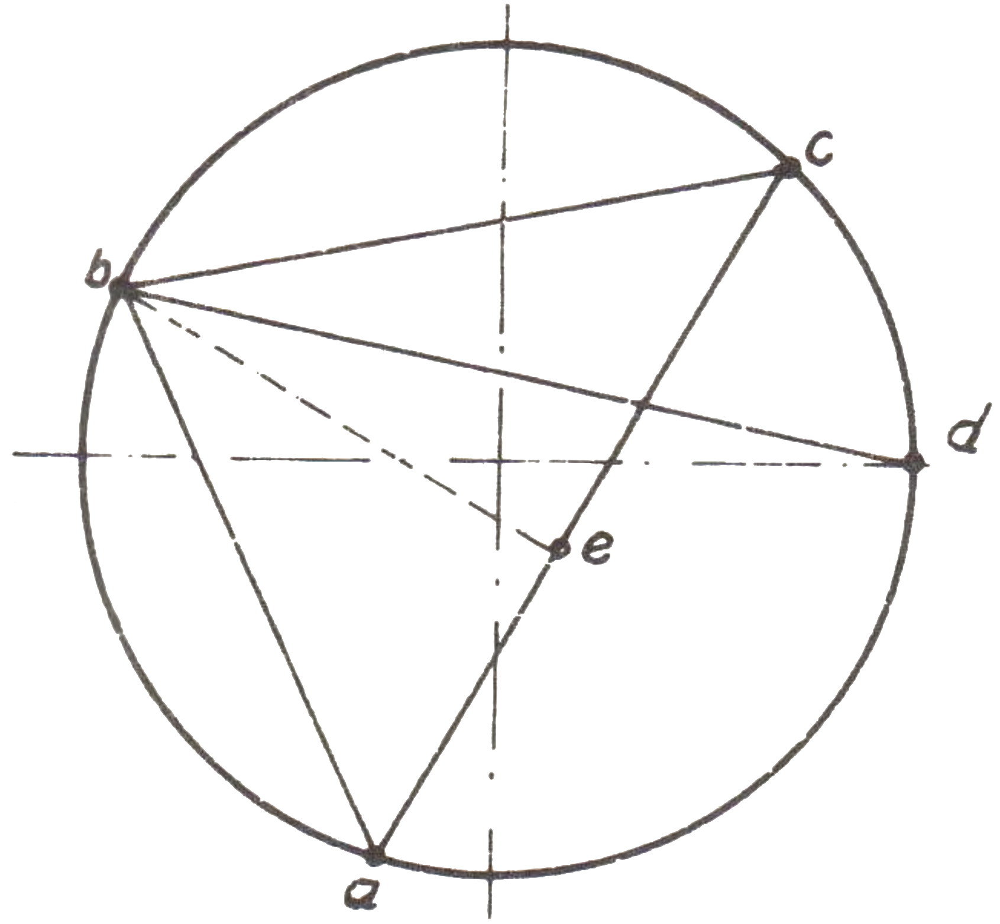
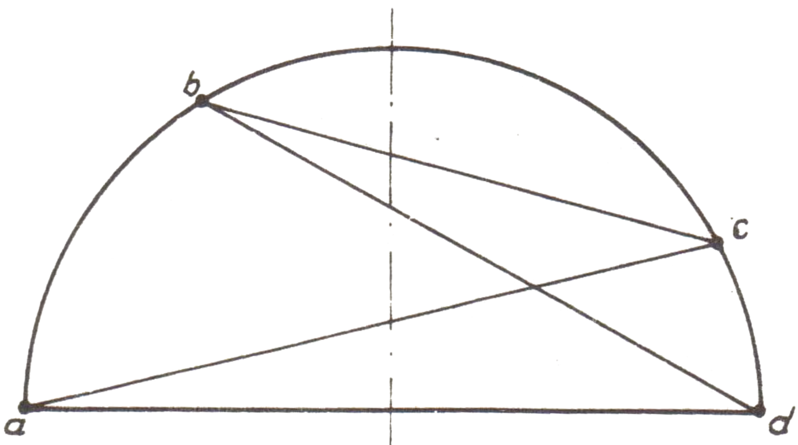

<!--
prenita el:

  Fonto: Scienca Revuo, n-ro Vol. 24, n-ro 5 (103)     
  (St. Gąska, TORUÑ, Pollando)
  STEB: https://www.eventoj.hu/steb/matematiko/koperniko/kopernik.htm

-->

<!--
- listo de simboloj uzeblaj en formuloj: https://www.cmor-faculty.rice.edu/~heinken/latex/symbols.pdf
- unikodo kojnoskribo: https://www.compart.com/en/unicode/block/U+12000
- unikodo egiptaj hieroglifoj: https://www.compart.com/en/unicode/block/U+13000
-->

Laboro de ĉiu astronomo konsistas el du partoj: observado kaj plej
ĝenerale komprenataj kalkuloj. El ĉi tiuj partoj konsistas ankaŭ la
historio de astronomio, kiuj en ĉiu epoko reciproke kompletiĝis. La
unuaj astronomiaj observoj rilatis precipe al pozicioj de astroj. Ĉar
movoj de astroj okazas sur la "sfero", do iliajn poziciojn oni difinas
per la angulaj grandecoj. Tiajn ĉi grandecojn oni ĝuste ricevas pere de
tiaj aŭ aliaj instrumentoj. Por esplori reciprokajn variojn de
astropozicioj, oni devas solvi antaŭ ĉio sferajn triangulojn. Por ricevi
el iuj angulaj grandecoj la aliajn, oni devas havi: unue --- nombrojn
per kiuj estas prezentataj anguloj, nombrajn sistemojn kaj ankaŭ la
operaciojn, kiujn oni rajtas realigi je tiuj nombroj. Tiun ĉi fakon
antikvaj grekoj nomis logistiko kaj ni nomas ĝin aritmetiko. Due ---
rilatojn inter angulaj grandecoj, priskribantaj sferajn triangulojn, do
ebenan kaj sferan geometrion kaj trigonometrion. Du supre menciitaj
fakoj estis al Kopernik tre necesaj. Li mem en la enkonduko al volumo I
de la verko "[De Revolutionibus]{.maldense}\..." skribas:

"Kaj do se dignon de la sciencoj mi pritaksos laŭ ilia objekto, tiam
senkompare plej elstara el ili estas tiu, kiun iuj nomas "astronomio",
aliaj "astrologio", kaj multaj el malnovaj sciencistoj "pinto de
matematiko". Kaj nenio estas miriga, se ĝuste ĉi tiu, estanta la kapo
de liberaj sciencoj kaj la plej inda por noble pensanta homo, apogas sin
sur preskaŭ ĉiuj partoj de matematiko: aritmetiko, geometrio, optiko,
geodezio, mekaniko kaj kiuj ili ankoraŭ povas esti --- ĉiuj konsistigas
ĝin".

Ĉi-loke oni devas atentigi, ke Kopernik kiel astrologio komprenas ne
aŭguradon, kiel ni nun komprenas ĝin, sed simple astronomion. El la
citaĵo ne dusence rezultas, ke astronomion kaj pli ĝuste ĝian
esplorobjekton --- ĉielon --- Kopernik admiris, eĉ raviĝis pri ĝi ("kio
estas pli bela ol ĉielo, kiu ja ĉirkaŭprenas ĉion, kio estas bela" ---
skribis li en alia loko); sed li samtempe konfirmas ke ĝi apogas sin sur
ĉiuj fakoj de matematiko. Li bone komprenis, ke sen kono de matematiko
oni ne povas okupiĝi pri astronomio. Pro tio en ĉi tiu artikolo mi
deziras prezenti Kopernikon kiel matematikiston. Oni skribas pri li,
kiel pri tiu, kiu "haltigis sunon\...", oni atribuas al li ekonomiajn
traktatojn kaj rilate tion nomis lin ekonomiisto. Li ankaŭ estas konata
kiel "militisto", ĉar li defendis la urbon [Olsztyn]{.maldense} antaŭ
Kruckavaliroj. Oni ne forgesas pri lia kuracista agado, ankaŭ oni
montras liajn poeziajn meritojn. Tamen oni forgesas pri tio, ke antaŭ
ĉio li estis matematikisto, kiu apartenis al la tiutempa mondavangardo.
Ŝajnas al mi, ke tio rezultas el nia pola antipatio al matematiko. Ĉe ni
oni povas ne nur ne koni la matematikon, sed eĉ fieri pri tiu ignoremo.
Ne estas troigo, se mi diros, ke se Kopernik ne estus matematikisto, li
ne konstruus sian planedan sistemon. Matematiko, kiu ne agnoskas
aŭtoritatojn, kiel neniu alia fako de scienco, permesis al li ataki
tion, kio estis agnoskata kaj protektata de tiuj aŭtoritatoj kiel
Eklezio.

Por paroli pri matematiko de Nikolao Kopernik, oni devas almenaŭ
mallonge prezenti tion, kio estas farita en la teorio de kalkulado kaj
ankaŭ en geometrio kaj trigonometrio ĝis la tempo de Kopernik. Mi
prezentas tion en la unua ĉapitro.

En la dua ĉapitro mi prezentas la trigonometrion prilaboritan de
Kopernik. Precipan atenton mi turnas al lia prilaboro de sinustabelo,
kiu estis necesa al Kopernik por solvado de trianguloj. La metodojn de
triangulsolvo mi prezentas pro la malmulta loko, pli supraĵe. Ĉe la fino
mi prezentas en maksimuma mallongigo, influon de astronomio je
matematiko post Kopernik.

## Mallonga skizo de matematikhistorio

Pri matematiko ni povas paroli ek de momento, kiam oni demandis unue
"kiom" kaj poste "kial". Tiun momenton oni ne povas precize indiki,
same kiel oni ne povas indiki, kie kaj de kiu tiuj demandoj estis
faritaj. Kun ekonomia evoluo de la primitivaj popoloj sekvis ankaŭ
disvolvo de la komerca interŝanĝo inter ili, kaj tio en plua konsekvenco
kreis bezonon de notado pri kvantoj kaj fikso de iuj simboloj. Tiuj
unuaj simboloj estis ekzemple: entranĉaĵo sur peco de ligno aŭ nodoj
sur ŝnuro. Tia entranĉaĵo prezentis la objekton aŭ unuon de mezuro
sendepende de tio, ĉu estis tio besto, vazo aŭ porcio da greno.

Ekonomi-komercaj bezonoj postulis pli precizajn notilojn kaj nombran
sistemon. Plej verŝajne unuaj skribitaj nombrosignoj estis egiptaj
hieroglifoj. Oni prilaboris ilin jam kelkajn jarmilojn antaŭ nia erao.
Tiu ĉi sistemo baziĝis sur la respektiva grupado de strekoj por la
nombroj ekde unu ĝis 9. Dekojn oni registradis per la konforma grupigo
de la signo [𓎆]{.grande}. Por signi la nombron 100 --- oni uzadis signon [𓍢]{.grande}, kiu
simbolis la mezurilon kaj 1000 --- [𓆼]{.grande}
--- ĝermo de lotuso. 10000 estis rano, ĉar ranoj estis unu el la dek
egiptaj plagoj (kaj tiom granda nombro kiel 10000 jam estas plago).
\[laŭ kio mi trovis por 10000 la simbolo estas fingro: [𓂭]{.grande}, 
sed ja por 100000 ranido [𓆐]{.grande}, red.\]
Nombron 222 en la egipta sistemo ni povas skribi jene:
[𓍢𓍢𓎆𓎆𓏺𓏺]{.grande}

La greka nombrosistemo estas litera. En ĝi la unuaj naŭ literoj de
alfabetoj estis uzataj por signado de la nombroj 1 - 9. La plua naŭo estis
dekoj: 10 - 90 kaj lastaj naŭ literoj estis centoj: 100 - 900. Mil estis
denove unua litero de alfabeto: *α*. Nur pli poste oni komencis
aldonadi komon ĉe litero *α\'*. por distingi 1000 de 1. La
menciita antaŭe nombro 222 en la greka sistemo aspektus jene:
*σλβ* (sigma, lambda, beta).

La roma nombrosistemo estas en iu senco retroira kompare kun la pli frua
babilona sistemo. Ĝi apartenas al miksaj sistemoj; troviĝas en ĝi
simboloj kaj literoj. Novaĵo en tio estas apliko de adicio kaj subtraho,
ekzemple kvar (IV) estas kvin (V) minus unu (I); kaj ses (VI) estas kvin
(V) plus unu (I). Ĝenerale --- el la maldekstra flanko oni subtrahas kaj
el la dekstra oni adicias.

El nia vidpunkto la plej interesa estas babilona sistemo pro tio, ke laŭ
ĝi estas modelita nia decimala sistemo. Prilaborita je tri mil jaroj
antaŭ nia erao, la babilona sistemo signife superas la antaŭe
priparolitajn. Ĉiun nombron oni notas en tiu sistemo nur per du signoj
--- la vertikala kojno $\vee$ ([𒐕]{.grande}) kaj la horizontala $<$ ([𒌋]{.grande}). Ĝia dua eco estas ke ĝi
baziĝas sur la sesdeka sistemo. La nombrojn 1 - 9 oni en tiu sistemo
skribis per konforma grupigo de la vertikalaj kojnoj \($\vee$\). Dek estas
horizontala kojno \($<$\), 59 do estas

$$<<<<<\begin{matrix}\vee&\vee&\vee\\ \vee&\vee&\vee\\ \vee&\vee&\vee\end{matrix}$$

60 estas --- $\vee$ --- denove vertikala kojno (same kiel unuo). Donita en la
antaŭa ekzemplo nombro 222 skribiĝos kiel

$$\vee\vee\vee <<<< \vee\vee$$

(legu: tri sesdekoj kaj kvardek du unuoj). Ni vidas laŭ tiu ĉi ekzemplo,
ke valoro de simbolo dependas de la loko kiun ĝi okupas en iu nombro. Ĉi
tiujn sistemojn oni nomas poziciaj. La plej granda malavantaĝo de la
sistemo estas manko de nulo (tio ankaŭ koncernas la sistemojn antaŭe
priparolitajn). Tiu fakto ofte kaŭzas malfacilaĵojn en relegado de la
malnovaj babilonaj skribaĵoj. Ekzemple nombro $\vee\vee\vee$ povas signifi tri kaj
ankaŭ sesdek du. Enkondukita en pli posta periodo signo ${\Delta \atop \Delta}$
por dividi unuojn de pli alta kategorio de pli malalta (ekzemple tri
estas $\vee\vee\vee$, sesdek du estas $\vee{\Delta \atop \Delta}\vee\vee$,
ĝi forigis la miskomprenon, sed neniam oni uzis tiun signon ĉe la fino
de nombro, por diferencigi 1 ($\vee$), de 60 ($\vee$) aŭ de 3600 ($\vee$).

Kiel ni supre menciis, la bazon de nia decimala sistemo oni serĉas ĝuste
en la babilona "sesdek"-sistemo.

Kreis ĝin tamen ne babilonanoj sed hindoj. Kiam en Eŭropo ĉe la fino de
la V jc. de nia erao, post disfalo de la Roma Imperio, sekvis intelekta
krizo, tiam en Hindujo komenciĝis rapida evoluo de scienco kaj arto.

Precipe forte evoluas matematiko kaj astronomio. Sekvante sesdekan
babilonan sistemon ili prilaboris la decimalan pozician sistemon. Simile
kiel en antaŭa sistemo, ĉi tie ankaŭ valoro de simbolo dependas de la
loko kiun ĝi okupas en iu nombro. Tamen ili faris ion pli. Ili
enkondukis nulon. La preciza dato de tiu ĉi koncepto ne estas konata,
tamen oni supozas ke tio okazis en la V. aŭ VI. jc. de nia erao, ĉar en
tiu tempo vivis kaj laboris la plej elstaraj hindaj matematikistoj,
kiel: [Aryabhata]{.maldense} (naskiĝis ĉirkaŭ la 500 j.) kaj [Brahmagupta]{.maldense} (ĉirkaŭ la
625. jaro), kiuj siajn studojn koncentris antaŭ ĉio je aritmetiko.
Eltrovo de nulo estis verŝajne kunligita kun la astronomiaj laboroj kaj
atingoj de hindoj, ĉar la astronomio postulas grandajn nombrojn. Estas
eraro nomi la unuan decimalan sistemon araba. Araboj estis nur perantoj
en ĝia transporto el Hindujo al Eŭropo. Precizan priskribon de tiu ĉi
sistemo donis la vivanta en la deka jarcento arabo [Al Chvarzimi]{.maldense}. Liaj
laboroj estis en la XII. jc. latinigitaj de la angla filozofo kaj
vojaĝanto [Adelard el Bath]{.maldense}. Tamen plej multe meritis por la adapto de la
hinda sistemo por eŭropanoj Leonardo el Pizo (pli konata kiel
Fibonacci). En la jaro 1202 li verkis libron titolitan "[Liber Abaci]{.maldense}";
en ĝi li komunikis principojn de operacioj kun la decimalaj nombroj kaj
uzmanieron de nulo. Estis do en la XIII. jc. objektivaj kondiĉoj
ebligantaj ekkonon de tiu sistemo. Tamen ekestis alispecaj kaŭzoj kiuj
bremsis tiun procezon ĉar muzulmanoj estis konsiderataj kiel paganoj,
sekve ĉio, kio kun ili ligiĝis estis konsiderata kiel koncepto de
satano. Tio koncernis ankaŭ la decimalan sistemon.

En la jaro 1299 oni eldonis en Florenco malpermeson uzadi la hindajn
nombrojn. En unuaj tradukoj de arabaj skribaĵoj, tabeloj kaj nombroj
restis senŝanĝaj. Kiam oni anoncis supremenciitan interdikton, tabeloj
kaj nombroj estis transskribitaj laŭ la latina sistemo. Pro tio ankoraŭ
en la XVII. jc. latinaj ciferoj estis universale uzataj. Tamen oni povas
supozi, ke inter scienculoj kono de la hindaj ciferoj estis universala
jam en fino de la XV. jc. Estas sufiĉe interesa, ke N. Kopernik en sia
laboro uzadis latinajn ciferojn aŭ priskribis ilin per vortoj. Sed tamen
kalkulojn li faris per la hindaj ciferoj. Oni devas ĉi tie rimarki, ke
principoj de la adicio kaj subtraho en la decimala sistemo estis
prilaboritaj sufiĉe frue. Male, principojn de la multipliko kaj divido
ni havis dank\' al eŭropanoj. Ankoraŭ en la XVI. jc. dividadon oni
traktis kiel grandan arton, ekzemple [Melanchton]{.maldense} havis specialajn
lekciojn pri dividado en la virtemberga universitato. Kiel daton de
enkonduko de la negativaj nombroj oni povas akcepti la jaron 1545., kiam
[G. Cardano]{.maldense} eldonis sian "[Ars Magna]{.maldense}", en kiu li eksplikis principojn de
ilia uzado.

Se temas pri frakcioj, egiptanoj, babilonanoj kaj ankaŭ grekoj konis nur
la fundamentajn frakciojn. Kvankam en la VI. jc. [Brahmagupta]{.maldense} prilaboris
multiplikregulojn por frakcioj, sed tamen, je definitiva prilaboro de
iuj operacioj oni devis atendi ĝis la XVII. jc. Enkonduko de la
decimalaj frakcioj, estas merito de [Simon Stevin]{.maldense} (1548-1620). Oni povas
diri ĝenerale, ke en la tempo de Kopernik la kono de frakcioj estis
limigita ĝis la fundamentaj frakcioj.

---

Je la fino de tiuj konsideroj pri nombroj kaj nombraj sistemoj ni
kunmetas en tabeloj priparolitajn nombrajn sistemojn kaj ilian
skribmanieron.

Jen la tabelo:

|  hinda | egipta | babilona | greka | roma |
|---:|---|---|---|---|
|  1 | $\shortmid$ | $\vee$      | α |    I |
|  2 | $\shortmid\shortmid$ | $\vee\vee$ |β  |   II |
|  3 | $\shortmid\shortmid\shortmid$ | $\vee\vee\vee$ |γ  | III |
|  4 | $\shortmid\shortmid\atop\shortmid\shortmid$ | ${\vee\vee \atop \vee\vee}$ |δ|     IV|
|  5 | $\shortmid\shortmid\shortmid\atop\shortmid\shortmid$ | ${\vee\vee\vee \atop \vee\vee}$ |ε | V|
|  6 | $\shortmid\shortmid\shortmid\atop\shortmid\shortmid\shortmid$ | ${\vee\vee\vee \atop \vee\vee\vee}$ |ζ|VI|
|  7 | $\shortmid\shortmid\shortmid\shortmid\atop\shortmid\shortmid\shortmid$| $\begin{smallmatrix}\vee&\vee&\vee\\ \vee&\vee&\vee\\ \vee& & \end{smallmatrix}$| η|  VII|
|  8 | $\begin{smallmatrix}\shortmid&\shortmid&\shortmid\\ \shortmid&\shortmid&\shortmid\\ \shortmid&\shortmid& \end{smallmatrix}$ |   $\begin{smallmatrix}\vee&\vee&\vee\\ \vee&\vee&\vee\\ \vee&\vee & \end{smallmatrix}$| θ|     VIII|
|  9 | $\begin{smallmatrix}\shortmid&\shortmid&\shortmid\\ \shortmid&\shortmid&\shortmid\\ \shortmid&\shortmid&\shortmid \end{smallmatrix}$ |   $\begin{smallmatrix}\vee&\vee&\vee\\ \vee&\vee&\vee\\ \vee&\vee&\vee \end{smallmatrix}$| ι|     IX|
|  10 | $\cap$ |$<$|κ|     X|
|  11 | $\cap\shortmid$|$<\vee$|κα|    XI|
|  20 | $\cap\cap$|$<<$|λ|     XX|
|  50 | ${\cap\cap\cap\atop\cap\cap}$|$<<<<<$|χ|   L|
|  60 | ${\cap\cap\cap\atop\cap\cap\cap}$ |$\vee$|ο| LX|
|  100 | [𓍢]{.grande}| $\vee <<<<$ | τ|     C|
|  1000 | [𓆼]{.grande} |$<{\vee\vee\vee\atop\vee\vee\vee}<<<<$|α\'|   M|

La naskiĝjaron de Nikolao Kopernik oni povas skribi jene:

hinde
: 1473

egipte
: $𓆼{𓍢𓍢\atop 𓍢𓍢}{\cap\cap\cap\cap\atop\cap\cap\cap}\shortmid\shortmid\shortmid$

babilone
: $<<{\vee\vee\atop\vee\vee}<<<\vee\vee\vee$

greke
: αλπγ

rome
: MCDLXXIII

## Trigonometrio

Dua, krom la nombro, fundamento de matematiko, precipe grava en niaj
konsideroj, estas geometrio kaj ĝia pli juna frato trigonometrio. Unuajn
sciencajn fundamentojn de geometrio donis grekoj irante de la demando
"kiel" ĝis la demando "kial". Ja egiptanoj, same kiel babilonanoj,
ne starigis la duan demandon, sed donadis nur receptojn kiel solvi tiujn
aŭ aliajn taskojn. Kiel patro de la greka matematiko oni opinias Taleson
el [Milet]{.maldense} (640 - 546. jaro a.n.e.). Li estas ne nur la aŭtoro de kelkaj
teoremoj, sed ankaŭ de iliaj pruvoj. Dank\' la disĉiplojn de Pitagoro
fronte kun li mem, la greka matematiko elfluis al larĝa akvo. Al Platona
Akademio, sur kies pordo estis la surskribo: "Ne eniru tiu kiu ne konas
geometrion", dank\'al la laboro de analitika metodo por pruvoj de
geometriaj teoremoj kaj ankaŭ kvalifikon de tiuj ideoj kiel: punkto,
rekto, ebeno kiel originaj ideoj. Pro malfacilaĵoj kiujn renkontis la
greka matematiko, post malkovro de neracionalaj nombroj (precipe $\sqrt{2}$
disĉiploj de Plato diferencigis sciencon pri nombroj de la kalkulado kaj
de geometrio de mezurado.

Ili mem okupiĝis antaŭ ĉio pri la nombroscienco kaj pri geometrio. Tipa
metodo por tiu periodo estis prezentado de ekz. volumeno de unu figuro
per volumeno de aliaj, sen informo pri la kalkulmetodo. Ekzemple
[Endoksos]{.maldense} el [Knidos]{.maldense} (408 - 355 j.a.n.e.) pruvis, ke volumeno de konuso
egalas trionon da cilindro kun la samaj bazo kaj alteco, sed li ne
montris kiel ilin kalkuli.

En la jaroj ĉirkaŭ 365 - 300 a.n.e. vivis kaj laboris unu el la plej
grandaj matematikistoj de ĉiuj tempoj --- Eŭklido. Lia verko titolita
"Elementoj" estis la plej ofte eldonata libro en la mondo. Ĝi akiris
ĉirkaŭ mil eldonojn. Pro ĝia escepta signifo kaj pro tio ke el ĝi lernis
Kopernik, necesas almenaŭ nelonge priparoli ĝian enhavon. "Elementoj"
konsistas el dek tri volumoj. La unuaj kvar volumoj rilatas al ebena
geometrio. Ili entenas fundamentajn problemojn koncernantaj liniojn,
angulojn kun ilia kongrueco de areoj, divido de abscido, cirklo kaj
regulaj poligonoj. En la V-a volumo estas teorio de [Endoksos]{.maldense} pri
nekunmezurebloj en ĝia geometria formo. La VI. volumo estas adapto de
tiu teorio al trianguloj. La volumoj VII kaj VIII prezentas la teorion
de nombroj, ekzemple divideblecon de entjeroj. Nenion oni diras pri
kalkulmetodoj. En la volumo IX li skribis pri dismeto je la primaj
faktoroj. La teorion de kvadrataj neracionalaĵoj li donis en la volumo
X. En la volumoj XI, XII, XIII li prezentis atingojn de la sfera
geometrio, ekzemple ecojn de sferanguloj, volumenojn de paralelepipedoj,
prismoj kaj piramidoj.

Kiel el la supra trarigardo sekvas, la enhavo de "Elementoj" estas tre
larĝa. Tamen vane ni serĉus en ili indikojn rilatantajn al apliko de
enhavantaj en ili rezultoj. Mankas eĉ tiel fundamenta grandeco kiel
rilato inter cirkonferenco kaj diametro de zono; t.e. la nombro π. Ankaŭ
mankas iu ajn indiko pri difinado de volumenoj, kvankam tre multe li
skribas pri rilatoj de iliaj volumenoj. Malgraŭ tiuj mankoj,
"Elementoj" estis libro, kiu plej multe influis multajn generaciojn de
matematikistoj. Ankoraŭ hodiaŭ plimulto de geometrio kiun ni lernas en
la elementa lernejo, baziĝas je unuaj sep volumoj de "Elementoj".
Necesas ĉi tie substreki, ke klopodoj, kiujn havis grekaj matematikistoj
kun neracionalaj nombroj, respeguliĝas reduktitaj je geometria formo.
Ekz. esprimo $\sqrt{A}$ ne estas radikalo de nombro $A$, sed estas traktata kiel
latero de kvadrato kun areo $A$. Aritmetiko de Eŭklido okupiĝis pri
entjeroj kaj pri rilatoj inter ili.

Pri Eŭklido oni diras, ke li estis dirinta al la reĝo Ptolomeo I, ke por
geometrio ne ekzistas reĝa vojo, kiam tiu demandis lin ĉu ne estas alia
vojo al ekkono de geometrio, ol tiu kiu estas en "Elementoj".

La sekvonta granda matematikisto kaj ankaŭ fizikisto --- estis
Arĥimedo (278 - 212 j. a.n.e.). Li estis iusence kontraŭeco de Eŭklido.
En siaj esploroj li ne limigis sin al t.n. pura scienco, sed li metis
pli grandan akcenton je praktika flanko. Aproksimante cirkonferencon per
regulaj naŭdekseslateroj, enskribitaj kaj ĉirkaŭskribitaj je ĝi, li
konstatis ke rilato inter cirkonferenco kaj la
diametro troviĝas inter $3\frac{1}{10}$ kaj $3\frac{1}{7}$. Dank\' al li, ni konas
formulon por la areo de sfero kiel kvarobla areo de ĝia granda cirklo,
same ankaŭ formulon por la volumeno de globo. Li ankaŭ finfaris
formulojn por la areo kaj volumeno de cilindro kaj de sferoĉapo. La
supremenciita estas nur parto de liaj atingoj. Kiam roma armeo konkeris
urbon Sirakuzo, li pereis trapikita per glavo, petante soldaton ke li ne
neniigu geometriajn figurojn kiujn en tiu momento li studis.

Tiamaniere mi atingis la trian kaj samtempe lastan matematikiston de
t.n. helena epoko. Tiu estis Apolonio el [Perga]{.maldense} (260 - 160 j.a.n.e.).
Simile kiel Eŭklido, li okupiĝis pri la pura scienco. Li enkondukis
elipson, parabolon kaj hiperbolon kiel ebenajn sekcojn de la konuso.
Nomoj de tiuj kurboj, donitaj de Apolonio, estas kunligitaj kun ecoj de
iliaj areoj. Parabolo signifas transformon, elipso transformon kun
malsuperfluo kaj hiperbolo transformon kun superfluo.

En ombro de tiuj granduloj vivis kaj laboris aliaj matematikistoj kiuj
eble malpli okupiĝis pri la pura matematiko, tamen iliaj meritoj en la
praktikaj aplikoj estis grandegaj. Ekz. Eratosteno --- prekursoro de la
matematika geografio. Lia merito estas unua kalkulo de la terradiuso. Li
ankaŭ donis metodon por registro de ĉiuj primoj, la t.n. kribrilo de
Eratosteno.

En tiu momento ni atingas tre interesan fenomenon. Dum ĉe la fino de II.
jc. a.n.e. sekvas malapogeo de la greka matematiko, komenciĝas disvolviĝo
de astronomio. Iom pli frue, ĉirkaŭ la 280 j. a.n.e., [Arystarhos]{.maldense} el
[Samos]{.maldense} prezentas sian suncentran teorion pri konstruo de planedsistemo.
En la jaroj 190 - 125 a.n.e. vivas Hiparho el Niceo, konsiderata kiel
kreinto de fundamentoj de astronomio. Liaj verkoj formas pli grandan
parton de prilaborita post tri jarcentoj fundamenta verko de tiutempa
astronomio "[Almagest]{.maldense}" de Ptolomeo. Al li ni dankas enkondukon de ideoj
pri geografiaj latitudo kaj longitudo kaj de astronomiaj metodoj por
ilia kalkulado. Ŝajnas, ke li enkondukis en astronomion ankaŭ
ekscentrajn cirklojn kaj epiciklojn por klarigi observatajn moviĝojn de
astroj. Verŝajne li kreis ankaŭ fundamentojn de trigonometrio.

La regreso de la greka matematiko troviĝis en ĝia esenco. Unuflanke
manko de kontentiga teorio pri nemezureblaj grandecoj kaŭzis interrompon
inter la aritmetiko kaj geometrio. Laŭ alia flanko, primitiva nombra
sistemo malebligadis evoluon de aliaj fakoj de matematiko, ekz. algebro.
Ĝuste tial sekvis ĝia disigo de la praktiko, kaj tio kaŭzis ke malaperis
socia bezono je ĝiaj rezultoj. Apartenas al tiu grupo: Nikomaho el
[Gerasa]{.maldense} (ĉirkaŭ la 1000-a jaro de nia erao), lia samaĝulo Menelao kaj la
plej granda geometriisto de tiu tempo Herono (la unua jarcento de nia
erao).

Oni povas diri ke ili okupiĝis pri tio kio ne estis en la "Elementoj"
de Eŭklido.

En la II-a jarcento de nia erao vivis kaj verkis Ptolomeo, kreinto de la
geocentra sistemo de la mondo. En verko konata sub la araba titolo:
"[Almagest]{.maldense}", li kolektis kaj prezentis ne nur astronomiajn atingaĵojn
de liaj samlandanoj, sed ankaŭ la necesajn sciojn pri matematiko,
precipe pri linia geometrio kaj trigonometrio. Por faciligi kalkulon pri
pozicioj de astroj, li faris tabelojn, kiujn ni hodiaŭ nomus:
sinustabeloj, por anguloj ekde 0° ĝis 180°.

Oni devas substreki, ke "[Almagest]{.maldense}" dum preskaŭ 1400 jaroj, t.e. ĝis la
tempo de Kopernik, estis "biblio de astronomio". Ptolomeon oni devas
konsideri kiel matematikistan-praktikulon. Lia matematiko, prezentita en
"[Almagest]{.maldense}", estis fakte kolekto de reguloj por solvado de
ekzemplotaskoj, kaj ne teoremoj kun pruvoj.

Ĉar romanoj nenion kontribuis al matematiko, Kopernik disponis antaŭ ĉio
tion, kio estis en "Elementoj" de Eŭklido kaj "[Almagest]{.maldense}" de Ptolomeo
kaj li nur ilin mencias.

## "De lateribus et angulis"

En la jaro 1542, do unu jaron antaŭ apero de la granda verko de Nikolao
Kopernik, dank\' al penoj de la juna matematikisto [J. Rheticus]{.maldense}
(1514 - 1576) estis presita negranda libreto titolita "[De lateribus et
angulis]{.maldense}", kies aŭtoro estis ankaŭ N. Kopernik. Kiel kuriozaĵon oni
povas ĉi tie komuniki, ke [Rheticus]{.maldense} alvenis al [Frombork]{.maldense} februare en la
jaro 1542. Sed en la vatikana biblioteko troviĝas ekzemplero de la
libreto kun dediĉo de [Rheticus]{.maldense}, devenanta de julio de la sama jaro.

Tiu ĉi malgranda, nerimarkebla libreto estas la dua eŭropa lernolibro de
trigonometrio. La unua estis trigonometrio de [Regiomontan]{.maldense} (1436 - 1476),
kiu aperis en la j. 1533. La tempa anticipo estas kaŭzo ke kelkaj
aŭtoroj, skribantaj pri Kopernik, sugestas, ke li skribante sian
trigonometrion baziĝis je trigonometrio de [Regiomontan]{.maldense}. Profesoro [B. Birkenmajer]{.maldense}, 
en sia granda monografio, rilatanta vivon kaj agadon de N.
Kopernik, refutas tiujn sugestojn per kvar pruvoj:

1.  Kopernik povis konatiĝi kun la trigonometrio de [Regiomontan]{.maldense} nur post
    la j. 1533, ĉar ĝis tiu ĉi tempo ĝi estis en formo de manuskripto en
    la posedo de [J. Shoner]{.maldense} kaj eĉ ne unu kopion el ĝi oni faris. En la
    biblioteko de N. Kopernik troviĝas ekzemplero de tiu ĉi
    trigonometrio, sed ĝin donacis al Kopernik [Rheticus]{.maldense}, kiam li alvenis
    al [Frombork]{.maldense} en la j. 1539. De tio oni konkludas, ke nur tiam li
    povis ĝin ekkoni.
2.  Kopernik ekkonis ĝisfunde trigonometrion studante en Krakovo kaj
    aŭskultante modernajn lekciojn.
3.  La fonto de la kopernika trigonometrio estis ekstrakto el la verko
    "[Almagest]{.maldense}" de Ptolomeo. La ekstrakton preparis pli frue [Pauerbach]{.maldense}
    (volumoj I - VI) kaj [Regiomontan]{.maldense} (volumoj VII - XIII) kaj nomis ĝin
    "[Epitomat]{.maldense}". Ĝi estis publikigita en la j. 1496 kaj estis en la
    posedo de Kopernik ek de la 1497 j. Oni devas mencii, ke
    "[Almagest]{.maldense}" mem en la dekdujarcenta traduko de Kremonano estis
    publikigita en la j. 1515. La trigonometrio de Kopernik diferencas
    de la trigonometrio prezentita en "[Almagest]{.maldense}" kaj "[Epitomat]{.maldense}"
    antaŭ ĉio per tio, ke anstataŭ tendenojn ĝi uzas la nocion de
    sinuso, ne uzante tiun ĉi vorton sed aplikante la priskriban
    manieron "duono da tendeno la duobligita arko" ([dimidium
    subtendentis duplae circumferenciae]{.maldense}).
4.  La trigonometrio de Kopernik, kiu estis nur ilo en lia laboro, devis
    ekesti antaŭ la j. 1512, ĉar en tiu ĉi tempo la heliocentra sistemo,
    en ĝenerala skizo, jam estis konstruita. Konsiderante la fakton, ke
    Kopernik kalkuladis la tabelojn de sinuso, la tempon de ekesto de
    la trigonometrio oni devas deloki ankoraŭ kelkajn jarojn malantaŭen.

Post tiuj ĉi enkondukaj konsideroj ni okupiĝu pri la trigonometrio mem.
Kiel ni supre menciis, ĝi estis publikigita unuafoje en la formo de
aparta libreto. En "[De revolutionibus orbium caelestium]{.maldense}" ĝi okupas
ĉapitrojn XI, XII, XIV de la I-a volumo. Prilaborante ĉi tiun referaĵon
ni baziĝis precipe je la traduko "[De revolutionibus]{.maldense}..." de profesoro
[J. Baranowski]{.maldense} (1854). De tiu ĉi traduko ni ĉerpis citaĵojn. En enkonduko
al la ĉapitro XI Kopernik skribas: "Argumentoj, kiujn preskaŭ en la
tuta verko ni uzos, reduktiĝas al rektoj, arkoj kaj ankaŭ al la ebenaj
kaj sferaj trianguloj, kiuj sufiĉe multaj jam estas en "Elementoj" de
Eŭklido, tio tamen ne ampleksas tion, kion ĉi tie ni pleje deziras,
nome: kiamaniere oni povas atingi el anguloj laterojn kaj el lateroj
angulojn" kaj plue, jam en la ĉapitro XII-a: "Pro tiuj kaŭzoj ne estos
malbone, se pri tiuj ĉi linioj ni parolos, same pri lateroj kaj anguloj
de la ebenaj kaj sferaj trianguloj, kiujn Ptolomeo kelkloke prezentis en
ekzemploj, por jam ĉiloke faciligi kaj komprenigi prezentotajn
pruvojn". Cirkonferencon, laŭ la ĝenerala kutimo de matematikistoj, ni
dividas je 360 gradoj. Antikvuloj konvenciis diametron divideblan je 120
partoj. Sed poste, evitante enkondukon de frakcioj en multiplikadon kaj
dividadon de nombroj rilatantaj al linioj, kiuj kutime estas
nekunmezureblaj, ili pli ofte prenis kiel diametron la kvadraton de tiu
ĉi nombro iuj 120 000 partojn kaj aliaj 200 000, aliaj akceptis
alimaniere determinitan diametron ek de tiu tempo, kiam en uzadon estis
enkondukitaj la hindaj signoj de nombroj, kiuj, pro preciza mallongigo
en operacioj, superas ĉiujn aliajn ĉu la grekajn, ĉu la latinajn, kaj en
ĉiuspeca kalkulo plej bone taŭgas. Ni ankaŭ, pro tiu ĉi kaŭzo, akceptis
por la diametro 200 000 egalajn partojn, kiel sufiĉaj por eviti
videblajn erarojn".

En tiu ĉi, eble iom tro longa, citaĵo ni permesis al Kopernik mem
argumenti celon kaj metodon de lia trigonometrio, klarigi kial li
akceptis kiel diametron tian kaj ne alian grandecon kaj pritaksi la
hindan nombrosistemon, ĉar ni opinias, ke li mem faris tion plej bone.

Ĉi tiu ĉapitro enhavas ses teoremojn kaj unu kalkultaskon.
La I-a teoremo diras ke, se estas konata la diametro de cirklo,
eblas kalkuli laterojn:

de triangulo ($a_3$), kvadrato ($a_4$), sesangulo ($a_6$), kvinangulo
($a_5$), kaj de dekangulo ($a_{10}$)

enskribitaj en la cirklon. Ĉi tiun teoremon li uzas post akcepto el
"Elementoj" de Eŭklido, ke la kvadratlatero de triangulo, enskribita
en cirklon, egalas kvadratlateron de sesangulo, multiplikata per tri,
tio estas

$a_3^2 = 3 a_6^2$ kaj simile $a_4^2 = 2a_6^2$

Poste, per konvenaj funkcioj inter jam ricevitaj lateroj de kvinangulo
kaj dekangulo, enskribitaj en cirklon, li prikalkulas iliajn laterojn;
t.e. $a_5$ kaj $a_{10}$. Por $a_6 = 100000$ li ricevas 
$a_3 = 173205, a_4 =
141222, a_5 = 117557, a_{10} = 61803$ kaj $a_{12} = 50000$.

Kiel konsekvencon de tiu ĉi teoremo li montras, ke se estas donita la
tendeno rilatanta al iu arko, tiam oni povas ankaŭ prikalkuli la tendenon de
arko, kiu kune kun la antaŭa egalas duoncirklon. La pruvon li faras per
la teoremo de Pitagoro por ortangulo bazanta sur la diametro. Li
ilustras tion per la ekzemplo de dekangullatero, kiu estas tendeno por
angulo de 36 gradoj kaj prikalkulas tendenon de arko rilatanta al 144
gradoj.

La II-a teoremo (t.n. Ptolomea teoremo): "En la kvarlatero
enskribita en cirklon la du diagonaloj egalas la sumon de ortanguloj el
kontraŭkuŝantaj lateroj".

Pro tio ke Kopernik ofte uzas tiun ĉi teoremon por pruvi la pluajn
asertojn, ni prezentos ĉi tie la pruvon en formulo de Kopernik kaj ankaŭ
en la nuntempa formo: "Estu la kvarlatero $abcd$ enskribita en cirklon;
mi diras, ke kvarangulo el diagonaloj $ac$ kaj $bd$ egalas ortangulojn el
lateroj $ab$ kaj $cd$ kaj ankaŭ $ad$ kaj $bc$.

\
des. 1

Por pruvi tion ni streku la angulon $abe$ egalanta angulon $cbd$; adiciante
al la ambaŭ la angulon $cbd$, la tuta angulo $abd$ egalos tutan angulon $ebc$.
La anguloj $acb$ kaj $bda$, kiel apogitaj sur la sama segmento de la cirklo,
estas reciproke egalaj; do ankaŭ la ceteraj anguloj --- tio estas $bec$
kaj $bad$ --- ankaŭ reciproke egalas, tial la trianguloj $bce$ kaj $bda$ kiel
egalanguloj havos la proporciajn laterojn, do $bc$ rilatas al latero $bd$
kiel $ec$ al $ad$, tial la ortangulo $bc$ kaj $ad$ egalas rektangulon $ec$ kaj $bd$.
Ĉar ankaŭ du trianguloj $abe$ kaj $cbd$ estas konformaj, tial ke ili havas
la angulojn $abe$ kaj $cbd$ egalaj pro la konstruo kaj anguloj $bac$ kaj $bdc$
ankaŭ estas egalaj kiel apogitaj sur la sama arko, tial la latero $ab$
rilatas la lateron $bd$ kiel $ae$ rilatas $cd$, do rektangulo el $ab$ kaj $cd$
egalas la rektangulon el $bd$ kaj $ae$, ĉar ni montris, ke la rektangulo el
$ad$ kaj $bc$ egalas la rektangulon el $bd$ kaj $ac$, do, post la sumigo, estos:
la rektangulo el $bd$ kaj $ac$ egalas la rektangulojn el adcb kaj abcd; kio
estis necesa por la pruvo".

Tiu ĉi komplika pruvo en moderna formo prezentiĝas jene:

Tezo: $ac\cdot bd = ab\cdot cd$

Pruvo:

$\sphericalangle abe = \sphericalangle cbd$\
$\sphericalangle ebd = \sphericalangle ebd$\
$\sphericalangle abd = \sphericalangle cbd + \sphericalangle ebd$\
$\sphericalangle acd = \sphericalangle bda$\
$\sphericalangle bec = \sphericalangle bad$  de tie:
$\vartriangle bce \sim \vartriangle bda$

$\displaystyle\frac{bc}{bd} = \frac{ce}{ad}$
sed ankaŭ $\vartriangle abe \sim \vartriangle cbd$, de tie:

$\displaystyle\frac{ab}{bd} = \frac{ae}{cd}$; de tio ni ricevos:

$bc\cdot ad = ce\cdot bd$\
$ab\cdot cd = ae\cdot bd$ sumigante la flankojn ni ricevos:\
$bc\cdot ad + ab\cdot cd = bd (ce + ae)$ sed sur la desegno videblas ke:

$ce + ae = ac$ do:\
$ac\cdot bd = bc\cdot ad + ab\cdot cd$ k.e.p.p.

La III-a teoremo "El tio rezultas, ke se en unu duoncirklo estas
difinitaj la tendenoj de du neegalaj arkoj, konata estos ankaŭ la
tendeno de diferenco inter tiuj arkoj".

Do $ad$ estu diametro de cirklo. La teoremo diras: se ni havus difinitajn
$ab$ kaj $ac$ (desegno 2), ni do povas prikalkuli $bc$.

La necesajn por tio nekonatajn $ac$ kaj $bd$, li elkalkulas helpe de la
teoremo de Pitagoro el orttrianguloj $abd$ kaj $acd$. En nia nuntempa
formuligo tiu ĉi teoremo estas formulo de sinusoj por diferenco de du
anguloj.

\
des. 2

Per la teoremo III Kopernik kalkulas de la konataj tendenoj $a_6$ kaj
$a_5$ la tendenon rilatantan al angulo 12-grada kaj rezulte li ricevas
12905. Tiu ĉi valoro estas la sinuso de 6 gradoj multiplikita per
200 000.

Ni kalkulu tiun ĉi valoron laŭ Kopernik --- kaj nuntempaj metodoj. Ĉe
Kopernik: El la rilato ricevita per teoremo de Ptolomeo restas nekonata
$bc$ (desegno 2)

$$bc = - \frac{ac\cdot bd - ab\cdot ce}{ad}$$

Estu $ad = 200000$ kiel diametro de la cirklo
$ab = 100000$ kiel $a_6$, kio rilatas angulon 60°
$ac = 117557$ kiel $a_5$, kio rilatas angulon 72°

Estantajn en la formulo nekonatajn valorojn $bd$ kaj $cd$ li prikalkulas per
la teoremo de Pitagoro el orttrianguloj $abd$ kaj $acd$.

Estos: $(bd)^2=(ad)^2-(ab)^2 = 200000^2-100000^2$ el tio, post
operacioj: $bd = 173222$ kaj simile:
$(cd)^2 = (ad)^2 - (ac)^2 = 200000^2 - 117557^2$ do:
$cd = 161496$

Post substituo de ĉi tiuj valoroj al formulo por $bc$ ni ricevas:

$$bc=\frac{117557\cdot173222-100000-161496}{200000}=20907$$

Dividante ĉi tiun lastan valoron per 200 000 ni ricevos

$\sin 6° = 104 525$

Nuntempe ni kalkuladus laŭ maniero:

$$\sin{\frac{1}{2}(72°-60°)}=\sin{36°}\cos{30°}-\cos{36°}\sin{30°}=\sin{6°}$$

Per logaritmaj tabeloj ni ricevas:

|||
|---:|---:|
|$\lg\sin 36° = 9,75922$ | $\lg\cos 36° = 9,90796$| 
|$\lg\cos 30 = 9,93753$  | $\lg\sin 30° = 9,69897$|
|post sumigo: $9,70675$ | $9,60693$ 
| $\text{nlg}\, 0,50904$ |$0,40451$ |

el tio:

$$\sin 6° = 0,50904 - 0,40451 = 0,10453$$

Ni ricevis la valoron tute egalan al tiu de Kopernik (al la leganto ni
proponas plenumi ĉiujn kalkulojn kaj kompari necesajn por tio tempojn)

La IV-A teoremo: "Havante tendenon de iu ajn arko oni povas
determini la tendenon de la duono de tiu ĉi arko".

En la nuntempa formuligo ĉi tiu teoremo havas formon:

$$\sin\frac{a}{2} = \sqrt{\frac{1-\cos a}{2}}$$

Tiu ĉi teoremo permesas al li prikalkuli tendenojn de 3°,

$\left(1\frac{1}{2}\right)°$ kaj $\left(\frac{3}{4}\right)°$

La V-A teoremo: "Se estos donitaj tendenoj de du arkoj, do estos
ankaŭ donita la tendeno de sumo de tiuj arkoj".

En nia formo tio estas formulo por sinuso de du anguloj.

$$\sin (\alpha+\beta) = \sin\alpha \cos\beta + \cos\alpha \sin\beta$$

La VI-A teoremo --- la lasta teoremo de tiu grupo temas pri tio, ke
la rilato inter longeco de du arkoj pli grandas ol rilato inter iliaj
tendenoj. En la tasko aldonita al tiu ĉi teoremo, Kopernik prezentas
pruvon, ke se la arko malgrandiĝas, la rilato de tendeno al arko
direktiĝas al unuo. La pruvon li faras per nombroj prenante kiel
elirpunkton la tendenojn 5235 kaj 2618 de la anguloj

$3°$, $\left(1\frac{1}{2}\right)°$ kaj poste la arkojn $\left(1\frac{1}{2}\right)°$ kaj $\left(\frac{3}{4}\right)°$

kun la tendenoj 2618 kaj 1309. Do li ricevis, ke por la malgrandaj
anguloj rilato de du anguloj egalas rilaton de iliaj tendenoj. La
[teoremo VI](#t-6), kune kun la tasko, estis por li necesa por prikalkuli
tendenon rilatantan al la arko 1° kiel egalan al sumo de tendenoj
prezentantaj

$\left(\frac{3}{4}\right)°$ kaj $\frac{1}{3}$ 
da tendeno de $\left(\frac{3}{4}\right)°$

kio en la fina efekto donas:

$$1309 +\frac{1}{3} 1309 = 1745$$

Poste, bazante sur la [teoremo IV](#t-4), li prikalkulas la tendenojn
prezentitaj de (1/2)° kaj (1/3)°.

La tuta ĉapitro estas al li necesa por prikalkulo de tendenoj rilatantaj
al iliaj anguloj kaj finiĝas per la tabulo de tiuj tendenoj. La tabulo
estas nenio alia nur tabulo de angulsinusoj. La valorojn prezentitajn en
ĝi sufiĉas dividi per 100 000 por ricevi niajn sinusojn. En la fino de
tiu ĉi ĉapltro ni legas "Tamen mi opinias, ke sufiĉos, ke nur duonoj de
tendenoj apogantaj la arkojn duoble pli grandajn en tabulon ni lokos kaj
per tiu mallongigo fermos en unu kvadranto ĉion, kio al duoncirklo oni
povas etendi; precipe tial, ke pli ofte estas uzataj en pruvado kaj
kalkuloj duonoj de tendenoj ol la tutaj tendenoj".

Se temas pri tabuloj, li prilaboris du versiojn. La tabuloj "_De
lateribus_..." estas prikalkulitaj por la argumento varianta je ĉiu
minuto. Tie li ankaŭ prezentis la tabulojn de sinusoj (mi ankoraŭfoje
substrekas , ke li ne uzis la vorton sinus) por kompletigo de la konataj
anguloj ĝis 90°, ĉar $\sin(90-a) = \cos(a)$, tio signifas, ke li prezentis
ankaŭ la tabulojn de kosinusoj kaj eĉ laŭ la nuntempe uzata sistemo. Sed
en la tabuloj publikigitaj en "[De revolutionibus]{.maldense}\..." en la j.1543.,
la angulo varias po 10 minutoj. En ambaŭ tabuloj li prezentas
diferencojn tiel necesajn ĉe interpolado. Ĉi tie oni devas mencii
tabulojn kalkulitajn de Kopernik kaj skribitajn sur la marĝenojn de
[Regiomontan]{.maldense}-tabuloj. Tio estas verŝajne unuafoje prikalkulitaj tabuloj
de sekansoj (ĉirkaŭ la j. 1520). Ĉi tiuj tabuloj estas kalkulitaj por
eviti klopodan dividadon.

Naskiĝas demando, kial Kopernik mem kalkuladis siajn tabulojn kvankam li
havis la tabulojn de Ptolomeo. La diferencoj inter liaj tabuloj kaj la
tabuloj de Ptolomeo estas tiom grandaj, ke oni ne povas suspekti, ke li
nur trakalkulis la tabulojn de Ptolomeo. La diferencoj estas jenaj: la
tabeloj de Ptolomeo estas prezentitaj en la sesdeka sistemo kaj la
tabeloj de Kopernik en la decimala sistemo. Due --- Ptolomeo prezentas
tutajn tendenojn kaj Kopernik nur iliajn duonojn, trie --- argumento ĉe
Ptolomeo variiĝas po 15 minutoj, kaj ĉe Kopernik po 1 minuto en la
trigonometrio kaj po 10 minutoj en "[De revolutionibus]{.maldense}\..."

La sekvanta ĉapitro de Kopernik-trigonometrio (XVIII, Vol. 1 "_De
rev_\...") estas dediĉita al solvmetodoj de ebenaj trianguloj. En ĝi li
konsideras sep kazojn. Li komencas de la kazo, kiam estas donitaj la
anguloj de triangulo kaj oni devas trovi ĝiajn laterojn. Enskribante
triangulon kun la donitaj anguloj en cirklon kun la radiuso 100 000 li
asertas, ke li havis la konatajn arkojn korespondaj al konataj anguloj,
sed la serĉataj lateroj de la triangulo estas tendenoj de tiuj ĉi arkoj
kaj li trovas ĉi tiujn laterojn en la propre prikalkulita kaj
supremenciita tabelo de tendenoj.

Simile li solvas ceterajn kazojn. Se temas pri orttriangulo, li aplikas
teoremon de Pitagoro. En la lasta kazo li konsideras la triangulon, en
kiu estas konataj lateroj kaj serĉataj anguloj. En tiu kazo li aplikas
sen iuj rezervoj la ĝeneraligitan teoremon de Pitagoro por elkalkuli la
angulojn. Oni devas mencii, ke inter la konsiderataj de Kopernik kazoj
mankas la plej facila, t.e. tiam kiam estas konataj du anguloj kaj unu
latero. Verŝajne li opiniis ke ĝi estas tiel facila, ke ne valoras
okupiĝi pri tio.

La lasta ĉapitro estas la plej ampleksa. Per 15 teoremoj (li ne nomas
ilin teoremoj) li priskribas ecojn kaj rilatojn inter lateroj kaj
anguloj en la sferaj trianguloj. Du unuaj estas ĝuste difinoj rilatantaj
triangulojn. La sferan triangulon li difinis kiel figuron el tri arkoj
de la grandaj cirkloj kaj li postulas, ke arko, kiel latero de la
triangulo, estu pli malgranda ol duoncirklo. Nur la teoremo III donas
iujn ligojn inter lateroj kaj anguloj de triangulo, sed nur de la orta
triangulo. Ni prezentu por ekzemplo la esencon de tiu ĉi teoremo en
formuligo de Kopernik. "En sfertriangulo, havanta ortangulon, la
tendeno de duobligita hipotenuzo tiel rilatas la tendenon de la
duobligita tendeno el katetoj kiel diametro de la sfero rilatas al
tendeno de la duobligita arko prezentanta angulon kontraŭan al la
kateto.

Nun tiu ĉi teoremo aspektus jene:

$\sin{c} \sin{A} = R \sin{a}$     (ni akceptas $R=1$).

Do tio estas la formulo de sinusoj por orta triangulo. Tiun ĉi teoremon
li tre ofte uzas, ĉar ĉiun kazon li reduktas per konvena dispartigo al
orta triangulo. En la aserto IV li diras, ke por solvi ortan triangulon
necesas koni la duan angulon kaj lateron. El liaj konsideroj en la
demonstro de tiu teoremo rezultas, ke prezentitan supre formulon de
sinusoj, kompreneble en la propra formo, li aplikis nur al ortaj
trianguloj.

Priskribo de ĉiuj kazoj, kiujn li konsideris, estus por legantoj tro
longa, do ni opinias ke sufiĉos, se ni diros, ke pluaj teoremoj enhavas
ĉiujn kazojn aperantaj ĉe solvado de sferaj tri anguloj kaj ankaŭ iliaj
kongruoj. Oni devas ĉi tie diri kaj forte substreki, ke Kopernik
enkondukas kaj demonstras rilatojn inter la elementoj de sfera triangulo
per aplikado de konvena rezonado el la ebena trigonometrio. Pro tio la
sistemo de lia trigonometrio estas tia, ke unue li prikalkulas la
tabelojn, kiuj estas al li necesaj por solvado de ebenaj trianguloj, por
poste --- per konvena rezonado --- transiri de ebenaj al sferaj
trianguloj.

La neceso apogiĝi sur la sfera orta triangulo rezultis unue el nescio
pri ceteraj formuloj de la sfera trigonometrio, due --- la formulo de
sinusoj en apliko al ortaj trianguloj estas tre simpla kaj plifaciligas
al li la kalkuladon.

En fino de sia trigonometrio li skribas: "Tiom pri la trianguloj por
nia intenco estis necesa. Se ĉion ni volus, tiu ĉi laboraĵo formigus la
apartan verkon". Kiel sekvas el la citaĵo, matematiko estis por
Kopernik ilo kaj ne celo. Tamen liaj provoj ligitaj kun plifaciligo de
la astronomiaj kalkuloj estis impulso por [J. Neper]{.maldense}, kiu en la j. 1614
eltrovis logaritmojn. La trigonometrion de Kopernik sekvis [J. Rheticus]{.maldense}
kaj ankaŭ [K. Rothman]{.maldense}, kiu en la jaroj 1580-1590 verkis sub influo de
Kopernik la libron "La teorio de trianguloj". Oni povas trovi signojn
de la Kopernika trigonometrio en verkoj de [Viète]{.maldense} kaj [Neper]{.maldense}.

Por la fino oni devas aldiri, ke Kopernik estas la unua, kiu rimarkis
kaj ĝuste valorigis kelkajn ecojn de averaĝo, skribante ke ĝi havas pli
grandan certecon ol unuopa valoro. Tio ĉi okazis 200 jarojn antaŭ la
granda Jakobo [Bernoulli]{.maldense}, por kiu la averaĝo estis fundamento de la tuta
praktika matematiko.

## Finalo: influo de matematiko je astronomio

Kiel ni diris supre, la plifaciligoj enkondukitaj de Kopernik ĉe la
astronomiaj kalkuloj estis impulso por Neper enkonduki logaritmojn.
Ankoraŭi pli frue Rheticus prikalkulis la tabelojn de sinusoj,
tangentoj, sekantoj ĝis dek kvin frakciciferoj. La malfacilaĵoj ligitaj
kun solvado de la sferaj trianguloj inklinigis matematikiston [Viète]{.maldense} al
la preciza prilaboro kaj finfaro de la sfera trigonometrio. Jam oni ne
bezonas dismeti laŭvolan triangulon je ortaj trianguloj, sed solvadi ĝin
senpere.

La mirinda reguleco en la principoj de planedmovado, formulitaj de
[Kepler]{.maldense}, alkondukis [I. Newton]{.maldense} en la j. 1665 - 1666 al malkovro de la
diferenciala kaj integrala kalkuloj por priskribi moviĝon de astroj. La
kaŭzo reganta planedmoviĝon evidentiĝis en la regulo de ĝenerala gravito
kaj de tie jam [Newton]{.maldense} tre mallongan vojon havis al la teorio de
potencialo.

La mekaniko de ĉielo estis do unua scienco, kiu sian principojn notis
per diferencialaj ekvacioj. La sekvojn de tiuj ekvacioj serĉis tiaj
matematikistoj kiel [L. Euler]{.maldense}, [Clairaut]{.maldense}, [J. L. Dalambert]{.maldense}, [J. L. Lagrange]{.maldense}
kaj [P. S. Laplace]{.maldense}, kiujn oni povis nomi kreintoj de la moderna
ĉielmekaniko. Ekz. [Lagrange]{.maldense} solvante ekvaciojn de kometvojoj prilaboris
metodon de variigo de konstantoj por solvado de diferencialaj ekvacioj.

En la XIX jc., kiam okazis, ke diferencialaj ekvacioj de mekaniko ne
havas ĝeneralajn solvojn, oni komencis unuflanke serĉi principajn
solvojn. Ĉi tio alkondukis al la disvolvo de teorio de periodaj solvoj,
kiuj trovis tre larĝan aplikon, ekzemple en radiotekniko. Aliflanke oni
serĉis proksimumajn solvojn, kiuj eniris ĉiujn sciencojn priskribantaj
siajn principojn per la diferencialaj ekvacioj.

