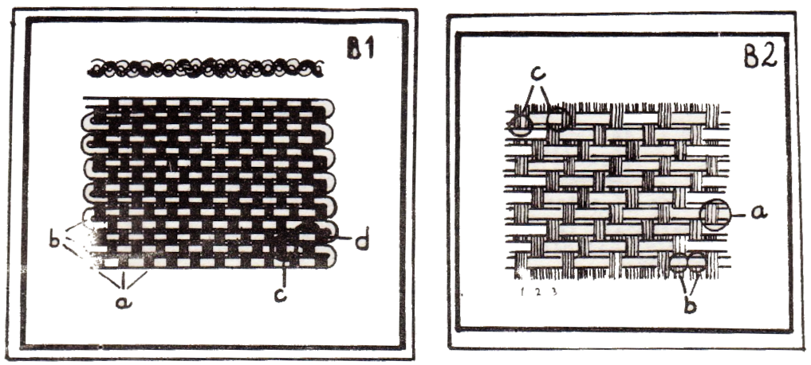
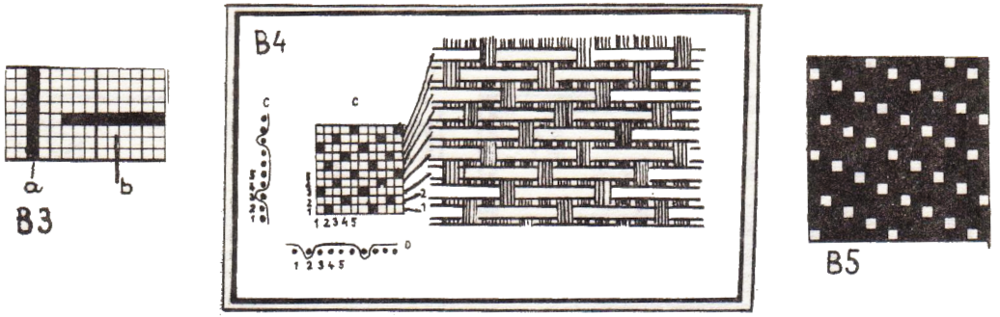
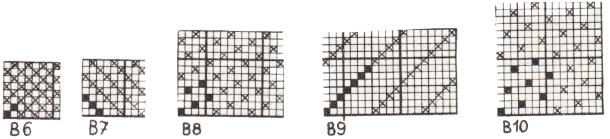

<!--
SCIENCA REVUO de

Intennacia Scienca 
Asocio Espenantista
BEOGRAD, Jugostavio 

LA BAZAJ TEKSAJ PLEKTOJ

(MARIE RARTOVSKA, FRYDEK-MISTEK, ĈEĤOSLOVAKIO)
-->

Se oni rigardas teksaĵon, oni vidas, ke ĝi konsistas el fadenoj
ortangule metitaj kaj diversmaniere interplektitaj. La laŭlongaj fadenoj estas *varpo* (B1a), la laŭlarĝaj estas *vefto* (B1b). La maniero,
laŭ kiu estas la fadenoj interplektitaj, estas la *plekto*.

La plekto konsistas el *plekto-punktoj*. Kie *vanpero* (varpa fadeno) transiras *vefteron* (veftan fadenon), tie estas *varpa plekto-punkto*
(B2a); se veftero estas supre kaj varpero sube, tiam temas pri 
*plekto-punkto vefta* (B2b).

La varpo kaj la vefto kunteniĝas verdire nur tie, kie varpero tre
pasas inter du vefteroj, aŭ kie veftero trapasas inter du varperoj.
Tie estas la veraj *ligpunktoj* (B2c). *Liga plektopunkto* estas tiu, kie
unu varpero transiras unu vefteron kaj tuj denove malaperas sub la najbaran vefteron; tio estas *liga plektopunkto varpa* (B1c]). *Vefta liga
ptektopunkto* (B1d) estas tie, kie unu veftero transiras unu varperon
kaj tuj malaperas sub la najbaran varperon.

Ĉiun plekton oni povas pentri sur *retpapero*, kie la interspacoj
inter la vertikalaj linioj prezentas la unuopajn varperojn (B3a); la interspacoj inter la horizontalaj linioj prezentas vefterojn (B3b). La
plekton oni desegnas tiel, ke sur loko de varpa plektopunkto oni plenigas nigre la koncernan kvadrateton; la kvadratetoj de la veftaj plektopunktoj restas blankaj. La varperojn oni kalkulas de maldekstre dekstren: maldekstre estas la unua varpero, dekstre la lasta. La vefterojn
oni kalkulas de malsupre supren, simile al tio, kiel dum la teksado aldoniĝas la vefteroj: malsupre estas la unua veftero, supre la lasta (B4).

::: {.plenlargha}

:::

Ekzistas amaso da diversaj plektoj, sed ili ĉiuj estas nur derivaĵoj de tri *plektoj bazaj*: *tolo*, *kepro* kaj *sateno*.

1. *Tolo* estas la plej simpla el ĉiuj plektoj. En ĝi alternas po unu
    plektopunktoj varpaj kaj veftaj same laŭlonge, kiel laŭlarĝe.
    Ĝi do konsistas nur el plektopunktoj ligaj kaj el ligpunktoj (B1).
    Tio donas al la tola plekto la avantaĝon, ke tia teksaĵo tre re    zistas frotadon kaj ne ŝiriĝas tiel facile, kiel teksaĵoj kun
    plektoj pli komplikaj. Bedaŭrinde ĝi rezistas ankaŭ lavadon, pre    cipe se ĝi estas densa. Se al tio aldoniĝas malfacila lavableco
    de materialo (ekz. kotono), tiam ĝi prezentas katastrofeton por
    mastrino.

2. *Kepro* estas karakterizata per oblikvaj linioj, ascendantaj dekstren
    aŭ maldekstren. En la baza kepro ĉiu (ekz.) varpero unu vefteron
    transiras kaj minimume du pluajn subiras; Plua varpero sammani    ere transiras duan vefteron, tria la trian ktp., kiel ĝin mon    tras B2. Ekestas do el la vico da varpaj ligaj plektopunktoj - oblikva *linio*. Apud ĝi ekestas duvica linio el veftaj plekto-punktoj. 
    Ĉar la linioj ascendas dekstren, temas pri kepro dekstra,
    ĉar sur la supro oni vidas pli multajn vefterojn, temas pri ke    pro vefta. Sur la suba flanko de la sama teksaĵo oni vidas, kiel
    aspektas maldekstra varpa kepro.

3. *Sateno* diferencas de la baza kepro per tio ke ĝiaj ligaj plektopun    ktoj ne tuŝas sin reciproke (B4). En preta teksaĵo ilin kaŝas la
    liberaj fadenoj kaj la teksaĵo briletas, precipe se ĝi estas te    ksita el filamentoj (silko, rajono k.s.). Ekzistas sateno vefta
    (B4), kie oni vidas nur liberajn vefterojn, kaj sateno varpa - kie
    oni vidas nur liberajn varperojn (B5).

Desegninte sufiĉe grandan pecon de iu plekto, oni rimarkas, ke post
certa nombro da fadenoj (varperoj kaj vefteroj) ripetiĝas la samaj plektopunktoj. En la bazaj plektoj ekestas per tio kvadratoj, kiuj ripetiĝas kvazaŭ transportitaj sur pluan lokon. La kvadratoj estas *riportoj*
(B6, B7, B8, B9, B10).

::: {.plenlargha}

:::

Por krei riporton de la tola plekto, sufiĉas du varperoj kaj du
vefteroj; tolo estas plekto dufadena (B6).

Por krei riporton de kepra plekto, necesas minimume tri varperoj
kaj tri vefteroj; tiel ekestas kepro trifadena. B7 estas trifadena vefta kepro maldekstra. B2 prezentas trifadenan veftan kepron dekstran. B9
montras sepfadenan veftan kepron dekstran. Teorie povas la nombro da
fadenoj en unu riporto de kepro kreski senlime, praktike ĝin limigas la
fakto, ke ekestus tro longaj fadenoj liberaj kaj la teksaĵo estus malfirma.

Por krei riporton satenan oni devas havi almenaŭ kvin varperojn
kaj kvin vefterojn. Ankaŭ en la satena plekto estas la nombro da fadenoj teorie senlima, sed praktike limigita pro la samaj kaŭzoj kiel kepro. B4 prezentas kvinfadenan veftan satenon, B5 sepfadenan varpan satenon, B10 okfadenan veftan satenon.
