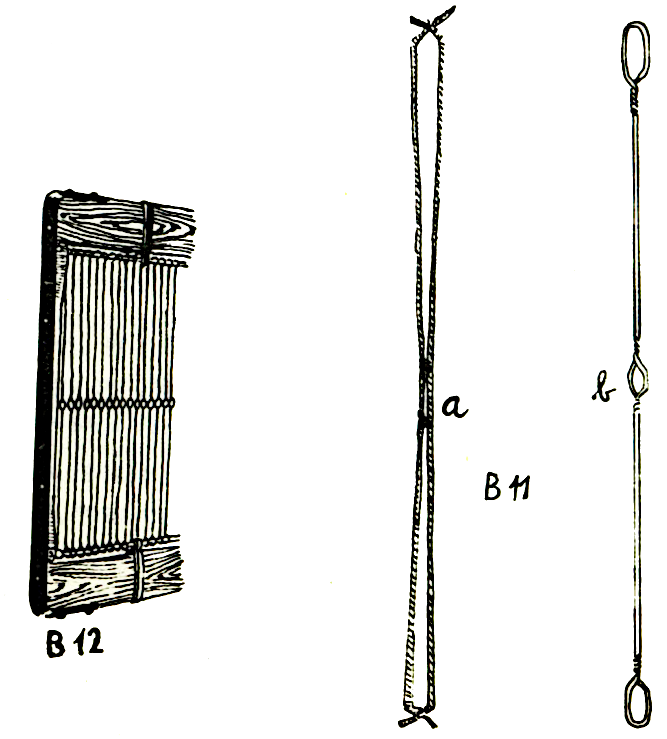
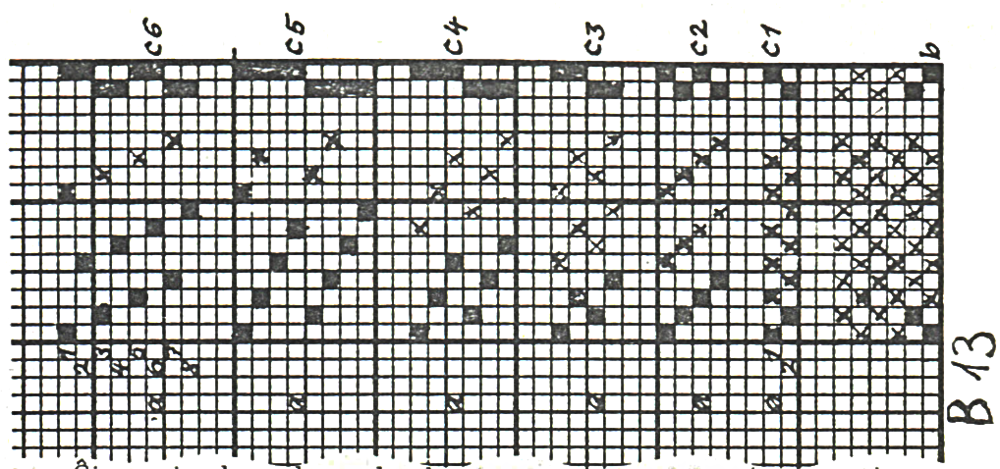
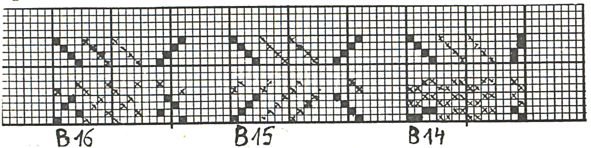

<!--
SCIENCA REVUO de

Intennacia Scienca | Et VOL. 56,
Asocio Espenantista 30.12.1975.
BEOGRAD, Jugostavio „Nt.

TREDO, TRETADO, LIGO
(KIEL EKESTAS TEKSAĴO)

[M.Bantovska, FRYDEK-MISTEK, Ĉeĥostovakio)
-->

Oni ne scias, kiam prahomo komencis plekti baston, kiam li faris la unu-
ajn fadenojn kaj kiam el la plektado evoluis teksado. Nepre daŭris milojn da jaroj, antaŭ ol iu faris kombilsimilan instrumenton kun truetoj ĉe la pintoj de la
kombilaj dentoj, kiu ebligis al li samtempe levi parton de la varpo, por formi
*ĵetkanalon*, en kiun li metis vefteron alpremotan al la preta teksaĵo. Pluan
tempegon daŭris la evoluado de tiu ĉi "kombilo", ĝis ĝi ŝanĝiĝis je *harneso*,
regata per piedoj sur pedaloj. Fine en la 18a - 19a jarcentoj, post kiam oni
inventis vapormaŝinon kaj poste la elektromotoron, ekanstataŭis la piedojn ekscentrikoj. La evoluado daŭras, sed harneso evidente malaperos nur tiam, kiam
malaperos la teksado.

Kio estas harneso? Kerno de la harneso estas la *varperingoj*, kiuj
ĉirkaŭas la unuopajn varperojn, ebligante ilin levadi kaj mallevadi. La varperingojn tenas ŝnuroj aŭ dratoj, formantaj kun ili *harneserojn*. La varperingoj povas esti noditaj rekte el la harnesa ŝnuro (fadeno, B 11 a); ili povas
esti torditaj el la harnesa drato (B 11 b); la varperingon povas prezenti trueto en plata ŝtala harnesero; ili povas esti ŝtalaj ringetoj, lutitaj inter du dratekstremoj; la ŝtalaj ringetoj povas ankaŭ esti alligitaj per fadenoj; ankaŭ vitraj
ringetoj per fadenoj alligitaj prezentas harneserojn, kaj pluraj aliaj.

Ekzistas du specoj de harnesoj: *harnesoj foliaj* por malpli komplikaj plektoj kaj *harnesoj ĵakardaj* por teksaĵoj komplike plektitaj (florumitaj).

Harnesa folio (B 12) ekestas per tio, ke oni la harneserojn por sammpe levotaj varperoj fiksas en unu kadron. Harneso devas havi minimume du
foliojn (por ne tre delikata kaj ne tre densa tolo).

Deksesfolia harneso jam estas iom malavantaĝa kaj oni tial anstataŭigas
ĝin per harneso ĵakarda, kies unuopaj harneseroj pogrupete pendas sub la ĵakarda maŝino, lokita super la teksmaŝino; la harneserojn tenas en rekta vertikala pozicio dikdrataj peziletoj malsupre: por unu harnesero unu pezileto.

Ĉiu harneso havas tiom da harneseroj, kiom da varperoj havas la teksaĵo, kutime kelkajn milojn. Oni ekzemple kalkulu nur la ege maldensan teksaĵon,
kiu havas nur 10 varperoj en unu centimetro kaj estas 70 cm larĝa: 700 varperoj, 700 harneseroj. Kaj ĉiun varperon oni devas unuope *tredi*, kio ankoraŭ
ofte okazas mane, ĉar nur sufiĉe komplikaj aparatoj kapablas iom anstataŭi la
atentajn okulojn kaj manojn de tredistinoj. Pri la tredado legu en Scienca revuo, Vol. 23, 1972, n-ro 3(95), en la artikolo "La teksokombilo". Tie vi ankaŭ vidas la sĥemon de teksmaŝino kun dufolia harneso.

Tamen por fari kanalon por la ĵetota vefto mankas sur la bildo ankoraŭ
la pedaloj, kiujn oni *tretas* laŭ preskribita sinsekvo. La pedaloj en tia teksmaŝino estis longaj levumiloj unubrakaj, fiksitaj sur pivotoj sub la varpo (laŭ
la bildo dekstre) aŭ malantaŭ la teksanto (laŭ la bildo maldekstre). Memkompreneble la pedaloj devas esti ligitaj al la harnesfolioj kaj ankaŭ la ligon oni
preskribas. En tia simpla teksmaŝino la tretita pedalo mallevas la alligitan harnesfolion. En iuj teksmaŝinoj estas la folioj alligitaj al levumiloj, per kiuj oni
la koncernan folion levas, tretinte la koncernan pedalon. Por pli multaj folioj
kaj pli komplikaj plektoj oni uzas *folimaŝinon*, lokigitan super la teksmaŝino, kiun oni funkciigas per nur unu pedalo. Ankaŭ ĵakardon oni funkciigas per
unu pedalo.

La tredon, tretadon kaj ligon oni desegnas sur retpapero: La tredon super la plekto (B 13 a), la tretadon dekstre de la plekto (B 13 b), la ligon en
la dekstra supra angulo (B 13 c).

Por la tredo signifas la interspaco inter du horizontalaj linioj unu harnesofolion kaj oni kalkulas ilin de supre, kvazaŭ oni la harneson rigardus de
supre, ĉar la unua folio en la maŝino estas tiu pli proksima al la varpoprovizo,
al la varpotrabo, la lasta proksimas la teksokombilon. Sur la retpapero oni plenigas tiujn kvadratetojn, kie oni la varperon per la koncerna folio levadu. Laŭ
la uzita tolplekto de maldensa teksaĵo oni do tredas ĉiujn malparajn varperojn
en la varperingojn de la unua folio kaj la parajn inter ĝiajn harneserojn; en la
dua folio pasas tra la varperingoj la paraj verperoj kaj la malparaj inter la harneseroj.

Dekstre de la plekto estas pedaloj kiel interspacoj inter du vertikalaj
linioj. Oni plenigas por la koncerna veftero kvadrateton sur tiu pedalo, kiun oni
en la teksmaŝino tretu. Kutime oni komencas per la dekstra pedalo kaj daŭrigas
laŭ la vefteroj de malsupre supren.

Kie la linio de la unue tretota pedalo trafas la linion de la unue
*levota* harnesfolio, tie oni plenigas la kvadrateton de la retpapero. Same la trafpunkton de la dua pedalo kaj dua folio. Tiel ekestas la *riporto de la ligo*. Ĝi en nia ekzemplo egalas la riporton de la plekto (B 13 c 1). La
*riporto de la tredo* egalas en ĝi la *riporton de la tretado* kaj ili
estas kontraŭaj al la unuaj du riportoj (B 13 a,b 1).

Per pedaloj aŭ tretataj piede aŭ premataj per ekscentrikoj estas tirata
malsupren tiu folio, kiu estas al pedalo ligita. Tial oni devas simplan ligon fari laŭ la blankaj kvadratetoj de la liga riporto. Se oni ligas laŭ la desegno la
foliojn al la levumiloj de la folimaŝino aŭ de alia levanta aranĝaĵo de la teksmaŝino, oni obeas la nigrajn kvadratetojn.

Pli densaj teksaĵoj tolplektaj bezonas pli multajn foliojn, por ke la varpo
ne suferu pro la frotado inter tro densajn harneseroj. Tial oni kotonan tolon
teksas kutime per kvar folioj, densan silkon (tafton) per ses- eĉ ok-folia harneso. Tamen pedaloj por pieda tretado povas resti du; la aferon aranĝas la ligo. Sur la desegnaĵo B 13 vi vidas ses diversajn tredojn kaj ligojn; ne ŝanĝiĝas plekto kaj tretado. La unuaj tredo kaj ligo estas por du folioj, kiel ni jam
menciis, la duaj kaj triaj por kvar folioj, la kvaraj por ses folioj, la kvinaj
kaj sesaj por okfolia harneso.

La plej simpla kaj facila estas la *glata tredo*, laŭ kiu oni tredas la
sinsekvajn varperojn en la sinsekvajn foliojn; ĝin montras B 13-1 kaj B 13-2
Sed la plej ofta por tolo estas la *tredo dismeta*, kiun vi vidas sur la B
13-3, 4, 5, 6. La kaŭzon oni komprenas, se oni rigardas la ligojn. Por glata
tredo oni devas kunligi la foliojn 1, 3, 5, 7 kaj 2, 4, 6, 8. Per tio ekestus
frotado inter ĉiuj folioj, do malavantaĝo. Se oni uzas la dismetan tredon laŭ
B13 - 3, 4, 5, oni povas kunligi la najbarajn foliojn je du grupoj kaj la frotado estas nur inter la du mezaj. Laŭ la tredo B 13-6 ekestas kvar grupoj da
folioj kaj la frotado en tri ebenoj, sed la tredo estas avantaĝa, ĉar oni ĝin povas fari pli facile per duobla tredilo. La distanco inter du samtempe "trapikataj" folioj ne estas tiel granda kaj unu ellasitan folion oni per la okuloj pli rapide kalkulas ol tri foliojn, do eraroj en B 13-6 estas malpli verŝajnaj.

Kaj nun oni rigardu, kiel ŝanĝiĝas plekto, se oni ŝanĝis tredon, ne ŝanĝinte la ligon kaj tretadon. Se oni uzis glatan tredon kaj la ligon B 13-3. aperas la plekto 14, duvarpera tolo, repso laŭlonga, repso varpa, kun la plej mallarĝaj ripoj. La saman rezulton donas glata tredo kun la ligo B 13-6. Glata tredo kun la ligo B 13-4 aperigas trivarperan repson, B 13-5 repson kvarvarperan, do du repsojn kun pli larĝaj ripoj.

Nun oni lasu glatan tredon kaj plimultigu la pedalojn. B 15 prezentas
*glatan tredon*, *glatan tretadon* kaj *glatan ligon* dekstran por kvarfolia harneso kaj kvar pedaloj. La rezulto estas kvarfadena vefta kepro dekstra.
Atentante, ke en la simpla teksmaŝino oni alligas la foliojn al la pedaloj laŭ la
blankaj kvadratetoj, oni ekkonscias, ke la alligado devas okazi per ŝnuroj, kiuj ĉe la netretita pedalo kurbiĝas, sed ne tiras. Por simpligi la subligon, oni
teksas tian veftan kepron per la ĝusta flanko malsupre, ankaŭ per la ekscentrikaj teksmaŝinoj, kie tia procedo simpligas la formon de la ekscentrikoj

Por la malmeĥanika teksado estas pli natura la *almeza tretado*, nome alterne per dekstra kaj maldekstra piedoj, komencante sur la eksteraj pedaloj. Sur la B 16 vi vidas tian tretadon kaj la ekestintan plekton. kvarfadenan
kepron rompitan. Dismeta tredo, glata ligo kaj almeza tretado kun kvar folioj
kaj pedaloj kreas kvarfadenan veftan kepron. Por pli multaj folioj kun glata ligo oni la almezan tretadon uzi ne povas, ĉar ekestus iaj malfirmaj fantaziaĵoj.

Tamen tio ĉi sufiĉu por klarigi, kiel rilatas reciproke la tredo, tretado
kaj ligo.

::: {.plenlargha}

:::