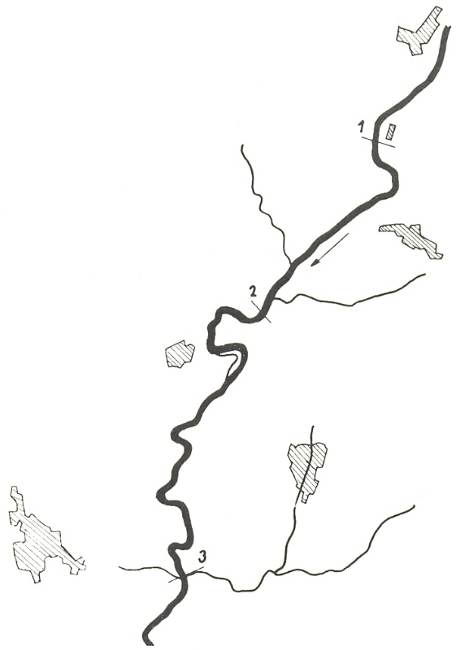
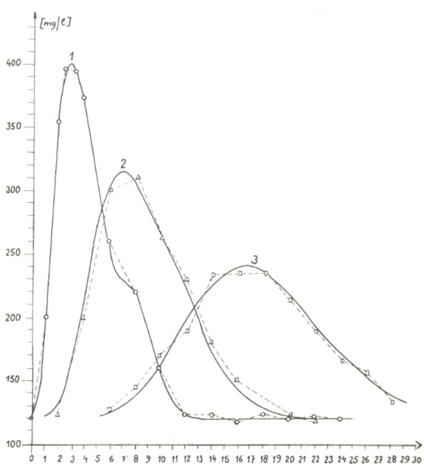

<!--
Internacia Scienca
Asocio Esperantista
BEOGRAD, Jugoslavio

El Vol. 27
n-ro 5/6(121/122))
30.12.1976.

(V.HRAZDIL, BRNO, Ĉeĥoslovakio)

+ Inĝeniero, Akvomastruma Esplorinstituto, BRNO, Ĉeĥoslovakio

Tradukis: inĝ. J. Vojaĉek,

Esplorinstituto de kemiaj ekipaĵoj, Brno, Ĉeĥoslovakio

-->

## Enkonduko

Matematika modelado de ŝanĝoj en kvalito de akvo per komputiloj
ebligas efike kontroli kvaliton de akvo en river-basenoj. La uzo de
ĝenerale konataj leĝoj de ŝanĝoj en kvalito de akvo ebligas simuladon de naturaj procezoj, okazantaj en riveroj.

Pri matematika solvado de determinismaj modeloj de ŝanĝoj en
kvalito okupiĝis [Bella]{.maldense} kaj [Dobbins]{.maldense} (1968.). [Krenkel]{.maldense} kaj kunlaborantoj (1968.) okupiĝis pri difino de parametroj en matematikaj modeloj de kvalito.

Poluo de riveroj povas esti aŭ konservativa aŭ nekonservativa
([Novotný]{.maldense} 1967.). Kiel nekonservativa poluo estas BSK (BOD), SHSK
(Cod), $\ce{O2}$, koliformaj bakterioj k.s.; solvado de modelo de nekonservativaj substancoj estas pli komplika ol ĉe la substancoj konservativaj (poluo per kloridoj, sulfatoj k.s.).

## Baza ekvacio de modelo

Ŝanĝoj en koncetriteco de polua substanco en fluanta rivero estas priskribitaj per ĝenerala rilato:

[(1)]{#e-1} $$\frac{\partial Y}{\partial t} = D_x \frac{\partial^2 Y}{\partial x^2} = U \frac{\partial Y}{\partial x} - Ky$$

kie

$x$ = akso en direkto de fluo  
$Y$ = mezvalora profila koncentriteco de substanco  
$t$ = tempo  
$D_x$ = koeficiento de laŭlonga miksado  
$U$ = mezvalora rapideco de fluo  
$K$ = koeficiento de malkomponiĝo

En nia kazo, kiam ni modelas koncentritecon de konservativa substanco, la lastan termon en dekstra flanko de la ekvacio ni ellasos
($K=0$).

## Modelado de kvalito de akvo per cifera komputilo

La ekvacion [(1)](#e-1) ni transformos laŭ metodo de la unua aproksimo.
Tempajn variaĵojn de kvalito en $i$-a elemento ni kalkulos helpe de
ordinara diferenciala ekvacio:

[(2)]{#e-2} $$\frac{dY_i}{dt} = \left(\frac{D_x}{(\Delta x)^2} - \frac{U}{2\Delta x}\right) Y_{i+1} - 2\frac{D_x}{(\Delta x)^2} Y_i + \left(\frac{D_x}{(\Delta x)^2} + \frac{U}{2\Delta x}\right) Y_{i-1}$$

En la lasta elemento por kalkulado de tempaj variaĵoj de kvalito validas la sekvanta rilato:

[(3)]{#e-3} $$\frac{dY_n}{dt} = \left(\frac{D_x}{(\Delta x)^2} + \frac{U}{\Delta x}\right) Y_{n-1} - \left(\frac{D_x}{(\Delta x)^2} + \frac{U}{\Delta x}\right) Y_n$$

Randa kondiĉo (por $x = 0; T \in \langle 0,T\rangle$), estas koncentriteco de la observata substanco de riverlinio. Difinitaj estas ankaŭ la komencaj
kondiĉoj (por $t=0$) en unuopaj elementoj de la rivero.

La sistemo de ekvacioj [(2)](#e-2) [(3)](#e-3) estas solvata cifere per subprogramo. Cifera bazo de la metodo estas formulo de [Runge-Kutt]{.maldense} (de la
2-a grado) kun varianta longo de paŝo, de kiu dependas precizo de
kalkulo. La precizon oni kontrolas per rekalkulo en duobla integra
paŝo (principo de takso de malprecizo laŭ [Runge]{.maldense}).

Por kontrolo de la menciita modelo estis elektita parto de rivero kun meza longtempa fluo $\pu{0,43 m^3/s}$, kie varias poluo per sulfatoj
influe de allasado de forte mineraligitaj akvoj el minejo.

Koncentriteco de sulfatoj estis observata en tri punktoj. En
komenco kaj en fino de modelita river-linio longa $\pu{13,77 km}$ kaj en
punkto distanca $\pu{4,86 km}$ de la linio-komenco. Skemon vidu sur 
[bildo 1](#bld-1).

Cele por kalkulado estis river-linio dividita je elementaj sekcioj longaj $\pu{0,81 km}$. Komparo de mezuritaj koncentritecoj de sulfatoj kun eliroj de la modelo en elementoj 6 kaj 17 montras [bildo 2](#bld-2).

## Aŭtomata kalkulmetodo de parametro de diferenciala ekvacio

Estas tasko difini koeficienton de laŭlonga miksado $D_x$ en la
ekvacioj [(2)](#e-2), [(3)](#e-3) per minimumigo de ekarto de la modelo rilate al la
origina sistemo. Ekartan funkcion $E_i(t)$ oni difinas per komparo de
registraĵo de mezuritaj koncentritecoj de sulfatoj kun eliro el la
modelo en apartena $i$-a elemento. La kalkulon oni faras per metodo
devenanta el iteracia tekniko [Newton-Raphson]{.maldense}. Korekton $D_x$ en la paŝo $k+1$ oni difinos en ripeta kalkulo:

[Bildo 1]{#bld-1} - Skemo de dislokigo de kontrolaj profiloj

[Bildo 2]{#bld-2} - Komparo de mezuritaj koncentritecoj de sulfatoj kaj rezultoj de modelo

[(4)]{#e-4} $$\Delta D_x^{(k)} = \frac{\int_{t_0}^{t_0+T} \sum_{i=1}^n \xi_i^{(k)} (t) \frac{\partial \xi_i^{(k)}(t)}{\partial D_x^{(k)} }dt}{\int_{t_0}^{t_0+T} \sum_{i=1}^n \left(\frac{\partial \xi_i^{(k)}(t)}{\partial D_x^{(k)} }\right)^2dt}$$

Derivaĵojn de ekartaj funkcioj laŭ $D_x$ oni elkalkulos per ekvacioj de senteblo, en kiuj oni indikos

$$\frac{\partial \xi_i}{\partial D_x}$$

kiel $v_i$:

Ekvacion por la elemento meze de modelita sekcio oni skribos en
la formo:

[(5)]{#e-5}
$$v_i = \frac{1}{(\Delta x)^2}\left(Y_{i+1}+Y_{i-1}\right) + \left(\frac{D_x}{(\Delta x)^2} - \frac{U}{2\Delta x}\right) v_{i+1} - \frac{2}{(\Delta x)^2}Y_i $$
$$- \frac{2D_x}{(\Delta x)^2}v_i + \left(\frac{D_x}{(\Delta x)^2} - \frac{U}{2\Delta x}\right)v_{i-1}$$

Por la lasta elemento estas konsistigita ekvacio:

[(6)]{#e-6}
$$v_i = \frac{1}{(\Delta x)^2}\left(Y_{i+1}+Y_i\right) + \left(\frac{D_x}{(\Delta x)^2} - \frac{U}{\Delta x}\right) v_i + \left(\frac{D_x}{(\Delta x)^2} - \frac{U}{\Delta x}\right)v_{i-1}$$

En kazo, ke oni simulas mezuritajn kurbojn de koncentriteco de
sulfatoj prezentitaj sur [grafikaĵo n-ro 2](#bld-2), oni povas la [formulon (4)](#e-4)
transformi al:

[(7)]{#e-7}
$$\Delta D_x^{(k)} = \frac{\int_{t_0}^{t_0+T} \left[ \xi_6^{(k)} (t) v_6^{(k)} (t) + \xi_{17}^{(k)} (t) v_{17}^{(k)} (t)\right]dt}{\int_{t_0}^{t_0+T} \left[\left(  v_6^{(k)} + v_{17}^{(k)}\right)^2\right]dt}$$

Se la valoro de koeficiento $D_x(k+1)$, elkalkulita en $k$-a paŝo,
estas negativa numero, laŭ konsistigita algoritmo oni metas $D_x^{(k+1)}$
egala al nulo. La kalkulo estas finita, kiam $D_x^{(k^*)}$ estas malpli
granda ol la elektita minimuma korekto.

## Resumo

Kvalito de akvo en riveroj estas influata per ellasado de forfalaj akvoj. En la artikolo estas detale solvata la matematika modelo de varianta poluo de rivera akvo per substancoj, kiuj ne malkomponiĝas (per konservativaj substancoj).

Parciala diferenciala ekvacio, kiu priskribas tempospacajn ŝanĝojn en kvalito de akvo en riverlinio, estas de parabola tipo kun
unu spaca variabilo. Per metodo DSCT, konata el programado de hibridaj komputiloj, la parciala diferenciala ekvacio estas aranĝita al
sistemo de ordinaraj diferencialaj ekvacioj. La tasko estas solvata
per cifera komputilo helpe de subprogramo, kies bazo estas la formulo de _Runge-Kutt_.

La praktika ekzemplo sekvas elkalkulon de sulfat-koncentriteco
sub memstara elfluo de forte mineraligitaj minaĵ-akvoj.

Matematika modelo de konservitaj substancoj kun helpo de optimumigo de parametroj ebligas analizi mezuradon de kvalito de rivera akvo. Estas prezentita la elkalkulo direktata al koeficiento de
laŭlonga disperso. Ĉe la solvado estas uzita iteracia tekniko de
_Newton-Raphson_.

## Literaturo

1. [Bella, D. A., Dobbins, W. E. (1968): Difference Modelling of Stream Pollution. Journal of Sanitary Eng. Div., Proc. ASCE, 94, SA 5, 995]{#b-1}

2. [Hrazdil, V. (1974): Numera solvado de ŝanĝoj en kvalito de akvo en riveroj por konduka akvomastrumado helpe de ekzemplo de baseno de Ohře, raporto de VUV, Brno]{#b-2}

3. [Krenkel, P. A., Hays, J. R., Thackston, E. L. (1967): Least Square Estimation of Mixing Coefficients. Journal of the San. Eng. Div., Proc. Asce, 93, SA 3,47]{#b-3}

4. [Novotný, V. (1967): Numera solvo de ŝanĝoj en kvalito de akvo en riveroj ĉe konduka akvomastrumado. Studmaterialo de VUV (Akvomastruma esplorinstituto) Brno]{#b-4}
