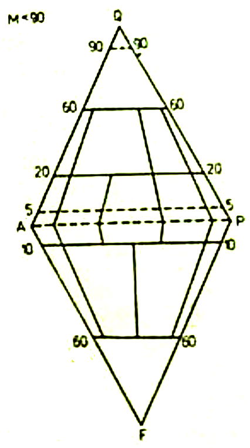
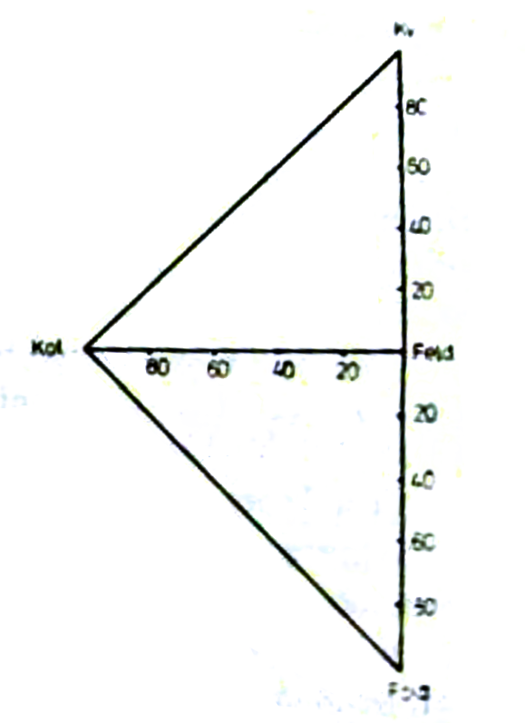

<!--
prenita el:
Fonto: SCIENCA REVUO, vol. 29 (1978), n-ro1 (129) pp. 9-20.
Aŭtoro: Josef Kavka (Ĉehoslovakio), doktoro de la natursciencoj, kandidato de la teknikaj sciencoj,
    ĉefo de specialgeologia esplorcentro ĉe GEOINDUSTRIA, nacia entrepreno en Prago.
STEB: https://www.eventoj.hu/steb/geologio/magmo-rokajxoj/magmo-rokajxoj.htm

------------------------------------------------------------------------

## Perspektivy v klasifikaci vyvøelin

Tato úvaha byla pøednesena v rámci semináøe na katedøe petrologie
(Pøírodovìdecká fakulta Karlovy univerzity v Praze). Pokouší se z
perspektivních hledisek hodnotit genetické i látkové aspekty v
klasifikaci vyøelin. Podrobuje kritice dosavadní principy, zejména pak
ty, na nichž se zakládá diagram QAPF navržený subkomisí IUGS v
Montrealu. Upozoròuje na mnohostranný význam èísla tmavosti pro budoucí
klasifikaèní praxi a na rostoucí uplatnìní moderních normativních
pøepoètý horninového chemismu v souladu se skuteènou koexistencí
nerostných fází.

-->

## 1. Enkonduko

Jenaj konsideroj prezentas esencon de prelego, plenumita ĉehlingve
(25.1.1977) por Katedro de Petrologio ĉe Naturscienca Fakultato de
Karola Universitato en Prago. Ili provas skizi pri tendencoj koncerne la
magmorokaĵan sistematikon. Por la petrologoj, kies profesio postulas
diagnozadon kaj klasadon de la magmoproduktoj, la problemaro estas nepre
aktuala. Oni bonvenigus universalan klasadsistemon, kiu estus normiga
por la ĉiutaga praktiko kaj premisa por la tutmonde komparaj studoj.
Aliflanke restas fakto, ke la ĝisnunaj sistemoj tro facile misfunkciis
eĉ en la plej banalaj okazoj.

Ĉi eseo celas --- krom alio --- konduki al tio, ke iuj tradiciaj
konceptoj submetiĝu al objektiva kritiko kaj ke iniciatiĝu serĉado de
novaj vojoj.

Scienco pri la magmaĵoj, same kiel petrologio de la sedimentoj kaj
metamorfaĵoj, trapasis dum la cent jaroj mirindan evoluon al ekzakteco.
Kontribuis al ĝi la pli-malpli teĥnika orientiĝo. Pro la fakto, ke
petrologio konsiderinde transpasis la kadron de geologiaj disciplinoj,
interveninte en multajn branĉojn de la teĥniko (minekspluatado kun
ercpurigado kaj metalurgio), konstruarto kun ceramiko kaj vitrofarado,
industria ĥemio, terkulturo inklude forstflegadon, hidroteĥniko kun
balneologio, energetiko, astronaŭtiko k.t.p.), ĝi sukcesis --- iom post
iom --- malkovri vicon da surprizaj korelacioj en la petrofizika,
petroĥemia, mineralogia, struktura kaj teĥnologia ĥarakterizado de la
rokaĵoj. Gravan influon al interpretado de grandega amaso da datoj havas
kaj ĉiam pli multe havos la tre impeta disvolvigo de la teĥnika
matematiko. Pri tio ankoraŭ pli poste.

## 2. Genez-aspektoj en la rokaĵ-klasado

Sed eĉ en la tradicia sfero de la geologiaj sciencoj, la situacio
radikale ŝanĝiĝis dum la lastaj jardekoj. Mapado, intense plenumata sur
vastaj teritorioj en la kaj evoluinta, kaj evoluanta partoj de la mondo,
serĉa ĝis detala esploradoj cele mineralkuŝeja aŭ inĝeniera geologio,
ĉio ĉi kontribuas al ĉiam pli klara formulado de genez-rilatoj en la
magmorokaj korpoj. La unua jarcent-duono alportis enormon da priskriba,
ofte reciproke izolita materialo pri diversaj magmorokaĵ-tipoj; en la
dua oni rimarkas tendencon multe pli eksplikan ol priskriban. La
profundaj borsondaĵoj senvualigas facian variemon kaj ebligas, pli
fidinde distingi genezon de unuopaj facitipoj, ĉu en la senco struktura,
ĉu heteromorfa, aŭ en kadro de izoĥemia komplekso, aŭ en atingosfero de
interagoj: magmo --- ĉirkaŭmedio, k.s.

Necesas koncedi, ke la genez-aspektoj en la magmorokaĵa klasado ĉiam
rolis eksterordinare. Jam la trikategoria divido de ĉiuj rokaĵoj ---
nome en la magmajn, sedimentajn, metamorfajn --- atestas, ke la strebo
al genez-difino havis, havas kaj havos unuarangan signifon por la
petrologia problemaro.

Same oni ne povas dubi, ke la tradicia distingo de la magmaĵoj je la
subkategorioj plutona kaj vulkana perfekte taŭgas. Kvankam inter la
magmokorpoj entrudiĝintaj profunde de la terkrusto kaj tiuj, kiuj
atingis la tersurfacon aŭ ties proksimon, ekzistas certaj transir-tipoj,
tamen la divido ne manifestiĝas kiel arbitre konvencia, sed vere
laŭnatura kaj al la terkrustaj realaĵoj nepre adekvata.

Esplorantoj de kristaliniko povas el profund-sonda borkerno legi ekz.
pri koneksoj inter plutonaĵo kaj ties metamorfa mantelo. Simile,
vulkanologoj studas formacion, stampitan de aktivado vulkana. Transira
ĥaraktero de la vulkanoklastaĵoj, "malpuriĝado" de lafoj per
nesolidiĝinta sediment-materialo mara aŭ laga, litostratigrafio de
vulkankorpoj kaj simila problemaro indikas kontaktan sferon inter la
vulkanaĵoj kaj la sedimentoj. Fine ja prezentiĝas la ĉefdemandoj:
magmodeveno, meĥanismoj de magmodiferenciĝo kaj asimilado, leĝaro de
magmaj formacioj-provincoj, ĉio tio en la lumo de la modernaj teorioj
pri tektogenezo, pri fiziko kaj ĥemio de altaj premoj kaj temperaturoj.
Vicon da faktoroj oni konas, multe da ceteraj ĝis hodiaŭ ne. La
nekonataj kaŭzas, ke por sistemo, kontentige difinanta petrogenezajn
rilatojn inter diversaj magmorokaĵaj grupoj, la tempo ankoraŭ ne
maturiĝis. Tamen, multaj geologoj kaj petrologoj de la hieraŭo kaj nuno,
serioze pledas por ĝi.

Vere indas esperi, ke **laŭgeneza sistematiko de la magmorokaĵoj** estos
meze de ĉiuj ceteraj fine la plej grava. La klasado laŭgeneza havas
plurajn avantaĝojn unuavice tial, ke ĝi respektas pli eble tutecajn
rokaĵ-korpojn ol unuopajn provpecojn. El tio rezultas, ke substanca
sistemo de rokaĵkorpo estas interpretebla tre komplekse, ne tiom
strikte, kiom ekz. ĉe specimeno teĥnologia. Difinon de magmorokaĵo eblas
prezenti en larĝa diapazono de variado, konekse kun rilatoj al la
ĉirkaŭaĵo, konsiderante amplekson de la singenezaj eĉ epigenezaj
transformiĝoj k.t.p.

Ne ĉiuj ĉi koneksoj ja estas atentindaj de la teĥniko ĝenerale kaj la
mineral-krudaĵa teĥnologio speciale. Tial ni alpaŝu la sekvan ĉapitron.

## 3. Substanc-aspektoj en la magmorokaĵa klasado

Koncepto pri aro de ĉiuj magmorokaĵoj kiel pri difinita substanca
sistemo logike alkondukis la postulon, ke certaj ĥarakterizitaj grupoj,
ankaŭ nomataj --- laŭ la biologia sistematiko --- familioj, estu
determinitaj laŭkvante.

La teĥnikofakoj, aluditaj supre, ĉi tiun laŭkvantan substanc-dispartigon
ne sole subtenas, sed nepre supozas. Ekzistas eĉ multe da fakoj,
interesataj sole de la substanc-aspektoj en magmorokaĵo. Vidpunktoj pri
strukturo, genezo, geologio k.s. restas por tiuj fakoj preskaŭ sen
signifo.

Estas do tre probable, ke dum la venonta jar-kvindeko povus akceptiĝi,
bone servi kaj laŭgrade pliperfektiĝadi sistemoj, bazitaj sur la
laŭsubstanca klasado.

Siatempe, la petrologan publikon estis trapasanta diskutado pri tio, ĉu
substanc-sistemo de la magmorokaĵoj devas baziĝi pli eble sur la ĥemia
konsisto, ĉu prefere sur la minerala, ĉu sur ambaŭ kune, sed sendepende,
aŭ fine sur sintezo de ambaŭspeca konsisto.

Kiam ekz. [Niggli]{.maldense} estis kreanta sian "[Magmenlehre]{.maldense}" helpe de la
parametroj *si, al, fm* k.t.p., li ne kredis, ke la modala kaj la norma
vidpunktoj estas sintezeblaj. [Von Wolff]{.maldense} tamen montris vojon en ĉi
direkto. Tio inspiris [Niggli]{.maldense} inventon de la unukatjonaj kombinaĵoj,
ekvivalenta normo kaj pliperfektigon de la triangula *QML*-projekcio. Al
la projekcioj ni revenos ankoraŭ pli detale.

Nuntempe oni kredas preskaŭ jam ĝenerale, ke datoj pri la efektiva
mineralkonsisto valoras pli ol ajna petroĥemia parametraro, eĉ se ĝi
estus plej fidele adaptita al fundamentaj steĥiometriaj sĥemoj. El
vidpunkto teĥnika ne sufiĉas scii ekz., kiom da silico estas en
magmorokaĵo. Teĥnologon ne kontentigas eĉ la konstato, ke difinita parto
ekzistas en formo de kvarco, dum cetera parto ligiĝas en silikatoj.
Necesas konkrete scii, en kiuj silikatoj: kiom en feldspato, kiom en
glimo, kiom en kaolinito k.t.p.

Sed aliflanke, petrologo ne rajtas fermi okulojn antaŭ la fakto, ke la
ĥemia analizado orientiĝas al tute novaj metodoj, eĉ ke ĝuste la
ĥemianalizoj prezentas kaj ĉefe prezentos la plej disponeblan
ĥarakterizon de substanca sistemo. Evidente ne estos imageble, neglekti
la ĥemikonsiston, se temos pri klasado de la magmorokaĵoj. Male, la
moderna matematika teĥniko ebligos oportunan transformon de la ĥemiaj
datoj al plej probablaj varioj de la laŭkvanta mineralkonsisto. Tio, kio
antaŭe rezultis el multhora teda rekalkulado, daŭros --- helpe de
komputoro --- sole sekunderojn. Konkurado inter tia permaŝina
interpretado de ĥemikonsisto unuflanke kaj la pena planimetrio de
mikrosekcaĵo aliflanke, jam hodiaŭ aperas kiel neegalpeza batalo. Krome,
la planimetria analizado helpe de punktokalkula integratoro estas ne nur
pena, sed --- kaŭze de superpoziciaj eĉ pluaj optikaj fenomenoj ---
relative svaga. Estas vero, ke ekzistas jam aŭtomataj integratoroj.
Bazitaj sur fotometrio, ili atingas utiligeblajn rezultojn antaŭ ĉio dum
mezurado de poluritaj facoj. Eble, iam future, petrologio iom post iom
transiros al la mikroskopado reflekta. Tiam eliminiĝos la superpozicia
misformado. Sed en nia jarcento ĝi ne okazos. Aliflanke, la ĥemiaj
laboratorioj liverados milojn da rokaĵanalizoj, interpretotaj komputore.

## 4. Klasad-diagramoj

Ni revenu al la substanco-projekciado de la magmorokaĵoj, do al tiu de
la laŭkvanta mineralkonsisto, akirita ajne: per modal-mezurado, per
normo-kalkulado, aŭ per modala-norma sintezo.

Ne estas hazarde, ke meze de amaso da diversaj projekcioj klare elstaras
la trianguloj de koncentriteco, t.e. la projekcisistemoj de tri
komponantoj, kies suma valoro egalas al 100%, 1000‰ k.s. Estas
memkomprene, ke dukomponanta sistemo povas kontentigi petrologon sole en
escepte simplaj okazoj. Aliflanke, al ĉiu kvarkomponanta sistemo mankas
la senpere demonstriva sinoptikeco. Eblas antaŭdiri, ke sistemoj bazitaj
tetraedre apenaŭ havos --- en proksima futuro --- rimarkindan ŝancon al
vasta aplikado. En lontana futuro verŝajne indiferentos, ĉu elektota
sistemo havu kvar aŭ dek komponantojn. Ties demonstrivecon sendube
certigos artifike konstruitaj videofonoj konektitaj al komputoro. Sed ni
ne okupiĝu pri "vernecaj" (laŭ [Jules Verne]{.maldense}) konsideroj, restante ĉe
la bone elprovita sistemo trikomponanta, kiu fidele servos al la
magmorokaĵa klasado ankoraŭ minimume 50 jarojn.

Ne estus celtrafe, analizi ĉi tie dekojn (aŭ eĉ centojn?) da ĝis hodiaŭ
proponitaj diagramoj. Kiel ekzemplo povas servi la diagramo de 
[A. Steckeisen]{.maldense} (1967); modifite de l\' *IUGS*-subkomisiono por klasado de la
magmorokaĵoj, ĝi provas ambicii al universala agnosko de la petrologoj.
Precize dirite, en Montrealo (1972) provizore aprobita estas sole tiu
por la plutonaĵoj ([fig. 1](#bld-1)).

## 4.1. Diagramo *QAPF*

La subkomisiono por klasado de la magmorokaĵoj diras (1972), ke utila
sistemo devas plenumi difinitajn kondiĉojn, ekz. respekton al laŭnaturaj
koneksoj. Konkretigite: la projekcipunktoj de naturaj rokaĵogrupoj devas
lokiĝi plejparte meze de kampoj, determinitaj de la klasad-diagramo.

Tiu ĉi formulaĵo estas eksterordinare interesa el la vidpunkto
gnozeologia. Dum [A. Johannsen]{.maldense} (1917) celkonscie kreis sĥemon absolute
simetrian, kien la rokaĵogrupoj "estis perforte devigitaj" eniri, jene
manifestiĝas sincer-intenca strebo, respekti la naturrilatojn. Bedaŭre,
la nocio pri rokaĵogrupo per si mem estas konsiderinde svaga. Nome, ĝi
estas alia antaŭ apliko de klasad-diagramo, ol post ĉi apliko. La ĵus
prezentita ĝenerala demando estas tiom grava kaj utila, ke ĝi meritus
memstaran traktaĵon, orientitan esklude semantike. Ĉi-loke ni preterlasu
la premisojn, kiuj koncernas aprioran difinon de natura rokaĵogrupo; ni
esploru ĥarakteron de la diagramo mem. La projekcio *QAPF* bildigas
([fig. 1](#bld-1)) du substanco-sistemojn de la sfero alkale ĝis kalcialkale
silikata: unu supersaturitan de silico, alian de alkaloj. El la
starpunkto fizika-ĥemia ne estus obstaklo, por fari el ambaŭ trianguloj
unusolan, sed ĝi ne gravas tiom, kiom bona difino de la komponantoj.
Bonege, t.e. preskaŭ unusence, estas difinita la komponanto *Q*. (Pure
formale, la simbolo *Q* koincidas kun la simboloj por iom aliaj nocioj
de petroĥemia projekciado, ekz. tiu de [Wolff]{.maldense} kaj [Niggli]{.maldense}. Konfuzoj
estus eviteblaj helpe de la simbolo *Kv*, bazita sur fonetike ortografia
formo de la vortradiko "kvarc-".)

{#bld-1}  
Fig. 1: Projekcio *QAPF* por la plutonaj magmorokaĵoj (*IUGS*, Montrealo, 1972)

Gravaj ĝenoj ekestas kun la kontraŭpoluso, la feldspatoida. Dum interne
de la triangulo *QAP* ni povas --- kun granda certeco --- aserti, ke la
projekcipunktoj, pli proksimaj al *Q*, apartenas al magmorokaĵoj kun pli
granda kvanto da silico, en la triangulo *APF* okazas ekz. jeno: Kvankam
magmorokaĵo kun 20% da leŭcito estas pli riĉa je silico ol tiu kun 10%
da nefelino, la projekcipunktoj sugestas al ni malon. Rokaĵo kun 80% da
analcimo estas laŭsilice ekvivalenta al tiu kun 30% da sodalito, sed en
la projekcio *APF*, la unua falas en la kampon de t.n. "foidolitoj",
dum la dua en la zonon, kiun oni povus --- obeante la nomenklaturan
stilon de [Streckeisen]{.maldense} --- nomi "foid-feldspatolitoj". Ĉi gravaj
eraroj en la klaso aperas tial, ke la praorigina diagram-aŭtoro, t.e.
[Johannsen]{.maldense}, tro facilanime neglektis la steĥiometrion de unuopaj
feldspatoidoj. La nocio de feldspatoido estas difinita kutime nur
funkcie; el la substanc-aspekto, ties difino implicas ioman
alkal-supersaturitecon, nenion pli. Ĉi-forme, ĝi ne plenumas la
postulojn de la koncentritec-triangulo. Se ni scias, ke ekz. filipsito
laŭsilice tre proksimiĝas al plagioklazo, projekcioj de olivina
filipsitito aŭ bazanito (resp. tefrito) impresas al ni en la
[Streckeisen]{.maldense}-diagramo tute nekonformaj. Evidentas, ke se la 
*APF*-triangulo devas havi --- samkiel *QAP* --- ĥarakteron de substanca
sistemo, restas nenio alia, ol rekalkuli la partopren-kvantojn de la
diversaj feld-spatoidoj al unueca silic-nivelo, ekz. la nefelina.
Kalkule ĝi ne prezentas obstaklon, dum la rezulto de ĉi alproksimiĝo
plurrilate alportas profiton. Sed ĝi signifas, ke projekcipunktoj de
rokaĵoj, kiuj enhavas egalajn kvantojn da diversaj feldspatoidoj, situos
malsam-distance de la rekto *AP*: la filipsit-magmaĵoj estos plej
proksime al ĝi, la leŭcitaj resp. analcimaj pli fore; sekvos la
natrolitaj kaj fine la nefelinaj resp. sodalitaj.

(Tute parenteze: [A. Streckeisen]{.maldense} (1967) diskutas sur p. 168 pri
alternativoj por diskampigo de la triangulo *APF*. 
[Niggli, Tröger, Rittmann]{.maldense} kaj eble ankaŭ aliaj atentigis, ke la simetri-akso devus
kongrui kun mezanto, konstruita de la vertico *P* al la latero *AF*.
[Streckeisen]{.maldense} decidiĝas por la pli simetria diskampigo johannseneca,
argumentante per simpleco. Ĉi tiu argumento estas neakceptinda en la
moderna petrologio de la magmaĵoj. Limojn inter la grupoj magmo-rokaĵaj
konsiderados la petrologoj ja surbaze de kompleksa esplorado, nepre ne
derivante ilin el simetrio de iu diagramo. Ankaŭ la iamaj primitivaj
atommodeloj aspektis pli simetrie ol la nuntempaj. Finfine eĉ la
feldspatdiagramo Or-Ab-An ne estas simetria; kiel ĝi povus esti tia, se
temas pri sistemoj multe pli komplikitaj?)

Se ni jam haltas ĉe la feldspatoj, ni atentu, kiel estas difinitaj ia
komponantoj *A, P* en la diagramo de [Streckeisen]{.maldense}. Ĉi-okaze ne ekzistas
tiom granda amplitudo silic-grada, kiom enkadre de la feldspatoidoj, sed
la proporcion inter ambaŭ komponantoj influas pli multe termodinamikaj
cirkonstancoj dum solidiĝado, ol substanca konsisto de magmorokaĵo. Tial
la parametro *A:P* taŭgus antaŭ ĉio por konsideroj pri genezo, nome kiel
facia indico dum komparado de proksimume izoĥemiaj magmaĵoj. En la
triangulo de koncentriteco, tiu ĉi parametro regule ne povas funkcii
kiel indico de la proporcio K:Na:Ca en kadro de la feldspatoj. Sole
nemultaj tipoj, ekz. iuj granitecaj magmaĵoj kun relative konstanta
partopreno de biotito estas --- helpe de *A:P* --- difineblaj oportune,
rapide kaj unusence. Aliokaze ni ne estas certaj, kion nomi alkala
feldspato kaj kion plagioklazo, ĉar la komponantoj Or, Ab, An apartiĝis
neperfekte aŭ tute ne.

La plej moderna sistematiko de la feldspatoj estas tre malsama ĉe
diversaj aŭtoroj. Ekz. tiu de [I. Muir]{.maldense} (1962) aspektas tute alia ol tiu
de [J. Smith]{.maldense} (1974). Ni citu kelke da tezoj el la monumenta verkego de
[Smith]{.maldense}: "Se mankas ĥemiaj datoj, petrologo provu distingi optikan
sanidinon, optikan anortoklazon kaj optikan plagioklazon. Surbaze de la
rentgen-metodoj laŭ [Wright, Stewart]{.maldense} (t.e. la pulvor-metodoj) aŭ
[Laves, Mackenzie, Smith]{.maldense} (t.e. la monokristal-metodoj) li kapablos
ĥarakterizi unuopajn fazojn. Tiel povas optika anortoklazo senvualiĝi
kiel antipertito de alta albito kun basa natrisanidino. Konsista limo
inter optika anortoklazo kaj optika plagioklazo ne estas fiksa, ĉar la
kristaliĝa temperaturo dependas unuflanke de kompleta ĥemia
magmokonsisto, aliflanke de premo. Antaŭ 1950, la
plagioklaz-nomenklaturo estis relative simpla, sed tion kaŭzis nescio
pri la strukturaj komplikoj." Fino de la citaĵo.

[Streckeisen]{.maldense} kun siaj kolegoj en la subkomisiono de *IUGS* konsideras
kiel plagioklazon tian feldspaton, kiu enhavas pli ol 5% da An. Sed
distingi tiun ĉi limon, jen tasko ege malfacila ([J. Kavka]{.maldense} 1976).
Konsekvence, iom dubinda aspektas tiu aserto de la subkomisiono (1972,
p. 112), ke la klasad-praktiko devas esti simpla kaj oportuna. Male, pro
ĝi la magmaĵ-identigado tute superflue fariĝas multekosta, ĉar ĝi
postulas ambician diagnozadon de la feldspatoj. La diagnozado tiom
malpli eble adekvatas al la simpligita diagramo por la uzado terena
(1.c., fig. 5a).

Sed la ĉefa rezervo kontraŭ la diagramo *QAFF* estu formulita jene: Dum
ĉiuj petroĥemiaj projekcioj komune kun iuj modalaj 
([Andreatta, Brögger, Ronner]{.maldense} k.a.) kiel la substanc-sistemon konsideras la kompletan
mineral-konsiston de la magmorokaĵa specimeno, [Streckeisen]{.maldense} kun la
kolegoj praktikas la johannsenan metodon, rekalkuli la helkonsistaĵojn
al 100%. Ne necesas emfazi, ke en la sfero de la mezokrataj aŭ
melanokrataj magmaĵoj ĉi-maniere akiriĝas valoroj, pri kiuj nur
malfacile oni povas imagi, ke ili estus utilaj al iu. En difinita
projekcipunkto ja povas aperi diversaj magmaĵoj, inter si apenaŭ
parencaj.

Aliflanke utilas konscii, ke la proporcio inter partopreno de la helaj
kaj tiu de la malhelaj silikatoj estas la plej grava magmorokaĵa
parametro, tiom el la vidpunkto geneza, kiom el la teĥnika. Geofiziko
estas interesata ne de la proporcio *A:P*, sed ekz. de partopren-kvanto
da ferimagnetaj mineraloj. Ankaŭ por geoĥemio, la distribuiĝo *L:M*,
*Sial:Sima* k.s. estas unuaranga indico de la substanca nekontinueco en
la terkrusto. Por la vitrofara kaj ceramika industrioj estas decide, ke
enhavo de koloraj mineraloj ne transpaŝu koncernan teĥnikan normon.
Adheremo al bitumoj kreskas kun pliiĝanta kvanto da malhelaj
konsistaĵoj. Meĥanikaj ecoj --- rezistemo kontraŭ premado, fleksado,
abrazio, desintegrado --- ĉio tio strikte dependas ĉefe de la
kolorindico. K.t.p.

[Streckeisen]{.maldense} ja proponas apartajn klasad-diagramojn por la magmaĵoj kun
kolorindico plia ol 90, sed li ne konscias, ke la intervalo 0 - 90 estas
tro vasta por distingado de la magmorokaĵoj. Pli precize dirite, li
konscias pri ĝi nur tiam, kiam eĉ al li la parametro *A:P* unuavide
misfunkcias. Ĝi estas okaze de la feldspatoidaj magmaĵoj, kie li estas
devigita servi sin de jena distingo laŭ la volumena kolorindico: 0 - 30
por feldspatoida sienito, 30 - 60 por malignito kaj 60 - 90 por ŝonkinito.
Parenteze: ankaŭ ĉi-okaze manifestiĝas lia simetri-amo spite al limoj
laŭnaturaj. Ion similan ni trovas ĉe liaj foidolitoj. Krome li koncedis,
ke andezito disde bazalto estas plej oportune distingebla helpe de la
kolorindico; sed dioriton disde gabro tiamaniere distingi li ne volas,
kvankam vico da aŭtoroj tian praktikon sukcese elprovis. Aliflanke
[Streckeisen]{.maldense} verŝajne apenaŭ konjektas, ke fonolitojn disde tefritoj ne
eblas distingi helpe de *A:P*; postulo, dividi laŭ kolorindico, estas ĉi
tie eĉ multe pli evidenta ol okaze de la limo andezita-bazalta.

Ni haltis konsiderinde longtempe ĉe la sistemigo laŭ [Streckeisen]{.maldense}
precipe tial, ke ĝi tipe prezentas kelkon da obstine enradikiĝintaj
tezoj, kiujn plantis parte [Johannsen]{.maldense}, parte jam liaj antaŭuloj, kaj
kiuj poste pli aŭ malpli transiris en la sistemojn de [Niggli, Rittmann]{.maldense}
k.a. Sed aliflanke, plede por [Streckeisen]{.maldense}, ni akcentu, ke lia strebado
estas motivita de urĝa bezono, normigi la ĝisnunan uzadon kaj fine trovi
iaspecan komunlingvon por la petrologoj, okupataj de magmorokaĵa
problemaro. Kiom da energio kaj pacienco liaflanke estas elspezita por
la traktado kun la subkomisionanoj de *IUGS*, tion kapablas plene apreci
sole tiu, kiu mem direktis normigan kampanjon en la skalo internacia. Mi
mem spertis, ke rezultoj tro ofte ne adekvatas al la suma peno. Tamen,
ili laŭgrade kontribuas al ĉiam pli perfekta klarigado de diversaj
starpunktoj.

Sed la projekciado kaj laŭkvanta klasado, bazitaj ĉefe sur la
helmineraloj --- aŭ eĉ sole sur ili --- ne povas esperi pri sukceso.
Pruvis tion la ĉiutaga praktiko pri la magmorokaĵaj diagnozoj. Dum pli
ol duona jarcento nur eta procento da petrologoj decidiĝis, apliki en
iuj siaj traktaĵoj la sistemon de [Johannsen]{.maldense} aŭ iun el ties modifoj (de
[Niggli, Rittmann]{.maldense} aŭ alian). Nu, la provintoj baldaŭ konvinkiĝis pri
nevenkeblaj obstakloj, kun tio ĉi ligitaj. Do, en niaj konsideroj pri
perspektivo de la magmorokaĵa klasado, apenaŭ eblas esprimi pli favoran
prognozon ol tiun, ke la sistemo de la [Streckeisen]{.maldense}-subkomisiono
penetros ĝis la lernolibroj por altlerneja studo, kiuj ofte prezentas
paradon de sistemoj, en la praktiko grandparte ne funkciantaj aŭ
malfacile utiligeblaj.

## 4.2. Diagramo Kv-Kol-Feld-Foid

Nun ja restas nenio alia ol skizi, kiuj vidpunktoj en proksima futuro
plej probable superregos. Antaŭ ĉio ni denove ripetu la tezon: La
fundamenta substanca simptomo pri la magmaĵoj estas kvanta partopreno de
la helaj kaj malhelaj mineraloj. Konekse kun tio nepre menciindas, ke la
distribuiĝoj ne estas kontinuaj, precipe, se oni ĥarakterizas ilin helpe
de statistika frekvenco. Rolas ĉi tie plia aŭ malplia stabileco de
faz-kunaĵoj. Detala esplorado de koncernaj rilatoj kutime ebligas, ke
pli klare elstaru naturaj limoj inter rokaĵogrupoj (kp. [F. Chayes]{.maldense}
1963). Mi mem --- post analizado de diversaj vulkanprovincoj --- havis
okazon konvinkiĝi, ke regule aperas frekvenc-hiato en la sfero de la
mezokrataj tipoj. Ne gravas, ĉu oni konsideras provincon alkalan aŭ
kalcialkalan. En la serio tefrita-fonolita, tiu ĉi hiato situas inter la
kolorindicoj 35 - 40, esprimitaj ekvivalent-procente. Do ne pravus tiu,
kiu ekz. pro simetrio, difinus la limon ie ĉirkaŭ 50. Tio estus
eksplicita neglektado de la naturaj koneksoj, alportanta memkomprenan
klasadĝenon.

Due: La plua grava parametro, ĉi-foje en akordo kun ĉiuj modernaj
sistemoj ĥemiaj eĉ mineralogiaj, estas *siliciĝo* de la magmaĵoj,
kaŭzita de diversa partopreno de konsistigaj mineraloj, malsame
saturitaj de silicia oksido, komencante per kvarco kaj finante per
mineraloj sen SiO~2~ (ekz. kalcito, titanomagnetito, apatito k.t.p.).
Sen disvolvi ideojn pri genezo, ni menciu, ke en tiu aŭ aliaj
magmo-provincoj inklino al siliciĝo estas tre diferenca.

Ĉi du plej gravajn indicojn ni provu sinoptikigi en kadro de substanca
sistemo trikomponanta. Por prevente ŝirmi nin kontraŭ emo al simetrio,
ni servu nin per triangulo orta simetria anstataŭ la tradicia triangulo
egallatera. La plej efika defendo estus triangulo nesimetria, sed en la
sistemo ortangula plej oportune --- t.e. sur la facile disponebla
milimetrita papero --- registriĝas la unuopaj projekcipunktoj ([fig. 2](#bld-2)).

{#bld-2}  
Fig. 2: Projekcio Kol-Kv-Feld-Foid por la magmorokaĵoj

La plej malhelaj magmaĵoj inklinos al la liva vertico, signita **Kol**
(= kolor-indico, [Kolorationsindex]{.maldense}, [l\' indice de coloration]{.maldense} k.t.p.),
la plej helaj proksimiĝos al la rekto **Kv-Feld-Foid**.

Sed la ĵus prezentita projekcio ne estas ĉiel necesa. Plene sufiĉus
normala projekcio *QML*, ekz. tiu de [Niggli]{.maldense} aŭ iu alia. Nome,
rekalkulo de modalkonsisto al la valoroj *QML* helpe de
komputor-programo aŭ nomogramo estas relative senproblema.

Ĉar en proksima futuro --- kiel jam dirite --- la ĉefa fonto, informanta
pri la rokaĵoj, estos ĥemianalizoj, tre verŝajnas, ke ĉiuj
klasad-diagramoj unuiĝos sur la bazo ekvivalenta. La
ekvivalent-kvocientoj laŭvalore ja situas preskaŭ ĉiuokaze inter la
masaj (uzataj precipe en la sediment-petrologio) kaj la volumenaj
(utiligeblaj unuavice en la mikroskopio).

Se ni volus determini en nia diagramo diversajn silic-nivelojn, ni
konstruus paralelojn kun la rekto **Kol-Feld**, kiu jen funkcias
proksimume kiel linio silico-satura. Sed tio estus senbaza tiom, kiom ni
dezirus respekti naturan koneksaron inter la magmorokaĵaj grupoj.
Diferenciĝado, kiel de la plutonaĵoj, tiel de la vulkanaĵoj, ne
tendencas pasi inter konstantaj silic-niveloj. Okaze de la
magmo-formacioj, saturitaj aŭ supersaturitaj de silico, oni regule
observas kreskadon de siliciĝo, komencante per la plej malhelaj tipoj
kaj finante per la plej helaj. Okaze de la formacioj supersaturitaj de
alkalo, la tendencoj estas malpli simplaj: aŭ okazas io simila al la ĵus
menciita, aŭ io mala, t.e. de la malhelaj, proksimume silicosaturitaj,
al la helaj tipoj, forte supersaturitaj de alkalo. Sed ekzistas ankaŭ
aliaj sĥemoj, ekz. tiu, kiun mi priskribis el la nordbohemiaj fonolitoj:
laŭgrada desiliciĝo ĝis difinita ekstremo kaj posta resiliciĝo direkte
al la fermaj produktoj ([J. Kavka]{.maldense} 1965).

Povus ŝajni, ke ni deziras transplanti genez-aspektojn al la diagramo
pure laŭsubstanca, sed jen temas pli eble pri tio, ke diskampigo de
klasad-diagramo ne povas bone kongrui kun apriore elektita simetrio, se
samtempe oni postulas respekti naturajn rokaĵogrupojn. Ekz. en la
vulkanaĵa serio: spilito-keratofiro-kvarckeratofiro, la unuaj du membroj
estas inter si distingendaj senkondiĉe laŭ kolorindico, dum la trian
disde la dua nature diferencigas partopreno de kvarco. Eĉ tiam
evidentas, ke kvarca keratofiro ĉiam inklinas al pli basa kolor-indico
ol senkvarca keratofiro. En ĉiu el la tri membroj, proporcio *A:P* estas
preskaŭ la sama; pri tio eblas konvinkiĝi el aldona petroĥemia projekcio
Or-Ab-An. Al simila konkludo ni venos pri la paleovulkana serio:
melafiro-porfirito-kvarcporfirito-kvarcporfiro. Kiu esploris tiun ĉi
serion pli detale, certe konsentos, ke la kvaran membron disde la tria
oni povas oportune distingi surbaze de la kolorindico, dum la proporcio
*A:P* regule misfunkcias aŭ ne estas difinebla helpe de mikroskopado.

Mi mem ne havis multe da okazoj por studi plutonaĵojn. Tamen mi aŭdacas
aserti, ke ties principoj de diagnozado tre similas al tiuj de la
vulkanaĵoj. Distingi helpe de plagioklaza acideco ekz. dioriton disde
gabro, jen kio impresus al mi tempoperde (kp. [M. Lang]{.maldense} 1975).
Kristaliĝado de plagioklazo estas ja proceso tiom subtile sentiva, ke eĉ
en kadro de eta provpeco ĝi povas konsiderinde varii. Ĉe tio oni ne
esperu, ke la devioj nuliĝus pro svageco de optika diagnozado.

## 5. Fine rekomendoj

Kion ferme diri al tiuj petrologoj, kiuj devas identigadi magmaĵojn ---
ni diru familiare --- "sur kuranta bendo"? La kolorindico estas sufiĉe
fidinde taksebla eĉ okaze de malkomponitaj specimenoj, eĉ sendepende de
ties grajno-dimensio. Sufiĉas nur iom da ekzercado. Male, partopreno de
kvarco povas resti kaŝata eĉ al mikroskopanto, nome en la tipoj
felzitecaj ĝis vitrozaj. Ĉi-konekse utilas perfektiĝadi en
normokalkulado. Ni ja ne pensas pri la normo *CIPW*, kiu estas senvalora
por nuntempa klasadbezono, sed pri modernaj normoj (de 
[Niggli, Ebert, Rittmann]{.maldense} k.a.), bazitaj ekvivalente.

Senĉesa konfrontado de modalo kun normo helpas senvualigi tre interesajn
korelaciojn ankaŭ en la sfero sistematika. Iom da komenca peno alportas
plenan profiton.

## 6. Referencoj

-   [Chayes, F.]{.maldense} (1963): Relative abundance of intermediate members of the
    oceanic Basalt-trachyte association. --- J. geophys. Res., vol 68,
    5, 1519-1534, Carnegie Inst.
-   [Johannsen, A.]{.maldense} (1917): Suggestions for quantitative mineralogical
    classification of igneous rocks. --- J. Geol. (Chicago), 25.
-   [Kavka, J.]{.maldense} (1965): Beitrag zur Kenntnis der Phonolithmagma-Evolution
    im nordböhmischen Tertiär. --- Acta Univ. Carol (Geol), 2, 91-117).
    Praga.
-   [Kavka, J.]{.maldense} (1976): La feldspatoj - ĉu bona bazo por ĉefa divido de la
    magmorokaĵoj? --- Geologio Internacia, vol. 3(1976), 27-37,
    Varsovio.
-   [Lang, M.]{.maldense} (1975): Bazicita a uspořádanost plagioklasů z peceradského
    gabra. - Studie ČSAV, 12, 107-123, Praha.
-   [Muir, I.]{.maldense} (1962): The paragenesis and optical properties of some
    ternary feldspar. - Norsk geol. Tidskr., 42, 2, 477-492. Oslo.
-   [Niggli, P.]{.maldense} (1936): Über Molekularnormen zur Gesteinsberechnung. ---
    Schweiz. mineralpetrogr. Mitt., 16, 295-317. Zürich.
-   [Streckeisen, A.]{.maldense} (1967): Classifications and nomenclature of igneous
    rocks. - N. Jb. Miner. Abh., 107, 144-240. Stuttgart.
-   [Smith, J.]{.maldense} (1974): Feldspar Minerals in Three Volumes, 1. Crystal
    Structure and Physical Properties. --- Springer-Verlag.
-   IUGS Montreal (1972): Commission on systematics in petrology.
    Subcommission on systematics of igneous rocks. Classification and
    nomenclature of plutonic rocks. Recommendations. 110-127. Montreal.

## 7. Diskuto postprelega

7.1. [RNDr. Jiří Konta, Dr. Sc.]{.maldense}, ĉefo de Katedro pri Petrologio,
profesoro pri sedimenta petrologio ĉe Naturscienca Fakultato de Karola
Universitato en Prago: "7.1.1. En sia interesa kontribuo, la preleginto
atentigis pri tio, ke la ĝisnunaj magmorokaĵaj sistemoj, bazite sur la
minerala konsisto kaj akcentante antaŭ ĉio ĥarakteron de la
helkonsistaĵoj, montriĝas iurilate jam nesufiĉaj. Jen mi dezirus esprimi
konvinkon, ke ĉiu sistemo en naturscienco estas sole klasad-maniero, kiu
devas esti nenio alia ol reflekto de ĝenerale konataj realaĵoj (veroj).
Se la sistemo ne adekvatas al siatempa stato de la scienco, ĝi estas
kompletigenda aŭ eĉ ŝanĝenda. 7.1.2. Sistemo de la magmorokaĵoj, bazita
sole sur ilia ĥemikonsisto, ne respektas tre gravajn
struktur-proprecojn, kies ekkono apartenas --- krom la substanca
konsisto --- al determinaj simptomoj; tiujn ĉi ne eblas anstataŭigi.
7.1.3. Klasad-manieroj laŭ genezo ĉiam estis en la natursciencoj fonto
de la plej grandaj malfacilaĵoj. Al ekkono de rokaĵ-genezo, sukcesa
petrologo venas nur post konstato de la priskriba simptomaro kaj kvanta
indikaro kun paralela analizo de la geologiaj koneksoj. La sistemoj
laŭgenezaj ĉiam servas sin per laŭgenezaj terminoj, jen ilia
malavantaĝo. Sed ni --- el la literaturo --- scias, ke malplej fidindaj
en faka artikolo estas ĝuste la genez-konkludoj kaj -terminoj. Oftegas,
ke malsame opinias pri genezo ne sole diversaj aŭtoroj; ankaŭ unusola
aŭtoro dum sia vivo ŝanĝas interpreton pri rokaĵ-genezo kaj remodifadas
rokaĵ-nomon. Tial mi opinias, ke la priskribaj-analizaj terminoj kaj
sistemoj estas racionalaj kaj respondantaj al la nuntempa stato de nia
scienco. 7.1.4. Mi rekomendas, dediĉi atenton al la kritika kontribuo de
d-ro [Kavka]{.maldense} kaj precipe aplikadi ĝin en la praktiko kaj la sugestojn
verkontroladi en la disertaĵoj por diplomigo kaj kandidatigo, samkiel en
praktikaj ekspertizoj, kiuj okupiĝas pri konsiderinda aro da magmaĵoj."

7.2. [J. Kavka]{.maldense}: "7.2.1. Al la lasta tezo de la tre trafe formulita
alineo, mi ligus jenan ideon: Se la sciencistoj ĝustatempe ne decidiĝas
al kompletigo aŭ ŝanĝo de sistemo, ĉi tiu eĉ povas fariĝi grava bremso
en disvolviĝado de la koncerna scienc-disciplino (kp. eŭklidan sistemon
en geometrio, geocentran sistemon en astronomio, linnean sistemon en
botaniko, k.t.p., k.t.p.). 7.2.2. Sistemo, bazita eksklude sur
ĥemikonsisto, ignoras ne sole strukturon kaj teksturon, sed ankaŭ
funkcion de rokaĵo en la terkrusto, ekvilibrojn de mineralaj fazoj,
heteromorfan variadon de difinita ĥemikonsisto k.t.p. Sekve ĝi ne estas
rekomendinda en la moderna petrologio, kvankam siatempe ĝi prezentis
progreson. 7.2.3. Tre alte mi taksas tion, ke prof. [Konta]{.maldense} ankoraŭ pli
reliefe emfazis rezervojn kontraŭ la sistemoj laŭgenezaj. Tamen --- el
la vidpunktoj perspektivaj --- disvolviĝado de petrologio regule
garantias laŭgradan pliprecizigadon de la genez-interpretoj. 7.2.4. Mi
rekomendas, ke via katedro de petrologio dediĉu enkadre de la
instru-programo eksterordinaran atenton al la modernaj norm-kalkuloj,
kiuj respektas efektivan kunekziston de la rokaĵokonsistigaj
mineraloj."

