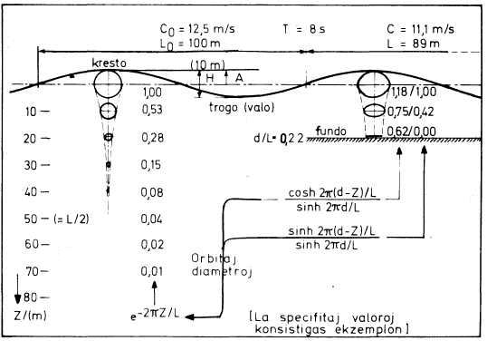
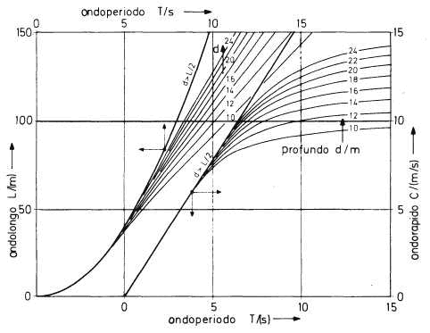
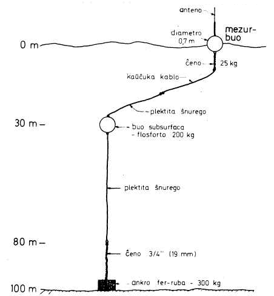
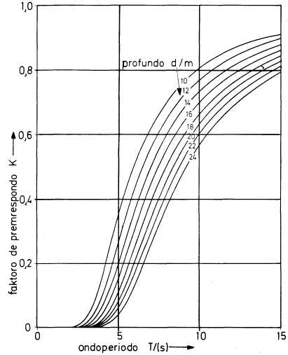
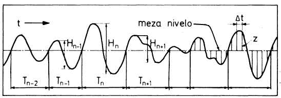
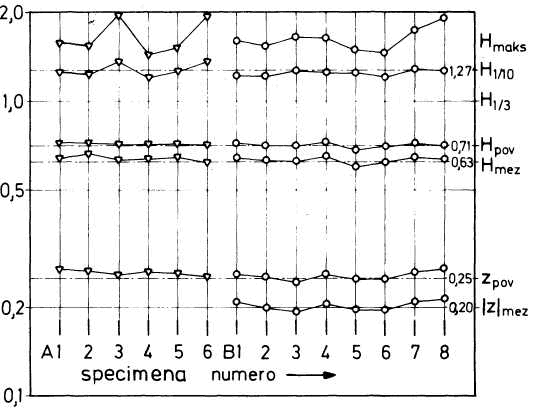
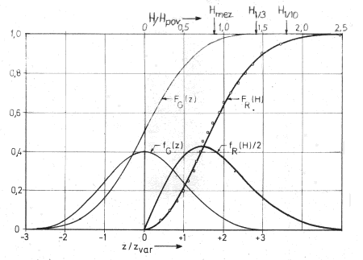
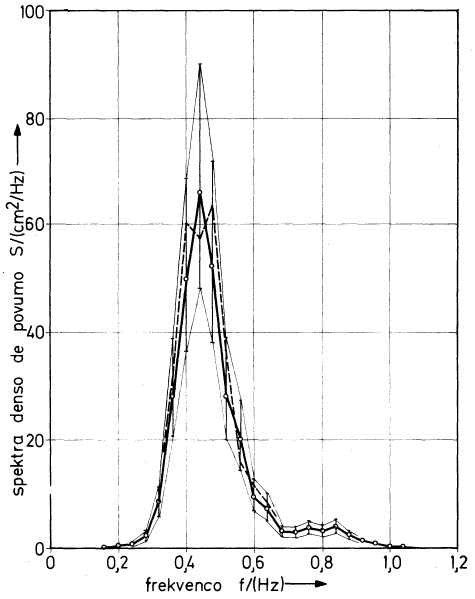
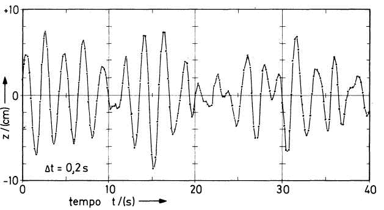
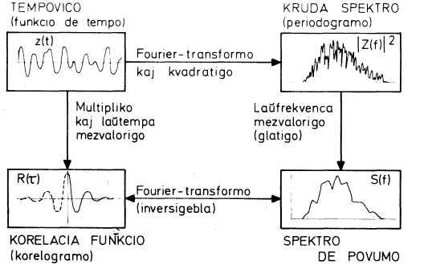

<!--

prenita el
Fonto: Scienca Revuo, vol. 29 (1978), n-ro 1 (129), pp. 21-38
AŬtoro: Nils UTNE, inĝeniero en Teknika Esplorinstituto SINTEF, Norvega Teknika Altlernejo, Trondhejm, Norvegio
STEB: https://www.eventoj.hu/steb/ingxenierado/hidrologio/marondoj/marondoj.htm                        

### Måling og statistisk analyse av havbøalgjer

Til å karakterisere havbølgjer kan ein bruke: retning, (bølgjejhøgd,
lengd, periode, fart. Mellom de tre siste er det enkel matematisk
samanheng. Ein har mange målemetodar å velje mellom, men også mange
omsyn å ta ved vurdering av metode for aktuelle formål. Ein del eldre og
nyare metodar: Stereofotografi, instrumentsatellitt, kapasitiv eller
resistiv nivåmålar, boye med akselerometer, omvendt ekkolodd, trykkmålar
på botnen.

Ved analyse av bølgjeregistreringar reknar ein ut ymse statistiske
middeltal; særleg mykje nytta er H~1/3~ ved dimensjonering av
konstruksjonar som er utsette for bølgjekrefter. I nyare tid har ein i
aukande grand teke i bruk effektspektret og delvis ogsa
retnings-effektspektret for bølgjene.

-->

### 1. Enkonduko

Ni devas supozi, ke maristoj ĉiam interesiĝis pri ondoj sur la maroj,
kie ili navigis per siaj ŝipoj. La ŝipkontruistoj evoluigis ŝipojn
diverstipajn laŭ bezonoj de uzo kaj sur bazo de sperto, akirita de la
maristoj.

En la nuna tempo oni konstruas ŝipojn multe pli grandajn ol antaŭe, kaj
ofte oni konstruas novajn tipojn por specialaj aplikoj. Tial oni bezonas
laŭeble plej bone koni la dimensiojn kaj ritmojn de la maraj ondoj, por
kalkuli fortikecon kaj stabilecon de la novaj ŝipoj.

Plue ni povas pensi pri la gigantaj enmaraj konstruaĵoj en multaj
regionoj, kie oni borsondas la marfundon por havi fontojn de nafto. La
konstruaĵoj devas rezisti la atakojn de ekstremaj ondoj. Ĉia laboro tie
dependas de la ondostato: Movado kaj lokado de la platformoj, ŝiptrafiko
al ili kun diversaj provizaĵoj, perŝipa transporto de nafto aŭ gaso, aŭ
metado de surfundaj tubegoj por la transporto ([R. Russell]{.maldense} 1961, 
[P. Bruun]{.maldense} 1976).

La supraj ekzemploj ne prezentas kompletan liston de homaj agadoj, kiuj
motivas registradon de ondoj sur la maroj de la mondo. Ni ankaŭ ĝenerale
deziras koni la naturon ĉiam pli bone.

## 2. Karakterizo kaj hidrodinamiko de ondoj

La ondoj generataj de vento estas tre neregulaj. La individuaj ondoj
havas malsamajn dimensiojn, kaj ili eĉ ne propagiĝas en sama direkto.
Por simpligi la aferon, oni povas konsideri idealigitajn, regulajn
ondojn, kiuj propagiĝas en unu sola direkto ([B. Méhauté]{.maldense} -- 
[A. Brenner]{.maldense} 1960, [F. Biésel]{.maldense} 1951). La suba priskribo de la ondoj kaj de
la akompanaj fenomenoj estas tre resuma, sed necesa bazo por la postaj
sekcioj de tiu ĉi artikolo. [Figuro 1](#bld-1), kiu montras profilon de ondaro,
suplementas la klarigon.

La ondolongo sur profunda maro ("profunda" tie ĉi: $d > L/2$)
dependas nur de la periodo --- ne de la alto:

[\(1\)]{.fno #e-1} $L_0 = (g/{2\pi})T^2 = (\pu{1,56 m/s^2})T^2$

{#bld-1}\
Fig. 1: Regulaj, dudimensiaj ondoj.

Tio validas ankaŭ por la rapido:

[\(2\)]{.fno #e-2} $C_0 = L_0/T = (g/{2\pi})T = (\pu{1,56 m/s^2})T$

La simboloj signifas: $d$ --- profundo, t.e. distanco de surfaca
meznivelo al fundo, $L$ --- ondolongo ĝenerale, $L_0$ ---
ondolongo sur profunda akvo, $T$ --- ondoperiodo, t.e. preterpasa
tempo de unu ondo, $C$ --- ondorapido (fazorapido) ĝenerale,
$C_0$ --- ondorapido sur profunda akvo, $g$ --- akcelo de
gravito, $m$ kaj $s$ --- metro kaj sekundo.

Kiam la ondo venas al malpli profunda akvo, la periodo restas konstanta,
sed la longo kaj rapido malpliiĝas (vidu ankaŭ [fig. 2]{#bld-2}):

[\(3\)]{.fno #e-3} $L = L_0 \tanh(2\pi d/L)$

[\(4\)]{.fno #e-4} $C = C_0 \tanh(2\pi d/L)$

kie $\tanh$ estas tangento hiperbola, $\tanh(x) = \sinh(x)/\cosh(x)$,
$\sinh(x) = (e^x - e^{-x})/2$, $\cosh(x) = (e^x + e^{-x})/2$. Rimarku,
ke $L$ estas nur implicite donita per ([3](#e-3)).

En [fig. 1](#bld-1) estas notitaj, kiel ekzempla okazo, la nombroj, kiuj rezultas
kalkule el la esprimoj. La figuro estas desegnita surbaze de periodo
oksekunda, kio respondas al longo centmetra sur profunda akvo. Ankaŭ la
alto iom ŝanĝigas sur malprofunda akvo, sed tio ne kunestas en la
figuro, por ke la ceteraj rilatoj estu pli klaraj.

Ĉiu parteto de akvo sub ondanta surfaco moviĝas laŭ orbito, kiu estas
cirklo en profunda kaj elipso en malprofunda akvo. Dimensioj de tiuj
orbitoj estas donitaj en la figuro.

{#bld-2}\
Fig. 2: Ondolongo kaj -rapido kiel funkcioj de periodo kaj profundo.
  
En subonda akvo estas premo, kiu kombiniĝas el du partoj: unu konstanta,
kiu dependas nur de la subsurfaca distanco $Z$, kaj alia parto
varia, kiu estas funkcio ne nur de $Z$, sed ankaŭ de la profundo
kaj de la ondolongo, krom de la amplitudo $A$ de la ondoj:

[\(5\)]{.fno #e-5} $\displaystyle p(Z) = \rho g(Z+A\frac{\cosh(2\pi(d-Z))}{\cosh(2\pi d/L)}\sin(2\pi t/T))$

kie $\rho$ estas la masdenso de la akvo, kaj $t$ estas
tempovariablo.

La dua termo de la formulo, sen la sinusa faktoro, estas ŝajna
ondamplitudo $A'$, observata per la premvariado ie sub la
supraĵo de la maro. La ŝajna alto $H' = 2A'$ estas proporcia al
la horizontala akso de la orbito en [fig. 1](#bld-1). Oni diras, ke 
$K = H'/H$ estas faktoro de premrespondo (aŭ premtransmeto). Speciale
sur la fundo, la faktoro estas

[\(6\)]{.fno #e-6} $K=1/\cosh(2\pi d/L)$

Fine ni devas mencii la energion en la ondoj. La energio varias
interŝanĝe de potenciala energio al kineta energio kaj inverse. Ambaŭ
formoj de energio estas mezvalore egalgrandaj. La tuta energio estas, je
unuo da longo de ondofronto,

[\(7\)]{.fno #e-7} $E_l = (\rho g/2)A^2L$

La energio propagiĝas kun rapido $C_g$, nomata gruporapido, kiu
estas malpli granda ol la ondorapido. Sur profunda akvo 
$C_g = C/2$, kaj tiu rilato proksimume (±20%) validas ankaŭ sur
malprofunda akvo, se $d/L > 0,04$. Uzante la rilaton [(1)](#e-1), oni
trovas, ke en profunda akvo la povumo transportata je unu da frontlongo
estas

[\(8\)]{.fno #e-8} $P_l =(\rho g/32\pi)TH^2 \approx (\pu{1 kW/m}\cdot(T/\pu{s})\cdot(H/\pu{m})^2$

kio estas konsiderenda, eĉ kun modere grandaj ondoj. Orkanoj povas havi
timige detruan efikon, sed aliflanke: en la lastaj jaroj oni serioze
esploras, kiel oni povas utiligi la energion de la maraj ondoj.

## 3. Mezurado de ondoj

Multaj metodoj por mezuri marondojn estas elpensitaj. Jam antaŭ 20 jaroj
oni povis trovi en [H. Roll]{.maldense} (1957) tabelon, kiu enhavas 35
mezurmetodojn. La metodoj estas ordigitaj laŭ ok kategorioj --- vida,
optika, akustika, hidrodinamika ktp. Por ĉiu metodo estas notite, por
kiuj el la sekvantaj ondokarakteriza grandoj ĝi konvenas: alto, longo,
periodo, rapido, direkto. Kelkaj metodoj estas aplikeblaj nur en
malprofunda akvo, pro hidrodinamika kaŭzo aŭ pro la postuloj de instalo.
Aliaj metodoj estas aplikeblaj ankaŭ tie, kie la maro estas profunda, eĉ
malproksime de marbordoj.

Alia aŭtoro klasifikas la metodojn laŭ nur tri kategorioj: supersurfaca,
surfaca, subsurfaca ([L. Draper]{.maldense} 1961).

La elekto de metodo por ĉiu aparta okazo dependas de pluraj konsideroj:

-   Al kiu celo servu la mezurado.
-   Kie oni deziras koni la ondojn.
-   Kiel oni volas poste analizi la registritajn ondojn.
-   Ĉu la instrumentoj estas manipulotaj de fakuloj aŭ ne.
-   Ekonomia konsidero pri kostoj de aĉeto, uzado, prizorgo kaj
    rezultanalizo.

Ni nun rigardos kelkajn metodojn kaj instrumentojn, uzitajn kaj uzatajn.

## 3.1. Stereofotografado

Se oni desupre stereofotografas la ondantan supraĵon de la maro, oni
povas poste uzi stereomezurilon same kiel por desegno de topografiaj
mapoj kun iliaj izo-nivelaj kurboj. Sed la bildoparo devas esti
eksponita samtempe pro la ĉiam moviĝantaj ondoj. Oni povas uzi du
paralele flugantajn aeroplanojn aŭ helikopterojn.

Se eksponiĝis paro post paro da bildoj kun intertempo regula kaj sufiĉe
mallonga, tiam la ondoj estas identigeblaj en sinsekvaj bildoj. Tiel oni
povas ne nur mezuri la dimensiojn de la ondoj, sed ankaŭ determini la
rapidon kaj direkton de propagiĝo de ĉiu ondo.

Tia mezurmetodo estas malrapida kaj multekosta kaj tial estas uzita ĉefe
por esplori la ĝeneralan naturon de la ondoj.

## 3.2. Instrumenthava satelito

Nuntempe oni enorbitigas multajn satelitojn, kiuj estas ekipitaj per
diversaj instrumentoj por esplori la surfacon de la tero kaj de la maro.
Ekzistas ankaŭ instrumentoj, kiuj povas informi pri la ondostato de la
maro. Tio povas utili por la transmara ŝiptrafiko.

Unu metodo baziĝas sur lasera altometro, kiu tiel precize mezuras
distancon al celata surfaca punkto, ke la ondoj estas mezureblaj.

Alia metodo baziĝas sur speciala radaro kaj analizo de la reflektita
signalo, kiu estas difuzita --- aŭ difraktita --- depende de la
ondostrukturo de la mara supraĵo. La analizo postulas ampleksan
kalkuladon por karakterizi la ondojn.

## 3.3. Fiksita mezurstango

Se ne estas tro profunda akvo, oni povas munti vertikalan stangon aŭ
kablon, per kiu oni povas elektre mezuri la nivelon de la ondanta
surfaco. La mezurado povas okazi per varianta rezistanco aŭ varianta
kapacitanco.

Se la kablo konsistas el drato kun maldika izolaĵo, ĝi povas funkcii
kiel elektra kondensilo, kies dua elektrodo estas la sala akvo. La
kapacitanco kreskas dum altiĝanta nivelo, kaj inverse dum la
malaltiĝanta nivelo ([J. Killen]{.maldense} 1955).

Rezistancan mezurilon oni povas fari laŭ (almenaŭ) du principoj. Interne
de izolanta tubo oni metas ĉenon da rezistiloj, kaj de ĉiu rezistila
junto oni kondukas elektrodon tra la tuba vando al la ekstera akvo. La
elektrodoj subakvaj kurtcirkvitas la rezistilojn tra la elektre
konduktiva akvo. Per konvenaj instrumentoj oni tiel havas laŭŝtupan
ondomezurilon ([J. Caldwell]{.maldense} 1955).

Alia praktikata principo estas, ke oni fabrikas specialan kablon, ĉirkaŭ
kiu rezistanca drato estas helice muldita en la surfaco de la izolaĵo.
Interne de la kablo, laŭlonge de la akso, estas ŝtala kerno por
fortigiki la kablon. La akvo kurtcirkvitas la trempiĝintajn volvojn de
la kablo.

La mezuriloj de tiuj ĉi diversaj surfaco-specoj povas esti fiksitaj
ekzemple al fortikaj fostoj aŭ dukdalboj firme starantaj en la fundo; al
varfoj kiuj ne ĝene perturbas la ondojn, aŭ al borplatformoj starantaj
en la maro.

{#bld-3}\
Fig. 3: Mezura buo kun ankrosistemo.

## 3.4. Instrumenthava buo

Buoj ekipitaj per laŭcelaj instrumentoj estas tre utilaj por
ondomezurado en lokoj, kie fiksitaj mezuriloj ne estas uzeblaj pro
teknikaj aŭ ekonomiaj kaŭzoj. La formoj kaj dimensioj povas esti tre
diversaj, de sfero malpli ol unumetra ĝis ekzemple granda toro, en kiu
estas instalitaj multaj mezur-instrumentoj por plej diversaj
meteorologiaj kaj oceanologiaj grandoj. Ordinare radiosignalo sendas la
mezuratajn grandojn al ricevilo surtera aŭ surŝipa, en kelkaj okazoj eĉ
al plusenda satelito.

Projektado de bona buo, inkluzive de instrumentoj kaj ankrosistemo, ne
estas simpla afero. Tial oni devas maksimume utiligi jam akumulitan
sperton de aliaj konstruintoj ([H. Berteaux]{.maldense} 1976). En [fig. 3](#bld-3) oni vidas,
kiel buo, uzata ekster la marbordo de Norvegio, estas fiksita al la
fundo ([O. Houmb]{.maldense} 1973).

La vertikala moviĝo de la buo estas sensata de akcelometro, kiu estas
muntita kardane, por ke ĝi ne respondu al horizontala komponanto de
moviĝo. Oni devas dufoje integri la signalon de akcelado por ekhavi la
valoron de la vera moviĝo aŭ delokiĝo vertikala. La integrado estas
farebla antaŭ transsendo aŭ post ricevo de la signalo per radio.

## 3.5. Inversa eĥosondilo

Eĥosondiloj estas vaste uzataj en ŝipoj por mezuri distancon al la fundo
aŭ al serĉata aro da fiŝoj. La sama principo estas --- almenaŭ teorie
--- uzebla invers-maniere por mezuri distancon de fiksa punkto subakva
al la surfaco: Mallarĝa fasko de ultrasona energio estas impulse
elradiata supren al la onda surfaco. La tempo por iro-reiro de la
impulso montras, kie la surfaco troviĝas ĉiumomente. La principo estas
praktike malfacila. La plej gravan problemon kaŭzas la fakto, ke la
surfaco ne estas akustike bone difinita en tempesta, tumulta ondo-stato,
speciale pro ŝaŭmo kaj aervezikoj en la supra akvozono.

## 3.6. Premomezurado surfunda

Tiu ĉi metodo estas vaste uzata --- almenaŭ pli frue --- por mezuri
marondojn. La formulo ([6](#e-6)) por la faktoro de premrespondo sur la fundo
estas bazo de la metodo. [Fig. 4](#bld-4) estas diagramo, kiu montras la rilatojn
inter la premrespondo $K$, la profundo $d$, kaj la
ondoperiodo $T$. Ekzistas ankaŭ tabeloj por diversaj funkcioj de
$d/L_0$ aŭ de $d/L$ ([R. L. Wiegel]{.maldense} 1954). Komparoj inter
surfaca mezurilo kaj surfunda mezurilo indikis, ke oni devas ĝustige
multipliki la teoriajn valorojn de $K$ per faktoro inter 1,10 kaj
1,15 ([L. Draper]{.maldense} 1957)).

{#bld-4}\
Fig. 4: Faktoro de premrespondo surfunda kiel funkcio de ondoperiodo kaj profundo.

La tajdo komplikas la metodon, parte pro la nekonstanteco de la statika
meza premo, parte pro la efiko al la faktoro $K$, ĉar la profundo
ja ŝanĝiĝas. Tial oni devas koni la amplitudon kaj fazon de la tajdo per
tajdomezurilo, lokita ne tro malproksime.

En la premomezurilo oni prefere uzas ian hidraŭlikan-pneŭmatan
filtrilon, kiu eliminas la protajdan premŝanĝon. Tiel oni plej bone
utiligas la precizecon de la mezurilo ([F. Snodgrass]{.maldense} 1955).

Ĉe la brita [National Institute of Oceanography]{.maldense} oni konstruis
ondomezurilon por uzado en ŝipoj ([M. Tucker]{.maldense} 1955). En ĝi oni aplikis
du principojn en unu instrumento: Unu parto sensas vertikalan akcelon,
alia parto sensas akvo-premon je la ŝipa kareno sub la mara surfaco.
Post dufoja integrado de la akcelometra signalo kaj adicio de la varia
parto de la premsignalo, oni havas signalon, kiu reprezentas la ondojn.

## 3.7. Registrado

La maniero, kiel la signalo de ondomezurilo estas registrata, devas esti
adaptita al la planita metodo de analizo.

Oni multe uzis registradon de ondokurbo sur papero. Tio donas tujan
kontroleblon pri la funkciado de la aparataro, dum interesaj partoj de
la registraĵo estas facile troveblaj. La lasta aserto validas nur, se ne
tro granda amaso da paperrulaĵoj kolektiĝis.

Nuntempe oni preferas uzi komputorojn por prilabori la registraĵojn,
kiuj tial devas havi formon legeblan de komputoro, aŭ devas esti facile
transformebla por tia legado. Tial registrado sur magneta bendo estas
avantaĝa. Kaset-bendoj estas praktikaj, se la ŝanĝo de bendoj estas
farata ne de instrumenta fakulo, sed ekzemple de lumtura gardisto.

## 4. Analizo de ondoj

Oni povas analizi la registritajn ondojn laŭ du principe malsimilaj
metodoj. Laŭ la unua metodo oni faras statistikajn kalkulojn pri aro da
individuaj ondoj ([R. Goodknight]{.maldense} --- [T. Russel]{.maldense} 1963). Laŭ la dua
metodo oni rigardas la ondadon kiel kolektivan fenomenon, kies spektron
oni serĉas. En statistika senco estas reciproka dependeco inter la
rezultoj de la du metodoj ([K. Nolte]{.maldense} --- [F. Hsu]{.maldense} 1972).

## 4.1 Individuaj ondoj

[Fig. 5](#bld-5) montras, kiel parto el ondoregistraĵo povas aspekti. Oni povas
mezuri ĉiun $H_n$ kaj ĉiun $T_n$ kaj tabeli ĉiujn parojn ($H_n$, $T_n$). Sed en
ĉi formo ĝi ne estas tre interesa tabelo. Tamen, ĝi prezentas bazan
dataron por kalkuli unu aû plurajn statistikajn meznombrojn kaj tiel
registri ondostaton.

{#bld-5}\
Fig. 5: Sekcio de tipa ondoregistraĵo.

Tiaj karakterizaj grandoj estas ekzemple

[\(9a\)]{.fno #e-9a} $H_\text{mez} = (1/N)\sum_n H_n \quad n=1,2,...,N$\
[\(9b\)]{.fno #e-9b} $T_\text{mez} = (1/N)\sum_n T_n$

kie $N$ estas nombro da ondoj.

Pli interesaj estas mezvaloroj de kelkaj el la plej grandaj ondoj. Por
kalkuli ilin, oni devas antaŭe ordigi ĉiujn ondojn laŭ kreskanta alto
kaj preni difinitan nombron da plej altaj ondoj:

[\(10a\)]{.fno #e-10a} $H_{1/3} = (3/N) \sum_n H_n \quad n=2N/3+1,...,N$ \
[\(10b\)]{.fno #e-10b} $H_{1/10} = (10/N) \sum_n H_n \quad n=9N/10+1,...,N$

kun similaj esprimoj por $T_{1/3}$ kaj $T_{1/10}$. Speciale
$H_{1/3}$ estas multe uzata parametro, ofte nomata "signifa
alto" $H_s$. Cetere estas interese koni la plej altan ondon
$H_\text{maks}$ inter la $N$ ondoj, kvankam tiu estas malpli
certa karakterizanto por la tuta ondaro aŭ ondostato.

Plue oni povas kalkuli grandojn, kiuj prezentas la energion (aŭ povumon)
de la ondoj:

[\(11a\)]{.fno #e-11a} $H_\text{pov} = \sqrt{(1/N_o)\sum H_n^2} \quad n=1,2,...,N_o$ \
[\(11b\)]{.fno #e-11b} $z_\text{pov} = \sqrt{(1/N_s)\sum z_n^2} \quad n=1,2,...,N_s$

kie $N_o$ estas nombro da ondoj, kaj $N_s$ nombro da
ordinatoj (specimenpunktoj). Teorie oni povas montri, ke inter la
diversaj paramentroj ekzistas certaj korelacioj, kaj kalkulado bazita
sur mezurado pravigas la teorion ([fig. 6](#bld-6)). Konsekvence, la ordinatoj
estas distribuitaj laŭ la formuloj de [Gauss]{.maldense}, kiuj esprimiĝas (kun
arbitra variablo $x$:

[\(12a\)]{.fno #e-12} $\displaystyle f_G(x) = (1/s\sqrt{2\pi}) e^{-(x/s)^2/2}$ \
[(12b)]{.fno}  $\displaystyle F_G(x) = \int_{-\infty}^x f_G(y)dy$

$f_G$ estas distribua denso, $F_G$ estas akumula
distribufunkcio, kaj $s^2$ estas varianco.

{#bld-6}\
Fig. 6: Korelacioj inter karakterizaj parametroj de registritaj ondoj.

Se la ondoj ne estas tro neregulaj, t.e. se ili havas "mallarĝan
spektron" (vidu la sekcion 4.2), tiuokaze la altoj estas distribuitaj
laŭ la formuloj de [Rayleigh]{.maldense},

[\(13a\)]{.fno #e-13} $\displaystyle f_R(x) = (2x/t^2) e^{-(x/t)^2}$\
[(13b)]{.fno} $\displaystyle F_R(x) = \int_0^x f_R(y)dy = 1- e^{-(x/t)^2}$

kie $t^2$ estas varianco-simila parametro.

Aplikante la [Gauss]{.maldense}-formulojn al la distribuo de ordinatoj, oni devas
substitui $z$ al $x$ kaj $z_\text{pov}$ al $s$,
kaj simile en la [Rayleigh]{.maldense}-formuloj oni devas substitui $H$ al
$x$ kaj $H_\text{pov}$ al $t$. [Fig. 7](#bld-7) montras la
distribufunkciojn. La diversaj karakterizaj parametroj estas markitaj
sur la skalo de $H$.

En la sama figuro oni vidas ankaŭ, kiel la punktoj de efektiva distribuo
kompariĝas kun la kurbo de teoria distribuo. La devioj de la kurbo
ekzistas parte pro la finia nombro da ondoj (tipa nombro 
$N_o = 200$).

{#bld-7}\
Fig. 7: Distribua denso $f(x)$ kaj distribua funkcio $F(x)$ de
[Gauss]{.maldense} kaj [Rayleigh]{.maldense} (kurboj) kaj distribuo laŭ mezurita okazo (cirkloj).

Kvankam la plej granda ondalto en ĉiu registraĵo estas tre necerta en
statistika senco, oni tamen povas antaŭdiri ĝian mezvaloron en multaj
registraĵoj, se oni konas ekzemple $H_{1/3}$. Tre interesa por
tiu, kiu projektas ian konstruaĵon en haveno aŭ ekster la bordo, estas
la plej granda ondo kaj la plej severa ondostato entute, kiun li povas
antaŭvidi dum la servotempo de la konstruaĵo. Tia eksterpolado ofte
estas farata sur bazo de registraĵoj, akiritaj dum nur malmultaj jaroj
([L. Draper]{.maldense} 1963).

Se oni ne disponas pri komputoro, aŭ se oni ne volas verki programon por
analizi kelkajn okazajn registraĵojn, aŭ se oni ne havas registraĵojn
maŝine legeblajn, tiam oni devas serĉi simpligon de la analiza laboro.
Estas temporaba kaj tre teda laboro, mezuri sur papera ondokurbo ĉiun
alton kaj ĉiun periodon kaj eventuale serĉi en tabelo la faktoron de
premrespondo por ĉiu diversa periodo. Efektive estas ellaborita metodo
simpligita ([M. Tucker]{.maldense} 1961, 1963), kiu per nur du aŭ kvar
amplitudomezuroj kaj per la nombro da ondoj povas doni sufiĉe fidindan
valoron de $z_\text{pov}$.

## 4.2 Spektro de ondoj

En la antaŭa sekcio ni rigardis la ondojn kvazaŭ individuojn nombreblajn
kaj mezureblajn. Sed tiu individua ekzisto estas mallonge daŭra. Se ni
efektive rigardas ondantan marsupraĵon, ni vidas ke certa ondo kvazaŭ
kreiĝas el nenio, kaj post distanco egala al kelkaj ondolongoj ĝi
senspure malaperas.

Laŭ la spektra vidpunkto ni rigardas la neregulan ondaron kiel tuton,
kaj ni diras, ke ĝi konsistas el multaj regulaj sinusaj ondaroj, kun
harmone rilatantaj periodoj, adicie surmetitaj. Ĉiu konsistiga sinusa
ondaro iras kun sia rapido, sendepende de la aliaj komponantoj.

Ni povas vidi, ke tia sendependa irado de ondoj estas fizike ebla, se ni
de aeroplano rigardas maron, kie blovas vento el alia direkto ol jam
ekzistanta hulo. Ni eĉ kelkfoje povas observi, kiel la hulo kaj la
ventondoj pasas en kontraŭaj direktoj.

{#bld-8}\
Fig. 8: Povuma spektro kun ĝia intervalo de fidindo kaj alternativa spektro ekvivalenta.

En [fig. 8](#bld-8) oni vidas ekzemplon de onda spektro. Ĝi estas nomata spektro
de povumo aŭ kelkfoje spektro de varianco. Ĝi informas, kiel la povumo
(t.e $(z_\text{pov})^2$ = mezvaloro de $z^2$) estas
distribuita laŭ skalo de frekvenco $f = 1/T$. La unuo de povuma
denso estas (unuo de z)²/herco, ekzemple $\pu{m^2/Hz}$ en
naturo aŭ $\pu{cm^2/Hz} en modelbasenoj.

La spektro de [fig. 8](#bld-8) estas relative mallarĝa; ĝi prezentas la ondojn en
[fig. 9](#bld-9), kiuj estas relative regulaj: ju pli malregulaj la ondoj, des pli
larĝa la spektro.

{#bld-9}\
Fig. 9: Ondoregistraĵo (sekcio), kies spektro estas prezentita en [fig. 8](#bld-8).

Ekzistas du ireblaj vojoj de kalkulado por veni de la registrita
laŭtempa vico de ondaj ordinatoj al la povuma spektro ([J. Bendat]{.maldense} ---
[A. Piersol]{.maldense} 1971). La du vojoj aŭ metodoj estas skizitaj en [fig. 10](#bld-10).
Ambaŭ donas ekvivalentajn rezultojn, kvankam ne ekzakte egalajn en ĉiuj
detaloj.

{#bld-10}\
Fig. 10: Alternativaj metodoj por kalkulado de povuma spektro.

La korelacia funkcio, en la okazo, kie $z(t)$ estas kontinua
funkcio, konata en la tempintervalo $0 ≤ t ≤ T$, jenas:

[\(14\)]{.fno #e-14} $\displaystyle R(\tau) = \overline{z(t)z(t+\tau)} = \frac{1}{T-\tau} \int_0^{T-\tau} z(t)z(t+\tau)dt = R(-\tau)$

Sed se $z(t)$ estas konata nur ĉe diskretaj tempopunktoj
$n\Delta t(n=O,1,...,N)$, tiam oni skribas

[\(15\)]{.fno #e-15} $\displaystyle R(m\Delta t) = R_m = \frac{1}{N-m}\sum_{n=0}^{N-m} z_n z_{n+m} \quad m=0,1,...,M$

Ordinare $M/N < 1/10$. Oni povas speciale noti, ke

[\(16\)]{.fno #e-16} $\displaystyle R(\tau=0) = \overline{z_n^2} = \overline{z^2} = z_\text{pov}^2$

do la varianco aŭ povumo de $z$.

La sekvanta ŝtupo en la klasika metodo estas *Fourier*-transformado de
la korelacia funkcio kaj multipliko per frekvencoskala faktoro:

[\(17\)]{.fno #e-17} $\displaystyle S(f) = S_k = 2T\left(R_0+2\sum_{m=1}^{M-1}R_mW_{2M}^{-km}\right) \quad k=0,1,...,M-1$

kie $f = k\Delta f = k/2T$ (tie ĉi $T = M\Delta t$), kaj
$W_M = e^{2\pi i/M}$. Aliforma esprimo de tiu faktoro estas

[\(18\)]{.fno #e-18} $W_{2M}^{-km} = W_M^{-km/2} = \cos(\pi km/M) - i \sin(\pi km/M)$

Pro la simetrio $R_{-m} = R_m$ oni povas jam komence elimini la
sinus-termon. --- La spektra komponanto $S_k$ estas speco de
korelacio aŭ kovarianco inter $R_m$ kaj harmona funkcio
$\cos(\pi km/M)$.

Multaj elementaj kalkuloperacioj estas necesaj por trovi la korelacian
funkcion (proksimume $NM$ multiplikoj kaj egale multaj adicioj).
kaj poste la transformon ($M^2$ da kosinuskalkuloj, da
multiplikoj kaj da adicioj). La labortasko fariĝas konsiderinda, se oni
havas multajn registrostaciojn, kaj se ĉiu stacio produktas plurajn
registraĵojn ĉiutage.

Oni rimarku en la formuloj ([17](#e-17)) kaj ([18](#e-18)), ke multaj kombinoj de la
faktoroj $k-m$ donas saman valoron de la harmonaj funkcioj. Do
kalkuloj de tiuj funkcioj estas neracie ripetataj.

En la lasta jardeko disvastiĝis apliko de komputoraj algoritmoj, kiuj
draste mallongigis la tempon bezonatan por *Fourier*-transformado. Ili
estas ĉiuj bazitaj sur la principo nomata rapida *Fourier*-transformo
([J. Bendat]{.maldense} --- [A. Piersol]{.maldense} 1971, [F. Resch]{.maldense} --- [R. Abel]{.maldense} 1975, 
[P. Bloomfield]{.maldense} 1976). La plej multaj el tiuj algoritmoj kondiĉas, ke
$M$ estas entjera potenco de du, $M = 2^p$. Sed ekzistas
ankaŭ algoritmoj por la okazoj, kie $M$ estas produto de ajnaj
faktoroj primaj ([R. Singleton]{.maldense} 1968).

Rezulto de la mallongigo de la kalkullaboro estas, ke nun oni ofte
preferas iri la alian vojon, montritan en [fig. 10](#bld-10): Unue
*Fourier*-transformi la originalan tempofunkcion

[\(19\)]{.fno #e-19} $\displaystyle Z_j=\frac{1}{N}\sum_{n=0}^{N-1}z_nW_n^{-jn} \quad j=0,1,...,N-1$

kaj dividi per frekvenco-ŝtupo $\Delta f = 1/T = 1/N\Delta t$, kaj poste
kvadratigi por havi "krudan" spektron

[\(20\)]{.fno #e-20} $\displaystyle P_j=2T|Z_j|^2 \quad j=0,1,...,N/2-1$

Oni ordinare uzas nur $N/2$ frekvenco-valorojn, ĉar la restantaj
$N/2$ ripetas la unuajn simetrie. Tial oni anstataŭe simple
duobligas per la faktoro 2 en ([20](#e-20)). Plue oni kungrupigas po certa nombro
$L$ da najbaraj komponantoj $P_j$ kaj kalkulas la
mezvaloron en ĉiu grupo. Rezultas la spektro

[\(21\)]{.fno #e-21} $\displaystyle S_k=\frac{1}{L}\sum_{j=-L/2}^{L/2} P_{kL+j} \quad k=0,1,...,N/2L$

Oni parolas pri "frekvenca fenestro" de larĝo $L$, kiam oni
tiel mezvalorigas la spektron. En ([21](#e-21)) la fenestro estas kvarangula, sed
oni povas uzi ankaŭ fenestrojn triangulajn, kosinusajn, k.a.

Per la mezvalorigo aŭ glatigo ni celas al pli difinita, pli certa
spektro ol la kruda spektro. Ni supozu, ke ni iel havigus al ni la
"veran" spektron de la ondostato. Tiam ni trovus, ke la linioj aŭ
komponantoj de nia specimen-spektro varias ĉirkaŭ la "vera" spektro
laŭ ĥikvadrata distribuo kun $2L$ libergradoj.

En [fig. 8](#bld-8) estas montrita spektro de registritaj ondoj, ĉe kiu
90-procenta "intervalo de fidindo" estas desegnita. Estas skizita
ankaŭ alia spektro, kiu estas tute interne de tiu intervalo, kaj kiu
same bone povus prezenti la ondostaton (same en [M. Gohin]{.maldense} 1960).

## 4.3. Aliaj tipoj de spektroj

Oni povas vastigi la koncepton de spektro en du direktoj. La ordinara
tipo jam pritraktita prezentas dudimensiajn ondojn, t.e. nur la
koordinatoj $x$ (aŭ $t$) kaj $z$ de la ondoj estas
konsiderataj. Sed tiel simpla la naturo ne estas.

La ondoj havas finiajn krestolongojn, kaj ili propagiĝas laŭ diversaj
direktoj ĉirkaŭ la ĉefa direkto. Tial oni kelkfoje kalkulas la
"direkto-spektron", en kiu la povumo estas distribuita laŭ la
frekvenco kaj direktangulo. Bazo por kalkuli tian spektron estas ia reto
de mezuriloj, kiuj kune donas la necesajn informojn ([L. Borgman]{.maldense} 1969).

Alitipa evoluo de la spektroj konsideras la fakton, ke la ondoj ne estas
simetriaj ambaŭflanke de la meza nivelo, t.e. la distribuo de 
$z^±$ simetriaj ambaŭflanke de la meza nivelo, t.e. la distribuo de
$z$ ne estas simetria ([D. Wells]{.maldense} 1964). Oni esprimas la
distribuan malsimetrion per la grando $z^3$ aŭ 
$z^3/(z^2)^{3/2} = z^3/z^3_\text{pov}$. Por esplori pli detale la naturon de la
malsimetrio, oni kalkulas tiel nomatan bispektron. Per bispektra
grafikaĵo oni povas vidi transefikon inter du frekvencoj, ekz. inter iu
baza frekvenco $f_1$ kaj ĝia dua harmono $f_2 = 2f_1$.
Ni ĉi tie povas nur referenci literaturon pri tiu temo ([K. Hasselmann]{.maldense}
--- [W. Munk]{.maldense} --- [G. MacDonald]{.maldense} 1963).

## 5. Referencoj

-   BENDAT, J. S. --- PIERSOL, A. G. (1971): *Digital data analysis
    procedures* \[ĉapitro 9, p. 283-342, en:\] *Randon data: Analysis
    and measurement procedures*, John Wiley & Sons, Inc., New York.
-   BERTEAUX, H. O. (1976): *Buoy engineering*. John Wiley & Sons, Inc,
    New York (ISBN 0-471-07156-0).
-   BIÉSEL, F. (1951): *Étude théorique d\'un certain type d\'appareil à
    houle. La Houle Blanche*, 156-165, 476-496, 724-727.
-   BLOOMBIELD, P. (1976): *Fourier analysis of time series. An
    introduction* \[la libro enhavas multajn FORTRAN-programojn\]. John
    Wiley & Sons.
-   BORGMAN, L. E. (1969): *Directional spectra models for design use
    for surface waves.* Hydraulic Engineering Laboratory, University of
    California, Berkeley.
-   BRETSCHNEIDER, C. (1976): *On the determination of the design ocean
    wave spectrum.* Kongress-Berichtswerk (Band 1), "interocean
    \'76", 3. Internationaler Kongress und Ausstellung für
    Meerestechnik und Meeresforschung, Düsseldorf, 218-233.
-   BRUUN, P. k.a. (1976): *Wind, Wave and current data for off-shore
    operations.* Kongress-Berichtswerk (Band 1), "inter-ocean
    \'76", 3. Internationaler Kongress und Ausstellung für
    Meerestechnik und Meeresforschung, Düsseldorf, 242-253.
-   CALDWELL, J. M. (1955): *The step-resistance wave gage.* Proc. of
    the First Conf. on Coastal Engineering Instruments, Berkeley,
    Califomia.
-   DRAPER, L. (1957): *L\' atténuation de la houle en fonction de la
    profondeur* \[dulinga, franca kaj angla paralele\]. La Houle
    Blanche, n-ro 6, 926-931.
-   DRAPER, L. (1961): *Wave recording instruments for civil engineering
    uze.* The Dock and Harbour Authority, okt., 201-203.
-   DRAPER, L. (1963): *Derivation of a \'design wave\' from
    instrumental records of sea waves.* Proc. Institution of Civil
    Engineers, vol. 26, okt., 291-303.
-   GOHIN, M. (1960): *Étude des spectres de houle à proximité des
    côtes.*Proc. Institution of Civil Engineers, vol. 26, okt., 291-303.
-   GOHIN, M. (1960): *Étude des spectres de houle à proximité des
    côtes.* La Houle Blanche, n-ro2, 113-121.
-   GOODKNIGHT, R. C. --- RUSSEL, T. L. (1963): *Investigation of the
    statistics of wave heights.* Journal of the Waterways and Harbour
    Division (Amer. Soc. Civ. Engrs), majo, 29-54.
-   HASSELMANN, K. --- MUNK, W. --- MACDONALD, G. (1963): *Bispectra of
    ocean waves* \[ĉapitro en:\] ROSENBLATT, M. \[red.\]: *Time series
    analysis.* John Wiley and Sons, Inc, New York.
-   HOUMB, O. G. (1973): *A Nonvegian wave climate study.* Second
    International Conference on Port and Ocean Engineering under Arctic
    Conditions, University of Iceland.
-   HOUMB, O. G. --- RYE, H. (1973): *Analyses of wave data from the
    Nonvegian continental shelf.* Second International Conference on
    Port and Ocean Engineering under Arctic Conditions.
-   KILLEN, J. M. (1955): *Capacitive wave profile recorder.* Proc. of
    the First Conf. on Coastal Engineering Instruments, Berkeley,
    California.
-   LE MÉHAUTÉ, B. --- BREBNER, A. (1960): *An introduction to the
    mathematical theories of tro-dimensional periodic progressive
    waves.* Civil Engineering Department, Queens University at Kingston,
    Ontario.
-   NEUMANN, G. --- PIERSON, W. J. (1966): *Wind waves and swell;
    seiches; storm surges; tsunamis; internal waves* \[ĉapitro 12, p.
    326 - en:\] *Principles of physical oceanography.* Prentice-Hall,
    Inc,
-   NOLTE, K. G. --- HSU, F. H. (1972): *Statistics of ocean wave
    groups.* Offshore Technology Conference, Paper Number OTC 1688,
    Dallas, Texas.
-   RESCH, F. J. --- ABEL, R. (1975): *Spectral analysis using Fourier
    trnasform techniques.* International Journal for Numerical Methods
    in Engineering, vol. 9, 869-902.
-   ROLL, H. U. (1957): *Überflachen-Wellen des Meeres.* Handbuch der
    Physik, vol. 48 (Geophysik 2). Springer, Berlin.
-   RUSSEL, R. C. H. (1961): *The information required by the civil
    engineer.* The Dock and Harbour Authority, sept, 156-159.
-   SINGLETON, R. C. (1968): *Algorithm 339: An ALGOL procedure for the
    fast Fourier transform with arbitrary factors.* Communications of
    the ACM, vol. 11, n-ro 11, 776-779.
-   SNODGRASS, F. E. (1955): *Mark IX shore wave recorder.* Proc. of the
    First Conf. on Coastal Engineering Instruments, Berkeley,
    California.
-   TUCKER, M. J. (1955): *A ship-horne wave recorder.* Proc. of the
    First Conf. on Coastal Engineering Instruments, Berkeley,
    California.
-   TUCKER, M. J. (1961): Simple measurements of wave records. The Dock
    and Harbour Authority, nov., p. 2 31.
-   TUCKER, M. J. (1963): Analysis of records of sea waves. Proc.
    Institution of Civil Engineers, vol. 26, okt., 305-316.
-   WELLS, D. R. (1964): *On the time varying horizontal water velocity
    of single, multiple, and random gravity wave trains* \[doktoriĝa
    tezo\]. Technische Hogeschool te Delft.
-   WIEGEL, R. L. (1954): *Gravity waves. Tables of functions.* Council
    on Wave Reasearch, The Engineering Foundation, Berkeley, California.

