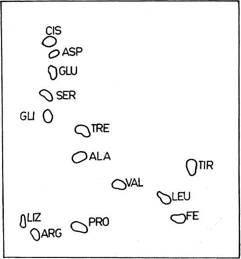

<!--
prenita el:

Fonto: SCIENCA REVUO, vol. 29 (1978), n-ro2 (130) pp. 61-70 
Aŭtoro: Ilona Emma Gál (Hungario)\
  Dr. fil., kandidatino de la kemiaj sciencoj, emerita sekciestrino, Budapeŝto.
STEB: https://www.eventoj.hu/steb/kemio/proteino1978/analizo-de-proteinoj.htm

## A fehérjék analizisérõl táplálkozástani szempontból

Korunkban világszerte súlyos gondot jelent a táplálkozástani szempontból
értékes fehérjékkel való hiányos ellátottság. Az alapvetõ táplálkozási
szükségletek átfogó felmérése a szerzett ismeretek gyakorlati
alkalmazása céljából --- lesz egyik kiemelt feladata egy felállításra
kerülõ ENSZ-egyetemnek is. Minthogy a kérdés az érdeklõdés homlokterében
áll, az ilyenirányu kutatásokhoz pedig nélkülözhetetlen az
élelmiszerfehérjék folyamatos vizsgálata és értékelése, a szerzõ ---
tájékoztatási szándékkal --- rövid áttekintést ad a jelenleg alkalmazott
fõbb vizsgálati módszerekrõl és az ezekkel kapcsolatos egyes
problémkákról.

Bevezetõbõl néhány alapfogalmat tárgyal és táblázatosan mutat be
adatokat az esszenciális aminósavakra vonatkozólag, szükséges
mennyiségüket az emberi szervezet számára, tényleges mennyiségüket
néhány fontosabb élelmiszerben. Ezután rátér a kémiai öszetétel
vizsgálatára, foglalkozik az összfehérjetartalom meghatározása, a
frakcionálás, a hidrolízis alapelveivel, az aminósavak meghatározásának
gyakoribb, elsõsorban kromatográfiás változataival A harmadik részben a
biológiai érték meghatározásának alapelveit tárgyalja: kémiai eljárások
és "en vivo" módszerek csoportosításban, utóbbiba beleértve a
mikrobiológiai elemzést is. Külön foglalkozik azokkal a tényezõkkel,
amelyk kisebb-nagyobb mértékben befolyásolhatják a kísérleti
eredményeket.

Vegül egybevetve a fehérjeminõség értékelésére szolgáló módszereket
megállapítja, hogy ebben a vonatkozásban egyik legfontosabb .kutatási
feladat olyan egyszerû, gyors, rutinvizsgálati módszerek kidolgozása,
amelyek a biológiai érték meglehetõs pontossággal való meghatározására
alkalmasak.

-->

## 1. Enkonduko

Al la plej gravaj problemoj de nia jarcento apartenas la fenomeno de
monda malsato. Pro tio prezentiĝis la projekto, ke la ĉi-rilataj
esploradoj kaj fortostreĉoj okupu emfazitan lokon kadre de planata
Universitato de Unnuĝintaj Nacioj (la rezidejo verŝajne estos en Tokio)
inter la "premaj tutmondaj problemoj de homa pluvivado, evoluado kaj
bonfarto" tiel nomataj laŭ la Ĉarto de tiu ĉi Universitato. Temas antaŭ
ĉio pri la ekkono de bazaj nutraj bezonoj en la dieto de homoj, kiuj
loĝas en diversaj regionoj kun variaj klimatoj, altitudoj kaj
ĉirkaŭaĵoj, kaj pri la aplikado de la scio al praktikaj demandoj, kiujn
frontas la homoj ĉiutage.

Estas sciate, ke la malsatado nuntempe havas plejofte ne kvantan, sed
specialan, kvalitan karakteron, do fontas el parta manko de gravaj por
la sano komponantoj, precipe el tiu de la proteinoj.

Ĉar ĉiaspeca orientiĝo kaj praktika aplikado koncerne la
protein-problemon baziĝas sur detala ekzamenado de nutraĵ-proteinoj
rilate al la procenta enhavo, ĥemia konsisto kaj biologia valoro, mi
opinias ke estos interese mallonge trarigardi la ĉefajn analizmetodojn
el nutradologia vidpunkto kaj kelkajn koneksajn demandojn.

Antaŭ ĉio jen kelkaj bazaj scioj pri nutraĵproteinoj:

La proteinoj estas --- kiel konate --- nitrogenhavaj organikaj
kombinaĵoj kun molekula maso inter kelkmil kaj plurmilionoj. La
konstruadon de tiuj makromolekuloj partoprenas ĝenerale 20
"konstru-brikoj", aminoacidoj, jenaj:

:::{.kolumne}
alanino (ALA)\
arginino (ARG)\
asparaginacido (ASP)\
asparagino (ASN)\
cisteino (CIS)\
fenilalanino (FE)\
glicino (GLI)\
glutaminacido (GLU)\
glutamino (GLN)\
histidino (HIS)\
izoleŭcino (ILEU)\
leŭcino (LEU)\
lizino (LIZ)\
metionino (MET)\
prolino (PRO)\
serino (SER)\
tirozino (TIR)\
treonino (TRE)\
triptofano (TRI)\
valino (VAL)\
:::

La ĝenerala formulo de aminoacidoj estas:

::: {.kemfrm}
\begin{array}{ll}
 \ce{H2N-&  CH-COOH}\\
 \ce{    &\,|      }\\
 \ce{    &  R      }
\end{array}
:::

Ĉiu aminoacido havas amfoteran karakteron; pro aminogrupo ($\ce{-NH2}$) ĝi
estas bazo, kaj pro karboksil-grupo ($\ce{-COOH}$) acido. Per tiuj du grupoj
ligiĝas la aminoacidoj, formante t.n. peptid-ligojn ($\ce{-CO-N -}$) kaj
estigas pli malpli longajn polipeptidajn ĉenojn:

::: {.kemfrm}
\begin{array}{llllll}
 \ce{    &  R_1&        &     &   O    &  R_3          }\\
 \ce{    &\,|  &        &     &\,\|    &\,|            }\\
 \ce{-NH-&  CH-&   C-NH-&  CH-&   C-NH-&  CH-&   C-NH -}\\
 \ce{    &     &\,\|    &\,|  &        &     &\,\|     }\\
 \ce{    &     &   O    &  R_2&        &     &   O     }
\end{array}
:::

En la formulo $\ce{R1}$, $\ce{R2}$, $\ce{R3}$R... reprezentas diversajn radikalojn de la unuiĝintaj molekuloj.

Laŭ nutra valoro ne ĉiu proteino estas samvalora. Por la homo 8 amino-acidoj pruviĝis esencaj, do nemalhaveblaj en la proteino por certigi la normalan metabolon, kaj krome en juna organismo la kreskadon. La biologia valoro de proteino ĉefe dependas de la kvanto kaj proporcio de ĝiaj esencaj aminoacidoj.

[Tab. 1](#tab-1) denombras la ok esencajn aminoacidojn kaj informas pri la ĉiutaga bezono (v. 
[C. Siekmann-Steffens]{.maldense} 1974, p. 19).

[Tab. 1]{#tab-1}: Minimuma bezono de esencaj aminoacidoj (g/tago)

||viroj|virinoj|infanoj kaj gejunuloj|
|---|---|---|---|
|valino|0,8|0,46 -— 0,65|1,6|
|leŭcino|1,1|0,17 -— 0,62|2,2|
|izoleŭcino|0,7|0,25 -— 0,45|1,4|
|metionino|1,1|0,35 -— 0,55|2,2|
|fenilalanino|1,1|0,12 -— 0,22|1,0|
|treonino|0,5|0,10 -— 0,30|1,6|
|lizino|0,8|0,40 -— 0,50|0,25|
|triptofano|0,25|0,08 -— 0,16|0,5|

Videblas, ke la bezono de diversaj aminoacidoj malsamas laŭ aĝo kaj sekso. [Tab. 2](#ab-2) montras enhavon de kelkaj gravaj nutraĵoj je proteinoj kaj esencaj aminoacidoj (indikoj laŭ [R. Tarján]{.maldense} - [K. Lindner]{.maldense} 1974).

[Tab. 2]{#tab-2}: Enteno de kelkaj nutraĵoj je proteinoj kaj esencaj aminoacidoj (g en 100 g da proteino)

::: {.plenlargha}
|nutraĵo|protein-enhavo %|FE|ILEU|LEU|LIZ|MET|TRE|TRI|VAL|
|---|---:|---|---|---|---|---|---|---|---|
|bovviando|20,6|5,7|6,3|7,7|8,9|3,4|5,7|1,3|5,8|
|bovo-hepato|20,9|5,0|5,5|8,4|8,3|2,5|4,7|1,1|5,8|
|bovinlakto|3,5|5,3|6,2|11,3|7,5|3,3|4,6|1,6|6,6|
|tuta ovo|13,5|5,1|5,1|9,2|7,4|3,0|4,9|1,0|6,9|
|tritikfaruno|14,0|5,0|4,5|8,6|2,7|2,4|4,0|1,1|4,5|
|terpomo|2,5|4,8|5,4|9,9|10,1|2,0|6,5|1,9|5,6|
|pizo (seka)|22,7|3,5|6,7|7,8|7,0|0,8|4,0|0,6|6,2|
|sojo|41,5|4,6|6,2|7,3|6,4|1,5|4,2|1,1|4,5|
|rizo (polurita)|8,0|5,5|4,5|8,1|3,0|3,3|4,1|1,2|6,0|
:::

Por la homa organismo la animaldevenaj proteinoj plejofte valoras pli ol la vegetaldevenaj. Nome, en pluraj el inter ĉi-lastaj unu aŭ alia aminoacido troviĝas, en multe pli eta kvanto ol estus bezonata. La esenca aminoacido ĉe estanta en plej malgranda kvanto nomiĝas *limiga aminoacido*, ĉar la organismo povas utiligi la aliajn esencajn aminocidojn nur proporcie al ĝi, do ĝi grave efikas sur la kvaliton, biologian valoron de la proteino. Tiel limige funkcias ekz. la lizino en la tritiko, la metionino en la pizo. Prenante la nutran valoron de la ovoproteino 100%, tiu de la tritiko-proteino estus nur ĉirkaŭ 50%, kaj tiu de la pizoproteino ĉ. 60%.

Por eviti tiun malavantaĝon, la plej simpla metodo estas konsumi mankantajn proteinojn kune kun plenvaloraj, ekz. terpomon kun ovo (optimuma proporcio 64:36), aŭ rizon kun lakto k.t.p., ĉar la 
"superabundaj" aminoacidoj de plenvaloraj proteinoj
efikas kompletige sur la malpli valorajn.
aliflanke, oni povas ankaŭ ĥemie kompletigi
proteinojn per aldono zorge kalkulitaj kvantoj
mankantaj aminoacidoj.

## 2. Analizmetodoj por determino de la kemia konsisto de proteinoj

Ĉar la procenta enteno de la nutraĵo je proteinoj povas esti tre diversa
(v. tab. 2), la unua paŝo ĉe la analizo ĝenerale estas la determino de
la *tuta protein-enhavo*. La analizisto uzas por tiu celo plejofte iun
freŝdatan varianton de la klasika metodo de [Kjeldahl]{.maldense} (1883). Tiu
metodo baziĝas sur la fakto, ke el organikaj kombinaĵoj, enhavantaj
nitrogenon --- okaze de ilia malkomponado per varmega, koncentrita
sulfuracido --- la ligita nitrogeno reduktiĝas al amoniako, kaj tiu
ligiĝas kun la superabunda sulfuracido je nevolatila amoniosulfato
$\ce{(H4N)2SO4}$. El tiu kombinaĵo amoniako estas liberigebla per forta
lesivo (kutime $\ce{NaOH}$), kaj estas transdistilebla en precize konatan
kvanton da acido; ties superabundon oni reentitras.

La *prikalkulado* baziĝas sur la ĝenerale akceptita supozo, ke la
enhavo de protein-miksaĵo je nitrogeno estas 16%. Sekve, se oni
multobligas la nitrogen-enhavon per la faktoro (100/16 =) 6,25; oni
ricevas la tutan protein-entenon de la provaĵo.

En certaj okazoj povas esti necese ekstrakti la tuton de proteinoj el
nutraĵoj kaj apartigi la unuopajn komponantojn. Ĉi tiun procedon antaŭas
dispecetigo kaj homogenigo de la provaĵo; oni frakasas la ĉelojn
plejofte per alterna frostigo kaj degeligo, aŭ per ultrasono. Poste
sekvas la desolvo kaj *divido en frakciojn*, kelkfoje ankoraŭ laŭ la
klasika metodo de [Osborne]{.maldense} (1907) surbaze de la *solvebleco*. Laŭ tiu
distingiĝas la *konataj grupoj*: albuminoj (solveblaj en akvo,
diluitaj salsolvaĵoj, acidoj kaj lesivoj), globulinoj (nesolveblaj en
akvo, jes en diluitaj salsolvaĵoj, acidoj kaj lesivoj), glutelinoj
(nesolveblaj en neŭtralaj solviloj, jes en diluitaj acidoj, lesivoj),
prolaminoj (solveblaj en 50 - 90%-a alkoholo), kaj skleroproteinoj
(nesolveblaj). Menciindas, ke sur la solveblecon grave efikas
temperaturo kaj pH.

Ĝisdata procedo por frakcii proteinojn en komponantojn estas la t.n.
*jon-interŝanĝa ĥromatografio* (v. sube).

Por esplori la kemian konsiston de proteino aŭ -miksaĵo, oni devas
malkombini ĝin per *hidrolizo*, ĝis la "konstrubrikoj", aminoacidoj.
Al tiu celo servas acidoj, lesivoj aŭ enzimoj. En la praktiko oni
plejofte uzas 20%-an kloridan acidon, kaj varmigas la protein-miksaĵon
kun la acido dum 18 - 24 horoj. Per tiu ĉi longa acid-efiko kelkaj
aminoacidoj (precipe triptofano) difektiĝas. Se gravas, precize
determini ties kvantojn, oni aplikas paralele ankaŭ aliajn oportunajn
metodojn. --- La superfluan acidon oni forpelas per ripetita distilado
en vakuo. La postrestinta seka substanto servas kiel bazmaterialo por la
analizo.

La analizado de aminoacidoj nuntempe okazas plej ofte per ĥromatografio,
kiu estas unu el la plej elstaraj plenumaĵoj de la analiza kemio.

La principo de *ĥromatografio* estas jena: Komponantoj de miksaĵo,
inversigeble ligitaj al (plejofte solida) portilo (*stabila fazo*)
postrestas sur ĝi en individue diversa grado, se trafluas ĝin solvilo,
eluanto (*mobila fazo*), sekve disiĝas je apartaj makuloj.

La plej konata varianto de la metodo baziĝas sur la diversa
*adsorbopovo* de komponantoj. Tiel apartigis la ellaborinto [Cvet]{.maldense}
(1906) vegetalajn kolorigilojn sur kolonoj el pulvoro de alumino
($\ce{Al2O3}$).

Tamen, por hidrofilaj (en akvo solveblaj) substancoj, kiaj estas la
aminoacidoj, plie taŭgas la *paperĥromatografio* 
([Consden, Gordon, Martin]{.maldense} 1944). Ĉi tie la stabilan fazon reprezentas la papero, pli
precize tegaĵo el hidratoj (do akvo), elformiĝinta ĉirkaŭ la
(celulozo)-molekuloj de la papero. Sekve, la aminoacidoj *dividiĝas*
--- laŭ sia materiala kvalito --- *inter du likvaj fazoj*.

La teĥniko estas simpla. Oni uzas striojn de filtropapero. Proksime al
unu ekstremo oni surmetas gluteton da apartigenda hidrolizaĵo. Post
sekiĝo de la guteto oni permesas al konvena solvilo (ekz. miksaĵo el
n-butanolo, aceta acido kaj akvo 4:1:5) sorbiĝi de tiu ekstremo en la
paperon kaj kuri kiel mobila fazo ĝis certa distanco. Poste oni sekigas
la paperon, kaj por riveli (videbligi) la ĥromatogramon, oni aspergas
ĝin per reakciilo, oportune per diluita solvaĵo de ninhidrino. Post
varmigo, la aminoacidoj aperas kiel bluetaj-violaj makuloj sur la
papero, liverante unudimensian ĥromatogramon (ĉar la mobila fazo kuris
en nur unu direkton).

Plialtigi la disig-povon oni povas helpe de ĥromatogramo
*du-dimensia*, nome tiel, ke oni turnas la paperon post la sekiĝo (sed
antaŭ la rivelo) je 90 gradoj kaj kurigas alian solvilon tra ĝi. Post
denova sekiĝo sekvas la rivelo. Tiamaniere eĉ 20 aminoacidoj estas
disigeblaj.

\
Fig. 1: Dudimensia paperĥromatogramo de aminoacidoj.

La paperĥromatografio ebligas ne nur identigon de la unuopaj
komponantoj, sed ankaŭ taksadon de kvantaj valoroj, surbaze de grandeco
aŭ intenso de la makuloj, aŭ mikroanalizo de substancoj, el ili
desolvitaj.

Por rapida identigo kaj taksado oni prefere laboras per
*ĥromatografio* sur minca tavolo ([Stahl]{.maldense} 1958): Surglaso-plato oni
preparas mincan (ĉ. 250*μ*m-ojn dikan) tavolon el taŭga,
plejofte neorganika adsorbilo. Aplikante la teĥnikon de dividiĝo inter
du likvaj fazoj (stabila fazo estu hidrat-tegaĵo) oni pretigas
bonkvalitan ĥromatogramon --- anstataŭ dum pluraj horoj --- dum 15 - 20
minutoj.

Por kvante, precize determini la ĉeestantajn en hidrolizaĵo
aminoacidojn, oni ĝenerale laboras per *jon-interŝanĝa ĥromatografio*.
Ĉi tie la stabila fazo plejofte konsistas el plasto, ekz. artefarita
rezino, kiu entenas acidajn (katjon-interŝanĝajn) aŭ bazajn
(anjon-interŝanĝajn) grupojn, enkondukitajn per ĥemia procedo. Per tiu
--- kutime granulforma --- portilo oni plenigas kolonon, poste malrapide
tralasas solvaĵon, kiu enhavas la aminoacidojn. Tiuj ĥemie, salece
ligiĝas al la portilo, laŭ sia elektra ŝargo. Se oni antaŭe acidigis la
solvaĵon, kiel kutime ĉe aminoacidoj, ĉi tiuj ligiĝas kiel katjonoj. Nun
sekvas la eluado (tralavo per mobila fazo), plejofte per plialtigo de
pH. En ties daŭro laŭvice liberiĝas la acidaj, neŭtralaj kaj bazaj
aminoacidoj, aperas ĉe la malsupra finaĵo de la kolono kaj kolektiĝas en
aŭtomataj frakcio-kolektiloj. Aldonante reakciilon (ninhidrinon), oni
determinas la koncentritecon kolorimetrie.

Se la primara celo ne estas kompleta analizo, sed determino de nur unu
aŭ kelkaj aminoacidoj, ankaŭ *mikrobiologiaj metodoj* povas fari
valorajn servojn. Ili baziĝas sur la biologia efiko de la determinenda
substanco. Nome, por la vivaktiveco de kelkaj mikroboj (bakterioj,
fungoj, protozooj), certaj aminoacidoj, vitaminoj kaj aliaj kombinaĵoj
estas bezonataj. La principo de analizo: Se iu inter la substancoj,
nemalhaveblaj por la test-tribo mankas el la nutra medio, ĝenerale tute
ne okazas kreskado. Aldono de la mankanta komponanto --- en pliiĝanta
kvanto ĝis la optimumo --- kondukas al proporcie ĉiam pli intensa
evoluo, mezurebla per acidometrio, turbidimetrio aŭ alimaniere. El la
akiritaj indikoj konstrueblas kalibra kurbo, de kiu la kvanto de la
determinenda efikilo estas rekte legebla.

## 3. La determinado de la biologia valoro.

Biologia valoro nomiĝas la procenta utiligo de la nitrogeno, alprenita
per la nutraĵo. La procedoj, ellaboritaj por ĝia determinado, estas
metodoj ĥemiaj aŭ "en vivo".

1\) La *ĥemiaj metodoj* baziĝas sur la enhavo de aminoacidoj. Jen
kelkaj karakterizaj variantoj:

-   "[Chemical Score]{.maldense}" ([Mitchell]{.maldense} kaj [Block]{.maldense} 1946). Ĝi komparas la
    procentan enhavon de esencaj aminoacidoj kun tiu de la ovoproteino.
    La procenta deficito en la *limiga* aminoacido (v. supre) egalas
    la biologian valoron. Ekz. en la tritiko-gluteno la limiga
    aminoacido estas la lizino, enhavo 2,1%. Komparite kun la
    lizino-enteno de la ovoproteino 6,7%, la deficito, la "_Chemical
    Score_" kalkuliĝas al 68,7%.
-   La *EAA-indico*, esenca aminoacid-indico 
    ([essential amino acid index Oser]{.maldense} 1951), diferencas de la "[Chemical Score]{.maldense}" nur
    tiurilate, ke ĝi konsideras ĉe la kalkulado *ĉiujn* esencajn
    aminoacidojn, kaj ne nur la limigan.
-   La *rilato E/T* ([E/T ratio, FAO]{.maldense} 1965) montras, kiom da gramoj da
    esencaj aminoacidoj estas alprenitaj --- po unu gramo de tuta
    nitrogeno --- per la koncerna nutraĵo. Ekz. per la ovo 3,09 g, per
    tritiko-gluteno 1,93 g.
-   La *rilato E/N* ([E/N ratio, FAO]{.maldense} 1965) iom simile montras la
    rilaton de la esencaj aminoacidoj al tiu de la ne esencaj. Ĝi estas
    ekz. en ovo 1:1,02, en la tritiko-gluteno 1:219.

Ĉiuj tiuj du lastaj kalkuladoj akordiĝas kun esplorrezultoj, laŭ kiuj ne
nur la esencaj aminoacidoj havas efikon sur la biologian valoron, sed
ankaŭ aliaj aminoacidoj (v. sube).

2\) La *metodoj "en vivo"* baziĝas ĉefe sur mezurado de la metabolo
de vivaj organismoj, plejofte de ratoj aŭ porkoj, kelkfoje de hundoj aŭ
kortobirdoj. Remaĉuloj ne taŭgas por tiaspecaj eksperimentoj pro la
granda diferenco de sia digesta sistemo. Ĉi tie menciindas ankaŭ la
metodoj utiligantaj la metabolon de mikroboj.

La plej gravaj *kriterioj* de la pritaksado de nutra valoro "en
vivo" estas jenaj:

------------------------------------------ ---------------------------
--- la *N-bilanco* (nitrogen-bilanco);   laŭ ekvacio de FAO (1957)
$B = a - (u + f)$ kie                      $a$ .. alpreno de N
                                            $u$ .. urino
                                            $f$ .. fekaĵo
------------------------------------------ ---------------------------

Se malpli da nitrogeno ekskreciĝas ol iĝas alprenita, la N-bilanco estas
pozitiva. Ju pli bone iu nutraĵo-proteino kontentigas la bezonojn de
organismo, des pli malgranda estas la kvanto per kiu la bilanco
egaliĝas.

Sur la mezurado de la N-bilanco baziĝas pluraj gravaj metodoj kaj
variantoj.

--- La *kreskado* estas bone aplikebla kriterio ĉe junaj organismoj;
ankaŭ ĝin utiligas pluraj variantoj.

Ekz. ĉe determino de la *relativa kreskada kurbo* ([Hegsted]{.maldense} kaj
[Chang Yet]{.maldense} 1965) kurboj estis konstruitaj, montrantaj la kreskadon de
bestoj (ratoj), nutritaj per diversaj test-proteinoj, kaj poste
komparitaj kun similaj kurboj konstruitaj por bestoj, nutritaj per
plenvalora proteino (albumino). Se la nutran valoron de ĉi-lasta oni
prenis 100%, la biologia valoro de kazeino pruviĝis por ili 70%, tiu de
sojoproteino 33,7 kaj tiu de la tritiko-gluteno 21,8%.

El inter *mikroboj* la plej ofte aplikitaj test-triboj estas
*bakterioj*, ĉefe pro la relativa rapideco de ilia kulturado. Kaŭzas
tamen iom da malfacilaĵo la fakto, ke la proteinojn ekzamenendajn pri
kvalito, aldonitajn en la nutran medion, oni devas en ĉiu okazo
prehidrolizi per enzimoj "en vitro", krome, eventuale kompletigi la
nutran medion per aliaj, por la bakterio bezonataj aminoacidoj. Ekz. la
test-tribo [Leuconostoc mesenteroides]{.maldense} P~60~ bezonas krom ĉiuj,
por la homo esencaj aminoacidoj ankoraŭ 8 aliajn por sia evoluo. Kiel
mezuro de la bakteria kreskado servas la laktoacido, produktita dum ĝia
metabolo. Oni komparas la ricevitajn indikojn kun tiuj de plenvalora
fonto ([Nehring]{.maldense} kaj [Wünsche]{.maldense} 1959).

Elstarajn proprecojn havas la *protozoo* 
[Tetrahymena pyriformis]{.maldense} kaj precipe ties *tribo W*. ([Rosen]{.maldense} k.a. 1958;
[Teunison]{.maldense} 1961). Ĝi bezonas la samajn esencajn aminoacidojn, kiel la
homo, ĝi posedas eksterĉelajn proteinazojn, per kiuj ĝi memstare
hidrolizas la proteinojn, aldonitajn en la nutran medion, krome, ĝia
kreskado estas proporcia al la nutra valoro de proteinoj, ĝi eĉ estas
sentiva al ties difekto pro teĥnologiaj kaŭzoj. Tamen, pro la ege
komplika kaj longdaŭra bredado kaj mezurado, la metodo nur malofte estas
uzata en laboratorioj. Antaŭ ol kompari la metodojn per kies helpo eblas
determini aŭ taksi la kvaliton de proteinoj, ni devas okupiĝi pri kelkaj
*faktoroj, kiuj pli malpli grave povas efiki sur la nutran valoron*,
ties mezuradon kaj prijuĝon:

-   Gravas la *diferencoj inter la organismoj* rilate al nutraj
    bezonoj. Ĉe eksperimentoj kun bestoj la rezultatoj ne estas
    senkondiĉe aplikeblaj al homoj, ĉefe se temas pri kreskantaj ratoj,
    kies bezono precipe koncerne la triptofanon estas multe pli granda
    ol tiu de adoltaj homoj. Ankaŭ la nutra bezono de porkoj similas al
    tiu de ratoj. Por hundoj ankaŭ la histidino ŝajnas esti esenca. Ĉe
    kortobirdoj dum la plumiĝo pli multe da metionino estas necesa.
    Ĝenerale ankoraŭ pli granda estas --- memkomprene --- la diferenco
    inter la nutraj bezonoj de mikroboj kaj tiuj de la homo.
-   Gravas la *konsisto de la dieto*, kiu efikas sur la utiligon de
    proteinoj kaj aminoacidoj precipe dum la kreskado. Se ĝi ne
    kontentigas la bezonon je *energio*, per liverado de sufiĉe multaj
    kalorioj el karbonhidratoj kaj grasoj, parto de alprenitaj proteinoj
    devas anstataŭi ilin. Samtiel ludas signifan rolon alpreno de
    sufiĉaj kvantoj da *mineralaj* substancoj kaj *vitaminoj*, male
    perdiĝas korposubstanco, kio siaflanke efikas sur utiligon de
    proteinoj. Krome, ankaŭ abunda ĉeesto de *neesencaj aminoacidoj*
    pruviĝas grava, alimaniere la esencaj parte transformiĝas al
    neesencaj kaj malkreskas la kvanto de por la vivo nemalhaveblaj,
    esencaj aminoacidoj.

La *teĥnologio* povas efiki avantaĝe kaj malavantaĝe sur la nutran
valoron. Kuireja varmigo ĝenerale plialtigas la digesteblecon, sed
varmigo ĉe pli alta temperaturo, precipe per seka varmo plejofte
malutilas, kaŭzas perdojn je esencaj aminoacidoj. Koncerne la lizinon
oni supozas, ke ĝia t.n. Σ-aminogrupo

::: {.kemfrm}
\begin{array}{ll}
 \ce{     &  CH2-CH2-CH2-CH2-&  NH2  }\\
 \ce{     &\,|               &\,|    }\\
 \ce{ H2N-&  CH-COOH         &  \Sigma-aminogrupo }
\end{array}
:::

reagas kun $\ce{-CO -}$ grupo aŭ aliaj aktivaj grupoj, kaj elformiĝas
kombinaĵoj rezistaj al digestaj enzimoj, sed ne al acidoj; do tiu
difekto ĝenerale ne malkovriĝas.

Sur tiu supozo baziĝas sprita kemia metodo pri *taksado de la
protein-kvalito* per determino de la "*disponebla lizino*"
([Carpenter]{.maldense} kaj [Ellinger]{.maldense} 1955). Ĝi utiligas la fakton, ke nur
lizinmolekuloj kun reagemaj Σ-grupoj, do valoraj el nutra vidpunkto,
formas koloran kombinaĵon kun la reackiilo fluoro-dinitro-benzeno
(FDNB), kolorimetrie mezureblan post hidrolizo per acido.

*Superrigardante* la metodojn pri la determino de la kvalito de
nutraĵo-proteinoj, oni povas konstati jenon:

La ĥemiaj metodoj havas la avantaĝon de relativa simpleco kaj rapideco,
sed la malavantaĝon, ke ili ne konsideras, ĉu la organismo vere povas
utiligi la aminoacidojn tiom, kiom rezultas el la diversaj kalkuladoj.

La biologiaj metodoj evitas ĉi tiun malavantaĝon, sed estas pli
komplikaj kaj longdaŭraj. Inter ili plej fidindaj estas la metodoj, per
kiuj mezureblas la N-bilanco, kvankam ankaŭ ili dependas en certa grado
de provizore ne ĉiam precize kalkuleblaj faktoroj, precipe de la
diferencoj inter la protein-utiligo de la test-organismo kaj la homo.

Laŭ ĝenerala praktiko de la lastaj jaroj oni kutimas kombini metodojn
ĥemiajn kaj "en vivo", pritaksante la nutran valoron surbaze de ambaŭ.
Tio estas ege longdaŭra procedo.

Resume estas konstateble, ke por determino de la ĥemia konsisto de
proteinoj la analizisto disponas pri pluraj rapidaj kaj precizaj
metodoj, sed por ekzamenado de la biologia valoro ankoraŭ ne. El tiu
situacio sekvas primara tasko de esploristoj: ellabori laŭeble simplajn
rapidajn, por ĉiutaga rutinlaboro taŭgajn analizmetodojn, surbaze de
kiuj oni fidinde povu determini la kvaliton de proteinoj en niaj
nutraĵoj.

## 4. Literaturo

-   GÁL, I. E. (1969): *A mikrobiológia szerepe élelmiszereink
    minõségvizsgálatábán.* --- Élelmiszervizsgálati Közlemények, 15.
-   GÁL, I. (1978): *Enkonduko en la nutraĵo-sciencon.* --- Sciencaj
    Komunikaĵoj. Budapest.
-   HESTER, J. (1977): *Kiel praktiki la sciencon?* --- Esperanto, 70.
    Rotterdam.
-   POMERANZ, Y. - MELOAN, C. E. (1971): *Food Analysis.* --- The AVI
    Publishing Company Inc. Westport.
-   SCHORMÜLLER, J. (1967): *Handbuch der Lebensmittelchemie,* ILBd, 2.
    Teil Springer, Berlin---Heidelberg-New York.
-   SIEKMANN-STEFFENS, C. (1974): *Vergleich von
    Proteinbewertungsmethoden in ernährungsphysiologischem Aspekt.* ---
    Diss. Bonn.
-   TARJÁN, R. - LINDNER, K. (1974): *Tápanyagtáblázat* 8. kiad
    Medicina. Budapest.
-   TELEGDY KOVÁTS, L. - HOLLÓ, J. (1957): *Élelmezési iparok I.* ---
    Tankönyvkiadó. Budapest.

## 5. Glosaro

::: {.plenlargha}
----------------------- ------------------------------------ -----------------------
**nutradologio**        nutradscienco, branĉo de la       
                        nutraĵo-scienco.                  

**fenilalanino**        aminociado $\ce{C6H5                  esenca
                        CH2NH2COOH}$                 
                                                        
**izoleŭcino**          aminoacido                            konstru-
                        $\ce{(CH3)2 CH2 CHCHNH2 COOH}$      

**lizino**              aminoacido                            briko
                        $\ce{CH2 NH2 (CH2)3 CHNH2 COOH}$   

**metionino**           aminoacido $\ce{CH3 S(CH2)2           de la
                        CHNH2 COOH}$                       

**treonino**            aminoacido $\ce{CH3 CHOH CHNH2 COOH}$ orga-

**valino**              aminoacido $\ce{(CH3)2                nismo
                        CHCHNH2 COOH}$                     

**arginino**            aminoacido $\ce{COOH CHNH2           
                        (CH2)2 CH2 NH CNH NH2}$     

**asparaginacido**      aminoacido $\ce{COOH CH2 CHNH2 COOH}$  

**asparagino**          aminoacido $\ce{CO NH2 CH2          
                        CHNH2 COOH}$                       

**glutaminacido**       aminoacido                        
                        $\ce{COOH(CH2)2 CHNH2 COOH}$         

**glutamino**           aminoacido $\ce{COOH                   
                        (CH2)2CHNH2CONH2}$          

**histidino**           aminoacido $\ce{C6H9N3O2}$    
                        heterocikla derivaĵo de alanino   

**serino**              aminoacido $\ce{CH2OH-CHNH2 COOH}$                              

**glutelinoj**          grupo de proteinoj, trovigantaj   
                        en cerealoj; apud la prolaminoj,\ 
                        ĉefaj komponantoj de gluteno      

**ninhidrino**          senkolora, kristala kombinaĵo     
                        $\ce{C9H6O4}$, estiganta kun       
                        proteinoj,\                       
                        polipeptidoj kaj aminoacidoj      
                        karakterizan kolorreakcion        

**acidometrio**         mezurado de koncentriteco de      
                        acido                             

**turbidimetrio**       mezurado de malklaraĵo en likvaĵo 
----------------------- --------------------------------- -----------------------
:::
