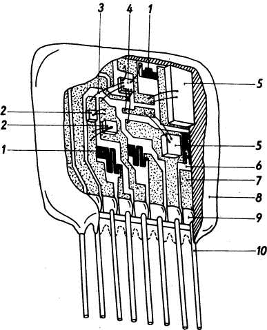
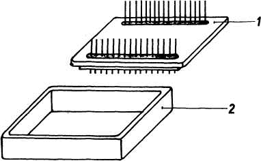
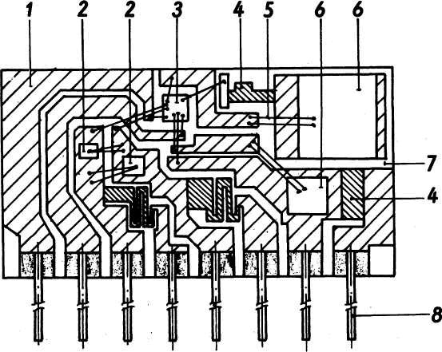
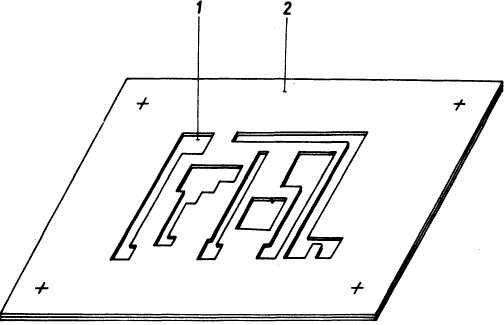
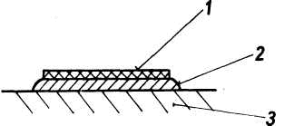
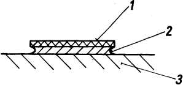

<!--

prenita el:
Fonto: Scienca Revuo, vol. 29 (1978), n-ro 2 (130) pĝ. 71-78.
Aŭtoro: František Hort (Ĉehoslovakio), projektisto en la entrepreno TESLA LANŠKROUN, kie estas fabrikataj pasivaj komponantoj por elektroniko. 
STEB:     https://www.eventoj.hu/steb/ingxenierado/elektro/hibridaj-ic/hibridaj-integritaj-cirkvitoj.

## Hybridní integrované obvody

Èlánek se zabývá problematikou integrovanych obvodù se zamìøením na
hybridní integrované obvody (HIO). Uvádí klasifikaci integrovaných
obvodù z rùzných hledisek. Vysvìtluje nìkteré základní technologie
použivané pøi vyrobì HIO s rozdìlením na techologii tenké a tlusté
vrstvy. Ukazuje možnosti aplikace HIO v elektronice, popisuje nìkteré
jejich výhody oproti monolitickým integrovaným obvodùm.

-->

## 1. Enkonduko

La uzado de integritaj cirkvitoj (mallonge ICoj) akiris eksterordinaran
amplekson en elektrotekniko. La aplikado de ICoj estas tuŝanta preskaŭ
ĉiujn sferojn de homa aktiveco, komencante per "konsuma elektroniko"
(elektraj konstru-ludiloj por infanoj kaj gejunuloj, radioriceviloj,
televidiloj, magnetofonoj, poŝkalkuliloj k.s.), mezurtekniko, medicina
elektroniko kaj finante per kosma tekniko. La uzado de ICoj signifas ne
nur la akiron de novaj altkvalitaj parametroj de finaj fabrikaĵoj, sed
ankaŭ ŝparojn dum produktado kaj muntado.

La disvastigon de ICoj akompanas miniaturigo kaj mikrominiaturigo
unuavice en la aparata tekniko kaj en la produktado de komputoroj. Tie
ni povas klare kompari: se antaŭ dek jaroj por instalo de komputoro
estis necesa ĉambro ampleksa dekojn da kvadratmetroj, hodiaŭ oni povas
instali ĝin sur labortablon aŭ enmunti ĝin rekte en regan ŝrankon de
maŝino aŭ produkt-linio. Ni povas konstati, ke per la enkonduko de ICoj
la elektrotekniko, telekomunika tekniko kaj elektroniko faris kvalitecan
salton signifantan rimarkindan gajnon sur la kampo de scienco kaj
tekniko.

## 2. Klasado de integritaj cirkvitoj

La integritajn cirkvitojn oni klasas kelkmaniere, ekzemple:

1.  El vidpunkto de produkta teknologio ili estas
    -   monolitaj, t.e. kreitaj en unusola peco de duonkonduktanto per grada selektiva difuzo,
    -   hibridaj, t.e. kunmetitaj el pli ol unu monolita komponanto.
2.  Laŭ funkcia amplekso kaj nombro da elementoj distingiĝas
    -   etgrada integreco ([SSI]{.maldense} --- el la angla [Small Scale Integration]{.maldense}), temas pri simplaj kutime monolitaj ICoj,
    -   mezgrada integreco ([MSI]{.maldense} --- [Medium Scale Integration]{.maldense}), temas pri monolitaj ICoj kun pli komplika strukturo,
    -   larĝgrada integreco ([LSI]{.maldense} --- [Large Scale Integration]{.maldense}), temas pri monolitaj ICoj kun tre komplika strukturo,
    -   aparte larĝgrada integreco ([ELSI]{.maldense} --- [Extra Large Scale Integration]{.maldense}), ĝi entenas ampleksajn diĝitajn sistemojn.
3.  El la vidpunkto de aplika destino ili estas
    -   diĝitaj, t.e. logikaj ICoj, kiuj funkcias nur en du tensiaj niveloj.
    -   analogaj, t.e. ICoj, kies ĉefa elemento estas linia cirkvito. Se ili enhavas krom tio ankoraŭ nelinian elementon, rezulta karaktero de tia ICo povas esti nelineara.

## 3. Specoj de hibridaj integritaj cirkvitoj

Hibrida integrita cirkvito (mallonge HICo) estas integrita cirkvito,
kunmetita el pli ol unu monolita komponanto ([fig. 1.](#bld-1)). Nuntempe
produktataj HICoj:

1.  **Plurĉipa HICo** estas kunmetita el pluraj monolitaj ICoj, reciproke interkonektitaj en unu skatolo.
2.  **Minctavola HICo** estas integrita cirkvito, kies unuopaj komponantoj estas formitaj per sinsekva deponado de mincaj konduktivaj tavoloj kaj izolaj materialoj sur nekonduktiva substrato. La cirkvito povas esti kompletigita per kelkaj diskretaj komponantoj alkonektitaj al tavola konduktilaro per diversaj metodoj. La minca tavolo estas konduktiva, duonkonduktiva aŭ izola tavolo dika 0,1 --- 10^3^nm, metita sur la substraton de HICo plej ofte per vakua vapordeponado aŭ katoda disŝprucado.
3.  **Diktavola HICo** estas integrita cirkvito, kies unuopaj komponantoj estas formitaj per sinsekva deponado de dikaj konduktivaj tavoloj kaj izolaj materialoj sur nekonduktivan substraton. La cirkvito povas esti kompletigita ankaŭ per kelkaj diskretaj komponantoj. La dika tavolo estas konduktiva aŭ izola tavolo dika 10 - 100 jum, metita sur la sub-straton de HICo kutime per serigrafia teKnologio.
4.  **Kombinita HICo** estas monolita integrita cirkvito, enhavanta aktivajn komponantojn. Sur ĝi estas deponitaj minctavolaj konduktilaroj kaj pasivaj komponantoj. Ĉe fabrikado oni uzas procedojn aplikeblajn en la teknologio de monolitaj cirkvitoj.

## 4. La bazaj elementoj de HICoj

{#bld-1}\
Fig. 1: Hibrida integrita cirkvito.\
1 - tavola rezistilo\
2 - ĉipa diodo\
3 - kontakta drato\
4 - ĉipa monolita integrita
cirkvito\
5 - ĉipa kondensilo\
6 - substrato\
7 - kondukta tavolo\
8 - tegaĵo\
9 - lutaĵo\
10 - elduktaj dratoj

1.  Tavola cirkvito estas elektra cirkvito, farita el diktavolaj aŭ minctavolaj elementoj, kiuj estas reciproke interkonektitaj per la sistemo de tavola konduktilaro. La tavolo funkcianta kiel tavola konduktilaro aŭ tavola komponanto, estas plej ofte pretigata per: kemia deponado, brulizado de suspensio sur la substrato, senkurenta deponado, metalizado, vakua vapordeponado, katoda disŝpruco kaj serigrafio.
2.  Tavolaj komponantoj, precipe la tavola rezistilo, estas formataj sur la substrato de HICo per la surmeto de rezistiva suspensio aŭ pasto. La precizan rezistanc-valoron de tavola rezistilo oni alĝustigas per ŝlifado, blovegado de fajna malmola pulvoro aŭ per lasero. Tavola kondensilo estas formata sur la substrato per du konduktilaj tavoloj kaj per intermetita dielektrika tavolo. Tavola bobeno estas fabrikata per tekinologio de tavolaj konduktilaroj rekte sur la substrato de HICo. Minctavola transistoro estas kutime la transistoro de tipo [FET]{.maldense}, produktata per la teknologio de minctavoloj.
3.  **Ĉipoj** estas aktivaj aŭ pasivaj cirkvit-elementoj, kutime neenskatoligitaj, destinitaj por muntado al HICo. Uzataj estas precipe ĉipaj transistoroj, rezistiloj, kondensiloj, monolitaj ICoj. Por ilia muntado oni uzas lutadon, ultrasonan aŭ termopreman veldadon, gluadon per elektre konduktiva gluaĵo aŭ mastiko.

{#bld-2}\
Fig. 2: Skatolo.\
1 - soklo kun elduktiloj\
2 - ujo

4.  **Skatolo** protektas HICon kontraŭ eksteraj mekanikaj kaj klimataj influoj kaj forkondukas varmon. La konstrua solvo de skatoloj estas tre ofte derivata de skatoloj por transistoroj, signataj per la literoj [TO]{.maldense}. La skatolo konsistas el metala ujo kaj el soklo kun elduktiloj ([fig. 2.](#bld-2)). Por la HICoj estas ofte uzataj plataj skatoloj. Por hermete kunigi la soklon al la ujo oni uzas rezistanc-veldadon aŭ oni verŝ-tegas la HICojn per rezinoj. La skatoloj estas plej ofte el latuno, kupro, aluminio, malpli ofte el ceramikaĵo, vitro aŭ plastoj.

## 5. Kondiĉoj de produktado

Unu el la bazaj kondiĉoj de sukcesa fabrikado de HICoj estas pureco en
fabrikejoj. Ĉefa medio-pretendo estas malaltigita ĉeesto de polvaj eroj
kaj reguleblaj humido kaj temperaturo de aero. Estas necese prikonsideri
la fakton, ke ĉe la HICoj malkreskas la dimensioj de unuopaj elementoj
ĝis kelkaj nanometroj kaj sekve de tio la difektiĝo povas esti kaŭzata
per la maska efekto de polvaj eroj sedimentiĝintaj sur fotorezistalon aŭ
sur produktan maskon ĉe eksponado k.s.. La tehnologio de la fabrikado de
HICoj estas tre ekzakta, ĝi postulas altan specialiĝon kaj zorgemon de
laboristoj kaj ankaŭ precize funkciantajn maŝinojn kaj aparatojn. La
plenumado de teknologia disciplino kaj de labor-higienaj principoj dum
la fabrikado de HICoj estas unu el la bazaj premisoj de ilia sukcesa
produktado.

{#bld-3}\
Fig. 3.Topologia skizo:\
1 kondukta tavolo, 2 ĉipa diodo, 3 ĉipa monolita integrita cirkvito, \
4 tavola rezistilo. 5 kontakta drato. 6 ĉipa kondensilo. 7 substrato, \
8 elduktaj dratoj. 9 lutaĵo.

## 6. Propona kaj labora procedoj

La laboro pri HICo komenciĝas per propono de cirkvito. Kun kliento estas
pritraktita baza propono, kiu estas poste prilaborata kiel t.n.
model-skizo. Ĝi havas desegne prilaboritajn ĉiujn geometriajn
parametrojn de la cirkvito. Plu estas necese ellabori topologian skizon,
t.e. idean proponon de ICo-topologio inkluzive dislokiĝon de cirkvitaj
elementoj ([fig. 3.](#bld-3)). La topologia skizo servas kiel fundamento por
pretigo de preponaĵo. Ĉi estas desegno de unu tavolo de tavola cirkvito
pretigita en difinita skalo ([fig. 4.](#bld-4)). La materialo de preponaĵo estas
kutime majlara laminaĵo. Ĝi estas travidebla majlara folio kun surgluita
tavolo de opaka materialo. La preponaĵo estas fabrikata per tranĉado
helpe de koordinatografo (direktata ofte per komputoro) kaj per deigo de
opaka materialo. Por atingi deziratan precizecon de estonta ICo oni
pretigas la preponaĵon en taŭga pligrandigo, 25:1 ĝis 125:1. Poste
sekvas pretigo de la reduktita preponaĵo en dezirata dimensio. Laŭ la
reduktita preponaĵo estas fabrikata aŭ ŝablono por la telinologio de
minctavoloj, aŭ serigrafia ŝablono por la teknologio de diktavoloj. Ĝis
nun estas la teknologioj por minctavoloj kaj diktavoloj preskaŭ
ekvivalentaj. Plej grava diferenco estas en la metodoj de surmeto de
tavoloj kreantaj cirkvitojn.

La minctavolaj cirkvitoj fabrikiĝas plej ofte helpe de vakua
vapordeponado de tavolo. La vakua vapordeponado estas la metodo de
vaporigado de metaloj per varmigo en vakuo. En la altaj temperaturoj
okazas intensa elvaporiĝado de metalo kaj liberigitaj molekuloj
kondensiĝas sur apudaj malpli varmaj surfacoj.

{#bld-4}\
Fig. 4. Proponaĵo. 1 travidebla majlara folio, 2 opaka materialo.

Katoda disŝprucado estas ankaŭ tre ofte uzata. Temas pri formado de
metala tavolo per amasiĝo de eroj liberiĝintaj el katodo helpe de la
molekuloj de jonigita gaso.

Post la depono de la minca tavolo sur la substraton el berilia aŭ
korunda ceramikaĵo oni pretigas la koncernan cirkviton per
fotolitografia teknologio kaj per gravurado en acidoj. Tiucele oni uzas
diversajn specojn de rezistaloj. Ili estas materialoj, rezistantaj
kontraŭ efiko de gravuraj likvaĵoj. Ekzemple pozitiva fotorezistalo
rezistas kontraŭ tiaj efikoj sur areo neprilumita, diference de negativa
fotorezistalo, kiu rezistas sur la prilumitaj lokoj. La gravurado iam
kaŭzas superetendon ([fig. 5.](#bld-5)), t.e. lokan pligrandigon de desegno
kompare al la desegno prezentata per la fotorezistalo. Okazi povas ankaŭ
subgravuriĝo ([fig. 6.](#bld-6)), t.e. nedezirata gravura enpenetro sub randon de
la fotorezistalo. La superetendo kaj la subgravuriĝo negative influas
kvaliton de cirkvito.

Per la minctavola teknologio eblas fabriki kelkajn tavolojn sinsekve,
unu sur la alia. En tiu okazo estas grava preciza interspacigo de
tavoloj, reciproka spaca orientado de skemoj en unuopaj tavoloj dum ilia
sinsekva fabrikado sur la substrato.

{#bld-5}\
Fig. 5: Superetendo.\
1 rezistalo, 2 superetendo 3 substrato

{#bld-6}\
Fig. 6: Subgravuriĝo.\
1 rezistalo 2 subgravurigo 3 substrato

La diktavolaj cirkvitoj estas fabrikataj per serigrafia surmeto de
tavoloj. Ĝi estas teknologio, ĉe kiu oni premas rezistivan, konduktivan
aŭ alian paston tra metala, plasta aŭ silka fajna reto. Sur la fajna
reto estas formitaj dezirataj skemoj el malplenaj maŝoj, tra kiuj oni
trapremas la paston sur la substraton. La dikeco de fajna reto kaj la
premo de forviŝilo influas la dikecon de tavoligita pasto. Poste sekvas
sekigado kaj brulizado en difinitaj temperaturoj. Per la serigrafia
telinologio estas eble krei sinsekve kelkajn tavolojn per ripeta depono
kaj brulizo de ĉiu tavolo.

La pluaj fabrikaj operacioj ĉe la minctavolaj kaj la diktavolaj
cirkvitoj estas preskaŭ la samaj. Post pretigo de la pasiva reto oni
alĝustigas celatan rezistancon de tavolaj rezistiloj ekzemple helpe de
ŝlifado, blovegado per fajna malmola polvo aŭ helpe de lasera radio. La
valoro de rezistanco estas dum la alĝustigado kontinue mezurebla kaj
tiel estas garantiita ĝia alta precizeco. Poste sekvas muntado de
unuopaj ĉipoj per lutado, ultrasona aŭ termoprema veldado. Uzata estas
ankaŭ la gluado per elektre konduktiva gluo aŭ mastiko. Ĉar temas pri
tre fajna laboro postulanta precizecon, oni faras tiujn ĉi operaciojn
helpe de mikroskopo. Poste estas kontrolataj la elektraj parametroj de
kompleta cirkvito. Se la rezulto estas pozitiva, oni hermete
enskatoligas la cirkviton kaj denove estas kontrolata ĝia funkcio. La
tipo de la HICo estas markita sur la skatolo per stampado, presado,
etiketado.

## 7. Aplikeblo de HICoj

Kie kaj kiaamplekse ni povas apliki la HICojn kun sukceso? Ĉie, kie ne
estas uzeblaj la monolitaj ICoj pro ekonomiaj aŭ teknikaj motivoj kaj
ankaŭ tie, kie la uzo de HICo prezentas teknikan progreson kaj atingas
almenaŭ la suban limon de ekonomie profita nombro da pecoj fabrikotaj.
Memkomprene ne estas ekonomie uzi ilin, kiam temas pri fabrikado de nur
kelkaj dekoj da pecoj. La ĝisnunaj spertoj montras, ke la hibrida
teknologio ebligas ampleksan aplikadon de HICoj ekzemple por la
rezistilaro kun difinitaj parametroj, por la precizaj
potencial-dividiloj kun difinita temperatura koeficiento, por
amortiziloj, aktivaj filtriloj, diĝitaj cirkvitoj, diversaj tipoj de
cirkvitoj ĉe malaltaj kaj altaj frekvencoj, diversaj kategorioj de
povumaj cirkvitoj k.t.p..

Nuntempe ni uzas la HICojn en la komputora, radiosenda kaj televida
tekniko, industria aŭtomatiko, konsuma elektrotekniko, mezura tekniko,
aŭtomobila kaj avia industrio, sekuriga tekniko en transporto, medicina
elektroniko, kosma tekniko k.t.p.. La HICoj alportas al klientaro
rimarkindajn avantaĝojn:

-   ili ebligas atingi pli altajn teknikajn parametrojn de la fina
    fabrikaĵo (malaltigas pezon, altigas fidindecon, malgrandigas
    dimensiojn),
-   ili malaltigas kostojn eĉ ĉe malgrandaj serioj,
-   ili ebligas grandan variadon dum projektado de cirkvito.

En la nuntempa elektroteknika industrio la HICoj okupis firman pozicion
apud la monolitaj ICoj kaj kontribuas al la daŭra progreso en la teknika
nivelo de elektronikaj produktoj.

## 8. Literaturo

-   Ehlbeck,H. W. (1967): *Integrierte Schaltungstechnik.* Telekosmos
    Verlag. Stuttgart.
-   Hnatek, R.E. (1973): *A User\'s Handbook of Integrated Circuits.*
    John Wiley and Sons. New York.
-   Holland, L.A. (1966): *Thin Film Microelectronics.* Chapman and Hall
    London.
-   Lilen, H. (1974): *Circuits hybrides à couches minces et à couches
    épaisses.* Éditions Radio. Paris.
-   Topfer, M.L. (1971): *Thick-Film Microelectronics.* Van Nostrand
    Reinhold Company. New York.