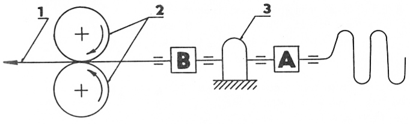
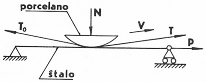

<!--

Determino de frotkoeficiento en la bremsilo
por entrena transversa fadeno de teksa stablo

A. Stoljarov (Sovetunio)
-->

Ĉe la determino de frotoforto kaj fadenostreĉo dum labordaŭro de la
bremsilo por entrena transversa fadeno (BETF) en la ekzistanta literaturo la
esplorantoj uzas tre mezumigitajn valorojn. Lige kun tio la frotkoeficiento
atingas relative tro altajn valorojn. Ekzemple la difinita frotkoeficiento por
rajona fadeno sur la kontaktantaj surfacoj de BETF estas egaligata al 0,82, kiu
estas je 40 - 50 % pli granda ol la efektiva.

Esplorante la determinon de la frotkoeficiento en BETF de la teksa
stablo STB-175 ni muntis provstandon, kiu imitis la teĥnologian skemon de
enigo de la entrena tranversa fadeno en la stablon. La skemon de la instalaĵo
montras fig. [1](#bld-1). Ĉi tie la entrena transversa fadeno estas metata spirale sur glacean
surfacon, plu ĝi pasas tra la streĉindikatoro *A* kaj la BETF *3*. La determino de
fadenostreĉo post eliro de la fadeno el la bremsilo estas farata per la dua streĉindikatoro *B*. La rapideco de trapaso por la entrena transversa fadeno estis
variigata inter 20 m/s kaj 25 m/s, kio respondas al la fadenrapideco en teksa
stablo. En la prov-instalaĵo la rapideco estis atingata per ŝanĝo de la lineara
rapideco ĉe la eltira rulil-duo *2*.

{#bld-1}\
Fig. 1: Skemo de provo-stando

La procedo estis registrata per oscilografo ĉe la rapideco de bendo 0,5 m/s.
Dum la analizo de la esplormaterialo estis konstatite, ke la fadenostreĉo ĉe la
eniro kaj la eliro el la stablo en la intervalo de fadenrapidecoj 20 - 25 m/s restis
senŝanĝa. Tamen ne estus prava aserto, ke la frotkoeficiento ne dependas de la
fadenrapideco. Se ni prenus la intervalon 5 - 25 m/s, estus jam rimarkebla
abrupta ŝanĝigo en la valoro de la frotkoeficiento. Ankaŭ estas notinde, kiel
grava faktoro, influanta la dumlaboran fadenstreĉon, estas la glateco de fadeno.
Ties valoro konstateble influas la kvanton de perdoj de entrena transversa fadeno. Tio rilatas al la fakto, ke la neglataĵoj de fadensurfaco kaŭzas kreskon de
streĉo en la intervalo BETF — fadengvidilo. Tial ĉe la determinado de frotoforto en BETF estas necese enkonduki la korekton por neglateco de ŝpinitaĵo.

Ĉe la determinado de la frotkoeficiento sur la elementoj de BETF (fig. [2](#bld-2))
ni uzis la formulon:

$$T = T_0 \mathrm{e}^{k\varphi} + \frac{P}{\varphi} \cdot \frac{k+k_1}{k}(\mathrm{e}^{k\varphi}-1)\cdot c$$

kie:

|||
|---|---|
|$T$   | la streĉo de fadeno post ĝia eliro el bremsilo|
|$T_0$ | la streĉo de fadeno antaŭ la bremsilo|
|$k$   | la frotkoeficiento por la kombino fadeno-porcelano|
|$k_1$ | la frotkoeficiento por la kombino fadeno-ŝtalo|
|$\varphi$| la fadena ĉirkaŭpren-angulo por la elementoj de BETF (78°)|
|$P$   | la streĉforto de bremsa bendo (350 N)|
|$c$   | la konsidero de fadena neglateco|

{#bld-2}\
Fig. 2: Skemo de determinado de frotkoeficiento

Ni determinis la frotkoeficientojn por diversaj tipoj de ŝpinitaĵo. Rezulte
ni ricevis sekvajn valorojn de frotkoeficiento:

- por artefarita silko n-ro 60: $k = 0{,}213, k_1 =0{,}251$,
- por katuna fadeno n-ro 54: $k = 0{,}218, k_1 = 0{,}259$,

Konkludoj

1.  Eksperimente estas trovite, ke la frotkoeficiento sur la bremselementoj
    havas tendencon al kresko. Tamen en la intervalo de fadenrapideco
    20 - 25 m/s ni povas konsideri ĝin kiel konstantan.

2.  La uzo de la formulo permesas plej racie determini la fadenostreĉon,
    konsiderante la fadeno-neglatecon kiel faktoron de la kresko de fadenostreĉo.

## Literaturo

[Andreeva, V.S. — Efremov, E.D.]{.maldense} (1971): Teĥnologia tekstilnoj promiŝlenosti N-ro 1/1971.

Avtomatiĉeskoje pitanie tkackiĥ maŝin osnovnoj utkom. (1975). Redaktis: [Asonov, V.N. — Ornatskaj, V.A.]{.maldense}. Ljogkaja industria, p. 154-162.

[Strnad, Z. — Nosek, S. — Valášek, J.]{.maldense} (1973): Reibungsmessungen am laufenden Faden. — Vĕda výzkum v textilním průmyslu, XIV, 109-135. VÜP, Brno.
