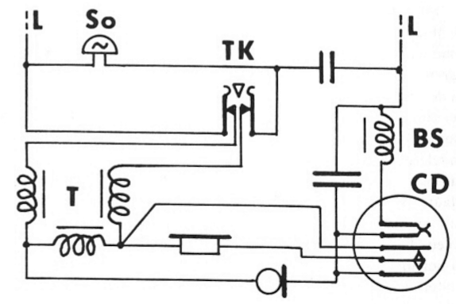
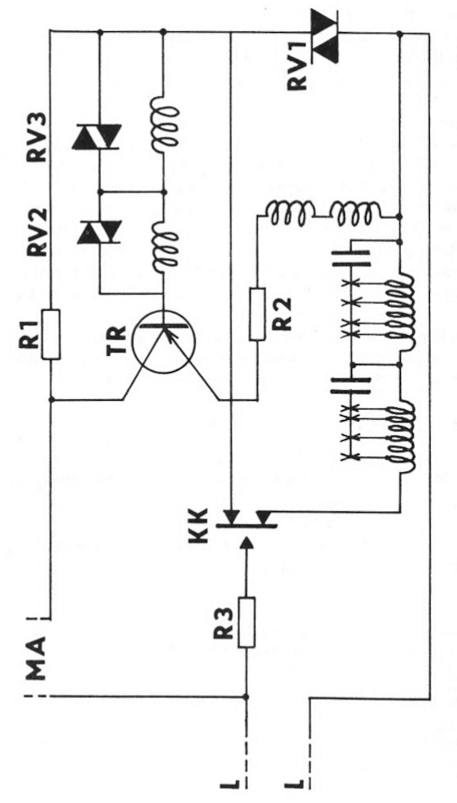

<!--
Historio de la telefonaparatoj
Karlo Juhász (Hungario)
Elektroinstrumentisto en la entrepreno B.H.G., Budapeŝto

A telefonkészülékek története

A téviro feltálálásával azonnali igeny jelentkezett a tavbeszelesre is. Az elso tavrecsegot Bell
helyezte izembe, amit kĉesobb Hughes, Hunnings es Edison tOkeletesitett, A mikrofon aramel-
latasa miatt LB vagy CB keszulek lehetseges. Automata kozpontkhoz szamtarcsas keszŭlek haszndlatos. Az lektronikus kozpontokhoz nyomogombos keszileket fejlesztettek ki. Vegŭl
ismertettem az Ericsson, €s Siemens ŭjdonsagokat.
-->

La telefonaparato apartenas al la ĉiutaga vivo. En la artikolo mi prezentas
la evoluon ekde la unua “telekrakilo” ĝis la nuntempe uzataj aparatoj.

Post naskiĝo de la telegrafo anonciĝis forta pretendo pri la teleparolo.
Tiun plenumis [G. Bell]{.maldense}, kiu inventis la pratelefonon en 1876. Ĝi konsistas el
elektromagneto, antaŭ ĝi situas membrano; vidu fig. [1](#bld-1). Se oni parolas, la
membrano vibretas. La fenomeno induktas kurenton, kiu cirkvite fermiĝas
tra simila aparato. Tie la kurento estigas magnetan flukson, kiu fine resonigas membranon. La aranĝaĵo estas nomata *elektromagneta mikrofono*.

{#bld-1}\
Fig. 1: La unua telefono: aparato de [Bell]{.maldense}.\
M = membrano; E = elektromagneto; L = lineo; A = aŭdilo

La unua aparato funkciis modeste, tial [Bell]{.maldense} perfektigis ĝin. Modifante inventon de [Grav]{.maldense}, li tiam uzis la *rezistanco-mikrofonon*. Helpe de ĝi li telefone
vokis sian kolegon. Tiu frazo estas konata kiel la unua frazo komunikita
pertelefone: "[Mr. Watson, come here. I want you!]{.maldense}”. Jen la nova invento; fig.
[2](#bld-2). Laŭ la parolintenso la membrano pli-malpli premadas la moveblan elektrodon en la likvon. Pro tio la rezistanco ŝanĝiĝas. Laŭ tio ŝanĝiĝas ankaŭ la
kurent-intenso kaj la tensio.

{#bld-2}\
Fig. 2: la rezistanco-mikrofono de [Bell]{.maldense}.\
E = elektrodo; AL = acidigita likvo; U = metala ujo, samtempe la dua
elektrodo; B = baterio

La nuntempe uzata mikrofono estas la karbon-mikrofono, invento de
[Edison]{.maldense}. Poste [Hughes]{.maldense} pliperfektigis ĝin; vidu fig. [3](#bld-3). Dum parolo, pro la
akustika premo ĉe la ekstremaĵoj de stangeto, la rezistanco ŝanĝiĝas kaj
kurento-variado estiĝas. Fine [Hunnings]{.maldense} ankoraŭ pliperfektigis la aparaton.
En metalan ujon li metis karberojn kaj kovris ĝin per metala membrano. La
membrano pli-malpli forte premadas la karberojn, do efike ŝanĝiĝas la rezistanco.

{#bld-3}\
Fig. 3: La karbo-mikrofono de [Hughes]{.maldense}.\
K = karbo; S = stangeto el karbono, ambaŭekstreme pinta, anstataŭanta la membranon.

La karbo-mikrofono bezonas baterion. La konekto havas du eblecojn. La
unua estas la loka bateria sistemo (LB). Ĉe ĉiu aparato estas necese loki
apartan baterion kun tensio 3 - 9 voltoj. Sed la aŭdilon oni devas ŝirmi kontraŭ la unudirekta kurento pro la malutila magnetado. Tial oni devas uzi
transformilon; vidu fig. [4](#bld-4). Dum parolo la amplifitaj signaloj de mikrofono
induktiĝas trans la bobeno kaj vibrigas ambaŭ membranojn de la aŭdiloj. Se
iu parolas kaj samtempe aŭdas sian parolon ankaŭ el sia aŭdilo, tiu fenomeno estas nomata flankaŭdo.

{#bld-4}\
Fig. 4: La loka bateria sistemo.\
Mi = mikrofono; T = transformilo

La dua ebleco postulas centran aŭ komunan baterian sistemon (CB) --
fig. [5](#bld-5). Ĉe tiu ĉi sistemo la unusola baterio troviĝas en la centralo mem, ĝi
estas 20 ĝis 60-volta. Ĝi estas konektita al la cirkvito de mikrofono tra barsolenoido, kiu tralasas la elektran kurenton el la baterio, sed baras la alternan
kurenton de la mikrofono.

La telefono ankoraŭ ne estas kompleta, la akcesoraĵoj mankas. Ĉe la
LB-aparato oni vokas aliajn partoprenantojn aŭ la centralon helpe de induktoro, kiu estas sinĥrona generatoro de alterna kurento. Dum rotacio ĝi induktas alternan kurenton, kiu funkciigas sonorilon de alia aparato; fig. [6](#bld-6). 

{#bld-5}\
Fig. 5: La centra bateria sistemo.\
BS = barsolenoido

{#bld-6}\
Fig. 6: La LB-aparato.\
I = induktoro; So = sonorilo; KK = komuta kontaktilo;
T = telefonila kontaktilo

En la baza stato (kiam la telefonilo troviĝas sur la aparato) la mikrofona cirkvito
estas malfermita, la baterio preskaŭ ne malŝargiĝas. Se nia aparato sonorigas, la unudirektaj kurentaj signaloj fermiĝas tra alia aparato. Ĉe nia aparato dum rotacio de la induktoro la komuta kontaktilo funkcias, nia propra
sonorilo do troviĝas en kurta cirkvito kaj ne konsumas energion. Sed kiam
ni ricevas sonoradon, tiam en la baza stato nia induktoro troviĝas en kurta
cirkvito por ne konsumi energion. Post sonorado ambaŭ telefonantoj levas
la telefonilon kaj la telefonilaj kontaktiloj fermiĝas (al la blankaj kontaktiloj). Tiam la kontakto ĉe la nigra kontaktilo ĉesas, la sonorilo kaj la induktoro apartiĝas kiel elementoj nun superfluaj. Fermiĝas la cirkvito de mikrofno kaj ambaŭ telefonantoj povas paroli.

La CB-aparato ne bezonas induktoron, ĝi simple signalas per levo de telefonilo. Tiam la kontaktiloj fermiĝas, la kurento el la centrala baterio povas
flui tra la aparato (tra unu el la bobenoj, mikrofono); tion la centralo rimarkas kaj baldaŭ faras parol-kontakton. En ĉi tiu aparato la bobenoj ankaŭ reduktas la flankaŭdon, ĉar la aŭdilo troviĝas en la cirkvito de ponto laŭ
*Whetstone*, do nia voĉo ne aŭdiĝas tiel forte el nia aŭdilo. En la baza stato
nur la sonorilo kaj la kondensilo povas funkcii. Se la centralo estas manipula, la aparato bezonas ankoraŭ specialan suplementon, kiu sen parolo, nur
per signaloj, komunikas numeron de la petata aparato. Post diversaj eksperimentoj disvastiĝis la *ciferdisko*. Se el la centralo alvenas speciala permesa
signalo, la diskotono, oni turnadas la ciferdiskon. Tiam la plej grava kontaktilo de la ciferdisko intermitigas la diskotonon. Vidu fig. [7](#bld-7).

{#bld-7}\
Fig. 7: La CB-aparato.\
CD = ciferdisko

La centralo nombras la intermitadojn (la impulsojn), notas la paŭzojn inter la impulso-serioj kaj registras eventualan rezignon pri telefonado. Laŭ la
centralo faras parolkontakton.

Por manipulisto la ciferdisko ne estas konvena, ĉar dum tuta labortago
turni la ciferdiskon estas lacige. Nuntempe, kiam la telefono havas ankaŭ
antaŭ- kaj post-numerojn por lando, regiono k.t.p., tia aranĝo estas neoportuna ankaŭ por simpla telefonanto. Kion fari?

Nuntempe disvolviĝas klavaro, kiu estas rapida, komforta kaj praktika.
Ĝis nun realiĝis du sistemoj:

a.  Sistemo uzanta kontinuajn elektrajn signalojn: ili ĉifras laŭ tensio,
    kurent-intenso aŭ tempa sinsekvo. Tiu sistemo akceptiĝis ĉe neelektronikaj
    centraloj.
b.  Frekvencaj signaloj: centralo analizas la ciferojn laŭ frekvencoj. Ĝi
    estas sistemo utila por elektronikaj centraloj.

Ankaŭ la ekstera formo de la aparatoj moderniĝis. Mi mencias novan aparaton de [L. M. Ericsson]{.maldense}, ĉe kiu telefonilo muntiĝis kune kun la aparato. Levante la aparaton oni tuj povas uzi klavaron.

Funkcion de klavaro bonvolu sekvi ĉe la aparato [Bell]{.maldense}-500 ([Touch Tone]{.maldense}) el
[Bell Laboratory]{.maldense}). Vidu fig. [8](#bld-8), kiu prezentas la principon. La sistemon de
klavar-funkcio prezentas dugrupa kodo. Ĉe ekpremo de klavo estiĝas du
apartaj frekvencoj. La unua ekpremo koncernas la unuan frekvencogrupon, plua ekpremo la duan. La ciferkodo validas nur, se alvenas du frekvencoj samtempe, po unu el la du grupoj. Se alvenas alio, ĝi estas perturbo,
falsa signo.

{#bld-8}\
Fig. 8: Moderna telefono: [Bell]{.maldense}-500 ([Touch Tone]{.maldense}).\
TR = transistoro; la ceterajn klarigojn vidu en la teksto

Fazoj de uzitaj frekvencoj estas diversaj, tamen ili estas inter 900 - 3000 Hz,
ĉar la telefono ebligas telekomunikadon inter 300 kaj 3400 Hz. Por eviti intermikson de cifersignoj kaj voĉoj (minimumigi la falsajn signojn) dum klavado, la telefonilo estas preskaŭ ŝuntita per rezistilo R3. Sekve la mikrofono
ne povas elsendi voĉon kaj en la aŭdilo oni aŭdas la signalon de la klavaro
tre mallaŭte. Se la cirkvito inter la centralo kaj la aparato fermiĝas, estiĝas
konstanta *emitor-kurento* tra la telefonilo MA, rezistilo R1, *varistoro* RV1
kaj la lineo. Tasko de RV2, RV3 estas agi kiel nelinia elemento en la oscilila
cirkvito por limigi la amplitudon de oscilado.

Unu ciferklavo funkciigas tri klavetojn: po unu en ambaŭ agorditaj cirkvitoj kaj komunan klaveton KK.

La transistora oscililo enhavas du agorditajn cirkvitojn, ĉiu konsistas el tri
bobenoj kaj unu kondensilo. Unu agordita cirkvito apartenas al unu
frekvenco-grupo, konsistanta el kvar frekvencoj. La oscililo estas stabiligita
helpe de ponto-cirkvito. Se po unu klaveto fermiĝas ĉe la koncernaj kondensiloj kaj difinita frekvenco-grupo, estiĝas signalo, dum la komuna klaveto
KK liveras tension ankaŭ al la transistoro kaj igas la telefonilon esti preskaŭ
en kurta cirkvito.

Praktika novaĵo estas [Etafon]{.maldense} de [Siemens]{.maldense}. En la aparato ne estas moviĝantaj partoj. La klavaron anstataŭas tuŝbutonoj, kiuj funkcias per ektuŝo, ĉar
fingro kaŭzas kapacito-ŝanĝon. La toneto konfirmas la senditajn frekvencojn. La staton de levata aŭ remetata telefonilo la aparato elektronike detektas. Okaze de remeto de telefonilo oni interparolas per enkonstruitaj laŭtparolilo kaj mikrofono. Se oni tenas la telefonilon enmane, la laŭtparolilo
estas malkonektita. La sonoradon anstataŭas elektronika muzika signalo,
kies laŭteco estas regulebla. La aparato ĉiam konservas la petatan numeron,
kaj se ĝi estas okupata, post ektuŝo de aparata tuŝbutono la tuta numervokado ripetiĝas.

Mi prezentis la plej gravajn trajtojn de la modernaj telefonaparatoj. Mi
fermas la artikolon, sed post iu tempo pli kaj pli modernaj aparatoj postulos
allason, ne nur sur paĝojn de revuoj, ankaŭ en la ĉiutagan vivon.

## Vortklarigoj:

1. flankaŭdo — En: [sidetone]{.maldense}, De: [Rückhören]{.maldense} ([für Sprache]{.maldense}).

2. telefonilo — akcesoraĵo de telefono konsistanta el aŭdilo, mikrofono kaj tenilo.

3. emitoro — unu el tri elektrodoj de transistoro.

4. varistoro — duonkonduktilo uzata por intenso-limigo; ĝia rezistanco dependas de tensio, kurentintenso aŭ polarizo.

## Referencoj

[Blum, E.]{.maldense} (1966): Korszerü elektronikus köpontok, Budapest.

[Pattantyus, G.]{.maldense} (1971): Gépész és villamosmérnökök kézikönyve II. Budapest.

[Simon, F.]{.maldense} (1960): Távbeszélotechnika, Budapest.

