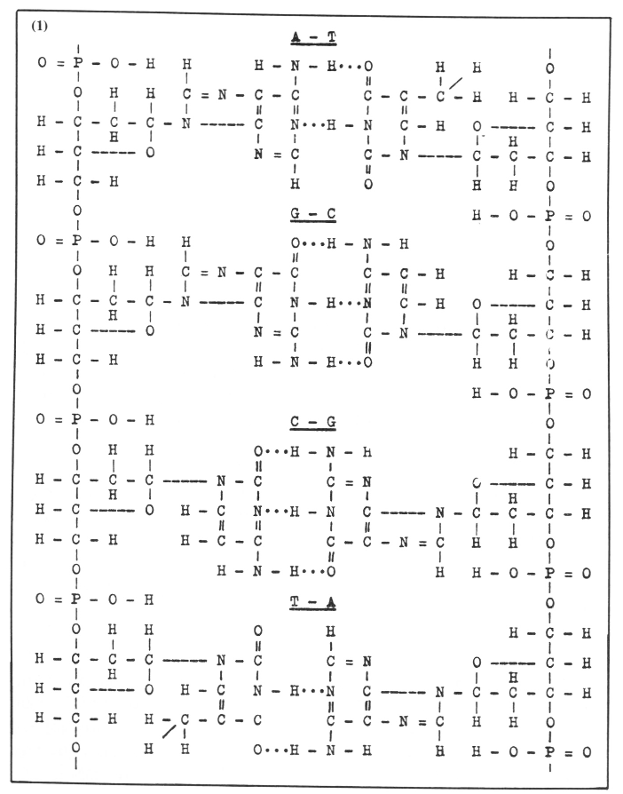
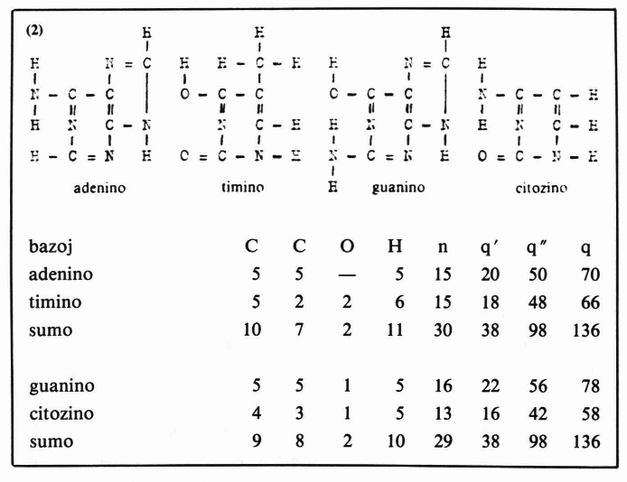
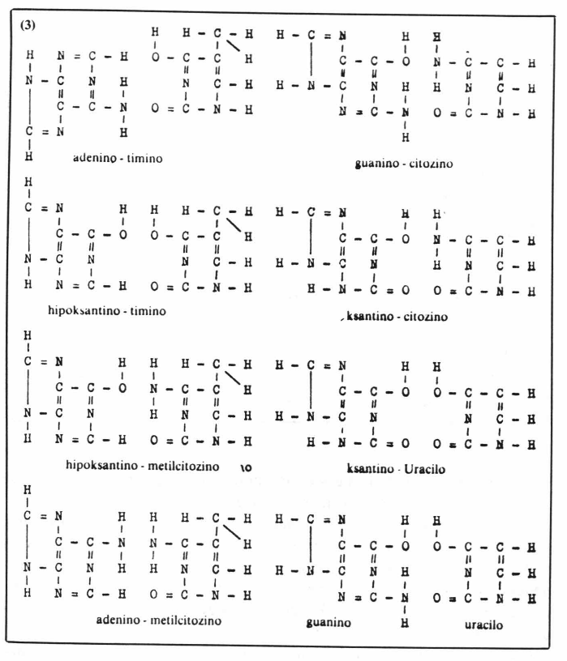
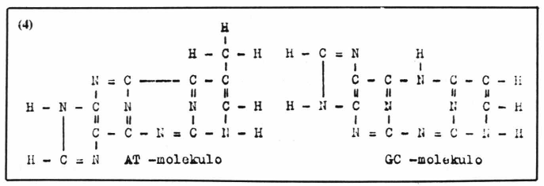
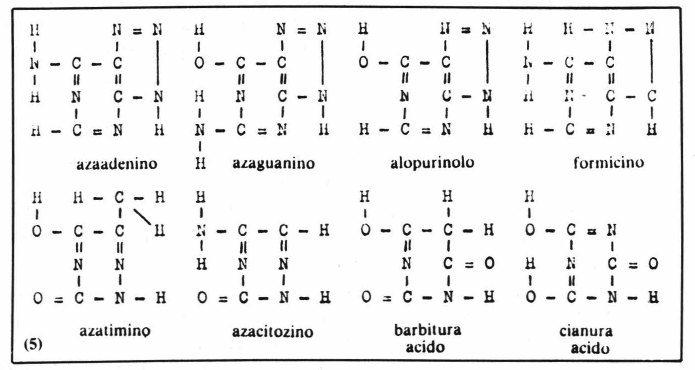
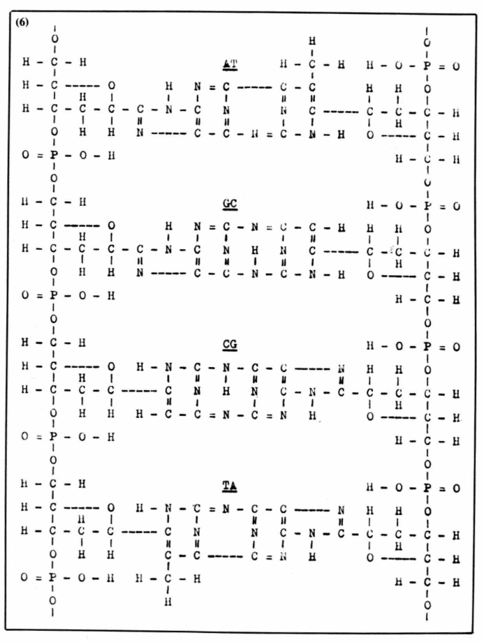
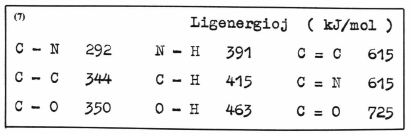
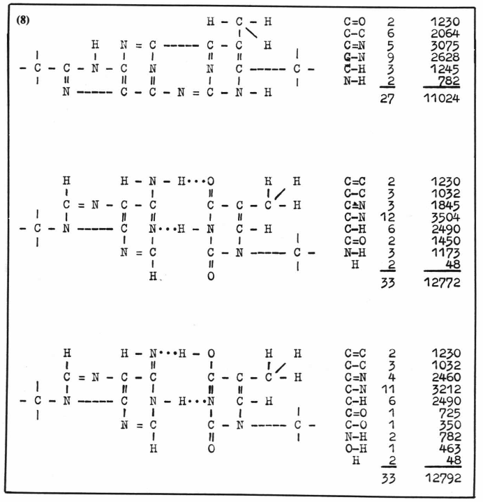
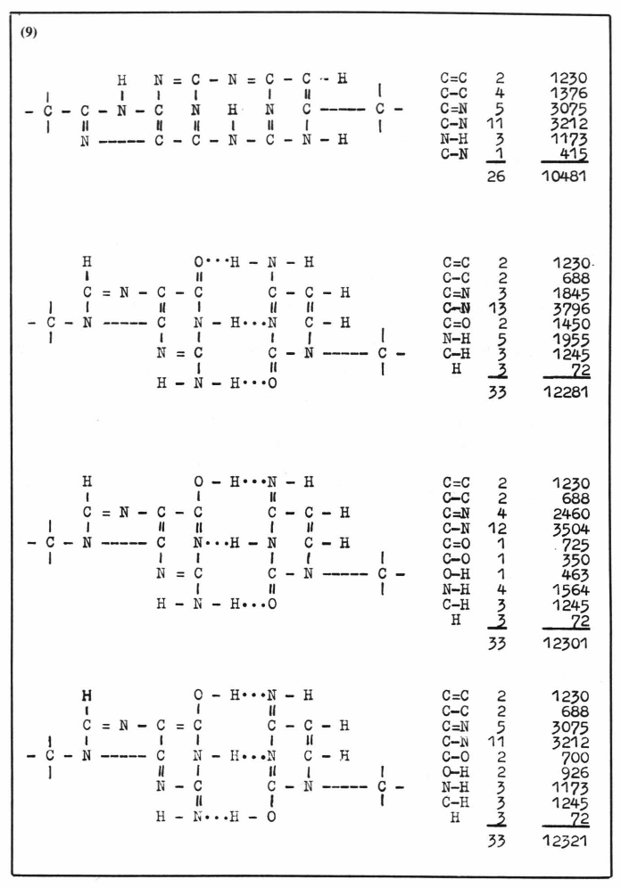

<!--

Formulo de la nativa DNA
M.T.Popov (Sovetio)

kandidato de fizik-matematikaj sciencoj, docento de fiziko en Pedagogia Instituto, Melitopolska 4-12, SU-332440 BERDJANSK

-->

En 1953 [Crick]{.maldense} kaj [Watson]{.maldense} laŭ rentgenogramoj, ricevitaj de [Wilkins]{.maldense} kaj
[Franklin]{.maldense}, konstruis modelon de la desoksiribonukleata acido (DNA). DNA
aperis antaŭ biologoj en aspekto de spirala ŝtupetaro, kies ŝtupetojn formas
paroj de purinaj kaj pirimidinaj azotaj bazoj adenino-timino (A-T) kaj
guanino-citozino (G-C). La bazoj en ĉiu paro estas ligitaj per hidrogenaj ligiloj; per siaj eksteraj nitrogenaj atomoj la bazoj estas kroĉitaj al desoksiribozoj de spiralaj suker-fosfataj polimeroj. La molekulo havis du sukerfosfatajn spiralojn; la desoksiribozoj en ili estas orientitaj malsamdirekte.
Konforme al tiu modelo estas skribita formulo de DNA ([1](#bld-1)).

Kiun DNA prezentas la modelo kaj konforma al ĝi formulo?

Por esplori fizikajn-ĥemiajn ecojn kaj strukturon de DNA oni eligas ĝin el
histo per "barbaraj" metodoj: oni dispecigas kaj dispistas la histon, agas per
multaj reagentoj, ŝanĝas temperaturon kaj disdividas en centrifugiloj per
grandegaj akceloj dekmiloble pli grandaj ol gravitakcelo. DNA, ricevita tiamaniere, konservas vitalecon, sed estas tre dube, ke ĝi restas la sama, kia ĝi
estis en citoplasmo aŭ tiom pli en ĥromosomoj.

Kia do estas la nativa DNA? Nativa en strikta senco de la vorto, t.e. en
senco "denaska", sed ne en senco "vivkapabla".

La aparatoj kaj metodoj, uzataj de bioĥemiistoj kaj molekulaj biologoj,
ne donas eblecon "palpi" DNA en ĥromosomoj. Ni ne povas vidi vivan
DNA; ĉu tio signifas ke ni ne povas pentri ĝian portreton? Paleontologoj neniam vidis dinosaŭrojn, sed ja scias, kiel tiuj aspektis. Leĝecoj, malkovritaj
de la aŭtoro, permesas "laŭ ostoj" restarigi aspekton de la viva DNA.

{#bld-1}

En 1977 mi malkovris komplementecon de ŝargaĵo de elektronaj tavoloj
en la ĉefaj bazoparoj de DNA, kiu konsistas en tio, ke ŝargaĵoj de elektronaj
tavoloj (subŝeloj) en la paroj A-T kaj G-C estas egalaj — ĉiu paro havas 38
internajn elektronojn kaj 98 eksterajn, dum en apartaj bazoj, la nombroj de
elektronoj en la tavoloj estas malsamaj ([2](#bld-2)).

{#bld-2}

La komplementeco de ŝargaĵo aparte en la internaj kaj eksteraj tavoloj
aludas tion, ke paro de azotaj bazoj en DNA-polinukleotido formas komplekson, kiun oni devas konsideri unu molekulo, sed ne du, ligitaj per hidrogenaj ligiloj. Krome la fakto de komplementeco de elektra ŝargaĵo en internaj tavoloj devigas supozi, ke en vivprocesoj partoprenas ankaŭ
1s-elektronoj de karbono, nitrogeno kaj oksigeno.

Konataj estas bazoj, ne kutimaj por natura DNA — ksantino, hipoksantino, uracilo kaj metilcitozino, kiuj unuiĝante kun A,G,T,C, aŭ inter si
povus formi parojn kun la sama suma nombro de elektronoj en la tavoloj
kiel paroj A-T kaj G-C. Povus formi, sed ne formas.

Estis rimarkite, ke el ĉiuj paroj de la suprenomitaj bazoj, kiuj plenumas la
kondiĉon de ŝargaĵkomplementeco, nur paroj A-T kaj G-C havas ĉe la dua
kaj sesa atomoj de iliaj sesmembraj heterocikloj atomojn aŭ funkciajn grupojn, kiuj povas krei du kovalentajn ligilojn formante interbazan senoksigenan heterociklon ([3](#bld-3)).

{#bld-3}

El tiu fakto sekvas konkludo, ke adenino kun timino kaj guanino kun citozino dum formado de DNA-polinukleotido interligiĝas tiel, ke post elimino de du akvomolekuloj ĉiu paro formas unu pirimidin-purinan molekulon,
en kiu primaraj heterocikloj estas ligitaj per interna granda heterociklo ne
enhavanta oksigenon ([4](#bld-4)).

{#bld-4}

Kaj tio signifas, ke la modelo de [Watson-Crick]{.maldense} prezentas parte denaturigitan DNA, en kiu internaj heterocikloj estas hidrolize splitigitaj, sed ne nativan ĝian formon. La nativa DNA konsistas el du suker-fosfataj ĉenoj, ligitaj
transverse per pirimidin-purinaj molekuloj (pp-molekuloj).

Por ekscii la manieron de alkroĉo de pirimidin-purinaj molekuloj al sukerfosfataj ĉenoj estis selektitaj bazaj analogoj, kiuj povus komplementi la bazojn laŭ ŝargaĵo de elektronaj tavoloj, sed kiuj ne eniĝas en DNA. Al tiaj
analogoj apartenas azapurinoj, azapirimidinoj, alopurinolo, formicino, cianura kaj barbitura acidoj ([5](#bld-5)).

{#bld-5}

El komparo de ĉi kombinaĵoj kun ĉefaj bazoj iĝas videble, ke en naturan
DNA eniras nur bazoj, kapablaj kunligiĝi per senoksigena heterociklo, kiuj
povas formi C-C glikozidan ligilon kun desoksiribozo de suker-fosfataj ĉenoj. Neniu purino prezentita en ([5](#bld-5)) povas formi tiun ligilon per sia 8-atomo
kaj neniu pirimidino — per sia 4-atomo (numerado laŭ [Fischer]{.maldense}). La purinoj,
prezentitaj en ([5](#bld-5)), havas N-atomon sur 9-loko (krom formicino) kaj ĉiuj pirimidinoj havas N-atomon sur 3-loko. Do, se ili formus C-N glikozidajn ligilojn, ili devus eniri en la nativan DNA, ĉar laŭ komplementeco de ŝargaĵo
kaj laŭ kapablo formi internan heterociklon ili plene konvenas. La komparo
de la formuloj ([5](#bld-5)) kun formuloj de ĉefaj bazoj de DNA devigas konkludi, ke
en la nativa DNA azotaj bazoj estas ligitaj al desoksiribozoj ne per nitrogena
atomo, sed per la karbona (la 4-a en pirimidinoj kaj la 8-a en purinoj).

Tiel estas deduktita la formulo de la nativa DNA ([6](#bld-6)).

{#bld-6}

La plej serioza argumento kontraŭ tia DNA estas tiu, ke kovalentaj
inter-bazaj ligiloj estas dekoble-tridekoble pli firmaj ol la hidrogenaj kaj pro tio
estas bezonata pli granda energio por distranĉi DNA laŭlonge. Seriozeco de
tiu argumento estas nur ŝajna.

La unua etapo de la distranĉo estas transformo de pp-molekuloj, kroĉitaj
al suker-fosfata karkaso per la ligiloj C-C en pp-parojn kies bazoj estas interligitaj per la H-ligiloj kaj kroĉitaj al la karkaso per la ligiloj C-N. Por ekscii, ĉu tiu kuniĝo estas endoerga aŭ ekzoerga, necesas kalkuli tutan ligenergion de la pp-molekulo, subtrahi energion de ĝia tensio, aldoni ligenergion
de du akvomolekuloj, kiuj aperas dum hidrolizo, kaj kompari tiun sumon
kun tuta ligenergio de la pp-paro. Se la sumo (E~1~) estas pli granda ol la ligenergio de la paro (E~2~), tiam la transformo estas endoerga, se male — ekzoerga.

Por taksi energion de la tensio necesas havi modelon de DNA.

La aŭtoro konstruis modelon konforman al formulo ([6](#bld-6)). La konstruita
DNA do evidentiĝis ne spirala sed rubandforma (1978, 1979 ab).

Tiu modelo estas unu el la kelkaj, kiujn eblas konstrui laŭ la formulo ([6](#bld-6)).
Ni rimarku ĉi tie ke laŭ modelo eblas skribi nur unu formulon sed laŭ formulo povas esti konstruitaj pli ol unu modelo.

La tensienergio, kiun mi kalkulis laŭ donitaĵoj prenitaj el [Eliel]{.maldense} (1962) kaj
el aliaj fontoj, egalas ĉirkaŭ 60 kJ/mol, ĝi estas proksimume la sama por
ambaŭ pp-molekuloj. La valoroj de ligenergioj prezentitaj en ([7](#bld-7)) devenas el
[L.]{.maldense} kaj [P. Pauling]{.maldense} (1972), la energivaloron de la H-ligiloj ni prenu 24 kJ/mol
el [Watson]{.maldense} (1976). Ligenergio de atomoj en du akvo molekuloj, kalkulita kiel
energio de kvar ligiloj O-H, egalas 1852 kJ/mol. La formuloj kaj la energioj
de ĉiuj ligiloj en AT-molekulo kaj en At-paroj estas prezentitaj en ([8](#bld-8)), la samo por GC — en ([9](#bld-9)).

{#bld-7}

{#bld-8}

{#bld-9}

Ligenergio de AT-molekulo por ĉiu ĝia taŭtomero kaj resonanco estas la
sama 11024 kJ/mol; por ligenergio de AT-paro ni prenu mezan valoron de
ligenergio de du ĝiaj eblaj taŭtomeroj montritaj en ([8](#bld-8)) E~2~ = 12782 kJ/mol.
Tiam E~1~ = 11024 - 60 + 1852 = 12816 kJ/mol,
E~1~ - E~2~ = 12816 - 12782 = 34 kJ/mol. Do, transformo de AT-molekulo en
AT-paron estas endoerga, ĝi postulas 34 kJ/mol de energio.

Ligenergio de GC-molekulo estas ankaŭ la sama por ĉiu ĝia taŭtomero,
kaj resonanco, ĝi egalas 10481 kJ/mol; por ligenergio de GC-paro ni prenu
mezan valoron de ligenergio de tri ĝiaj eblaj taŭtomeroj E~2~ = 12301 kJ/mol.
Tiam E~1~ = 10481 - 60 - 1852 = 12273 kJ/mol, E~1~ - E~2~ = 12273 - 12301 =
-28 kJ/mol. Kiel videblas, transformo de GC-molekulo en GC-paron estas
ekzoerga; dum ĉi transformo liberiĝas energio 28 kJ/mol. Do, se oni kalkulas energion por du diversaj pp-molekuloj, oni akiras etan valoron de 6
kJ/mol.

Certe ni ne devas forgesi, ke la kalkulo estas nur proksimuma; en ĝi ne
estis kalkulitaj energioj de resonancoj en la molekuloj kaj en la paroj, krome
ni ne atentis tensienergion interbazan en pp-molekuloj. La lasta verŝajne rekompencas grandparte diferencon de resonancenergioj en la ambaŭ strukturoj, pro tio en la kalkuloj ni povas neglekti tiun diferencon.

Ĉi supraj kalkuloj kaj konsideroj permesas konkludi, ke transformo de
pp-molekuloj en pp-parojn ne postulas aŭ preskaŭ ne postulas energion. Do
aserto pri neeblo de pp-molekuloj pro iliaj firmaj kovalentaj ligiloj estas sendube erara. Kio koncernas energion de aktivigo de pp-molekulo dum ties hidroliza transformo en pp-paron, pri tio zorgu enzimoj; de energia vidpunkto
tiu transformo estas tute ebla.

La deduktita formulo de la nativa DNA prezentas strukturon, kiu ege diferencas de la duondenaturigita DNA kun interbazaj H-ligiloj. Karaktera trajto de pp-molekuloj estas neordinara abundo de taŭtomeroj kaj resonancoj.
AT-molekulo havas 37 taŭtomerojn kaj resonancojn, GC-molekulo — 82.
Ĉar ĉiuj taŭtomeroj kaj resonancoj de iu pp-molekulo havas la saman ligenergion, dum transiro de hidrogeno en pp-molekulo de unu N-atomo al la
alia, ligenergio de la molekulo restas senŝanĝa. La distanco inter proksimaj
N-atomoj de najbaraj pp-molekuloj egalas ĉirkaŭ 300 pm, tia distanco ebligas transiron de H-atomoj kaj protonoj al N-atomoj de najbara ppmolekulo. Dum tiu proceso okazas interŝanĝo de energio kaj elektra ŝargaĵo
inter najbaraj ĉeneroj de DNA. La distanco ebligas ankaŭ dinamikajn
H-ligilojn inter najbaraj pp-molekuloj. Dum ekesto kaj detruo de tiuj ligiloj
la molekuloj ankaŭ interŝanĝas energion. La energio pulsas laŭlonge de
DNA. Signalo pri iuj ŝanĝoj en iu-ajna pp-molekulo de la ĉeno disvastiĝas
tra la tuta DNA.

Resumante suprediriton, ni povas deklari, ke la nativa DNA havas propran nervan sistemon; ĝi havas internan vivon. Interna vivo de DNA konsistas en senĉesa transĵetado de H-atomoj, protonoj kaj elektronoj inter
N-atomoj, kiu kaŭzas senĉesan alternon de taŭtomeroj kaj resonancoj de
pirimidin-purinajn molekuloj — DNA vivas.

## Referencoj

[Eliel, E.L.]{.maldense} (1962): Stereochemistry of carbon compounds.

[Pauling, L. — Pauling, P.]{.maldense} (1915): Chemistry.

Popov, M.T. (1978): Ruband-forma desoksi-ribonukleata acido. — SCIENCA REVUO, 78.
Ĉapeko.

[Popov. M.T.]{.maldense} (1979): Komplementeco de ŝargaĵo de elektronaj tavoloj en paroj de ĉefaj bazoj de DNA. — SCIENCAJ KOMUNIKAĴOJ. Budapeŝto.

[Popov, M.T.]{.maldense} (199): Ruband-forma desoksi-ribonukleata acido. MEDICINA INTERNACIA
REVUO, vol. 8.

[Popov, M.T.]{.maldense} (1979): Rubandforma DNA. — SCIENCAJ KOMUNIKAĴOJ. Budapeŝto.

[Watson, J.D.]{.maldense} (1916): Molecular biology of the gene.
