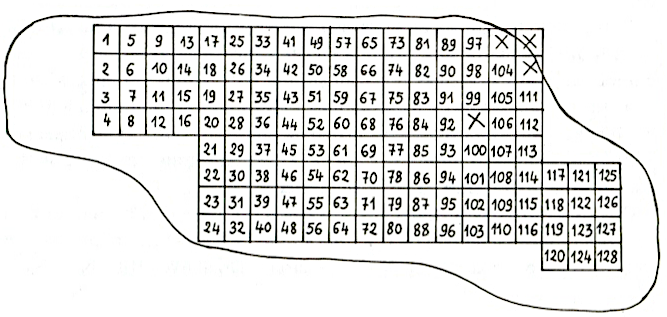
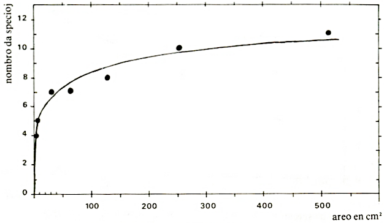
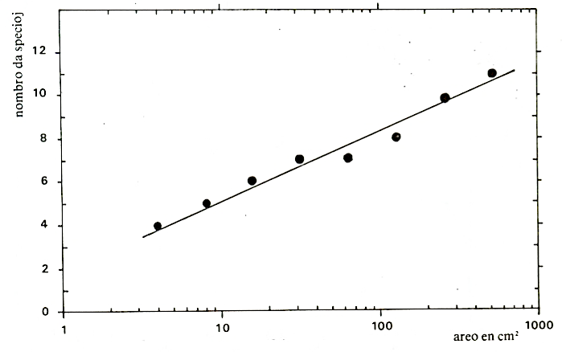
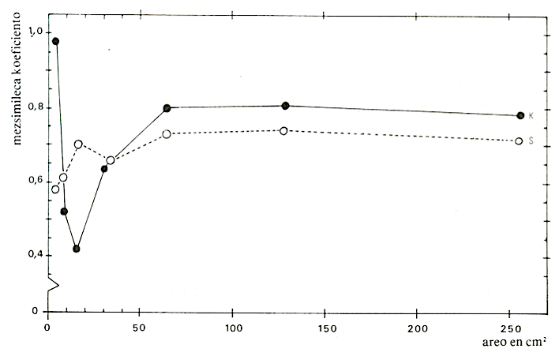

<!--
La minimumaj areoj de surŝela likenkunaĵo
de Physconia grisea
Rene Rieux“ — Claude Roux“ (Francio)

René Rieux: Esploristo ([Chargé de Recherche]{.maldense}) en INRA (agrikultura esplorinstituto): Laboratoire de Zoologie, I.N.R.A., Domaine Saint-Paul, F.84 000 AVIGNON.

Claude Roux: Esploristo ([Chargé de Recherche]{.maldense}) en CNRS (scienca esplorinstituto): Laboratoire de
Botanique et Ecologie méditerranéenne, Faculté des Sciences et Techniques de Saint-Jérôme, Rue Henri Poincaré, F-13397 MARSEILLE.

Les aires minimales d'un peuplement de lichen corticole
(peuplement ĉ Physconia grisea)

Les aires minimales qualitative et quantitative d'un peuplement corticole lichénique ĉi petits
thalles foliaces dominants (peuplement ĝ Physconia grisea) sont determindes par la methode de
Gounot et Calleja (etude de la variation d'un coefficient de similitude moyen en fonction de l'aire). Ces aires sont sensiblement ĉgales et estimdes ĉi 150-200 cm².
-->

## 1. Enkonduko

En la studo de vegetaĵa kunaĵo, fitosociologo devas unue registri la vegetaĵaron en diversaj lokoj, kie kreskas la kunaĵo. La areo, kiun ĝi okupas, ege
diversas laŭ la lokoj: de kelkaj cm² ĝis kelkaj dekoj da m² (iafoje eĉ pli) por
la likenkunaĵoj. Plej ofte ne eblas studi tiel vastajn areojn; necesas elekti
poan parton de ili. La plej malgranda areo, reprezentiva por la kunaĵo, nomiĝas minimuma areo: minimuma areo kvalita, se oni zorgas nur pri la listo
de la specioj; minimuma areo kvanta, se oni atentas pri la kovreco de la specioj

Ĉi tiu nocio tre gravas en kriptogama fitosociologio, ĉar la identigado de
specioj ofte tre malfacilas. Studi la kiel eble plej malgrandan areon ŝparigas
multan tempon kaj ebligas precizan studon laŭkvalitan kaj laŭkvantan.

Antaŭ nelonge, [Roux - Rieux]{.maldense} (1980, 1981) studis la minimuman areon de
du likenkunaĵoj kalkofilaj. Post provo de pluraj metodoj, evidentiĝis la plej
kontentiga tiu de [Gounot]{.maldense} kaj [Calleja]{.maldense} (1962), kiu konsistas en la studo de
mezsimileca koeficiento funkcie de la areo.

De post [Hilitzer]{.maldense} (1925), neniu grava studo pri likenkunaĵo surŝela estis publikigita. Pluraj likenologoj (i.a. [Barkman]{.maldense} 1958) menciis minimumareajn
valorojn, sed eĉ ne aludas pri la uzita metodo. Do al likenofitosociologoj ege
mankis fidindaj rezultoj tiukampaj, tiom pli, ke pluraj aŭtoroj (i.a. [Gounot]{.maldense}
1969) evidentigis, ke ĉiuj metodoj uzitaj antaŭ 1962 tre kontesteblas (do eĉ la
rezultoj de [Hilitzer]{.maldense} pri [Pseudevernietum furfuraceae]{.maldense} estas kritikeblaj).

## 2. Studmetodo

La elektita kunaĵo kreskis sur trunkŝelo de migdalarbo izola en natura ŝafpaŝtejo en [Crau]{.maldense} (pron. *kro*), 10 km n. de [Fos-sur-mer]{.maldense} (pron. *fos sur mer*), n.
ok. de Marsejlo, Provenco, Francio, je altitudo de ĉ. 10 m. Post elpreno de
ŝelpeco, ni dividis ĝin en 128 kvadratojn de 4 cm², entute 512 cm² (fig. [1](#bld-1)).
Ĉiun kvadraton ni studis kiel eble plej precize per stereomikroskopo, se necese kontrolante per mikroskopo la identigon de la specioj. La kovrecon de
tiuj ĉi ni mezuris per diafana kvadratita folio el polietileno.


{#bld-1}\
Fig. 1 — Aranĝo de la 128 kvadratoj studitaj sur arbŝelo kovrita de
[Physconia grisea]{.maldense}-kunaĵo
(X = nestuditaj kvadratoj pro difektiĝo de la ŝelo kaj likenoj).

## 3. Flaŭra kaj fitosociologia analizo

Sur la 512 cm² ni recenzis (tab. [1](#tab-1)) nur 11 speciojn (el kiuj 4 muskoj); tio
estas malgranda nombro kompare kun tiu de la kalkofilaj kunaĵoj antaŭe
studitaj ([Roux - Rieux]{.maldense} 1980): 30 specioj sur la sama areo. Eĉ se la likenkunaĵoj surŝelaj kutime malpli riĉas je specioj ol la kalkofilaj,
[Physconia grisea]{.maldense}-kunaĵo aparte malriĉas.

Krom ĉi tio, ĝin karakterizas la ega plejkovreco de likenoj folietecaj, ĉefe
[Physconia grisea]{.maldense} (relativa mezkovreco: ĉ. 88%!), kaj malabundo de muskoj
kaj krustecaj likenoj.

[**Tab. 1**]{#tab-1}: Fitosocilogia registro de la studita areo (512 cm²): 126 kvadratoj de 4 cm²)
kovrita de [Physconia grisea]{.maldense}-kunaĵo (kovreco en %; + signas malpli ol 0,01%;
sf = senfrukta).

||||
|---|---|---:|
||**1 — Likenoj**||
|sf |Candellariella concolor (DICKS.) STEIN | 1,25|
|sf |Hyperphyscia adgluttinata (FLOERKE) MAYRH. et POELT |0,50|
|   |Lecanora chlarotera NYL. |0,25|
|   |Lecanora sienae B. de LESD. |+|
|   |Physcia aipolia (EHRH. ex HUMB.) FUNROHR |1,38|
|   |P. biziana (MASSAL.) ZAHLBR. |5,50|
|sf |Physconia grisea (LAMK.) POELT |75,63|
||**2 — Muskoj**||
|sf |Orthotrichum diaphanum BRID. |+|
|st |Orthotrichum Sp. |+|
|sf |Tortula papillosa WILS. ex SPRUCE |1,50|
|sf |Zygodon baumgartneri MALTA |+|
||*totala kovreco*|**86,01**|
||*totala nombro da specioj*|**11**|


Pro la plejkovreco de [Physcia s.l.]{.maldense} ([Physconia]{.maldense}, [Physcia]{.maldense}, [Hyperphyscia]{.maldense}), ĝi
apartenas al alianco [Xanthorion parietinae]{.maldense} [OCHSNER]{.maldense} 1928 em. [BARK]{.maldense}.
1958 kaj tre afinas al [Physcietum ascendentis physconiosum griseae]{.maldense} [BARK]{.maldense}.
1958. Tamen ĉi tiu sintaksono diferencas de la provenca kunaĵo i.a. pro malesto de [Physcia biziana]{.maldense} ([MASSAL.]{.maldense}) [ZAHLBR.]{.maldense} (mediteranea specio) kaj
ĉeesto de [Ramalina fastigiata]{.maldense} ([PERS.]{.maldense}) [ACH.]{.maldense}, [Phlyctis argena]{.maldense} ([ACH.]{.maldense}) [FLOTOW]{.maldense}... (sufiĉe aerhumidejaj). [Physcia biziana]{.maldense} verŝajne karakterizas ĉu mediteranean subasocion de P[hyscietum ascendentis]{.maldense} ĉu memstaran asocion,
ambaŭ ankoraŭ ne priskribitajn; tial ne eblas ekzakte precizigi la sintaksonomian lokon de tiu kunaĵo, kiun ni provizore nomas
[Physconia grisea]{.maldense}-kunaĵo.

Tipe nitreja kaj polveja, ĝi oftas en Malalta Provenco sur izolaj aŭ disaj
arboj en kamparo.

## 4. Minimuma areo kvalita
### 4.1. Elekto de taŭga metodo

Kiel ni diris enkonduke, pluraj metodoj estis proponitaj por determini la
minimuman areon. La plej bone konata (tab. kaj fig. [2](#tab-2)) baziĝas sur analizo de la kurbo pri la nombro da specioj funkcie de la studita areo (specio-area
kurbo). La minimuma areo estas atingita, kiam la nombro da specioj ne plu
aŭ kvazaŭ ne plu kreskas.

:::{.plenlargha}
[**Tab. 2**]{#tab-2}: Nombro da specioj funkcie de la areo kaj ilia apera ordo

|nombro de kv.| numeroj de kvadratoj| specioj |areo<br>(cm²)|nombro da<br>taksonoj|
|---|---|---|---:|---:|
|1  |57 |Hyperphyscia adgluttinata, Physcia biziana,<br>Physconia grisea, Tortula papillosa |4 |4|
|2  |49; 57 | + Orthotrichum diaphanum | 8 | 5 |
|4  |49; 50; 57; 58 | + Candelariella concolor |16 |6 |
|8  |49; 50; 57; 58; 65; 66; 73; 74 |+ Physcia aipolia |32| 7|
|16 |49-52; 57-60; 65-68; 73-76 |+ Physcia aipolia |64| 7|
|32 |la ĉi-supraj +<br>81-84; 89-92; 97-99; 104-106; 111-112| + Lecanora chlarotera | 128| 8| 
|64 | la ĉisupraj +<br>85-88; 93-96; 100-103; 107-110; 113-128| + Zygodon baumgartneri, Orthotrichum sp. |256 |10 |
|128 | 1-128 |+ Lecanora sienae |512 |11|
:::

{#bld-2}\
Fig. 2: Nombro da specioj funkcie de la studita areo (areo-specia kurbo).

Fakte, pluraj aŭtoroj evidentigis, ke la nepliiĝo de la nombro da specioj
plej ofte — se ne ĉiam — devenas de laciĝo de l' observanto, kiu emas forgesi
ne tre videblajn speciojn post obervado. Objektivaj studoj montras, ke la
nombro da specioj daŭre kreskas logaritme ([Gounot]{.maldense} 1969; [Gounot - Calleja]{.maldense}
1962; [Roux - Rieux]{.maldense} 1980; fig. [3](#bld-3) de ĉi tiu artikolo). Tial la determino de la minimuma areo per tiu metodo ne estas objektiva, tiom pli, ke la formo de la
kurbo dependas de la adoptita skalo ([Roux - Rieux]{.maldense} 1980, 75).

Pluraj metodoj, devenantaj de la areo-specia, celas al pli preciza determino de la minimuma areo. Sed ili estas aŭ neobjektivaj (metodo de [Cain]{.maldense} kaj
[Castro]{.maldense}: [Cain]{.maldense} 1938; [Cain-Castro]{.maldense} 1959) aŭ arbitraj (metodoj de [Boudouresque]{.maldense}
kaj [Belsher]{.maldense} 1978; de [Vestal]{.maldense} 1949; ...) kiel evidentigis i.a. [Gounot]{.maldense} (1969) kaj
[Roux-Rieux]{.maldense} (1980).

Fine la metodo pri konstantaj specioj ([Du Rietz]{.maldense} 1921) ne baziĝas sur la
areo-specia kurbo, sed ne estas objektiva ([Braun-Blanquet]{.maldense} 1964; 
[Gounot-Calleja]{.maldense} 1962) kaj plie ne fidinde utiligebla por la studo de likenkunaĵoj.

{#bld-3}\
Fig. 3: Nombro da specioj funkcie de la studita areo (duonlogaritmaj koordinatoj).

En 1962 [Gouinot]{.maldense} kaj [Calleja]{.maldense} proponis novan metodon de determino de la
minimuma areo, bazitan sur la komparo de samlimaj areoj per simileca koeficiento. Malgraŭ la granda laboro postulata, ĉi tiu metodo pli kaj pli disvastiĝas pro objektiveco kaj nearbitreco ([Gounot]{.maldense} 1969; [Boudouresque]{.maldense} 1974;
[Coppejans]{.maldense} 1977; [Roux-Rieux]{.maldense} 1980).

### 4.2. Determino de la minimuma areo per la metodo de [Gounot]{.maldense} kaj [Calleja]{.maldense}
#### 4.2.1. Principo

Ĉi tiu metodo konsistas en la komparo de 4 samlimaj kvadrat(ar)oj per simileca koeficiento kvalita, ekz. tiu de [Sorensen]{.maldense} (1948):

[]{.fno} $\displaystyle P_s=\frac{2c}{a+b}$,

kie

----- --------------------------------------
$P_s$ simileca koeficiento kalkulota,
$a$   nombro da specioj en la kvadrat(ar)o A
$b$   nombro da specioj en la kvadrat(ar)o B
$c$   nombro da specioj komunaj al A kaj B.
----- --------------------------------------

La duopa komparo de la 4 areoj donas 6 valorojn de la simileca koeficiento, kies averaĝon oni uzas por konstrui kurbon funkcie de la areo (kurbo) pri
mezsimileca koeficiento funkcie de la areo.

#### 4.2.2. Rezultoj

La kurbo pri la mezsimileca koeficiento funkcie de la areo (tab. [3](#tab-3) kaj fig.
[4](#bld-4)) multe pli facile interpreteblas ol la areo-specia kurbo, ĉar ĝi asimptotas al
rekto $P_s\ge 1$). La figuro montras, ke post pli malpli neregula kresko, la koeficiento stabiliĝas proksimume je valoro 0,73. Trans 64 cm² la area pliigo rezultigas nur iometan kreskon de la mezsimileca koeficiento kaj eĉ, trans 128
cm², iometan malpliiĝon.


[**Tab. 3**]{#tab-3}: Valoroj de la mezsimilecaj koeficientoj de [Sorensen]{.maldense} kaj [Kulczyński]{.maldense} funkcie

```{=html}
<table>
<thead>
<tr>
    <th rowspan="3">areo de la duope<br> komparitaj kvadrat-<br>(ar)oj en cm²</th>
    <th colspan="4">simileca koeficiento</th>
</tr>
<tr>   
    <th colspan="2">valoroj de <span class="maldense">Sorensen</span></th>
    <th colspan="2">valoroj de <span class="maldense">Kulczyński</span></th>
</tr>
<tr>    
    <th>ekstremaj</th>
    <th>averaĝaj</th>
    <th>ekstremaj</th>
    <th>averaĝaj</th>
</tr>
</thead>
<tbody>
<tr>
  <td>4</td><td>0,40 - 0,80</td><td>0,58</td><td>0,95 - 1,0</td><td>0.98</td>
</tr>
<tr>
  <td>8</td><td>0,33 - 0,67</td><td>0,61</td><td>0,13 -0,75</td><td>0,52</td>
</tr>
<tr>
  <td>16</td><td>0,67 - 0,89</td><td>0,70</td><td>0,17 - 0,91</td><td>0,42</td>
</tr>
<tr>
  <td>32</td><td>0,60 - 0,83</td><td>0,66</td><td>0,33 - 0,92</td><td>0,64</td>
</tr>
<tr>
  <td>64</td><td>0,67 - 0,91</td><td>0,73</td><td>0,71 - 0,91</td><td>0,80</td>
</tr>
<tr>
  <td>128</td><td>0,67 - 0,86</td><td>0,74</td><td>0,70 - 0,91</td><td>0,81</td>
</tr>
<tr>
  <td>256<sup>*</sup></td><td colspan="2" style="text-align: center">0,71</td><td colspan="2" style="text-align: center">0,78</td>
</tbody>
</table>
```

(*): nur du kvadrataroj komparitaj

{#bld-4}\
Fig. 4: Variada kurbo de la mezsimileca koeficiento funkcie de la areo\
S = koeficiento de [Sorensen]{.maldense} \
K = koeficiento de [Kulczyński]{.maldense}

#### 4.2.3. Interpreto

Ju pli la komparitaj areoj vastas, des pli ili havas komunajn speciojn kaj
sekve intersimilas; sed la simileco ne iĝas totala, ĉar konstante aperas novaj
specioj. Tamen, trans iu area valoro (ĉi tie 100 - 150 cm²) ĝi ne plu kreskas.
Estas do logike akcepti, ke ne necesas studi multe pli grandajn areojn ol tiu
ĉi, kiun oni povas rigardi kiel minimuman.

## 5. Minimuma areo kvanta

### 5.1. Principo

*La minimuman areon kvantan oni povas determini* ([Coppejans]{.maldense} 1977;
[Roux-Rieux]{.maldense} 1980) samkiel la kvalitan, sed anstataŭigante la mezsimilecan
koeficienton kvalitan per iu kvanta, ekz. tiu de [Kulczyński]{.maldense} (1927):

[]{.fno} $\displaystyle P_k=\frac{2\sum_{i=1}^n R_c}{\sum_{i=1}^n R_a+R_b}$,

kie

----- --------------------------------------------
$R_a$ kovreco de specio i en kvadrat(ar)o A,
$R_b$ kovreco de specio i en kvadrat(ar)o B,
$R_c$ malpli granda kovreco de specio i en A aŭ B.
----- --------------------------------------------

### 5.2. Rezulto kaj interpreto (fig. [4](#bld-4) kaj tab. [3](#tab-3)).

La koeficiento unue tre gravas (0,98 por 4 cm²), sed frue kaj ege malpliiĝas,
poste rekreskas kaj fine stabiliĝas je valoro ĉ. 0,80. La interresponda minimuma areo kvanta takseblas inter 100 kaj 150 cm².

Tiaj gravaj valoroj de $\overline{P_k}$, por tiaj malvastaj areoj klarigeblas pro la ega grupiĝemo de [Physconia grisea]{.maldense}. Se oni konsideras 4 samlimajn areojn malvastajn (ekz. 4 cm²), lokitajn ĉemeze de densa grupo da [Physconia grisea]{.maldense}, la
koeficiento tre gravos; pliigante la studitan areon, oni transpasos la limon de
ĉi tiu grupo, renkontos aliajn speciojn kun sufiĉa kovreco, por ke la koeficiento malpliiĝu. Tio ĉi evidentigas strukturajn kunaĵ-elementojn, kiujn ni
ne povas ekstudi ĉi-artikole (v. [Boudouresque-Lück]{.maldense} 1972).

## 6. Komparo kun aliaj rezultoj

### 6.1. Pri [Physcietum ascendentis]{.maldense}

[Klement]{.maldense} (1948) kaj [Barkman]{.maldense} (1958) publikigis minimum-areajn valorojn
de [Physcietum ascendentis]{.maldense}, respektive 260 cm² kaj 1000 - 2000 cm², sed ne
menciis la uzitan metodon. Niaj rezultoj proksimas al tiuj de [Klement]{.maldense}; la
trotaksita minimuma areo fare de [Barkman]{.maldense} verŝajne klarigeblas pro nesufiĉa
enlaboratoria studo de la elektitaj areoj.

### 6.2. Pri diversspecaj kunaĵoj, kies minimuma areo estis determinita per la
metodo de [Gounot]{.maldense} kaj Calleja (tab. [4](#tab-4))

La minimuma areo de [Physconia grisea]{.maldense}-kunaĵo proksimas al tiu de likenasocioj kun krustecaj taloj kalkofilaj, sed ankaŭ al tiu de alg-asocioj. Kompreneble ĝi estas multe malpli granda ol tiu de fanerogam-asocioj; krome
konfirmiĝas, ke minimuma areo kvanta iafoje egalvastas al la kvalita (ĉilasta estas kutime rigardata kiel malpli granda), kio klarigeblas pro la ega
grupiĝemo de iu(j) specioj), ĉi tie de [Physconia grisea]{.maldense}.

[**Tab. 4**]{#tab-4}: Valoroj de minimumaj areoj kaj interrespondaj mezsimilecaj koeficientoj laŭ diversaj aŭtoroj.

```{=html}
<table style="width: 130%">
<thead>
<tr>
    <th rowspan="2>aŭtoroj</th><th rowspan="2">studitaj kunaĵoj</th>
    <th colspan="2">minimuma areo kaj interresponda mezsimileca koeficiento</th>
</tr>
<tr>
  <th>kvalitaj</th><th>kvantaj</th>
</tr>
</thead>  
<tbody>
<tr>
    <td><span class="maldense">Boudouresque</span> (1974)</td>
    <td>algokunaĵo nesuneja</td><td>≃200 cm²; 0,65</td><td>–</td>
</tr><tr>
    <td><span class="maldense">Coppejans</span> (1977)</td>
    <td>algokunaĵo suneja</td><td>≃200 cm²; 0,75</td><td> ≃400 cm²; 0,87</td> 
</tr><tr>
    <td rowspan="2"><span class="maldense">Roux-Rieux</span> (1980)</td>
    <td>likenkunaĵo krusteca, surkalkroka, suneja</td>
    <td>≃100 cm²; 0,80</td><td>200-300 cm²; 0,75</td>
    </tr><tr>
        <td>likenkunaĵo enkalkroka, nesuneja</td>
        <td>300-400 cm²; ≥0,77 </td><td> 300-400 cm²; ≥0,73</td>
</tr><tr>
    <td><span class="maldense">Rieux-Roux</span> (ĉi-artikole)</td>
    <td>likenkunaĵo surŝela, suneja, nitreja, polveja</td>
    <td>100-150 cm²; 0,73</td><td>100-150 cm²; 0,80</td>
</tr><tr>
    <td><span class="maldense">Gounot-Calleja</span> (1962)</td>
    <td>herbejo seka (<span class="maldense">Brachypodietum ramos</span>)</td>
    <td>≃8 m²; 0,80</td><td>–</td>
</tr><tr>
    <td rowspan="3"><span class="maldense">Moravec</span> (1973)</td>
    <td>herbejo (<span class="maldense">Sanguisorbo -Deschampsietum</span>)</td>
    <td> ≃25 m²; 0,90</td><td>–</td>
    </tr><tr>
        <td>herbeca kunaĵo marĉa (<span class="maldense">Caricetum vesicariae</span>)</td>
        <td> ≃16 m²; 0,79</td><td>–</td>
    </tr><tr>
        <td>fagaro</td>
        <td> ≃100 m²; 0,71</td><td>–</td>
</tr>        
</tbody>
</table>
```

## 7. Konkludo

Niaj rezultoj klare montras, ke la minimuma areo de surŝelaj likenkunaĵoj
folietecaj estas tre malgranda, kio ebligas ilian studon per la metodo de la totala elpreno: en homogena kunaĵo oni elprenas pecon — iom pli grandan ol
la minimuman areon — da likenkovrita substrato, kiun oni studas kiel eble
plej precize en laboratorio ([Boudouresque]{.maldense} 1974; [Roux]{.maldense} 1981).

Studoj pri la minimuma areo de aliaj surŝelaj kunaĵoj folietecaj estos necesaj por konfirmi niajn rezultojn. Sed, jam de nun, pro la relativa homogeneco de la rezultoj pri kunaĵoj sufiĉe diversaj, kaj algaj kaj likenaj, oni povas hipotezi — sen grava risko de eraro —, ke preciza studo enlaboratoria
pri elprenaĵo po 200 - 400 cm² taŭgas por registri la plejmulton da surŝelaj kunaĵoj folietecaj. Sed necesas substreki, ke ĉi tio ne aplikeblas al la kunaĵoj riĉaj je foliecaj (ekz. [Parmelia]{.maldense}) aŭ arbedecaj (ekz. [Usnea]{.maldense}) taloj, kies minimuma areo devas logike esti multe pli granda pro la pli vastaj taloj.

Kompare kun la kutima metodo (parta elpreno: [Clauzade-Roux]{.maldense} 1975), tiu
de la totala elpreno prezentas multajn avantaĝojn, i.a.: eblecon studi malgrandajn areojn; multe pli da precizeco en la kovreca mezuro. Sed kiam la
substrato estas vivanta arbo, antaŭvideblas la danĝero de blinda uzo de ĉi tiu
metodo kaj estas necese akcenti, ke oni nepre elektu nur freŝdate hakitajn aŭ
baldaŭ hakotajn arbojn.

## 8. Terminoj

Aerhumideja
: kiu kreskas nur aŭ plejofte en aerhumidaj lokoj.

Arbedeca
: Fr: *fruticuleux*; En: *fruticose*; De: *strauchig*.

Folieca
: Fr *foliacé*; En *foliose*; De: *blätterig*.

Krusteca
: Fr: *crustacé*; En: *crustose*; De: *krustig*.

Relativa mezkovreco
: $=\frac{mezkovreco de iu specio}{kovreco de la speciaro}$,
en la sama registro aŭ registraro.

Sintaksono
: Fr: *syntaxon*; En: *syntaxon*; De: *Syntaxon*

Sintaksonomio:
: Fr: *syntaxonomie*; En: *syntaxonomy*; De: *Syntaxonomie*.

## 9. Referencoj

[Barkman, J.J.]{.maldense} (1958): Phytosociology and ecology of cryptogamic epiphytes. 628 p., Assen.

[Boudouresque, C.F.]{.maldense} (1914): Aire minima et peuplements algaux marins. - Soc. phycol. de France, 19, 141-157.

[Boudouresque, C.F. Belsher T.]{.maldense} (1919): Le peuplement algal du Port de Port-Vendres: recherches sur l'aire minima qualitative. - Cah. Biol. mar. fran., 20, 259-261.

[Boudouresque, C.F. Lück H.B.]{.maldense} (1972): Recherches de bionomie structurale au niveau d'un peuplement benthique sciaphile. - J. exp. mar, Biol. Ecol. 8(2), 133-144.

[Cain, S.A.]{.maldense} (1938): The species-area curve. - Amer. midl. Natur., U.S.A., 19, 573-581.

[Cain, S.A., Castro de Oliveira, G.M.]{.maldense} (1959): Manuel of vegetation analysis. - Harper and Brothers eldon., 325 p., New-York.

[Clauzade, G. - Roux, Cl.]{.maldense} (1915): Etude écologique et phytosociologique de la végétation lichénique des roches calcaires non altérées dans les régions méditerranéenne et subméditerranéenne du Sud-Est de la France. - Bull. Mus. Hist. nat. Marseille, 35, 153-208 (kun resumo en
Esperanto).

[Coppejans, E.]{.maldense} (1977): Résultats d'une étude d'homogénéite de peuplements algaux photophiles
sur substrat rocheux à Port-Cros et à Banyuls (France). - Rapp. Comm. int. Mer Médit., 24(4), 143-14.

[Du Rietz, G.E.]{.maldense} (1921): Zur metodologischen Grundlage der modernen Pflanzensoziologie.
Akad. Abhandl., 272 p., Uppsala.

[Gounot, M.]{.maldense} (1969): Méthodes d'étude quantitative de la végétation. - Masson et Cie eldon., 314 p. Paris.

[Gounot, M. - Calleja, M.]{.maldense} (1962): Coefficient de communauté, homogénéite et aire minimale.
Bull. Serv. Carte phytogéogr., serv. B, 7(2), 181-200.

[Hilitzer, A.]{.maldense} (1925): Étude sur la végétation épiphyte de la Bohème - Spisy přírodov. Fak. Karl.
Univ. Praha.

[Klement, O.]{.maldense} (1948): Das Physcietum ascendentis in Schwaben. Ber. Naturf. Ges. Augsburg, 26-39.

[Kulczyński, S.]{.maldense} (1927): Zespoły roślin w Pieninach - Bull. int. Acad. Pol. Sci. Lett. Cl
et nat., ser. B, supl. 2, 57-203. Cracovie.

[Moravec, J.]{.maldense} (1973): The determination of the minimal area of phytocenoses. Folia Geobo1.
Phytotax., 8(1), 23-47.

[Roux, C.]{.maldense} (1981): Étude écologique et Phytosociologique des peuplements lichéniques saxicoles-calcicoles du SE de la France - Bibliotheca lichenologica, Cramer eldon., 15, 1-557 - (kun resumo en Esperanto)

[Roux, C. - Rieux, R.]{.maldense} (1980): L'aire minimale des peuplemenis de lichens crustaces saxicoles-calcicoles. - Rev. Biol. Ecol. medit., 7(27, 65-88 (kun resumo en Esperanto)

[Roux C. - Rieux R.]{.maldense} (1981): L'aire minimale des peuplemenis lichéniques: peuplements lichéniques saxicoles-calcicoles - Vegetatio, 44. 65-76.

[Sorensen, T.]{.maldense} (1948): A method establishing groups of equal amplitude in plant sociology based
on similarity of species contents - Biol. Skr., 5(4), 1-34.

[Vestal, A.G.]{.maldense} (1949): Minimum areas for different vegetations. Their determinaton from
species-area-curves.- Illinois biol. Monogr., 20(3), 1-129.


## Ĉu "likeno" aŭ "liĥeno"?

Mi rekomendis al prof. [Roux]{.maldense}, ke li konsentu pri anstataŭigo de lia "likeno" per "liĥeno". Li
tamen insistis resti ĉe la zamenhofa formo kun K.

Sur ĉi ekzemplo oni povas taŭge demonstri la lingvan politikon de la nuna SR: Kvankam en *kelko* da okazoj estus rekomendinde — cele al leksika kohereco de l'internacia scienca terminologio — substitui la zamenhofan K per Ĥ, mi neniam faros tion kontraŭ la deziro de l'aŭtoro.

Aliflanke, oni — precipe en popularaj Eo-revuoj — ofte renkontiĝas kun kontraŭfundamentaj K-formoj. Se SR-aŭtoro havas en sia manuskripto ekz. la vorton "mekanismo", mi aŭtomate modifas ĝin al "meĥanismo", kiu estas zamenhofa. Por apliki la fundamentan formon, la
SR-redakto sendube ne bezonas esti aprobita de l'aŭtoro. AN

Ankoraŭ iometon pri la vorto "liĥen". Transprenis ĝin medicino kaj poste ankaŭ botaniko
pere de La: [lichen]{.maldense} (pluralo: [lichenes]{.maldense}) el Gr: [λειχήν]{.maldense}. Plej multo de l'eŭropaj, aziaj kaj afrikaj
lingvoj posedas la fonemon Ĥ same kiel Eo, do inklinas apliki la ĝustan prononcon de la Gr-La-devenaj scienc-terminoj.

La supre eksplikita redakta procedo ja ne kondukas al senriproĉa leksikologia planlingveco
de Eo. Tamen eblas kredi, ke perspektive, la fonetiko de la Gr-La-terminoj, asimilitaj de Eo,
unuiĝos almenaŭ ĝis tiu grado, kiu estas atingita en la nacilingvoj. La kredon motivas ĝuste la
*rareco* de zamenhofaj vortoj, kies fonetika modifo estus rekomendinda

[J. Kavka]{.maldense}
