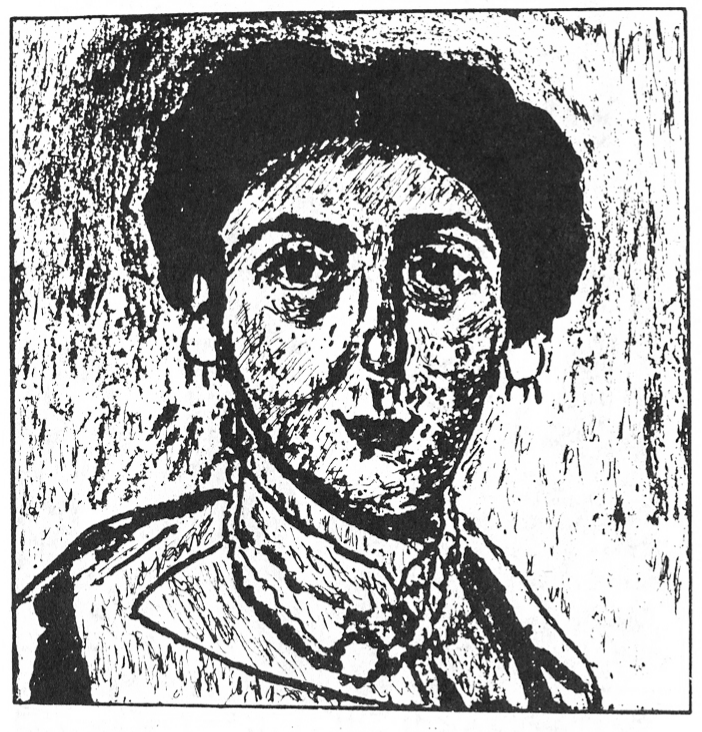
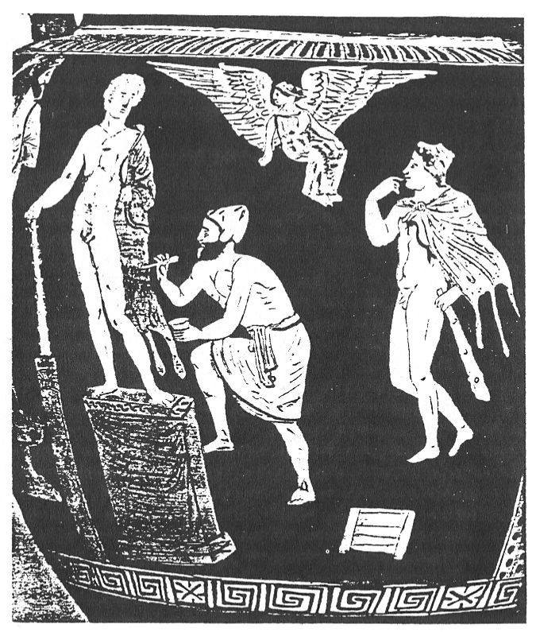
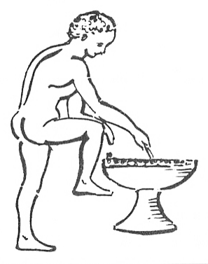

<!--

Vakspentra teĥniko (enkaŭstiko) retrovita
Tony Paredis (Belgio)
Korte Nieuwstraat 13, B-2000 ANTWERPEN

-->

Pentri oni povas per ĉiuspecaj kolorigaj pastoj (inkoj, farboj), kiujn oni
jen diluas, jen malfluidigas, jen miksas helpe de aliaj substancoj. Ankaŭ la
manieron apliki tiajn farbojn oni povas ŝanĝi, jen prenante alian instrumenton (vergeton, haregon, plumon, penikon), aŭ uzante fingron, jen aplikante
la farbojn per ŝmirado aŭ surgluado aŭ eĉ surĵetado (helpe de blovaparato).
Fine ankaŭ la t.n. "portanto" de la artaĵo estas laŭplaĉe elektebla: ŝtonmuro, vitro, lignobreto, tuko k.t.p. Daŭre artistoj en ĉiuj branĉoj de belarto
serĉas novajn materialojn, manierojn, ilojn, ĉu por esprimi specialajn sentojn kaj ideojn, ĉu por atingi specialan efikon. Tiele naskiĝas novaj teĥnikoj.

Unu el la plej interesaj pentroteĥnikoj estas la t.n. "vakspentrado" aŭ
"enkaŭstiko", kiu utiligas abelvakson. Ja, de plej foraj tempoj abelvakso —
el ĥemia vidpunkto tre pura kaj neŝanĝiĝema organika materialo — montriĝis utila por multnombraj celoj. Jencele ĝi permesas redoni konsiderinde fajnajn detalojn, ebligas vastan skalon de kolornuancoj, estas facile aplikebla
al plurspecaj portantoj, pruviĝis rezistema kontraŭ ĉiuspecaj eksteraj influoj
(temperaturo, vetero), reagas nek kun subtavolo nek kun pigmentoj, kaj
eble plej interese: tenas farbojn tra la jaroj same freŝaj kiel ĉe ekesto de la artaĵo (sen paliĝo aŭ malheliĝo), produktante preskaŭ neniun fendeton en ili.
Egiptanoj de Nova Regno (ĉ. 1580 - 525 a.Kr.) ŝajnas esti laŭokaze uzintaj ĝuste vakson por iuj siaj murpentraĵoj. Ankaŭ la mondfama poliĥromia busto
de [Nefertite]{.maldense} surhavas spurojn de abelvakso. Sed eksterdube veran enkaŭstikon oni renkontas ĉe la t.n. [ĉapti]{.maldense} (tombaj statuetoj) el la 20-a dinastio egipta
(1171-1085 a.Kr.). Tiuj ĉi estis unue tajlitaj en alabastro kaj poste kolorigitaj per verdaj, nigraj kaj ruĝaj farboj, iamaniere kun uzo de abelvakso. Pro tio,
mi persone konjektas, ke frua origino de la vakspentra teĥniko troviĝas en la
antikva Egipto.

Plej konataj enkaŭstikaĵoj el Egipto estas la t.n. mumioportretoj el la 1-a
ĝis 4-a jc. a.Kr. Tiuj ĉi estas pentritaj bildoj de la entombigitoj; pensige pri la
okcidenta kutimo, ĉizi bildon de iu mortinto en ties tomba ŝtono aŭ, pli moderne, surfiksi ties fotoportreton sub vitroprotekto. Tiaj mumi-portretoj
apartenas jam al la helenromia kulturo (pro konkeroj, unue fare de Aleksandro, poste de Cezaro). Plenan disfloron de tiu ĉi artprocedo oni tial devas pli
ĝuste situigi en la helena (greka) civilizo. Ĝi tie vivis ĝis la 8-a jc., plejparte
por produkti ikonojn, kiajn tiuj en la Sinaj-monaĥejo, datiĝantaj el la 6-a
ĝis 8-a jc. Sed, tre bedaŭrinde kaj strange, post tiu tempo, aplikado de la arto enkaŭstika malaperas sen eĥo! Kaŭzoj de tiu formorto estas verŝajne pluraj. Laŭ mi certe malbonefikis la disfloro de la kristanismo, kiu ja deturnis
sin de la "paganismo" kaj de ĉiuj ties esprimoj. 
\[vd. i.a. pri Ikonoklasmo post edikto de Leo III post 726 p.Kr., red.\]
Ĉiel ajn, komune kun la enkaŭstika artpentrado perdiĝis ankaŭ la sekreto de ĝia teĥniko. Efektive, ĥemia analizo de koncernaj farboj kapablas nur determini enestantajn pigmentojn, abelvakson kaj sodon, sed tiuj per si mem ne sufiĉas por rekonstrui la
pentroteĥnikon. Ankaŭ esplorado de malnovaj priskriboj aŭ de aliformaj
indikoj ne multon helpas.

Provoj retrovi la teĥnikon tamen ne mankas. Oni scias pri individuaj eksperimentoj de pentristoj jam el la 16-a jc. En la 17-a oni transportis du egiptajn mumiojn, komune kun ties "portretoj" enkaŭstikaj, al Italio — kio scivoligis iujn pri la pentrometodo, sed sen sukcesoj. Tamen estis ĉefe la arĥeologiaj prifosadoj en Pompejo kaj Herkulano — aperigante multajn vakspentraĵojn — kiuj dum la 18-a jarcento neoklasikisma forte stimulis esplorojn
kaj eksperimentojn. Same faris malkovro de la famaj egiptaj Fajum-portretoj en la 19-a jc. Speciale notinda estas elprovo de la multfaceta kaj
produktema franca grafo [A. C. de Caylus]{.maldense} (1692 - 1765), eminenta historiisto,
arĥeologo, beletristo, antikvaĵisto, pentristo k.t.p., kiu eksperimente aplikis
vakstavolon — unue moligitan iel — kiel fon-tavolon sur lignotabulon kaj
sur tiu fono pentris laŭ la t.n. metodo "[a tempera]{.maldense}". En tiu ĉi teĥniko oni
uzas simple akvon kiel ligilon por la pigmentoj. Kvankam la rezulto de lia
provo laŭaspekte bone proksimiĝis al la antikvaj modeloj, ĝi restis same vana kaj sensukcesa kiel la ceteraj, ĉar la farboj sidis nur supraĵe sur la vakso
kaj ne mergiĝis en ĝi.

Gvida ideo por esplorantoj nature estis signifo de la termino
"enkaŭstiko" mem. Bedaŭrinde, ankaŭ ĝi estas dub- kaj du-senca, signifanta jen antikvan pentroteĥnikon, jen materialon (vakso plus terebintoleo)
uzatan por protekte kaj orname kovri lignajn meblojn. Laŭ etimologio, la
termino devenus de la helena verbo [ἐγκαίω]{.maldense} = mi ekbruligas, kaŭstikizas.
Tiu ĉi ideo forte aludas iun procedon helpe de varm(eg)o aŭ de iu arda
(fer)instrumento, sed denove, se jes: ...ĝuste kiel?

Ĉe Plinio (23 - 79 p. Kr.), la erudicia romia historiisto, kiu kutimis priskribi
metiojn kaj artojn de sia tempo, ni tamen trovas — laŭ mi — tre interesan
aludon. Parolante pri enkaŭstiko, li rimarkigas, ke koncernaj artistoj unue
*ĉizis* gvidokonturojn de sia estonta bildo, kiam pentronte sur ŝtono aŭ eburo, sed *enbruligis* tiujn (pirogravure), kiam pentronte sur ligno. Estas ja tiel,
ke se oni volas apliki (maldikan) fonon de abelvakso, ne taŭgas enkonduka
skizado per ekz. karbokrajono. Tiuj skizaj linioj tuje forviŝiĝas pro la surŝmirado de vakso. La vorto sekve aludas tian antaŭpreparon. Aliaj indikoj
male montras al apliko de iu varma ilo (ekz. ferplato) en la tute fina fazo.
Jen ree dubaĵo.

Resume, ĝis nun oni ankoraŭ ne povis doni klaran, sciencteĥnike detaligitan priskribon de la enkaŭstika procedo; t.e. klarigi, kiamaniere oni povas
intime kunligi vakson kaj pigmentojn en pentraĵo, sen helpo de moderna
teĥnologio. Konekse oni ne sukcesis ellabori metodon por almenaŭ imiti la
antikvulojn.

Ambaŭ tiuj aspektoj — manko de fidinda teorio kaj manko de praktikaj
ekzemploj — instigis min kiel pentriston kaj antikvaĵiston kolekti
formojn troveblajn pri la demando; ordigi kaj interilatigi ilin; kaj fine fari
eksperimenton laŭ tiuj indikoj. La kriterioj, kiujn mi atentis ĉe tio, estis la
sekvaj:

-   Ĉiuj plastaj rezultoj devas esti konformaj al la antikvaj aŭtentaĵoj;
-   La farboj devas enteni la samajn ingrediencojn kiel tiujn de la ikonoj kaj
    mumio-portretoj supre nomitaj;
-   La procedo devas esti sufiĉe simpla kaj facile manipulebla, sen bezono de
    rafinita moderna teĥnologio;
-   La utiligataj materialoj devas esti ne novaj, sed jam konataj al la antikvuloj.

Pro la lasta postulo, mi pensis ekuzi terebint-oleon kiel solventon por la
abelvakso (malvarma metodo) same kiel estas farate en fabrikado de kutima
pormebla enkaŭstikaĵo. Iuj aŭtoroj opinias, ke tiu ĉi solvento — kvankam
jam konata de tre fruaj tempoj — ne estis uzata de iamaj pentristoj. Definitiva pruvo pri tio tamen ne ekzistas. Sed pruvo pri la malo eĉ malpli. Se modernaj homoj almenaŭ ĝis alveno de ĉiaspecaj plastaĵaj farboj kaj detergentoj — efike povis utiligadi terebinton por manipuli kolorigajn substancojn,
kial do ne la antikvuloj? Fakte, ĝuste ĝia relative rapida vaporiĝemo klarigus
ankaŭ ĝian kompletan malaperon el la originala farb-materialo kaj sekve nedetekton ĉe ĥemia analizo!

Surbaze de tiu ĉi centra ideo, mi deduktis la ĉi-sekvan procedon, kiu fidele
konformas al materialoj kaj metodoj konataj de la antikvuloj. Unue oni
provizas ekz. lignan panelon per apoga tavolo el kreto kaj iu organika gluo
kia osto-gluo. Tiu ĉi tavolo ne nepre necesas, sed ĝi tre utilas por doni glatan, egalan kaj kolore neŭtran fonon.

Due oni preparas solvaĵon el natrihidroksido (NaOH) kaj terebintoleo en
proporcio de ĉirkaŭ 100 g da NaOH por 1 litro da terebinto. Ankaŭ la natrihidroksido ne nepre estas bezona, sed ĝi firmigas la vakson, provizante pli
da rezistemo kontraŭ postaj "atakoj" de vetercirkonstancoj, akraj objektoj, ungogratoj k.s.

Triavice oni fandas abelvakson en iu kuirpoteto — la vakso fandiĝas ĉirkaŭ 65° C — kaj aldonas al ĝi per miksado en ankoraŭ varma stato la ĵus
preparitan senkoloran solvaĵon, ĝis fine postrestas kiel eble plej homogena
pasto sen koagulaĵoj. Tiun ĉi paston oni fine etendas kiom eble egale per surŝmirado sur la unua-instance pretigitan apogtavolon de kreto. Nun oni povas komenci la veran pentradon.

Oni pentras per pigmentoj, miksitaj kun la menciita terebintnatrihidroksida solvaĵo. Ja, kiel konate, pliparto de kolorigiloj (pigmentoj)
— ĉu de besta deveno (ekz. purpuro ekstraktata el gastropodoj) aŭ de planta
deveno (ekz. indigo ekstraktata el viciaco) aŭ de minerala deveno (ekz. lazurbluo el lazurito) — aperas post pritrakto en formo de pulvoroj. Por ŝmiri
tiajn pigmentojn sur iun portanton, oni do devas uzi rimedon pro igi ilin kaj
fluidecaj kaj fikseblaj. Tia rimedo povas esti jam nura akvo, sed pli bona
estas fluidaĵo iom viskoza kaj gluiĝema kia oleo aŭ... terebinto.

(La teĥniko de de [Caylus]{.maldense} konsistis el nura vakstavolo, sur kiun li pentris
laŭ al metodo "[a tempera]{.maldense}").

Post sekigo oni fiksas la pentraĵon per varmigo (enbruligo).

Sur la antikvaj enkaŭstikaĵoj oni ofte rimarkas intencajn sulketojn, gratojn, kiuj donas specialan reliefon al la bildo (v. fig. [1](#bld-1)). Tiujn oni akiras, singarde tien reen strekante en la farbita vakstavolo per iu milde pinta bastoneto, kia la malantaŭa ekstremaĵo de penikingo. Signifplenan ateston pri tiu
kroma "operacio" mi trovis sur ornamita greka vazo, nuntempe konservata
en Metropola Muzeo de Novjorko. Jam sciante, pri kio vere temas, oni facile kaj elokvente povas klarigi la scenon prezentitan sur tiu vazo (v. fig. [2](#bld-2), [3](#bld-3)).

{#bld-1}\
Fig. 1: Nepre realismaj estas la mumio-portretoj sur ligno aŭ lintuko, multkolore pentritaj per t.n.
"vaksteĥniko", datiĝantaj el la 2-a ĝis 3-a jc. a. Kr. Ili nomatas Fajum-portretoj, laŭ la ĉefa
trovloko (romia tombejo) en Egipto. Ĉe la romianoj, artpentrado staris ja sur tre alta nivelo.
Larĝe malfermitaj, fikse rigardantaj okuloj, estas tipaj por ili. Rimarku ankaŭ la "gratojn"
kun celo havigi pli da reliefo al la bildo. Jena ilustraĵo, prezentanta bildon, pentritan fare de la
aŭtoro per la teĥniko, priskribita en la artikolo, havas dimensiojn de 24 × 22 cm. Ĝi estas farita
laŭ originalo, konservata en Arthistoria Muzeo de Vieno.

{#bld-2}\
Fig. 2: Jena sceneto montras artiston poliĥromianta (probable ŝtonan) statuon laŭ la enkaŭstika metodo. La bildo figuras sur apulia (suditalia) vazo el komenco de la 4-a jc. p. Kr., konservata en
Metropola Muzeo de Novjorko ([Rogers Fund]{.maldense}, 1950/50114). Supre ŝvebas inspira Muzo. Dekstre staras modelo, portanta rekonilojn de la helena duondio Heraklo. La pentristo tenas en unu
mano penikon, per kiu li laŭaspekte produktas iujn ondetojn en la mola substanco. Laŭ rekonstruo de la aŭtoro, la celo de tiu faro estas akiri la tipan vakspentran efikon, kiun oni trovas ankaŭ sur la mumio-portretoj, Unua fazo estis surŝmirado de abelvakso, antaŭe preparita per fando kaj aldono de solvaĵo el natrihidroksido kaj terebintoleo. (Sur alia flanko de la vazo efektive videblas juna helpanto, okupiĝanta per ĝuste tia fandado k intermiksado de vakso kaj solvaĵo: Fig. [3](#bld-3)). En dua fazo de sia laboro, la viro aplikis ankoraŭ senkoloran vaksterebintan
miksaĵon al la skulptaĵo. En tria fazo li miksis pigmentojn kun la solvaĵo, kiun li surŝmiris per
iu peniko. Fine, en la jen montrata kvara fazo, li faras sulketojn en la nun kolorigita pasto, por
havigi tipan relief-impreson. La poteto en lia maldekstra mano entenas koncernan solvaĵon, por
forigi superfluan vakson de sur la penikpinto.

{#bld-3}

Kiam ankaŭ tio estas farita, oni povas eventuale ankoraŭ singarde sur la
tutan bildon aŭ sur parton de ĝi ŝmiri tavolon da terebinto, miksita kun iom
da maldensa pigmento, uzante dolĉan kaj larĝan penikon, kun celo havigi la
t.n. glaceon, ekz. por atingi delikatan ombrumadon de iuj partoj.

Kiam la tuto estas komplete sekiĝinta, oni povas lastinstance delikate poluri la pentraĵon per iu mola lantuko, cele al akiro de brilefiko.

La tuta sekreto, kiel mi sukcesis solvi ĝin, konsistas do en dufoja apliko de
terebinta eteroleo: unue por prepari kaj fiksi la fonan vakstavolon mem, kaj
poste por fluidigi kaj surpentri la pigmentojn. La terebinto sekve efikas kiel
ideala *katalizoro* inter vakso kaj pigmentoj, lante malaperonta, post kiam
ĝia kunliga tasko estas plenumita. La eraro de antaŭaj esplorintoj — kiuj
eventuale pensis pri aplikado de terebinto kiel solvento (malvarma metodo)
-- konsistas do en nur unufoja miksado de vakso kaj pigmento, kiu tute koeca pasto estas tro aĉa por permesi facilan kaj delikatan pentradon. La de
mi sekvata rezonmaniero pri la procedo estas sinoptike resumita en tab. [1](#tab-1), [2](#tab-2).

[Tab. 1]{#tab-1}: Maniero fari vakson manipulebla kiel pentrosubstanco
(1., 2. -- varmaj metdoj; 3.-6. malvarmaj metodoj)

|eblecoj | prijuĝoj laŭ aŭtentaĵoj |prijuĝoj laŭ eksperimentoj |
|---|---|---|
| 1. fluidigi per nura varmigo | ne kreitaj "[a la prima]{.maldense}" | neutiligebla kaĉo|
| 2. fluidigi per rezino kaj/aŭ oleo plus varmigo |ne konformas al ĥemia  analizo | post forpaso de tempoj, la farboj fendetiĝas kaj la koloroj aliiĝas|
| 3. aldoni rezinon, oleon, aŭ ambaŭ, plus solventon kiel terebinto| same kiel 2| same kiel 2|
| 4. fluidigi per emulsio (koloidigo) | akordigebla | malfacile manipulebla (same kiel 2|
| 5. fluidigi per emulsio plus same oleo, rezino, gumo k.s. | same kiel 2| same kiel 2|
| 6. fluidigi per terebinto kiel sola solvento|akordigebla pro vaporiĝemo de terebinto | facile manipulebla nek fendetiĝas, nek diskoloriĝas |

*Konkludo*: Terebinto estas la sole konforma natura prilabora produkto, kiu postlasas finfine neniun spuron en la vakspentraĵo.

Kiel oni povas vidi, la de mi post 13 jarcentoj rekonstruita metodo estas
tre facile realigebla; ĝi ne postulas komplikitan ilaron. Ĉiu ajn artisto povas
senpere apliki ĝin kaj tiel revivigi la de tiom longe perditan enkaŭstikan arton.

Jena artikolo volas do esti samtempe stimulilo kaj ekirbazo por pli vasta
studado de la enkaŭstika procedo. Ĝi estas ja promesplena, ne nur por novkamo de pentraĵoj, sed eventuale ankaŭ por restaŭrado de antikvaj artverkoj.

Pliaj informoj riceveblas; skribu france, angle, nederlande, germane aŭ en
Esperanto al la aŭtoro.

La tradukon al Esperanto faris [Manuel Halvelik]{.maldense}.

[Tab. 2]{#tab-2}: Elekto el la klasikaj pentroteĥnikoj

|eblecoj |prijuĝo|
|---|---|
|1. miksi pigmenton senpere kun la medio (ekz. oleofarboj)|pigmentoj miksitaj kun enkaŭstika vakso havigas kaĉan paston neutiligeblan en artpentrado|
|2. solvi solidajn kolorpastojn (ekz. akvofarbojn)|bloketoj de kolorigita vakso estas fluidigeblaj per terebinto, sed oni ne povas senĝene, rapide kaj spontane pentri; la substanco postulas pli da atento kaj zorgo ol la pentrado mem|
|3. apliki solidajn kolorpastojn senpere (ekz. krajonojn) | la procedo tute ne konformas al la donitaĵoj de enkaŭstika arto|
|4. unue apliki ligosubstancon al la portanto kaj poste surpentri pigmentojn solvitajn en iu flui daĵo (ekz. fresko-arto)|la enkaŭstika vakso facile ŝmireblas sur portanton kaj restas firme sur ĝi fiksita; la pigmentoj diluitaj per terebinto + natrihidroksido facile kaj spontane estas pentreblaj sur tiu fono|

Konkludo: Sola teĥniko 4. respondas al ĉiuj postuloj

## Bibliografio

[Berger, J.]{.maldense} (1977): L'oeil et l'éternité. — Portraits romains d'Egypte. Paudex (Suisse).

[Constable, W.]{.maldense} (1979): The Painter's Workshop. — New York.

[Doerner, M.]{.maldense} (1965): Malmaterial und seine Verwendung im Bilde. — Stuttgart.

[Dow, E.]{.maldense} (1932 - 1933): The Medium of Encaustie Painting. — Technical Studies, 1, 82-93. Fogg Art Museum, Harvard University.

[Eastlake, C.L.]{.maldense} (1960): Methods and materials of Painting of the Great Schools and Masters. Vol. 1 — New. York.

[Gettens, R. — Stout, G.L.]{.maldense} (1906): Painting Materials. — New York.

[Kuhn, H.]{.maldense} (1960): Detection and Identification of Waxes, including Punic Wax, by Infrared Spectrography. — The Journal of the International Institute for Conservation of Historic and Artistie Works, 5, 2, 71-79.

[Parlasca, K.]{.maldense} (1966): Mumienporträs und verwandte Denkmäler. — Wiesbaden.

[Shore, A.]{.maldense} (1972): Portrait Painting from Roman Egypt. — London.

[Stout, G.]{.maldense} (1932-1933): The Restauration of a Fayum Portrait. — Technical Studies, 1, 82-93. Fogg Art Museum, Harvard University.

[Weitzman, K.]{.maldense} (1976): The Icons. The Monastery of Saint Catherine at Mount Sinai. — New Jersey, vol. 1.
