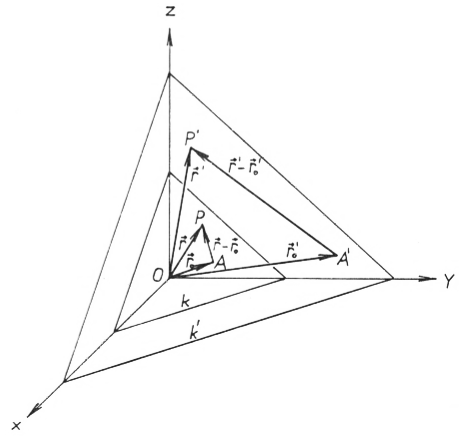
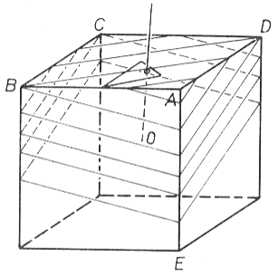
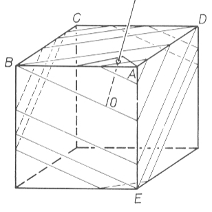
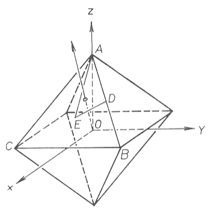
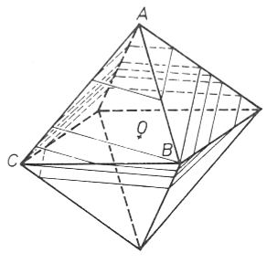

<!--
Figuroj okaze de hazarda intersekcado de
korpo kun ebeno
Václav Hník (Ĉeĥoslovakio)
doktoro de natursciencoj, kandidato de fizikaj-matematikaj sciencoj, 
Fakulta architektury ĈVUT, Thákurova 7, 166 34 PRAHA 6

Obrazce vznikle protindnim telesa s ndhodnymi rovinami

V teto prdci je popsina metoda, jak urĉiti relativni ĉetnost a druh planimetrickych obrazeŭ,
kterĉ vzniknou, jestliZe se protne tŝleso s rovinami ndhodnĉ rozmistenymi v prostoru. Jako miry zastoupeni ruznych druhi planimetrickych obrazeŭ se pouzilo (po zintegrovdnf ve vŝech smerech) vzdilenosti hraniĉnich rovin, jimiz jsou oddeleny roviny protinajici prostorovy utvar v
jednotlivych druzich planimetrickych obrazeŭ. Na pfikladu krychle a pravidelneho osmistenu se
metoda demonsiruje konkretnim vypoĉtem. Vysledky maj! vyznam napf. pri urĉovdni krystalowfch tvarŭ nerosti y horninovych vybrusech.
-->

## 1. Enkonduko

Grava diagnoza tasko de mineralogo, petrologo, ĥemiisto k.a. estas determini eksteran kristallimigon. Solvo de ĉi geometria-kristalografia tasko estas
pli simpla, se temas pri minerala individuo, pli malpli izolita aŭ facile apartigebla el sia medio. Tamen, praktike oni renkontiĝas kun agregatoj, konsistantaj el granda nombro da kristaloj, ĉu sammineralaj, ĉu plurmineralaj.

Precipe la petrologo bazas siajn esplorojn sur observado de rokaĵosekcaj
mikropreparatoj. Premise, ke la kristaloj, konsistigantaj rokaĵon, ne estas
ordigitaj laŭ iu maniero, ĉiun el ili ĥarakterizas en la sekcaĵo difinitaj relativa nombro kaj speco de ebenaj figuroj (ekz. trianguloj, kvaranguloj k.t.p.).
Inverse, la relativa nombro kaj speco de ĉi figuroj helpas determini la kristallimigon, do ankaŭ la kristalografian apartenon de koncerna mineralo.

Relativa frekvenco de tiuj ebenecaj figuroj neniel dependas de egalaj kristalgrandecoj enkadre de la preparato. Aliflanke necesas, ke la preparato
disponigu al la observanto sufiĉe grandan nombron da kristalindividuoj de
ekzamenata mineralo.

Jena traktaĵo konsideras la *pure matematikan alpaŝon al la problemo: determini la relativan frekvencon kaj specon de planimetriaj figuroj, kiuj estiĝas, se stereometrian korpon sekcas hazarde orientitaj kaj lokitaj ebenoj*.

## 2. Ĝenerala solvo

En spacan korpon ni loku koordinatsistemon de tri reciproke ortaj aksoj
$x$, $y$, $z$. Direkto de ajna ebeno estas difinita per normalrekto, kiu pasas tra la
nulpunkto (centro) de la sistemo kaj ortas al tiu ebeno. Direkton de ĉi normalo determinas la anguloj $\varphi \in \langle 0; 2\pi\rangle, \psi \in \langle 0; \frac{\pi}{2}\rangle$ (v. fig. [1](#bld-1)). 

{#bld-1}

Estu $\vec{n}(a;b;c)$ la
vektoro, orta al la ebeno $k$ (t.e. la vektoro de la normalo), $\vec{r_0}$ la pozicia vektoro de iu fikse elektita punkto $A$ en la ebeno $k$, $\vec{r}(x; y; z)$ la pozicia vektoro
de variabla punkto $P$ de la sama ebeno $k$ (v. fig. [2](#bld-2)). Tiuokaze la vektoro $AP = \vec{r}-\vec{r_0}$, situas en la ebeno $k$, do ortas al $\vec{n}$. La skalara produto de la du reciproke ortaj vektoroj egalas al nul, do validas

[]{.fno} $(\vec{r}-\vec{r_0})\cdot\vec{n}=0$, t.e. $\vec{r}\cdot\vec{n}-\vec{r_0}\cdot\vec{n} = 0$.

{#bld-2}

Se ni signas la konstanton $-\vec{r_0}\cdot\vec{n}$ per $d$, validas:

[]{.fno} $\vec{r}\cdot\vec{n} + d = 0$, t.e. $ax +by +cz +d = 0$,

kio estas la ĝenerala ekvaciformo de l'ebeno en la tridimensia spaco. La termojn $ax, by, cz$ oni nomas linearaj, dum $d$ estas termo absoluta.
Ni konsideru alian ebenon $k'$, paralelan kun $k$, do ebenon kun la sama
normalvektoro. Ankaŭ ĉi-okaze ni elektu fiksan punkton $A'$ en la ebeno $k'$
kaj ties pozician vektoron $\vec{r_0}$, arbitran punkton $P'$ en la ebeno $k'$ samkiel ties
pozician vektoron $\vec{r'}(x'; y'; z')$. Plue ni difinu vektoron $\vec{m} = AA' = \vec{r'_0}\vec{r_0}$.
Tiam evidente validas:

[]{.fno} $\vec{r'_0} - \vec{r'_0}\cdot\vec{n} = \vec{r'}\cdot\vec{n}-\vec{r'_0}\cdot\vec{n} =$
[]{.fno} $\vec{r'}\vec{n}-(\vec{r_0}+\vec{m})\vec{n} = \vec{r'}\cdot\vec{n}-\vec{r'_0}\cdot\vec{n} - \vec{m}\vec{n} =  \vec{r'}\vec{n}+d-|\vec{m}||\vec{n}|\operatorname{kos}\alpha$,

kie $\alpha$ estas angulo, kiun fermas la vektoroj $\vec{m}$ kaj $\vec{n}$. La vektoron $\vec{n}$ ni elektu
tiel, ke $|\vec{n}| = 1$. Tiuokaze

[]{.fno} $\vec{n} = (a;b;c) = (\sin \psi \operatorname{kos} \varphi;\sin\psi\sin\varphi;\operatorname{kos}\psi)$

(v. fig. [1](#bld-1)) kaj $|\vec{m}||\vec{n}|\operatorname{kos}\alpha = |\vec{m}|\operatorname{kos}\alpha = m$,

kie $m$ estas la distanco inter $k$ kaj $k'$. Do $k'$ havas jenan ekvacion:

[]{.fno} $\vec{r'}\vec{n}+d-m=ax'+by'+cz'+d-m=O$,

en kiu $x', y', z'$ estas la koordinatoj de arbitra punkto $P$ de l'ebeno $k'$.
Jen akiriĝis rezulto, por ni tre grava: okaze de du paralelaj ebenoj kun la
unuo-normalvektoro, la absoluta valoro de la diferenco inter la absolutaj
termoj en iliaj ekvacioj $|d—d'|$ indikas la distancon inter tiuj ebenoj.

Estu jenoj:

1. spaca korpo (ekz. kristalo)
2. koordinatsistemo kun la tri ortaj aksoj $x, y, z$
3. aro da paralelaj ebenoj, determinitaj per sia unuo-normalvektoro $\vec{n}$.

Se ni sukcesos trovi, ke por ebenoj kun la absoluta termo en la ekvacioj $d$
ĝis $d'$, la sekcaĵo inter tiuj ebenoj kaj la konsiderata korpo prezentas difinitan ebenan figuron, tiam $|d-d'|$, do $d-d'$ aŭ $d'-d$, indikas frekvencgradon de tiu figuro rilate al ĉiuj eblaj figuroj, generitaj de ĉiuj ebenoj kun
la normalvektoro $\vec{n}$: Tiel eblos sinsekve akiri frekvenc-gradon de ĉiuj aperantaj figuroj, generitaj de l'aro da paralelaj ebenoj.

Por akiri la tutan apergradon de l” ebenaj figuroj por ĉiuj eblaj ebendirektoj, ni devas la grandon $d-d'$ (eventuale $d'-d$) integrali en ĉiuj direktoj:

[]{.fno} $\displaystyle\int_{\varphi=0}^{2\pi}\int_{\psi=0}^{\pi/2}(d-d')\sin\psi\,\mathrm{d}\varphi\,\mathrm{d}\psi$.

Okaze de konkreta kalkulo estas avantaĝe, se oni lokas la koordinatsisteman centron en la simetricentron (se ĝi ekzistas) de la korpo kaj la tri koordinatajn aksojn orienti laŭ la simetriaksoj (se ili ekzistas) de la korpo. Sekve la
kalkulo plisimpliĝas tiom, ke ne estas necese integrali — konsidere la korpsimetrion — en la tuta amplekso: $\varphi\in\langle 0;2\pi\rangle, \psi\in\langle 0;\frac{\pi}{2}\rangle$.

### 2.1. Kubo (heksaedro)

En la centron de kubo, kies eĝlongo egalas al 2, estas lokita la koordinatsistemo kun la tri aksoj paralele al la kubeĝoj (v. fig. [3](#bld-3)). El la kubsimetrio rilate la koordinatsistemon sekvas, ke el ĉiuj eblaj direktoj de normalo al ebeno
sufiĉas konsideri sole tiujn, okaze de kiuj la normalrekto sekcas la kubon interne de la triangulo $AFG$. Jen la koordinatoj de grava punktaro kaj apude
la valoroj absoluttermaj el la ekvacioj de l' ebenoj, pasantaj tra la koncerna
punktaro. (Tiujn valorojn ni ricevos per substituo de la punkto-koordinatoj
en la eben-ekvacion $ax+by+cz+d=0$).

{#bld-3}

\begin{align}
A &= (1 ;1;1) & d_A    &= -a-b-c\\
B &= (1 ;-1;1) & d_B   &= -a+b-c\\
C &= (-1;-1;1) & d_C &= a+b-c\\
D &= (-1;1;1) & d_D   &= a-b-c\\
E &= (1 ; 1; -1) & d_E &= -a-b+c\\
O &= (0 ; 0; 0) & d_O &= 0
\end{align}

Estu ajna normalrekto, sekcanta la kubon interne de la triangulo $AFG$.
tiam validas $\varphi\in\langle 0;\pi/4\rangle, \psi\in\langle 0;\operatorname{arkkot}(\operatorname{kos}\varphi)\rangle$. La valoro $\psi=\operatorname{arkkot}(\operatorname{kos}\varphi)$
respondas al la normalrekto, sekcanta la kubon en la streko $AF$; eblas determini ĝin ekz. tiel, ke el aro da paralelaj ebenoj kun ĉi normalrekto ekzistas
por donita $\varphi$ ĉiam unu ebeno, pasanta tra ambaŭ punktoj $D$ kaj $E$. Tiuokaze $d_D = d_E$, aliforme

\begin{align}
a-b-c &=-a-b+c\\
a&=c\\
\sin\psi\operatorname{kos}\varphi&= \operatorname{kos}\psi\\
\operatorname{kos}\varphi&=\operatorname{kot}\psi\\
\psi&=\operatorname{arkkot}(\operatorname{kos}\varphi)
\end{align}

El la paralelaj ebenoj, determinitaj per normalo, sole iuj sekcos la kubon,
nome tiuj, kies ekvacia $d$-valoro estas en la intervalo $\langle -a-b-c; a+b+c\rangle$
t.e, $\langle-\sin\psi(\operatorname{kos}\varphi+\sin\varphi)-\operatorname{kos}\psi; \sin\psi (\operatorname{kos}\varphi+\sin\varphi)+\operatorname{kos}\psi\rangle$. La valoro
$-a-b-c= d_A$, respondas al tiu ebeno, kiu pasas tra la punkto $A$, la valoro
$a+b+c$ respondas al tiu ebeno, kiu pasas tra la punkto kun la koordinatoj
$(-1;-1;-1)$. Pro la centrosimetrio de la kubo laŭ $O$ (la nulpunkto koordinatsistema) sufiĉas konsideri la solan intervalon de l'absoluttermoj
$\langle-a-b-c; 0\rangle$ t.e. la tutan aron de ebenoj inter tiuj
$A$ kaj tra la koordinatsistema nulpunkto $O$.

Nun ni determinu sinsekvon, laŭ kiu per ĉi ebenaro sekciĝos la unuopaj
gravaj kubopunktoj, kaj specojn de ebenaj figuroj, aperontaj kiel intersekcaĵoj de ĉi ebenaro kun la kubo. Tiun difinon ni plenumos, se ni pligrandigos la absolutterman valoron laŭgrade ekde $-a-b-c$ ĝis nul.

La sinsekvo de l' unuaj tri punktoj evidente jenos: $A,B,D$. Plua vicordo
dependos de la normaldirekto. Por $\psi<\operatorname{arkkot}(\operatorname{kos}\varphi+\sin\varphi)$ ĝi estos $C,O$,
por $\psi>\operatorname{arkkot}(\operatorname{kos}\varphi+\sin\varphi)$ ĝi estos $E,O$. Okaze de $\psi=\operatorname{arkkot}(\operatorname{kos}\varphi+\sin\varphi)$
ja por ĉiu $\varphi$ ekzistas unu ebeno, pasanta tra ambau punktoj $C$ kaj $E$. Sekve
validas:

\begin{align}
d_c &= d_E\\
a+b-e &=-a-b+c\\
a+b&=c\\
\sin\psi(\operatorname{kos}\varphi+\sin\varphi) &= \operatorname{kos}\psi\\
\operatorname{kos}\varphi+\sin\varphi &= \operatorname{kot}\psi\\
\psi &= \operatorname{arkkot}(\operatorname{kos}\varphi+\sin\varphi)
\end{align}.

La supra kubedro dispartiĝas do laŭ fig. [4](#bld-4). La ortan triangulon $FGH$, al
kiu respondas la normaldirekto $\varphi\in\langle 0; \pi/4\rangle, \psi\in\langle 0; \operatorname{arkkot}(\operatorname{kos}\varphi+\sin\varphi)\rangle$, ni
nomas regiono $K$, dum regionon $L$ prezentas la tringulo $AFH$, al kiu respondas la normaldirekto $\varphi\in\langle 0;\pi/2\rangle, \psi\in\langle\operatorname{arkkot}(\operatorname{kos}\varphi+\sin\varphi); \operatorname{arkkot}(\operatorname{kos}\varphi)\rangle$.

{#bld-4}

Por la ebenaro, kies normalrekto trapasas la supran kubedron en la regiono $K$, la sinsekvo de la punktoj estas $A,B,D,C,O$; en la regiono $L$ estas
$A,B,D,E,O$. En tab. [1](#tab-1) demonstriĝas:

-   distanco de l' ebenoj, pasantaj tra l' opaj gravaj punktoj por la donita
    direkto (= diferenco inter la absoluttermoj el la ekvacioj de ĉi ebenoj);
-   integralo de tiuj valoroj tra ĉiuj direktoj rilataj al la regionoj $K$ kaj laŭ $L$;
-   speco de ebenaj figuroj, generitaj pro l'intersekcado de l'ebenoj kun la
    kubo.

Devenigon de l'ebenfiguraj specoj prezentas fig. [5](#bld-5) kaj [6](#bld-6). La kalkulo de la
duobla integralo estas — helpe de la fubina[^1] teoremo — trasformita en la
kalkulon de la du integraloj simplaj. La integralado laŭ $\psi$ estas plenumita
analitike, tiu laŭ $\varphi$ numere per la simpsona[^2] metodo.

[^1]: laŭ _G. Fubini_ (1879 - 1943), itala matematikisto
[^2]: laŭ _T. Simpson_ (1710 - 1761), brita matematikisto

{#bld-5}

{#bld-6}

La rezulto estas prezentita en tab. [2](#tab-2).

:::{.plenlargha}
[Tab. 1]{#tab-1}\

|regiono, en kiu  la normalrekto sekcas la sup- ran kubeĝon| la aron da ebenoj limigas tiuj ebenoj, kiuj pasas tra la punktoj| distanco de la limebenoj  (pasantaj tra la punktoj $X$ kaj $Y$) ($=d_y-d_X$) | $\int\int(d_y-d_X)\cdot$ $\sin\psi d\varphi d\psi$|speco de  ebena figuro|
|---|---|---|---|---|
|$K+L$| $A,B$|$2b=2\sin\psi\sin\varphi$| 0,109887 |trianguloj|
|$K+L$ | $B,D$|$2a-2b = 2\sin\psi(\operatorname{kos}\varphi-\sin\varphi)$| 0,130414 |trapezoj|
|$K$ | $D,C$ |$2b=2\sin\psi\sin\varphi$| 0,047880 |kvinanguloj|
|$K$ |$C,O$| $-a-b+c=\operatorname{kos}\psi-\sin\psi(\sin\varphi+\operatorname{kos}\varphi)$| 0,060751 |paralelogramoj|
|$L$ |$D,E$ |$-2a+2c=2(\operatorname{kos}\psi-\sin\psi\operatorname{kos}\varphi)$| 0,025519  |kvinanguloj|
|$L$| $E,O$| $a+b-c= \sin\psi(\sin\varphi+\operatorname{kos}\varphi)-\operatorname{kos}\psi$   | 0,018240 |sesanguloj|
:::

[Tab. 2.]{#tab-2}

|speco de ebena figuro |relativa frekvenco en %|
|---|---:|
|trianguloj |27,98|
|kvaranguloj trapezoj | 33,21|
|kvaranguloj paralelogramoj | 15,47|
|kvinanguloj | 18,69|
|sesanguloj |4,64|

### 2.2. Oktaedro

La tuta kalkulo estas analoga kiel okaze de la kubo, do ni povas ekspliki
ĝin koncize.

En la centro de la regula oktaedro kun la eĝlongo 2 estas lokita la nulpunkto de la koordinatsistemo, orientita laŭ fig. [7](#bld-7). La koordinatoj de gravaj
punktoj samkiel la $d$-valoroj el la ekvacioj de l' ebenoj, pasantaj tra ĉi punktoj, jenas:

{#bld-7}

\begin{align}
A &= (0; 0; \sqrt{2})\quad & d_A &= -\sqrt{2}c\\
B &= (1; 1; 0)\quad & d_B &= -a-b\\
C &= (1; -1; 0)\quad & d_C &= -a+b\\
O &= (0; 0; 0)\quad & d_O&=0
\end{align}

El la simetrio rezultas, ke el ĉiuj eblaj normaldirektoj sufiĉas konsideri sole tiujn, okaze de kiuj la normalrekto sekcos la oktaedron en la triangulo
$ADE$. (La punkto $D$ situas en la centro de la streko $AB$, dum la punkto $E$ situas en la mascentro de la triangulo $ABC$.) Por tiuj direktoj validas:

$$\varphi\in\langle 0;\pi/4\rangle, \psi\in\langle 0; \operatorname{arkkot}\frac{\operatorname{kos}\varphi+\sin\varphi}{\sqrt{2}}\rangle$$

La valoro $\psi=\operatorname{arkkot}\frac{\operatorname{kos}\varphi+\sin\varphi}{\sqrt{2}}$, kiu determinas la direkton ekde $S$ ĝis
la streko $DE$, eblas trovi el tio, ke por ĉiuj tia direkto ekzistas unu ebeno kun
ĉi normalrekto, nome ebeno, pasanta tra ambaŭ punktoj $A$ kaj $B$. Sekve

\begin{align}
d_A &= d_B\\
-\sqrt{2}c&=-a-b\\
\sqrt{2}\operatorname{kos}\psi &= \sin\psi(\operatorname{kos}\varphi + \sin\varphi)\\
\operatorname{kot}\psi &= \frac{\operatorname{kos}\varphi+\sin\varphi}{\sqrt{2}}\\
\psi &= \operatorname{arkkot}\frac{\operatorname{kos}\varphi+\sin\varphi}{\sqrt{2}}
\end{align}

La punkto-vicordo por ĉi normalrekto evidentas: $A,B,C,S$. La rezultojn
montras tab. [3](#tab-3) kaj [4](#tab-4). (Devenigon de l'ebenfiguraj specoj v. sur fig. [8](#bld8))

{#bld-8}

:::{.plenlargha}
[Tab. 3.]{#tab-3}

|aron da ebenoj limigas ebenoj, pasantaj tra la punktoj| distanco de la limebenoj (pasantaj tra la  punktoj $X$ kaj $Y$) ($=d_Y-d_X$)| $\int\int(d_y-d_x)\cdot$ $\sin\psi d\varphi d\psi$| speco de la ebena figuro|
|---|---|---|---|
|$A,B$|$-a-b+\sqrt{2}c=-\sin\psi(\operatorname{kos}\varphi+\sin\varphi)+2\operatorname{kos}\psi$ | 0,137822 | kvaranguloj|
|$B,C$|$2b = 2\sin\psi\sin\varphi$| 0,092216 | sesanguloj|
|$C,O$|$a-b = \sin\psi (\operatorname{kos}\varphi-\sin\varphi)$| 0,077702 |sesanguloj|
:::

[Tab. 4.]{#tab-4}

|speco de l'ebena figuro | relativa frekvenco en %|
|---|---:|
|kvaranguloj| 55,21|
|sesanguloj| 44,79|

