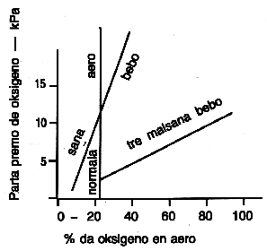
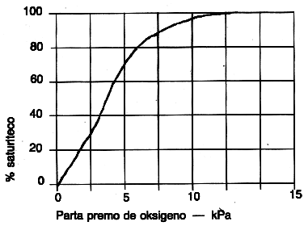
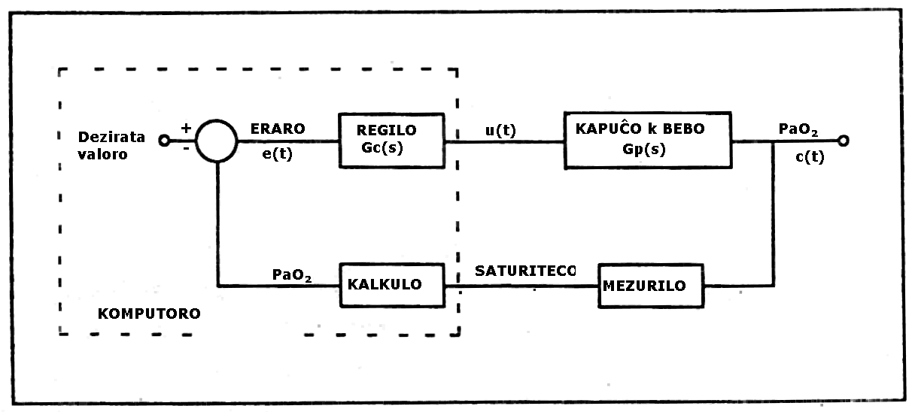
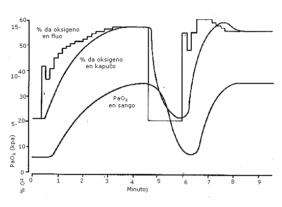

<!--

prenita el

Fonto: Scienca Revuo, Vol. 39 (1988) - 155, pĝ. 43-52.     
Aŭtoro: John Mills, Doktoro, supera lekciisto en Universitato de Okcidenta Aŭstralio,
        Departemento de Elektra kaj Elektronika Inĝenierado, Nedlands WA 6009.

STEB: https://www.eventoj.hu/steb/medicino/inkubator/inkubator.htm

## Automatic Control of Oxygen Flow for Neonates

anglalingva resumo:

This paper discusses the design of an automatic oxygen controller for
newborn babies under incubator treatment. A three term controller is
suitable, but, because of parameter changes, adaptive control is
required. Results from a computer simulation are shown.

-->

## 1. Enkonduko

En novnaskitaj infanoj, precipe se ili antaŭtempe naskiĝis, iufoje la
cerbon ne atingas sufiĉe da oksigeno. Eble parto de la pulmoj ne
funkcias, aŭ eble la feta cirkulado de sango, en kiu la sango evitas la
pulmojn, ankoraŭ iomete funkcias. Ĉiuokaze, oksigeno mankas en la sango,
kaj tial ĝi mankas en la cerbo. Pro tio, eble la infano mortos, aŭ, pli
tragedie, la cerbo nekuraceble difektiĝos.

La kuracado estas, ke la infano enspiru aeron, kiu enhavas pli da
oksigeno ol la normala 21 %, eĉ ĝis 100 %. Tamen estas danĝero; se la
infano enspirus tro da oksigeno, ĝi eble blindiĝus. Tial oni devas zorge
regi la fluon de oksigeno, laŭ la bezono de la infano. Maŝino, kiu
aŭtomate regus la oksigenon laŭ la bezono de la infano, plifaciligus la
taskon de la kuracado, kaj, pli grave, pli bone traktus la infanon. Tiu
ĉi artikolo priskribas la evoluadon de tia maŝino, kaj la problemojn de
la projekto.

## 2. Fiziologio

La cerbo ricevas oksigenon el la sango, kaj la difuzon de oksigeno en la
cerbon regas la parta premo de oksigeno en la arteria sango, P~a~ O~2~.
En sana infano tiu premo estas ĉirkaŭ 10,5 kPa. La cerbo ektuŝiĝus, se
la premo iĝus malpli ol 8 kPa, kaj pro malpli ol 5,5 kPa la infano
mortus. La oksigena premo rilatas al la proporcio de oksigeno en la
aero, kiun la infano enspiras, F~i~ O~2~. [Fig. 1](#bld-1) montras la rilaton.

{#bld-1}\
Fig. 1: Oksigeno en la aero kaj en la sango

{#bld-2}\
Fig. 2. Saturiteco per oksigeno kaj parta premo

Por sana infano, la normala 21 % da oksigeno en la aero sufiĉas por
premo ĝis pli ol 10,5 kPa en la sango, sed tre malsana infano bezonas
eble 90 % da oksigeno ([Guyton]{.maldense} 1976, [Sano-Kikuci]{.maldense} 1985).

La oksigeno parte portiĝas solvita en la sango, sed la plejparto
kombiniĝas kun la hemoglobino. La rilato inter P~a~ O~2~ kaj la
saturiteco de hemoglobino per oksigeno estas nerekta \[vd. [Fig. 2](#bld-2)\].

La saturitecon per oksigeno montras la koloro de la sango; sango plena
de oksigeno estas hele ruĝa. Oni povas mezuri la koloron de la sango,
kaj tiel la saturitecon per oksigeno, se oni pasigas lumon tra la fingro
de infano kaj mezuras la kvanton, kiu trapasas je du ondolongoj, ruĝa
kaj transruĝa. La mezuro devas sinkroniĝi al la pulso, por ke ĝi rilatu
al la arteria sango, ne la vejna. Estas mezurilo por tiu mezurado kiu
ofte uziĝas en malsanulejoj. Estas alia mezurilo kiu rekte mezuras la
metabolan staton de la cerbo. Tiu estas nuklea magneta resonanca
spektromezurilo (NMR), kiu uzas ^31^P spektromezuradon por kalkuli la
proporciojn inter kelkaj fosforaj kombinaĵoj en la cerbo. Tiu donas pli
ĝustan rezulton ol la mezurado de oksigeno en la sango de la fingro.
Tamen, la mezurilo funkcias malrapide; bezonante kvar minutojn por
konstati la proporciojn precize ĝis 15 %. Plue, ĝi ne estas tre
oportuna; la infano devus esti en magneta kampo de ĉirkaŭ 1,8 Tesla, kaj
tiu bezonas superkonduktan magneton. La mezurilo estas tre altkosta, kaj
ĉi-tempe troviĝas nur malmultaj en la mondo. Tamen, la regilo
priskribata povos uzi tian mezurilon, se ĝi estos havebla.

La responda rapideco de la regilo tre gravas. Normala plenkreskulo
tolerus mankon de oksigeno en la sango dum ĉirkaŭ kvar minutoj, antaŭ ol
la cerbo difektiĝus. Normala infano, dum naskiĝo, necese estas tre
tolerema al manko de oksigeno, sed eble malsana infano ne estas tiel
tolerema. Ĉiuokaze, oni bezonas tempon por enmeti la infanon en la
kapuĉon, do estas plej bone, ke la regilo respondu en la daŭro de ĉirkaŭ
unu minuto.

## 3. Dinamiko de la sistemo

Por projekti regilon, oni devas scii la dinamikon de la sistemo. Estas
du efikoj, kiuj gravas. Unue, troviĝas prokrastoj. Tiuj estas, ekz. la
tempo dum kiu fluas gaso tra tuboj, aŭ sango fluas tra angioj. Ni
supozas ke la gasfluo estas konstanta, sed la proporcio de oksigeno
varias. Se la enmeta proporcio estas $u(t)$, kaj la elmeta proporcio estas
$y(t)$, la rilato inter ili estas

[\(1\)]{.fno #f-1} $y(t) = u(t - T)$  

en kiu $T$ estas la prokrasto kaj $t$ la tempo. Estas simila rilato pri
oksigeno en la sango, ĉar la sango bezonas tempon por flui el la pulmoj
ĝis la mezurilo ĉe la fingro. La totala sistema prokrasto, $T_d$, estas
tipe dudek sekundoj. La alia grava efiko estas tempo-konstanto. Oni
enmetas la infanon en kapuĉon, en kiun fluas la gaso. Pro la volumeno de
la kapuĉo, oni bezonas tempon por ŝanĝi la oksigenan proporcion por la
infano. La rilato inter la proporcio en la fluo, $u(t)$, kaj la proporcio
en la kapuĉo, $y(t)$, estas

[\(2\)]{.fno #f-2} $\displaystyle u(t) = y(t) + T_i\frac{dy}{dt}$

Tipe, $T_i$ estas 30 ĝis 60 sekundoj.

Per la laplace-a transformo de ekvacio \([2](#f-2)\), oni povas skribi

[\(3\)]{.fno #f-3} $\displaystyle\frac{Y(s)}{U(s)} = \frac{1}{1+sT}$

(Legantoj, kiuj ne konas la laplacan transformon, povas rigardi la
varianton $s$ kiel la diferencialan operatoron, $d/dt$. La diferenco ne
gravas por la nuna desegno. La konstanta stata valoro de la elmeto, por
enmeto de unu unuo, estas la valoro de la esprimo en \([3](#f-3)\) por $s = 0$, aŭ
la limo, kiam $s$ proksimiĝas al 0.) La esprimo en ekvacio \([3](#f-3)\) nomiĝas
la transigfunkcio (TF).

Troviĝas ankaŭ tempo-konstanto por la funkcio de la pulmoj. Tipe ĝi
estas dek sekundoj. La TF el F~e~O~2~, la oksigena proporcio en la fluo,
ĝis P~a~O~2~ estas

[\(4\)]{.fno #f-4} $\displaystyle G_p(s) = \frac{K_L \exp(-sT_d)}{(T_is+1)(T_Ls+1)}$

La parametro $K_L$ estas la konstante stata valoro de tiu TF. Ĝi varias
kun la sanstato de la infano, kaj tiu estas grava problemo por la
regilo. La eksponenciala termo estas la laplaca transformo de la
prokrasto.

## 4. Regilo

Pro kelkaj kialoj, estas necese, ke komputoro uziĝu por la regilo. Oni
povas figuri la tutan sistemon, inklude la regilon, per [Fig. 3](#bld-3).

{#bld-3}\
Fig. 3: Bloka figuro de la sistemo

La elmeto de la mezurilo estas la valoro de saturiteco per oksigeno, kiu
nerekte rilatas al P~a~ O~2~. Por bone regi la sistemon, necesas, ke la
nerekteco nuliĝu. Tion povas fari la komputoro, kiu kalkulas P~a~ O~2~
el la mezuro de saturiteco per oksigeno. \'Erara\' signalo, $e$,
kalkuliĝas kiel la diferenco inter la dezirata valoro de P~a~ O~2~ kaj
la valoro el la mezuro.

La elektita formo de regilo estis la t.n. \"triterma regilo\". En tiu,
adiciiĝas la eraro, la diferencialo de la eraro, kaj la integralo de la
eraro, en taŭgaj proporcioj. La TF de la regilo estas

[\(5\)]{.fno #f-5} $\displaystyle G_c(s) = K_c(1/s+P+Ds) = \frac{K_c(Ds^2+Ps+1)}{s}$

en kiu $K_c$, $P$ kaj $D$ estas konstantoj. $P$ kaj $D$ elektiĝas por nuligi la
tempajn konstantojn en ekvacio \([4](#f-4)\), kaj pro tio

[\(6\)]{.fno #f-6} $\displaystyle G_c(s)G_p(s) = \frac{K_cK_L \exp(-sT_d)}{s}$

(Fakte la signaloj en la komputoro ne estas kontinuaj, sed estas
specimenataj ĉe intervaloj de dek sekundoj. Por la analizo oni bezonas
la z-transformon. Por tiu desegno, la kompliko ne necesas.)

La esprimo de ekvacio \([6](#f-6)\) estas la TF el $e$ ĝis $c$. Skribante $G(s)$ por
$G_c(s)G_p(s)$, kaj $K$ por $K_c K_L$, ni havas

[\(7\)]{.fno #f-7} $\displaystyle G_c(s) = \frac{K \exp(-sT_d)}{s}$

Kiam $s$ proksimiĝas al nulo, $G(s)$ senlime pligrandiĝas. Tio signifas, ke,
en la konstanta stato, la erara signalo, $e$, iĝas nulo, kaj $r$ precize
egalas $c$. La signalo $u$ ne estas nulo. Tiu rezultas de la integrala termo
en la regilo. Por rapida respondo, $K$ devus esti tiom granda kiom eble,
sed se ĝi estus tro granda, la sistemo estus nestabila. Per ekvacio
\([7](#f-7)\) kaj la rilato $e = r - c$, oni povas kalkuli ke la TF el $r$ ĝis $c$
estas

[\(8\)]{.fno #f-8} $\displaystyle\frac{K \exp(-sT_d)}{s+K\exp(-sT_d)}$

La ŝlosilo al stabileco estas la karakteriza ekvacio,

[\(9\)]{.fno #f-9} $\displaystyle s + K \exp(-sT_d)$

Kiam $s$ proksimiĝas al la radikoj de \([9](#f-9)\), la esprimo \([8](#f-8)\) senlime
pligrandiĝas. Ekvacio \([9](#f-9)\) havas infinitan nombron da kompleksaj
radikoj. Estas pruveble, ke, se la reala parto de ĉiu radiko de
karakteriza ekvacio estas malpli ol nulo, la sistemo estas stabila. Por
ekvacio \([9](#f-9)\) tio okazas se, kaj nur se validas

[\(10\)]{.fno #f-10} $\displaystyle 0 < K < \frac{\pi}{2T_d}$

Se $K$ proksimiĝus al $\pi/2T_d$, eĉ se malpli, la sistemo elmontrus malmulte
dampitajn osciladojn. Por sufiĉe dampita, sed kiom eble rapida respondo,
duono de tiu valoro taŭgas.

## 5. Memakomoda regilo

Kelkaj parametroj, kiuj gravas por la regilo, povas varii. $T_i$ kaj $T_d$
povas sufiĉe precize taksiĝi, kaj oni povas enmeti la valorojn en la
komputoron. Pri $T_L$ oni ne certe scias, kaj bezonas pluan esploradon.
Eble la variado estos tiom sufiĉe malgranda, kiom ne gravas por la
regado.

La variado en $K_L$ tre gravas. Por normala infano, la valoro
estas kvinoble de tiu por tre malsana infano. Se oni elektus $K_c$ por
bona respondo por normala infano, la respondo por malsana infano estus
tre malrapida; aliflanke, se oni elektus $K_c$ por malsana infano, la
sistemo estus nestabila por normala infano. Dum la kuracado efikas,
malsana infano iom post iom saniĝas, kaj $K_L$ pligrandiĝas, kaj, por
bona rego, $K_c$ devas akomodiĝi. Se la kuracisto, per sia profesia
scipovo, taksus la unuan oksigenan bezonon de la infano, la komputora
programo pro tio povus kalkuli unuan valoron de $K_L$ kaj, se necesus,
$T_L$. Pro tiuj valoroj, la programo kalkulus taŭgajn parametrojn por la
regilo. Post tio, la programo devus konstati novajn valorojn por $K_L$
kaj, se necesus, $T_L$.

Estas kelkaj rimedoj por tio ([Åström-Wittenmark]{.maldense} 1984). La metodo de
minimumaj kvadratoj ŝajnas alloga; oni devas registri, dum sufiĉe longa
tempo, la enmeton kaj elmeton de sistemo ($u$ kaj $c$ en [Fig. 3](#bld-3)). Tiam oni
kalkulas la parametrojn de matematika modelo kiu, kun enmeto u, havas
elmeton, kiu plej bone proksimiĝas al $c$. La metodo trovas la modelon,
kiu havas minimuman sumon de kvadratoj de eraroj. Tamen, se la enmeto ne
taŭgas por malkovri la parametrojn, la kalkulado povas liveri tute
malĝustajn rezultatojn, do la metodo havas danĝerojn por aŭtomata rego.

Se oni bezonas trakti nur $K_L$ kaj ne $T_L$, estas tre simpla metodo, kiu
eblas, ĉar la sistemo, dum la plejparto de la tempo, estas proksimume en
konstanta stato. Kiam la sistemo ŝanĝiĝas nur malrapide, la programo
kalkulas, el la rezultoj de mezurado, P~a~ O~2~/F~c~O~2~, kaj iomete
ŝanĝas $K_L$ cele al tiu valoro. Tiam kalkuliĝas novaj parametroj por la
regilo.

## 6. Komputora ŝajnigado

[Figuro 4](#bld-4) montras unu rezulton de komputora ŝajnigado de la sistemo kun
malsana infano.

{#bld-4}\
Fig. 4: Komputora ŝajnigado

La infano bezonis 58 % da oksigeno en la aero por subteni normalan
oksigenan nivelon en la sango. Tamen, la cifero enmetita en la programon
estis 21 %, do la unua valoro de $K_c$ estis tro malgranda. Unue, la
infano estis enspirinta aeron kun 21 % da oksigeno. 20 sekundojn post la
komenciĝo de la registrado, la aŭtomata regilo estis funkciigata. Post
dek sekundoj (la prokrasto por la aero), la oksigeno en la kapuĉo
plialtiĝis, kaj post pluaj dek sekundoj (la prokrasto por la sango),
plialtiĝis la oksigeno ensanga. La respondo estis malrapida kaj tro
dampita; ĝi bezonis du minutojn, plus la prokraston, por ke la ensanga
oksigeno atingu sendanĝeran nivelon. Post kvar minutoj kaj duono, kiam
la niveloj estis konstantaj, la regilo malŝaltiĝis, kaj la infano
enspiris 21 % da oksigeno dum naŭdek sekundoj. Aŭtomata rego denove
estis funkciigata, kaj, ĉi-foje, pro la memakomodo, la respondo estis
pli rapida; ĝi bezonis malpli ol unu minuton por atingi sendanĝeran
nivelon.

## 7. Listo de simboloj

  ----------   ---------------------------------------------
  $c$          elmeta signalo de rega sistemo
  $e$          \'erara\' signalo de rega sistemo
  F~c~O~2~     proporcio de oksigeno en la fluo de aero
  F~i~O~2~     proporcio de oksigeno en enspirata aero
  $G_c(s)$     transigfunkcio de regilo
  $G_p(s)$     transigfunkcio el F~c~O~2~ ĝis P~a~O~2~
  $K_L$        konstante stata valoro de P~a~O~2~/F~i~O~2~
  P~a~O~2~     parta premo de oksigeno en la sango, kPa
  $r$          dezirata elmeta signalo en rega sistemo
  $t$          tempo
  $T_d$        prokrasto de la sistemo
  $T_i$        tempo-konstanto de la kapuĉo
  $T_L$        tempo-konstanto de la pulmoj
  $u(t)$       enmeta signalo
  $U(s)$       laplaca transformo de u(t)
  $w$          frekvenco, radianoj en unu sekundo
  $y(t)$       elmeta signalo
  ----------   ---------------------------------------------

## 8. Dankesprimo

La verkisto, kiu laboris kun Phospho-Energetics, Usono, dum 1986,
esprimas dankon pro la permeso de Phospho-Energetics, por publikigi la
enhavon de tiu verko. La esploradon subvenciis la usona Nacia Instituto
de Sano, subvencio IR43, 22309-01, Phospho-Energetics.

## 9. Referencoj

-   ÅSTRÖM, K. J. and B. WITTENMARK (1948). --- Computer Controlled
    Systems --- Prentice Hall
-   GUYTON, A. C. (1976). --- Textbook of Medical Physiology. ---
    Saunders
-   SANO, A. & KIKUCI, M. (1985). --- Adaptive Control of Arterial
    Oxygen Pressure of Newborn Infants under Incubator Oxygen Treatments
    I.E.E. Proc, Vol. 132, Pt. D, No. 5.