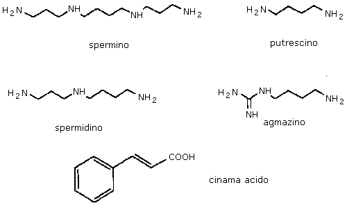
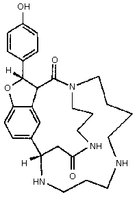
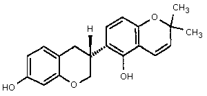
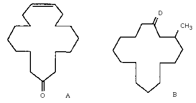
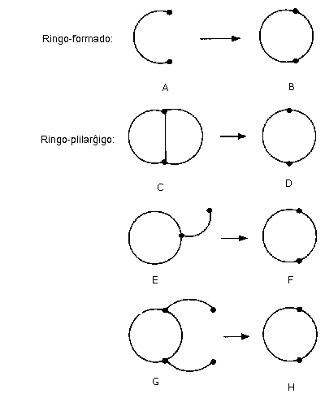
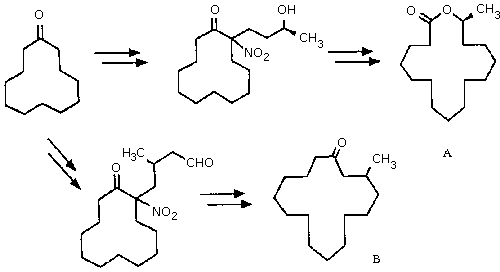

<!--
prenita el:

Fonto: Scienca Revuo vol. 43 (1992)(1) - 160. pĝ. 32-37.
Aŭtoroj: Manfred Hesse, Christa Werner, Manfred Süsse; Organisch-chemisches Institut der Universität Zürich, Svislando
Enretigo: Mészáros István\
STEB: https://www.eventoj.hu/steb/kemio/substancoj/substancoj.htm

-->

Grandan kvanton de naturaj substancoj reprezentas la t. n. sekundaraj
naturaj substancoj troveblaj plej ofte en plantoj. En la lastaj 20 jaroj
nia laborgrupo ekzamenis diversajn plantojn kaj klarigis la strukturon
de vico da raraj naturaj substancoj el la klaso de alkaloidoj. Unu grupo
de tiuj substancoj estas la poliaminaj alkaloidoj. Ili enhavas
poliaminan skeleton konstruitan plej ofte el la bazoj spermino,
spermidino, putrescino kaj agmatino kaj unu aŭ pli da hidroksi-cinamaj
acidoj (Fig. [1.](#bld-1)). Ambaŭ tipoj de konstrueroj troviĝas en ĉiuj plantoj
kaj estas inter- aŭ fin-produktoj en diversaj metabolaj procezoj.

{#bld-1}\
Fig. 1 Strukturo de la ĉefaj komponantoj de poliaminaj alkaloidoj.

La signifo de liberaj poliaminoj kiel putrescino, spermino kaj
spermidino por la ĉel-kresko okupas la biokemiistojn kaj la
molekul-biologojn en ĉiuj fakoj inkluzive la kancer-esploron.

La cinama kaj la hidroksi-cinamaj acidoj estas uzataj en la plantoj ĉefe
por ligniĝo de ĉel-vandoj kaj en la sintezo de serio da naturaj
substancoj kiel la kumarinoj kaj la flavonoidoj.

La poliaminaj alkaloidoj, kiuj estas konjugaĵoj de la du supre menciitaj
gravaj konstru-unuoj, troviĝas nur en kelkaj genroj de specialaj
plant-familioj. Ekz. la genro [Aphelandra]{.maldense}, el la familio de akantacoj,
enhavas en la radikoj poliaminan alkaloidon, afelandrinon (Fig. [2.](#bld-2)),
kiu konsistas el spermino kaj du molekuloj de cinama acido.

{#bld-2}\
Fig. 2. La strukturo de afelandrino

Post la struktur-klarigo, kiun nia laborgrupo faris, nun ni --- sintezaj
kemiistoj kaj biokemiistoj --- okupiĝas pri la biosintezo kaj pri la
strukturo kaj funkcio de sperminaj alkaloidoj. La planto, kiu estas nia
ĉefa stud-objekto, estas [Aphelandra tetragona]{.maldense} ([Vahl]{.maldense}) [Nees]{.maldense}, kiu originas
el Venezuelo kaj en la komerco kiel ornama planto estas havebla.
Unuflanke montriĝis, ke la kompleksigaj proprecoj por katjonoj kaj
aliflanke la polikatjona karaktero faris tiun substancon interesa
\"ilo\" por la farmakologia esploro. En la lasta tempo specialan
intereson vekis la poliaminaj toksinoj izolitaj el araneoj kaj vespoj.
La kemia sintezo de unuopaj poliaminaj toksinoj jam estas publikigita.
Specialan obstaklon prezentas la regioselektiva derivatizado de diversaj
nitrogen-atomoj de la poliamina skeleto. La klarigo de biosintezo en la
plantoj kaj la izolado kaj karakterizado de specifaj enzimoj povas
provizi novajn substancojn por la kemia sintezo de efikaj
substanco-grupoj.

Alia grava tereno de la kunlaboro inter organikaj kemiistoj kaj
biokemiistoj estas la agrikultura esplorado.

La perdo de la monda agrikultura rikolto malgraŭ la intensaj kultivadaj
rimedoj kaj la ampleksa kemia planto-protektado ankoraŭ longtempe certe
ne malkreskos. La pozicio de kemia planto-protektado flanke de la
publiko estas sufiĉe dubinda. Nuntempe oni strebas stabiligi la rikolton
kombinante metodojn kun prioritata konsidero de biologiaj, bioteknikaj
kaj plant-kultivadaj procedoj minimumigante la aplikon de kemiaj
planto-protektenzoj. Por la sukceso de tiu t. n. integrita
planto-protektado decidan rolon ludas la serĉo de novspecaj
plantoprotektaj strategioj.

Unu, de la tradiciaj kemiaj kaj biologiaj metodoj baze diferencanta
strategio involvas la aplikon de efikaj substancoj kiuj plialtigas la
propran rezistopovon de la infektiĝema planto sen ŝanĝi la
rezisto-potencialon per kultivada interveno. Tiun rezisto-indukton oni
povas atingi per antaŭ-inokulado de malforte virulentaj ĝermoj,
nepatogenaj, izolitaj naturaj substancoj, aŭ, ankaŭ per sintezitaj
kemiaĵoj. Tiuj du lastaj prezentas specialan intereson por la kemiistoj.
Tiuj substancoj mem estas toksaj nek por la planto nek por la
fitopatogeno, kaj post mallonga tempo malkombiniĝas (metaboliziĝas). La
(naturaj) plantaj defendo-mekanismoj nur tiam devus aktiviĝi, kiam la
damaĝaj ĝermoj atakas. Tio similas imunizigon kaj produktas tre modestan
ŝarĝon por la ekologia ekvilibro.

La elir-punkto de niaj esploroj esta la celata influado de formiĝo de
fitoaleksinoj (malgrand-molekulaj substancoj, kiujn la plantoj \[pli
intense\] produktas post la atako de parazitaj mikroorganismoj; ili
respondecas por la rezisto kontraŭ fitopatogenoj) en kelkaj
kulturplantoj. La fitoaleksinoj estas substancoj kun la plej diversaj
strukturoj. En la kulturplantoj ekzamenataj far ni (kelkaj cerealoj kaj
furaĝaj plantoj) oni trovas interalie fitoaleksinojn kun izoflavonoida
strukturo. Post infekto de seradelo-planto ([Ornithopus sativus Brot.]{.maldense})
kun fungosporoj la fitoaleksino fazeolin-izoflavano (Fig. [3.](#bld-3))
akumuliĝas en certa tempo-periodo. Poste la koncentreco rapide (ofte ĝis
nulo) malkreskas. Oni observis similajn fenomenojn kun ĉelkulturoj.

{#bld-3}\
Fig. 3. La strukturo de fazeolin-izoflavano

En la komenco oni devas klarigi la biogenezon de fazeolin-izoflavano, en
kiu la unuopaj postulataj prekurzoroj devas esti sintezitaj. Por ke oni
povu distingi la aldonitan sintezan substancon de la originala planta
kombinaĵo (ja ambaŭ havas la saman strukturon!), la sintezitan oni devas
izotope marki. Tiujn markitajn substancojn oni enkondukas en la plantan
metabolismon. Izolante kaj klarigante la strukturon de nove formitaj
kombinaĵoj oni povas kunmeti la \"puzlon\". Ankaŭ la divers-etape
funkciantaj enzimoj estas karakterizataj kaj ilia efikeco estas
ekzamenata. Se sukcesus inhibi la enzimon (malkombinantan la supre
menciitan substancon) en la planto aŭ en la atakanta mikroorganismo,
tiam eblus rimarkinde altigi la akumuliĝon de fitoaleksino kaj sekve
ankaŭ la fungostatikan efikon.

Fine, jen la tria ekzemplo el la tereno de esploro de naturaj
substancoj. Kun la kresko de niaj konoj pri la naturaj substancoj nepre
plifortiĝas ankaŭ la deziro sintezi tiujn kombinaĵojn kun komplika
strukturo kaj specifa fiziologia efiko. La rezultoj de tiuj klopodoj
kondukas al la evoluigo de novaj sintezo-strategioj kaj reagenzoj,
gravaj ankaŭ por la farmacia industrio. Unu plian gravan aspekton de nia
aktuala intereso reprezentas la evoluigo de principoj por
ringo-plilarĝigo, kiujn ni aplikas en la sintezo de makrociklaj naturaj
substancoj kaj iliaj analogaĵoj. Ekde 1926, kiam L. Ružička klarigis la
strukturon de la komponantoj de mosko, de cibetono kaj muskono 
(Fig. [4.](#bld-4)), la organikaj kemiistoj intense interesiĝas por la makrociklaj
kombinaĵoj.

{#bld-4}\
Fig. 4. La strukturo de cibetono (A) kaj muskono (B).

La dua periodo de makrocikla kemio komenciĝis en la 50-aj jaroj kun la
izolo de la unua makrocikla antibiotiko pikromicino el aktinomicetoj. De
tiam grandega nombro da makrociklaj laktonoj, laktamoj kaj cikloalkanoj
estis malkovrita en la naturo.

La sintezon de makrociklaj kombinaĵoj oni povas realigi per reakcioj de
ringo-formado kaj -plilarĝigo (Fig. [5.](#bld-5)).

{#bld-5}\
Fig. 5. Skema prezentado de ebloj por ringo-formado kaj -plilarĝigo

Kiel elirmaterialoj por ringo-plilarĝigo servas ciklaj kombinaĵoj pli
malmultekoste alireblaj ol la cel-substancoj. La granda nombro de ebloj
por plilarĝigi certan ringon povas esti reduktita je tri principoj:

1.  spliti la plej mallongan ponton en biciklo C por doni makrociklon D;
2.  enŝlosi funkciizitan flankan ĉenon, kiu almembrigas en la
    ringo-plilargiga procezo (E → F);
3.  du flankaj ĉenoj formas novan ciklon kun simultana splitiĝo de la
    origina ringo (G → H).

Ni okupiĝas ĉefe pri la unuaj du principoj. Unu menciinda ekzemplo de
tipo E → F estas prezentita sur Fig. [6.](#bld-6), montranta la sintezon de
(±)-15-heksadekanolido kaj (±)-muskono el malmultekosta ciklododekano.

{#bld-6}\
Fig. 6. Skema sintezo de (±)-15-heksadekanolido (A) kaj (±)-muskono (B).

La menciitaj tri ekzemploj el nia laboratorio prezentas nur partan
aspekton de la ĉiam pli kaj pli alloga kemio de naturaj substancoj kiel
interplekton de kemio, biokemio kaj biologio.

## Notoj

1.  La germanlingva originalo de ĉi tiu artikolo aperis en [UniZürich]{.maldense}.
    Informationsblatt der Universität Zürich, N-ro 1/1991, p. 17-19. La
    tekston tradukis kaj kompletigis [L. Kovács]{.maldense}.
2.  *-enzo* estas sufikso proponita far [Z. Pluhař]{.maldense} kun la senco aganta
    substanco.\
    (redakta noto: *-enzo* aperas ankaux en pluraj aliaj verkoj, ekz. en
    \"Mezgranda hungara-Esperanta vortaro\", redaktita de prof.
    [Szerdahelyi]{.maldense}\...)
