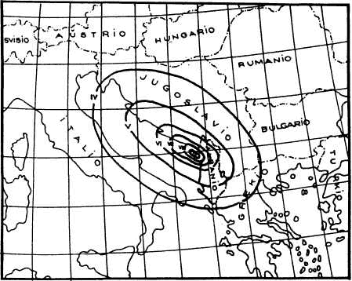

<!--
prenita el:
Fonto: Scienca Revuo Vol. 43 (1992)(2)-161. pĝ. 21-26
Aŭtoro: Vasil Pistoli, En Sismologia Centro de Akademio de Sciencoj kaj docento en la Universitato de Tirana
STEB: https://www.eventoj.hu/steb/geologio/sismo-alban/sismo-alban.htm
-->

## 1. Enkonduko

Albanio, la plej malgranda lando de la Balkana Duoninsulo, okupanta
28 000 km^2^, kie loĝas 3 milionoj da loĝantoj, troviĝas en la
Mediteranea sisma zono, kie dum la jaroj 1912 - 1980 okazis proksimume
10,5 % de la eŭropaj tertremoj de grando M \> 6. En Albanio okazas
ĉiujare 4 - 5 tertremoj kiuj kaŭzas negravajn damaĝojn de grado I ≥ 7 (laŭ
MSK-1964), kaj ĉiun dekan jaron unu tertremo de grado I = 8.

En tiu ĉi mallonga skribo mi montros kiel oni laboras en Albanio kaj
kion oni faras por disvolvigo de la sismologio kaj la kontraŭ-tertrema
protekto.

## 2. Disvolvigo de la Sismologio \[[1](#b-1)\], \[[2](#b-2)\]

La institucio okupiĝanta pri sismologiaj problemoj estas la Sismologia
Centro fondita en 1972, sur fundamento de la Sismologia Stacio de Tirana
ĉe la Universitato de Tirana. La stacio estis fondita en 1968 kaj de tiu
tempo komenciĝis la registrado kaj studado de la tertremoj en Albanio.

La Sismologia Centro havas 13 staciojn en diversaj urboj de Albanio. Ĝi
preparis kaj eldonis la publikaĵojn "Sisma Zonigo de Albanio",
"Katalogo de la tertremoj de Albanio (1975, 1982)", "Tertremo de
aprilo 15, 1979" k.c.

Ĝi eldonas la "Sismologian Bultenon" (1968) dulingve, albane kaj
angle, kiu havas tri apartajn eldonaĵojn: "Anticipaj dektagaj legaĵoj
de la sismologia reto de Albanio" (1968), "Monata Sismologia Bulteno
de la sismologia reto de Albanio" (1968), "Jara Sismologia Bulteno"
(1976).

La Sismologia Centro partoprenas iujn internaciajn projektojn en la
kadro de Unesco por studado de balkanaj kaj eŭropaj sismoj kaj estas
membro de Eŭropa Sismologia Komisiono. Ĝi kontaktas kun multaj
sismologiaj institucioj de la mondo.

Antaŭ la fondo de la Sismologia Centro en 1952 fariĝis la unua sisma
zonigo de Albanio, eldonita de la Scienca Instituto de la Akademio de
Sciencoj. En 1971 estis finita la Karto de Sisma Zonigo de Albanio de
skalo 1 : 2 500 000. Ĉi tiu karto servis ankaŭ por la Sisma Karto de
Eŭropo.

En 1972 la Sismologia Centro finis la studaĵon "Sisma Karto de Albanio
de Skalo 1 : 2 500 000" \[[3](#b-3)\]. La studo servis por projektado de la plej
gravaj industriaj kontraŭ-tertremaj konstruaĵoj, kaj por la Sisma Karto
de Balkano. En 1979, antaŭ la tertremo de aprilo 15, fariĝis la studo
"Sisma Zonigo de Albanio" \[[4](#b-4)\]. Sur la fundamento de tiu ĉi studo
finiĝis la "Karto de Sisma Zonigo de Albanio de Skalo 1 : 500 000"
\[[1](#b-1)\], kiu servas kiel normiga materialo por kontraŭ-tertrema projektado
de ĉiuj konstruaĵoj en Albanio.

Celante precizigon de mezuro de la sismaj agoj sur konstruaĵoj kaŭzotaj
de estontaj tertremoj, estas farata mikrozonigo, klasigante intenson de
ĉiuj agoj por diversaj zonoj. Por ĉi tiu celo oni studis indikojn pri la
sistemeco de la zono, ĝiaj geologiaj kaj tektonikaj specifaĵoj,
geomorfologiaj kaj hidrogeologiaj kondiĉoj, ter-tipoj dividitaj laŭ
inĝenieraj-geologiaj indikoj, kaj sismaj specifaĵoj de la teroj,
precizigitaj per instrumentaj mezuradoj. Ĝis nun estas finita la
mikrozonigo de la urboj _Vlora_, _Durrësi_ kaj _Shkodra_. Nun oni laboras por
la ĉefurbo _Tirana_.

------------------------------------------------------------------------

## 3. Kontraŭ-tertrema Kodo

Ĝis 1952 en Albanio ne estis kodo por la kontraŭ-tertremaj konstruoj. En
decembro 1952 aperis la unua normo de la kontraŭ-tertremaj konstruoj
bazitaj sur la statika teorio proponita de japana sciencisto _P. Omori_
\[[6](#b-6)\]:

$$S_k = K_s \cdot Q_k$$

En 1963 ĉi tiu normo estis anstatŭigita per la normo bazita sur la
dinamika teorio \[[7](#b-7)\]:

$$S_k = K_s \cdot \beta \cdot \eta_{ki} \cdot Q_k$$

Post la tertremo de aprilo 15, 1979, kiu estis la plej pristudita
tertremo en Albanio, en 1981 fariĝis kelkaj ŝanĝoj kaj suplementoj en la
normo el 1963 \[[8](#b-8)\]. Lŭ ĉi tiu normo je la unua fojo la masonaj
konstruoj estis plifortigitaj per fer-betonaj pilastroj \[[9](#b-9)\].

Lastatempe multnombra grupo da specialistoj laboras sub la direkto de la
Sismologia Centro de la Akademio de Sciencoj pri radike nova
antaŭ-tertrema kodo. En tiu ĉi kodo estas multaj elementoj el fremda kaj
enlanda spertoj.

Dum la prilaboro de la kodo estas uzitaj la Projekto de la Internacia
Kodo de ISO (ISO/DIS 3010.2) \[[10](#b-10)\]; la rekomendoj de 
"_Building Construction under Seismic Conditions of the Balkan Region_" \[[11](#b-11)\], kaj
la kodoj de diversaj landoj de la mondo \[[12](#b-12)\].

La valorigo de la sismaj agoj en tiu ĉi kodo estas farita laŭ du
metodoj:

**a) metodo unu** -- kun dinamika spektra koeficiento laŭ formulo:

$$S_{ki} = K_s \cdot K_r \cdot K_d \cdot \Psi \cdot \beta_i \cdot \eta_{ki} \cdot Q_k$$

kie

----------- ---------------------------------------------------------
$K_s$       = $a/g$ (sisma koeficiento),
$K_r$       -- gravita koeficiento de la konstruaĵo,
$K_d$       -- koeficiento de la akcepta damaĝeco,
$\Psi$      -- koeficiento de la konstrua solvo,
$\beta_i$   -- dinamika koeficiento,
$\eta_{ki}$ -- koeficiento de la formo de la tremoj,
$Q_k$       -- koncentrigita pezo je la nivelo *k* de la konstruaĵo.
----------- ---------------------------------------------------------

Laŭ tiu ĉi metodo oni kalkulas ĉiujn konstruaĵojn. Estas akceptitaj tri
kurboj por la dinamika koeficiento $\beta$; diferencigitaj laŭ tri diversaj
kategorioj de la grundo (Fig. [1.](#bld-1)).

{#bld-1}\
Fig. 1. Kurboj de la dinamika koeficiento $\beta$ por variaj
grundokategorioj

Kvankam la dinamika koeficiento $\beta$ dependas de epicentra distanco por
ĉiuj tri kategorioj de la grundo, kreskante laŭ kresko de la unua kaj
tria kategorio, en ĉi tiu kodo estas farita nenia diferencigo, kaŭzante
malgrandan valoron de la sismogramoj, sed estas akceptitaj la maksimumaj
valoroj.

Estas akceptita la kombino de la sismaj agaderoj laŭ rektangulaj
direktoj $x$, $y$ kaj $z$:

$$E = E_x + E_y + XE_z$$
$$E = \lambda E_x + E_y + \lambda E_z$$
$$E = \lambda E_x + \lambda E_y + E_z$$

Oni kalkulas ankaŭ la tordecon kaj aliajn valorojn.

**b) Metodo du** -- laŭ la karaktero de la sisma reĝimo de la konstrua
zono kaj la donaĵoj de la sisma mikrozonigo. Laŭ ĉi tiu metodo oni devas
kalkuli konstruaĵojn de aparta graveco, altajn konstruaĵojn kaj tiujn
kun grando spano, prenante sismajn agojn el instrumentaj registradoj de
la grundaj akceloj kaj ankaŭ el sintezitaj akcelogramoj.

------------------------------------------------------------------------

## 4. La tertremo de aprilo 15, 1979

La Adriatika marbordo, de Buna elfluo ĝis _Dubrovnik_, estis submetita al
fortaj tertremoj.

En la nord-okcidenta punkto (en _Dubrovnik_) troviĝis la fokuso de unu el
la plej fortaj tertremoj kiu okazis en Eŭropo, la fokuso de aprilo 6,
1667, de grado 10 laŭ MSK-1964 (_J. Mihajlović_, 1947; _D. Cvijanović_,
1971), kiu detruis komplete _Dubrovnik_on mortigante 5 000 homojn. En
_Shkodra_ la intenso de ĉi tiu tertremo estis de grado 8 laŭ MSK-1964.

En la sud-orienta punkto, je la zono de _Shkodra_, la plej forta tertremo
estis tiu de junio 1, 1905 havante M = 6,6 kiu sole en _Shkodra_ kaŭzis
200 mortojn kaj 500 vunditojn. Antaŭ la okazo de aprilo 15, 1979, la du
ekstremaj punktoj de la Adriatika marborda bloko aktiviĝis ankaŭ alifoje
preparante la tertremon de aprilo 15. La tertremo okazis meze de ĉi tiu
zono, precize en la zono kiu "silentis" por preskaŭ 300 jaroj, en la
sisma "vakuo", en la punkto de koordinatoj *Φ* = 42° 10\' (N), *λ* = 18°
52\' (O), *h* = 20 km.

La tertremo de aprilo 15, 1979 okazis je 6:19 (GMT) havante M~LH~ = 7,2
en la Adriatika marborda zono, je la profundo de 10 km. (Fig. [2.](#bld-2))

{#bld-2}\
Fig. 2. La tertremo de aprilo 15, 1979

En Albanio la maksimuma intenso estis de grado 8 laŭ MSK-1964. Pro tiu
ĉi tertremo en Albanio mortis 35 homoj, 38 estis vunditaj kaj 100 000
fariĝis senhejmuloj; difektiĝis 17.122 konstruaĵoj k.t.p. Damaĝoj estis
en tuta norda Albanio.

Kelkajn semajojn antaŭ la tertremo estis konstatita nenormala aktiveco.

La Sismologia Stacio de Shkodra registris de marto 31, 1978, 487
antaŭ-sismojn. En la tempodaŭro inter 20:56 de aprilo 14 kaj 5:58 de
aprilo 15 estis registritaj neniuj okazoj kun pli granda magnitudo ol 1.
Ĝis novembro 30, 1979 oni registris 24 048 post-sismojn havante M \> 1.

Dum la tertremo estis konstatitaj ankaŭ fenomenoj de fluidigo de la
grundo per eliroj de akvo sur grandajn supraĵojn, sablaj pseŭdovulkanoj
k.t.p.

La konsekvencoj de la tertremo estis likviditaj komplete en kvin monatoj
(ĝis oktobro 1, 1979), kaj ĉiuj elspezoj estis pagitaj de la ŝtato. Al
la damaĝitaj familioj estis donitaj senpage ankaŭ tujaj materialaj
helpoj.

Por la likvido de la konsekvencoj de la tertremo laboris 25 000
laboristoj, specialistoj kaj volontuloj el tuta Albanio. Estis
konstruitaj 24 411 domoj, 165 ekonomiaj-sociaj objektoj, 44 km da
akvokondukila reto por la novkonstruitaj vilaĝoj, estis rekonstruita 17
km da elektra reto. En la nov-konstruitaj kaj rekonstruitaj domoj
lokiĝis la 100 000 senhejmuloj.

Por la konstruo de la novaj vilaĝoj estis faritaj kompletaj arkitekturaj
esploroj. La novaj vilaĝoj lokiĝis en aliaj terenoj pli taŭgaj por
konstruado. Entuta sumo de la elspezoj faritaj pro la tertremo estis 150
milionoj da lekoj \[[2](#b-2)\].

------------------------------------------------------------------------

## Literaturo

1.  [Akademia e Shkencave e RPSSh: Fjalori Enciklopedik Shqiptar. Tiranë, 1985.]{#b-1}
2.  [Akademia e Shkencave e RPSSh Qendra Sizmologjike: The Earthquake of April 15, 1979. Tiranë, 1983.]{#b-2}
3.  [E. Sulstarova, S. Koçiaj, Sh. Aliaj: Harta sizmike e RPSSh, shkalla 1 : 1.250 000. Tiranë, 1972.]{#b-3}
4.  [E. Sulstarova, S. Koçiaj, Sh. Aliaj: Seismic Regionalization of the PSR of Albania. Tiranë, 1980.]{#b-4}
5.  [Ministria e Ndërtimit: Normat për ndërtimet në zonat sizmike. Tiranë, 1952.]{#b-5}
6.  [P. Omori: Publications of the Earthquake Investigations Committee in Foreign Languages No. 4. Tokyo, 1900.]{#b-6}
7.  [Ministria e Ndërtimit: Kushtet teknike të projektimit per ndërtimet në zonat sizmike (KTP2-78). Tiranë, 1979.]{#b-7}
8.  [Ministria e Ndërtimit: Plotësime dhe ndryshime të Kushteve teknike të projektimit pr ndërtimet në zona sizmike. Tiranë, 1981.]{#b-8}
9.  [V. Pistoli: Llogaritja e godinave antisizmike me mure mbajtëse prej tulle. Tiranë, 1982.]{#b-9}
10. [ISO/DIS 3010.2: Bases du calcul des constructions. Actions sismiques sur les structures. 1986.]{#b-10}
11. [United Nations Industrial Development Organisation: Executing Agency for the United Nations. Vienna, 1984]{#b-11}
12. [Earthquake Resistant Regulations. World List, 1984. Gakujutsu Bunken Fukyu-Kai Oh-Okayama, 21-1, Meguroku, Tokyo 152, Japan, July 1984.]{#b-12}
