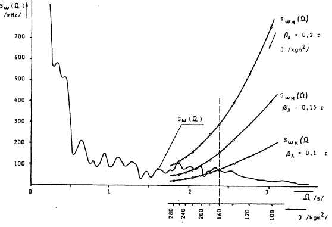
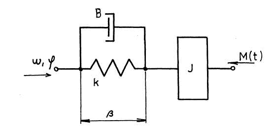
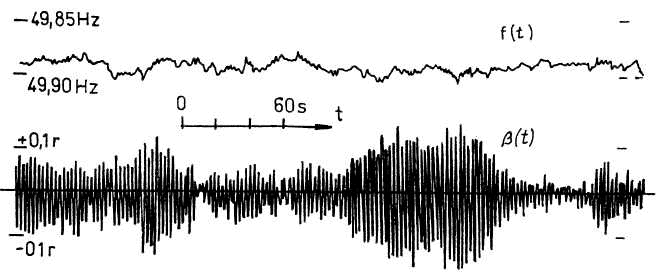

<!--
prenita el:
Fonto: Scienca Revuo, Vol 44 (1993) (1) - 162, pĝ. 19-24
Aŭtoroj: Ivan Uhlíř, Petr Chrdle (Ĉeha Respubliko)
STEB: https://www.eventoj.hu/steb/ingxenierado/elektro/frekvenco/freq-de-rettensio.htm
-->

<!--
## Ĉeĥa resumo

Vliv kolísání sí?ové frekvence na chod synchronních motoru pohánìjících
velké setrvaèné hmoty.

Èlánek ukazuje vliv dynamických zmìn frekvence elektrické rozvodné sítì
na vybuzení kývání synchronních strojù spojených s velkými setrvaènými
hmotami. Øeší maximální pøýpustnou velikost momentu setrvaènosti na
høídeli synchronního motoru s ohledem na kolísání sí?ové frekvence.

-   D-ro Ivan Uhlíř, docento ĉe Teknika Universitato en Praha, Fakultato
    de maŝinkonstruado, estro de la katedro de elektrotekniko.
-   D-ro Petr Chrdle, estro de privata konsultacia kaj eduka firmao
    KAVA-PECH, asociita docento de Akademio Internacia de la Sciencoj
    San Marino kaj ties senata sekretario.

-->

Ofta imago, ke la tensio en elektroproviza reto havas koheran sinusan
formon kun konstanta frekvenco, havas nur limigitan validon.

Per preciza mezurado ni ekscias, ke frekvenco de tiu reta tensio kaj ĝia
momenta fazo laŭ tempo balanciĝas. Tiu ĉi balanciĝo de la frekvenco
havas hazardan interferencan evoluon, ĉar ĝi respegulas hazarde
ŝanĝiĝantan povumon nutratan el la reto. Karaktero de la balanciĝo de
reta frekvenco dependas do de la strukturo de nutra reto kaj ŝanĝiĝas
laŭ dumtaga nutro-diagramo.

La fenomenon de balanciĝo de reta frekvenco oni povas priskribi el la
vidpunkto de statika dinamiko per povuma spektra denso $S_\omega(\Omega)$ de
fluktuadoj de la reta angula frekvenco $\omega$. Ekzemplon de evoluo de tia
funkcio, kiu karakterizas frekvencan spektron de devioj de la reta
frekvenco montras Fig. [1](#bld-1).

{#bld-1}\
Figuro. 1

La spektro de fluktuoj de reta frekvenco enhavas du elementojn:

1.  malrapidan elementon por $\Omega < \pu{2 s^{-1}}$, kiu dependas de ecoj de la
    rivolureguliloj en elektrocentrejoj kaj de ecoj de superordigita
    centra regulado de la frekvenco.
2.  rapidan elementon por $\Omega < \pu{2 s^{-1}}$, kiu estas difinita per
    elasteco de elektroproviza sistemo depende de la ŝarĝo. Tiu rapida
    elemento naskiĝas per ŝanĝo de grandeco kaj fazo de la momentaj
    malpliiĝoj de la tensio sur impedancoj de elektro provizaj
    konduktiloj kaj transformatoroj ene de elektroproviza reto per
    influoj de rapidaj ŝanĝoj de la reta ŝarĝo.

Se oni konektas al la elektroproviza reto sinkronan motoron movantan
inercian mason \[[Chrdle]{.maldense}, 1974\], la mekanika moviĝo de la rotoro devas
sekvi kaj la frekvencan kaj la fazan ŝanĝojn en la reto. La angula
devio, kun kiu la rotoro sekvas momentan fazon de la reta tensio,
difinas ŝarĝoangulon $\beta$ de la sinkrona maŝino. De la grandeco kaj
orientiĝo de la ŝarĝoangulo $\beta$ dependas la momenta povumo deprenata per
la sinkrona maŝino de reto, aŭ male aldonanta la momentan povumon en la
reton.

Ju pli grandaj estas la inerciaj masoj sur rotoro kompare kun la maso de
la sinkrona maŝino, despli granda estas dinamika devio dum sekvo de
rapidaj ŝanĝoj de la reto-fazo, kaj despli granda estas ankaŭ balanciĝo
de la ŝanĝoangulo.

Ĉar elektromekanika sistemo, kreita per sinkrona maŝino kaj inerciaj
masoj, estas tre malalte amortizita, la balanciĝo ricevas de la
ŝarĝoangulo (generita per fluktuado de frekvenco en la reto) harmonan
balancan karakteron, dum kiu okazas nedezirata transdonado de energio
inter la elektroproviza reto kaj inercimasoj surrotore.

Elektromekanika oscilanta sistemo, kreita per firmeco de magneta kampo
de la sinkrona maŝino, per ĝiaj amortizitaj efikoj kaj per inercimomanto
sur la rotoro, estas montrita en Fig. [2](#bld-2).

{#bld-2}\
Figuro 2.

Sistemon laŭ Fig. [2](#bld-2) oni povas priskribi per diferenciala ekvacio:

[(1)]{#e-1 .fno} $\displaystyle J\cdot \ddot{\beta} + B\dot{\beta} = \frac{J}{P_d}\dot{\omega}$

|||
|---|---|---|
| $\beta$  | \[-\]               |ŝanĝoangulo de sinkrona maŝino |
| $\dot{\beta}$ ($\ddot{\beta}$) | \[-\] | unua (dua) derivaĵo de la ŝanĝoangulo |
| $\omega$ | [$\pu{s^{-2}}$\]     | derivaĵo de elektroreta frekvenco |
| $J$      |\[$\pu{kgm^2}$\]     | entuta surrotora inercimomanto|
| $B$      | \[$\pu{Nms^{-1}}$\]  | torza amortiza konstanto|
| $k$      | \[$\pu{Nm}$\]       | torda firmeco de sinkrona maŝino|
| $P_d$    | \[-\]               |   nombro de polusparoj de sinkrona maŝino|

Precizeco de la sistemo priskribita pere de la ekvacio ([1]{#e-1}) post
[Laplace]{.maldense}-transformo estas:

[(2)]{#e-2 .fno} $\displaystyle G(p)=\frac{p\cdot J}{P_d(p^2+p\cdot B+k)}$

Povuma spektra denso de fluktuoj de la ŝarĝoangulo estas:

[(3)]{#e-3 .fno} $\displaystyle S_\beta(\Omega) = \lim_{p\to j\omega}\left[G(p)\right]^2\cdot S_\omega(\omega)$

kie:

||||
|---|---|---|
|$S\omega(\omega)$| \[-\] |ŝarĝa spektra denso de fluktuoj de la ŝarĝoangulo|
|$S_\beta(\Omega)$| \[$\pu{s^{-2}}$\]|ŝarĝa spektra denso de fluktuoj de reta angulofrekvenco.|

Kaj sekve:

[(4)]{#e-4 .fno} $\displaystyle S_\beta(\Omega) = \frac{\Omega^2\cdot J^2}{P_d\left[(k-\Omega^2\cdot J)^2+\Omega^2\cdot B^2\right]}$

Popra frekvenco de la sistemo estas $Ω_0$ \[$\pu{s^{-1}}$\]:

[(5)]{#e-5 .fno} $\displaystyle \Omega_0 = - \sqrt{\frac{k}{J}}$

Koeficiento de relativita amortizo de la sistemo $\displaystyle a=\frac{B}{2\cdot \sqrt{k\cdot J}}$
estas por la plejparto de ĉiuj sinkronaj maŝinoj tre malgranda, kutime
$a < 0,1$. Resonado de la sistemo estas sekve tre selektiva, tra la
sistemo do trairas nur la propra frekvenco $\Omega_0$. Respondo de la sistemo
estas sekve preskaŭ pura sinsekva balanciĝo de la ŝarĝoangulo, kies
amplitudo estas $β_A$.

Laŭ la ekvacio ([4](#e-4)) por $\Omega = \Omega_0$ estas:

[(6)]{#e-6 .fno} $\displaystyle S_\beta(\Omega_0) = \beta_A^2 = \frac{J^2}{P_d^2\cdot B^2}\cdot S_\omega(\Omega_0)$

Por ke la respondo al la balanciĝo de la ŝarĝoangulo havu la amplitudon
ne pli altan ol $β_A$, la ŝarĝa spektra denso de la fluktuoj rajtas akiri
la valoron $S_{\omega M}(\Omega_0)$:

[(7)]{#e-7 .fno} $\displaystyle S_{\omega M}(\Omega_0) = \frac{P_d^2\cdot B^2}{J^2}\cdot \beta_A^2$

La espimon $S_{\omega M}(\Omega_0)$ \[$\pu{s^{-2}}$\] ni nomu supra barilo de ŝarĝa spektra
denseco de fluktuoj de la reta angulofrekvenco.

Ni anstataŭigu la parametron $J$ en ([7](#e-7)) per $Ω_0$ laŭ ([5](#e-5)):

[(8)]{#e-8 .fno} $\displaystyle S_{\omega M}(\Omega_0) = \frac{P_d^2\cdot B}{k^2}\cdot \Omega^4\cdot\beta_A$

Poste ni difinu maksimuman grandecon de inerciirado, per kiu la amplitudo
de balanciĝo de la ŝarĝoangulo ne transigos antaŭe difinitan valoron
$\beta_A$.

Evoluon $S_{\omega M}(\Omega_0)$ por la difinitaj $\beta_A$ (ekzemple 0,1 - 0,15 rad) laŭ
la ekvacio ([8](#e-8)) ni desegnu en Fig. [1](#bld-1). La linioj tie kreas la suprajn
barojn de la ŝarĝaj spektrodensoj de la angulfrekvencaj retaj fluktuoj
$S_{\omega 0}(\Omega_0)$  por la permesataj $\beta_A$..

Valorojn de la supra baro $S_{\omega M}(\Omega_0)$ ni provizu per la normo $J$ laŭ ([5](#e-5)):

[(9)]{#e-9 .fno} $\displaystyle J = \frac{k}{\Omega_0^2}$

La unua komuna punkto de dekstre sur la evolulinio $S_{\omega M}(\Omega_0)$ en Fig [1](#bld-1).
por antaŭe difinita maksimuma amplitudo de balanciĝo de ŝarĝoangulo $\beta_A$
kun evolulinio $S_{\omega M}(\Omega)$, mezurita en difinita retoparto en difinita
tempo, montras la plej altan valoron de la inercimomanto, kiun oni povas
allasi sur la rotoro de difinita sinkrona motoro.

En Fig. [1](#bld-1) la komuna punkto $P$ montras tiun maksimuman valoron
$J = \pu{160 kgm^2}$, kio estas praktika ekzemplo por la sinkrona maŝino
MEZ 225M04, 50 kVA, 1500 rivoluoj/min, k = 900 Nm, B = 14 Nms, dum difinita allasita
amplitudo de balanciĝo de la ŝarĝoangulo estas $\beta_A = \pu{0,1 rad}$, kiu
spegulas trairon de la povumo proksimume +20 kW.

Fig. [3](#bld-3) dokumentas efektivan tempan registraĵon de fluktuoj de
elektroreta frekvenco kaj respondoj de ŝarĝoangulo de reala maŝino kun
supre difinitaj parametroj.

\
fig. 3

Komparante parametrojn en Fig. [3](#bld-3) kun la kalkulita meza amplitudo
$\beta_A = \pu{0,1 rad}$ oni povas pruvi la teoriajn konsiderojn priskribitajn en la
artikolo.

## Literaturo

-   [Chrdle, P.]{.maldense} (1974): NB 50 Automatic Diesel Plant. En: Czechoslovak
    Heavy Industry, N-ro 10/1974, Praha.
-   [Uhlíř, I., Vladař, J.]{.maldense} (1975): Elektronický regulátor otáček s
    přímočinným akčním členem pro naftové motory. Acta polytechnica II,
    1975, Praha
-   [Uhlíř, I.]{.maldense} (1980): Paralelní chod dieselelektrických agregátů
    (Paralela funkciado de dizelaj maŝinokombinaĵoj). Kandidatscienca
    disertacia laboro. ČVUT Praha, FSI.
