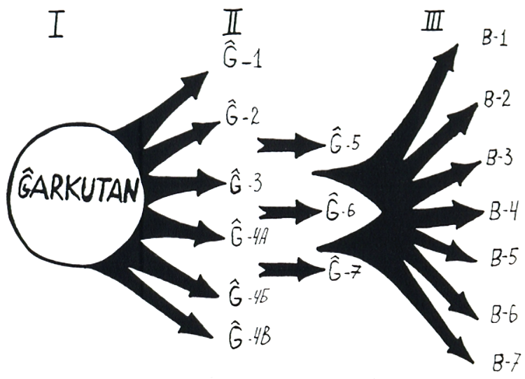
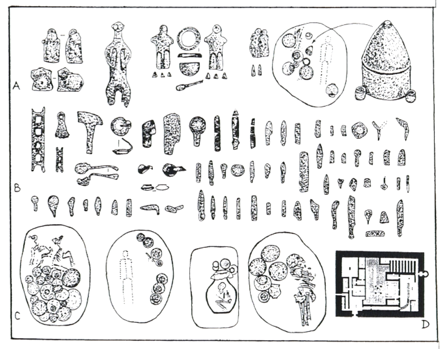

<!--
prenita el:
Fonto: Scienca Revuo Vol. 45 (1994) (2) 165 pp. 9-25

Aŭtoro: Vladimir I. Ionesov (RU)
Enretigo: *Mészáros István
STEB: [http://www.eventoj.hu](http://www.eventoj.hu/)
-->

La esplorado de la arkeologiaj monumentoj de la Sapalli-kulturo en suda
Uzbekistano montris, ke la plej granda fruurbeca centro de la
Proto-Baktria civilizacio estis Ĝarkutan (rigardu [SR, Vol. 43 (1992) (1), p. 3-8)](1641-baktrio.html).
*Ĝarkutan* estis ne nur la plej granda ĉefurba centro de la vasta regiono,
sed ankaŭ unika sociala organismo, interne de kiu okazadis historiaj
procesoj de struktura transiro de primitiveco al la frua ŝtateco. Ĉi
tiun epokfaran historian transiron sukcese karakterizis [I. L. Andrejev]{.maldense}:
"La transira ŝtupo estas epoko de la paralela kunekzistado (kutime je
diversaj niveloj, je diversaj etapoj de la vivo de la socio) de du
principe kontraŭaj sistemoj, laŭ la fonto kaj perspektivoj de la evoluo,
kaj samtempe genetike juntiĝantaj, najbaraj interagantaj strukturoj kiel
principoj de socia regulado kaj sociala kontrolo" (1985, p. 194).

Unuafoje al la problemo de la socia evoluo de Proto-Baktria civilizacio
adresis sin [A. A. Askarov]{.maldense} dum analizo de la arkitektura-planeca kaj
enteriga kompleksoj de *Sapallitepa* (1973, p. 130-139). Post la kompleta
malkovro de la loĝloko kaj eltrovo de la tombejo *Ĝarkutan* 4A li
konstatis, ke la kulturo *Sapalli* "ĝenerale estis en la lasta fazo de
evoluo de primitiveca sociordo, en la ŝtupo antaŭiranta al la epoko de
la milita demokratio " ([Askarov]{.maldense}, 1977, p. 144).

Postsekve dank\' al la ĝustigita kronologio de Sapalli-kulturo la
uzbekaj arkeologoj proponis ekzameni du fruajn etapojn de la kulturo
(*Sapallitepa* kaj *Ĝarkutan*) kiel periodon de malformiĝo de primitiveca
sistemo, kaj du malfruajn etapojn (*Kuzali* kaj *Molali*) kiel periodon de
formiĝo de fruaj formoj de klasaj rilatoj ([Askarov]{.maldense}, [Abdulajev]{.maldense}, 1983, p.
55).

En najbaraj nord-afganaj arkeologiaj kompleksoj de la Bronza epoko
(*Dashli* I, III) [V. I. Sarianidi]{.maldense} vidas ateston "\... de longe
enprofundiĝinta procezo de la sociala diferenciĝo, kiam la tuta socia
vivo de oazo-anoj reglamentiĝis per elstariĝinta intertavolo de la loka
socio" (1976, p. 84).

Tuŝante la politikan evoluon de la nenomadaj socioj de antikva Baktrio,
[V. M. Masson]{.maldense} karakterizis ilin kiel "socion de kompleksa sociala
strukturo, en kiu la instituigo de la sekulara potenco akcelas la
kreskadon de la rolo de la administraj kaj militaj funkcionoj de la
registoj, pro la kulturigo de novaj teritorioj kaj intensiĝo de
intertribaj kaj eble ankaŭ de interetnaj kolizioj " (1984, p. 62).

La analizo de la enterigaj kompleksoj de *Ĝarkutan*, entreprenita de ni,
en la kunteksto kun ĝia urbaneca evoluo ebligas al ni fari novajn
konkretajn konkludojn pri la procezo de la genezo kaj evoluo de
frupolitikaj rilatoj en la Proto-Baktria civilizacio.

La evoluo de la sociala sistemo de la kulturo *Sapalli* reflektas la
komunan historian tendencon de rompo de gent-tribaj strukturoj kaj de
embriiĝo de ia primaraj politikaj institucioj, ligitaj kun

a.  progresanta dispartiĝo de gentoj kaj ilia miksiĝo kaj
b.  plifortiĝintaj kontaktoj kun la ekstera mondo sekve de alfluo de
    nova loĝantaro ([Istorija pervobytnogo obŝĉestva]{.maldense}, 1988, p. 246).

Kiel videblas el la historia topografio de *Ĝarkutan*, la triba dispartiĝo
de loĝ-mastrumaj kvartaloj estas laŭgrade anstataŭata per la
sociala-teritoria disiĝo (apartiĝintaj ekonomia akumulaĵoj, templo,
palaco, loĝkvartaloj). La enterigaj kompleksoj transformiĝas el
komun-familiaj, kvartalaj tombejoj (etapoj *Sapalli* kaj *Ĝarkutan* I,
1750 - 1550 a.K.) en apartiĝintajn gentajn (etapoj *Ĝarkutan* II, *Kuzali*
kaj *Molali-Bustan*, 1550 - 950 a. K.) kaj subgentajn nekropolojn (etapoj
malfru-*Kuzali* kaj *Molali-Bustan*, 1250 - 950 a. K.) ([Bildo 1](#bld-1)).

::: {.figure}

{#bld-1}

Bildo 1: Dinamiko de la evoluo de la enterigaj kompleksoj de Ĝarkutan.

En la historia topografio oni distingas 3 etapojn:

I.  tombejoj situantaj interne de la loĝloko en diversaj loĝ-mastrumaj
    masivoj sub la plankoj kaj muroj de la konstruaĵoj (etapoj
    *Sapallitepa* kaj *Ĝarkutan I*);
II. tombejoj elportitaj ekster la limojn de la loĝloko kaj konstruitaj
    sur la apartaj montetoj sude kaj okcidente de *Ĝarkutan* (etapoj
    *Ĝarkutan II. Kuzali, Molali-Bustan*);
III. tombejoj lokigitaj sur la Bustanoj montetoj vastiginte la
     malnovajn ĝarkutanajn nekropolojn (etapoj malfrua *Kuzali* kaj
     *Molali-Bustan*).

:::

La evoluo de la produktadaj fortoj kaj la kresko de la loĝantaro
komplikigis la ekonomiajn kaj socialajn ligojn en la komunumo, kio
postulis principe novan sistemon de la administrado. Ekzisto de regula
aldona produkto en la socio ebligis apartigi por ĉi tiu celo la
specialan privilegian administran aparaton en la fino de la ĝarkutana
etapo. Ĉi tiu aparato, probable, konsistis el la plejaĝuloj de la plej
deven-noblaj bonhavaj membroj de la socio (genta aristokrataro). Ne
hazarde ĝuste en ĉi tiu tempo en la urbeca sistemo de *Ĝarkutan* aperas
novaj monumentaj kreaĵoj: palaco kaj templo de fajro. ([Bildo 4](#bld-4)).

::: {.plenlargha .figure}

{#bld-4}

Bildo 4: Ĝarkutana templo de fajro (D) kaj la ritaj variaĵoj en la imita rito de la *Sapalli*-kulturo.

A.  argilaj figuretoj de la homo kaj aliaj atributoj el la
    cenotafoj;
B.  bronzaj miniaturaj votaj enterigaj ujoj;
C.  tipoj de la imita enteriga rito (tomboj de la ŝafoj, pupo, kruĉa
    tombo, dismembrigita skeleto de la homo).

:::

Ĉio ĉi estas akompanata de kreado de produktantaj ceramikaj manufakturoj
kiel sekvo de la evoluinta teknologio kaj de kreado de altkvalitaj
potfaraj produktejoj (*Ĝarkutan*-monteto 1, *Bustan*-4) kaj ankaŭ de la
kreado de speciala apudtempla metalfanda kaj metalprilabora produktado
(metiejoj). Rezulte, pligrandiĝis la kvanto de tomboj kun metalaj aĵoj
(ĝis 41,8%) kaj ritaj oferdonoj de bestoj (ĝis 23,8%) en la etapo
*Kuzali*).

La institucio de la supera potenco efektiviĝis en la ĝarkutana socio ne
per rekta ekspluatado de la ordinaraj komunumanoj, sed per monopoligo
fare de genttriba aristokrataro el la plej gravaj sociaj funkcioj kaj
per perfektigo de la organizado de la produktado rilate al la
redistribua sistemo. Rezulte, la pli granda parto de regula aldona
produktado alvenis en la manojn de la burokrata aparato.

Laŭ la datumoj de la enterigaj ritoj ni ne povas paroli pri konfiskado
de la bazaj produktiloj far\' de genttriba aristokrataro. Por irigacia
ekonomio, tiu ĉi varianto de la sociala evoluo estus estinta la plej
malkonvena ([Pavlenko]{.maldense}, 1989, p. 262 - 263). La socialan kaj posedaĵan
diferencigon de la Proto-Baktria socio evidente eksplikiĝas per
neegalvalora aliro de diversaj hierarkiaj sociaj grupoj al la bazaj
produktadaj fontoj de la komunumo.

Diversaj grupoj de la tomboj reflektas multŝtupan socialan diferenciĝon
de la malfru-ĝarkutana komunumo, en kiu oni povas distingi sekvajn
tavolojn:

1.  senrajtaj, dependaj membroj de la socio (kaptitoj, ŝuldantoj,
    fremduloj, kaj ankaŭ, probable, fizike neplenvaloraj individuoj,
    fraŭloj, seninfanuloj k.a.),
2.  ordinaraj plenrajtaj komunumanoj (bazaj produktantoj),
3.  bonhavaj plenrajtoj komunumanoj (kvalifikitaj metiistoj, spertaj
    batalantoj kaj iliaj multinfanaj edzinoj, probable profetistoj,
    sorĉistoj, kuracistoj, personoj proksimaj al la agado en la templo,
4.  genta aristokrataro (gvidantoj, idolpastroj).

Plifortikiĝo de la socialaj oficoj kaj tavolaj privilegioj estis nur la
unua granda paŝo al institutigo de la sociala malegaleco ([Lensky]{.maldense}, 1966,
p. 132).

Laŭgrade disiga izoliĝo de la publika potenco for de la baza loĝantaro
forte subfosis la konfidon de la popolo kaj alkondukis grandan
socio-politikan krizon. La aperinta degrado de la ekonomiaj strukturoj
en la fina stadio de la kulturo estis laŭleĝa rezulto unue de
nekapableco de la superstrukturaj frupolitikaj mekanismoj efektive
realigi la administradon de la ekonomia vivo en ia kadro de la iama
primitiv-egaliga sistemo kaj due de la maldeziro de la ordinaraj
produkantoj toleri la kreskantajn ekonomiajn malfacilaĵojn kaj la premon
de la administra-burokrata kaj idolpastra korporacioj.

La rompo de mondkonceptaj principoj riveliĝis en la erozio de la
relative ordigita tradicia religia ideologio. Plej bone tio videblas en
la enteriga rito de la lasta etapo de *Ĝarkutan*. La karaktera trajto de
la enterigaj kompleksoj de la etapo *Molali-Bustan* estis la kunekzistado
de diversaj variantoj de la enterigaj ritoj. En la ĝarkutana etapo
ekzistis nur 6 variantoj de la enteriga rito, sed en la stadio *Bustan*
ekzistas jam 14 variantoj de rito (tomboj de dismembrigita skeleto de la
homo, kruĉaj tomboj, tomboj de bestoj, cenotafoj, tomboj de homoj en
pozo sidanta aŭ surdorsa). Krom tio, en la fina stadio aperas la nova
maniero de kremacio-entombigo. ([Bildo 2](#bld-2)) ([Bildo 3](#bld-3)) ([Bildo 4](#bld-4))

::: {.plenlargha}

{#bld-2}

:::

::: {.plenlargha}

{#bld-3}

:::

{#bld-5}

Disfalo de la etno-kultura unueco ĉe la portantoj de kulturo *Sapalli*
rimarkeblas ankaŭ en la enteriga ilaro (modlitaj potoj kun geometria
ornamento k.a.) ([Bildo 7](#bld-7)) kaj, kio estas aparte grava, en la
antropologia konsisto de la loĝantaro.

{#bld-7}

Aliflanke, la kreskado de redistribu-ekonomia ekspluatado sekvigis la
polarigon de la socia vivo kaj amasan mizeriĝon de la ordinaraj
komunumanoj (70,5 % da tomboj de la fina stadio de *Ĝarkutan* havas tre
malriĉan sortimenton de la enterigaj oferdonoj aŭ ne havas ĝin entute).
Redistribuo de la materiaj valoroj kaj parazitado de la burokratia
aparato, evidente, senigas bazajn produktantojn de la ekonomiaj
stimuloj. Marĝeneco de la socia pozicio de la bazaj produktantoj devigis
ilin kontraŭstari la premadon de la nova aristokrataro per intensa
reanimigo de la arkaismaj tradicioj por protekti la tradician kulturon
kontraŭ la neevitebla historia modifiĝo. En la enteriga rito denove
aperas la ceramikujaj kaj paraj tomboj, tipaj por la fruaj etapoj de la
*Sapalli*-kulturo. Samtempe reviviĝas rilate al la enteriga ilaro la
antaŭaj *Sapalli-Ĝarkutan*aj atributoj: ŝtonaj amuletoj, bronzaj
kosmetikaj flakonoj , ceramikaj tekruĉoj, vazoj kun altaj kaj maldikaj
piedoj k.a. ([Bildo 6](#bld-6)).

{#bld-6}

Ekonomia malstabiliĝo kaj la plifortiĝinta sociala konflikto estis
stimulata ankaŭ per la kreskanta milita danĝero, plej probable, flanke
de la brutbredistaj triboj de la stepa Nordo ([Askarov]{.maldense}, 1989).
Progresanta evoluo de la brutbredado, armilfarado, senprecedenca
disvastiĝo de cenotafoj k.a. en la *Sapalli*-kulturo estas la arkeologia
atesto pri tio.

Historia destino de la Proto-Baktria civilizacio estis determinata
komence de la 1-a jm a. K. kaŭze de la epokfara interna krizo pro
ekstera stimuligo . Malfortiĝinte sekve de la socialaj konfliktoj, la
ekonomia organismo de *Ĝarkutan* jam ne povis rezisti (kaj des malpli
haltigi) la plifortiĝantan agresan movadon de la stepaj brutbredistoj
kaj, plej probable, fariĝis la viktimo de konkero . Iukaze, la loĝantaro
forlasis *Ĝarkutan* kaj la tombojn de siaj antaŭuloj kaj ankaŭ rezignis de
siaj tradiciaj enterigaj ritoj. Kio do devigis la komunumon agi ĝuste
tiel?

Estas konate, ke granda kvanto de la ĝarkutanaj tomboj estis prirabitaj
kaj detruitaj ankoraŭ en la antikva tempo. Evidente, forlaso kaj
malhonorigo de la tomboj okazis preskaŭ samtempe. Povas esti, ke post la
invado de la stepaj brutbredistoj en *Ĝarkutan* jam komenciĝis la detruo
de la suragraj "sanktejoj". Interpretado por tia detruo kaj
malhonorigo de la tomboj de la ĝarkutanaj antaŭuloj povas esti la
rivelo, ke en la tomboj, laŭ arkaika konscio, estas konservata la
"forto" de la tribo. Vidu la sciigon, ke la okcidentaj skitoj estinte
konkeritaj de la persoj ne konsideris sin venkitoj tiom longe kiam la
tomboj de iliaj antaŭuloj restis netuŝitaj de la konkerintoj ([Herodot]{.maldense},
p. 218-219). Ekzistas kialoj supozi, ke ankaŭ la ĝarkutanaj tombejoj
estis intence detruitaj de barbaroj ne tiom cele al prirabo kiom cele al
malhonorigo, neniigo de la spiritoj radikoj de la konkerita popolo, por
sufoki ĝian volon kaj por ĉiam apartigi ĝin de ĝia pasinteco. Por tiu ĉi
supozo ni havas multnombrajn nerektajn atestojn. Ekzemple, estas signifa
kvanto da tomboj, en kiuj ĉiuj enterigaj oferdonoj (ritaj atributoj,
instrumentaro) troviĝas en surloka pozicio malgraŭ evidentaj spuroj de
elterigo kaj malhonorigo de la korpo de la mortinto. En la tombo N 258
(*Ĝarkutan* - 4B) troviĝis forte rompita skeleto de viro (la kranio ĉe la
piedoj, pelvaj ostoj kaose disĵetitaj), dum 9 grandaj ceramikaj ujoj,
ses bronzaj aĵoj kaj ankaŭ skeleto de ŝafo ne havas eĉ etajn signojn de
malordo kaj translokigo, sed restis surloke. La tombo N 268 montras la
skeleton de virino ankoraŭ pli multe detruita (la ostoj estas disĵetitaj
tra la tuta tombo), sed samtempe absolute netuŝitaj de la elterigantoj
restis la tuta enterigita atributaro: kompleto da bronzaj kaj ŝtonaj
ritaj aĵoj kaj arigilaj ujoj. Evidente, similaj faktoj parolas ne pri
rezultoj de prirabo, sed pri postsekvoj de malhonorigo, pri la intenca
fimokado kontraŭ la korpoj de la mortintoj. Lige kun tio rimarkindas, ke
la malhonorigo preskaŭ ne tuŝis cenotafojn, t. e. falsajn tombojn, kun
enterigitaj oferdonoj, sed sen mortinto. Tia elektado evidente atestas,
ke la tomboj iel distingiĝis laŭ la surfaco. Alimaniere malfacilas
klarigi kiel la malsanktiguloj sukcesis tiel senerare malkovri tombojn
kun homaj restaĵoj kaj ellasi la cenotafojn.

La ekzemplo de intenca malhonorigo de la tomboj estas la tombejo el la
skita tempo en la centro de *Tuva*, kie la skeletoj de mortintoj estis
dishakitaj kaj poste ree superŝutitaj per la ŝtonoj, dum la valoraj oroj
kaj bronzaj aĵoj tute ne estis elprenitaj el la tomboj. Ekzistas la
versio, ke la almigrantaj okupintoj la teritorion tiamaniere faris
"malutiligebla" rilate al la --- eĉ mortintaj --- malamikoj ([Grach]{.maldense},
1975, p. 178).

Interesajn faktojn ni povas trovi ankaŭ en la poemo Iliado de Homer. Tie
oni intence kremaciis la aĥean gvidanton Patroklo en la fremda lando de
la trojanoj malgraŭ tio, ke la grekaj triboj en tiu historia periodo
praktikis la riton de entombigo. La aĥeaj herooj prunteprenis tiun ĉi
praktikon en la ekstrema situacio kiel decan manieron enterigi siajn
mortintojn en fremda lando, defendante ilin kontraŭ ebla malhonorigo
flanke de la malamikoj (laŭ la opinio de [Gerni]{.maldense}, 1987, p. 150).

Verŝajne, ĝuste pro tio okazis la transiro al la kremacio de la
mortintoj ankaŭ en Norda Baktrio en la periodo de interetnaj kunpuŝiĝoj
kaj de disfalo de la Proto-Baktria civilizacio.

Transformiĝo de la sociaj rilatoj kaj kulturaj valoroj de la antikvaj
terkulturantaj triboj estis akompanata unuflanke de certa degrado de la
antaŭa sociekonomia bazo kaj aliflanke de la interpenetrado de la nomada
agresemo kaj de la propra nenomada malŝancelebleco. Tio, kio ne sufiĉis
al la nenomadaj terkulturistoj estis alportita de la nomadaj
brutbredistoj; tion, kio ne sufiĉis al la nomadaj brutbredistoj, tiuj
trovis ĉe la nenomadaj terkulturistoj. Kompreneble tia transformiĝo ne
povas okazi sen turmentaj bataloj kaj adaptiĝstreĉoj de la nomada kaj
malnomada sistemoj. Tamen, la post-ĝarkutana epoko montris, ke, finfine
"laŭ la nediskutebla leĝo de la historio, konkerintaj barbaroj mem
estas konkerataj de la pli alta civilizacio de la popoloj konkeritaj de
ili" ([Marx]{.maldense}, p. 225).

La rezultoj de la kultura infiltrado en la jaroj 900-750 a. K. klare
elmontriĝis en la monumenta arkitekturo, ceramiko kaj ankaŭ en la nova
sistemo de loĝigo. La antaŭaj grandaj fruurbecaj centroj kun komplekse
diferencigita strukturo anstataŭiĝas per ege fortikigitaj citadelaj
loĝlokoj kun densa konstruado kaj per citadeloj sur altaj platformoj.
Tiuj ĉi loĝlokoj koncentris la funkciojn de la administraj-politikaj
centroj kaj rifuĝejoj de la loĝantoj de la oazoj (*Kuĉuktepe, Kyzyltepe,
Bandyĥan-2, Talaŝkan, Ĝandav\'ljattepe* k.a. en Norda Baktrio kaj
*Tilljatepe, Altyn-1, Altyn-10* k.a. en Suda Baktrio).

La militigan destinon de la citadelaj loĝlokoj de la frufera epoko
atestas multnombraj embrazuroj en la muroj (*Kyzyltepe, Talaŝkan*), la
potenca citadela fortikaĵo, oftaj eltrovaĵoj de bronzaj sagoj kaj ŝtonaj
kuglegoj. Ĉe la militigo de la antikva Baktria socio la grava rolo estas
atribuata al la kavalerio. Pro tio rapide ekestis la evoluo de la
ĉevalbredado.

La sinkretismo de la stepaj kaj terkulturaj tradicioj reflektiĝis ankaŭ
en kunekzistado de potista kaj modlita vazaro. Krom tio laŭgrade pliiĝis
la porcio de la potista ceramiko. El ĉio videblas, ke la pli evoluinta
nenomada-terkultura ekonomio konservis sian prioritaton en la sistemo de
la socia produktado, dum la brutbreda kulturo subigis al si la sferojn
de la ideologio, inkluzive la religian kaj enterigan agadon.

Do, la faritaj konkludoj surbaze de la historia-arkeologia anatizo de la
Proto-Baktriaj monumentoj markas nur kelkajn ĉefajn punktojn de la
genezo de la antikva-baktria ŝtateco kaj neniel pretendas definitivan
kaj ĝeneraligan interpretadon de tiu ĉi granda historia problemo.

#### Literaturo

1.  Andrejev I. L. Rukopisnaya stranica istorii marksizma --- Moskva,
    1985, 272 p.
2.  Askarov A. A. Sapallitera --- Taŝkent, 1973, p. 172.
3.  Askarov, A. A. Drevnezemledelĉeskaja kultura epocĥi bronzy juga
    Uzbekistana --- Alma-Ata, 1989, p. 158-166.
4.  Askarov A. A. Stepnoj komponent v osedlvĥ kompleksaĥ Baktrii I
    voprosy ego interpretacii. --- Vzaimodejstvie koĉevyĥ kultur I
    drevniĥ civilizaciy. --- Alma-Ata. 1989, p. 158-166.
5.  Askarov A. A. Abdullaev B. Ĝarkutan. ---Taŝkent, 1983, p. 120.
6.  Gerni O. Ĥetty. --- Moskva, 1987, p. 234.
7.  Herodot. Kniga 4, Melpomena. - istoria V 9 KN. --- Moskva, 1972, p.
    599.
8.  Grach A. D. Principy i metodika istoriko-arĥelogiĉeskoi
    rekonstrukcii form socialnogo Stroja. --- socialnaja istoria narodov
    Azii --- Moskva, 1975, p. 158-182.
9.  Ionesov V. Kulturo kaj scio de norda Baktrio. --- Scienca Revuo,
    vol. 43 (1992) (1)-160, Zürich, p. 3-10.
10. Istoria pervobytnogo obŝĉestva, epoĥa klassoobrazovanija. ---
    Moskva, 1988, p. 366.
11. Lenski G. E. Power and Prmlege, A theorvy of social stratification,
    N 4 etc, 1966.
12. Marx K. Buduŝĉie rezultaty britanskogo vladyĉestva v Indii. K.,
    Engels F. Soĉinenija. tom 9.- Moskva, 1957, p. 224-230.
13. Masson V. M. Formirovanie drevniĥ civilzacij v aredney Azii i
    Indostane. Drevnie kultury srednev Azii i Indii - Leningrad,
    1984, p. 56-7.
14. Pavlenko Yu. V. Ranneklassovoe obŝĉestvo: Genezis i puti razvitija
    --- Kiev, 1989, p. 288.
15. Sarianidi V. I. Issledovanija pamjatnikov daŝlinskogo oazisa -
    drevnjaja Baktrija, Moskva, 1976, p. 21-86.

