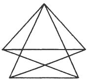

<!--
prenita el:

Fonto: Scienca Revuo Vol. 45 (1994)(2)-165. pp. 26-30. 
Aŭtoro:  Ulrich Matthias (DE)
STEB: https://www.eventoj.hu/steb/matematiko/turan/refuto-de-kombinatorika-konjekto-de-turan.htm
-->

$k$-*grafiko* aŭ $k$-*uniforma hipergrafiko* $G$ estas paro $(V,E)$, kie
$V = V(G)$ estas aro kaj $E = E(G)$ estas familio de $k$-elementaj subaroj de $V$.
$n = n(G) := |V|$ estas la *ordo* de $G$, dum $e = e(G) := |E|$ estas ĝia
*grando*. La elementoj de $V$ nomiĝas *verticoj* kaj la elementoj de $E$
$k$-*eĝoj* aŭ, mallonge, eĝoj de $G$. Por aro $S \subset V$ ni difinas la gradon
$d(S)$ kiel la nombron de la eĝoj entenantaj $S$. $G_1$ nomiĝas *subgrafiko*
de $G_2$, se $V(G_1) \subset V(G_2)$ kaj $E(G_1) \subset E(G_2)$.

Tiu $k$-grafiko $G$ kun ordo $r$, por kiu ĉiu $k$-elementa subaro de $V(G)$ estas
elemento de $E(G)$, nomiĝas $K_r^{(k)}$, la *kompleta* $k$-grafiko de ordo $r$.

[P. Turán]{.maldense} \[[1](#b-1)\] demandis pri la valoroj de la funkcio
$\text{ex}(n,K_r^{(k)})$, difinita kiel la maksimuma grando de $k$-grafiko de ordo $n$ entenanta
neniun $K_r^{(k)})$.

Li konjektis, ke se $m := (r-1) / (k-1)$ estas entjera, tiam la sekva
konstruo liveras *ekstreman* $k$-grafikon, t.e. $k$-grafikon de ordo $n$ kaj
grando $\text{ex}(n,K_r^{(k)})$,
kiu entenas neniun $K_r^{(k)})$:
Dividu $n$ verticojn en $m$ disajn klasojn, kiuj estu tiel egale grandaj
kiel eblas, kaj prenu kiel eĝojn ĉiujn arojn de $k$ verticoj, kiuj ne ĉiuj
troviĝas en la sama klaso.

{#bld-1}\
Fig. 1

Ni nomas la ĵus konstruitan $k$-grafikon $T_m^{(k)}(n)$;
Fig. [1](#bld-1) montras la 2-grafikon $T_3^{(2)}(5)$.
Se ni nomas la aron de la ekstremaj $k$-grafikoj $\text{EX}(n,K_r^{(k)})$,
ni povas formuli la konjekton de [Turán]{.maldense} jene:

$T_m^{(k)}(n) \in \text{EX}(n,K_r^{(k)})$ 
por ĉiuj entjeraj $k≥2, m≥2$ kun $m = (r-1)/k-1)$.

[Turán]{.maldense} pruvis sian konjekton por $k = 2$. Ni montras, ke en la kazo
$r < k^2 -3k+3$ ĝi estas malĝusta por ĉiu sufiĉe granda $n$. Tiucele ni unue
konstatas, ke ĉiu ekstrema $k$-grafiko
$G \subset \text{EX}(n,K_r^{(k)})$ devas plenumi la sekvan kondiĉon:

[(\*)]{.fno #e-1} $d(S) ≥ \text{ex}(n-k+2,K_{r-k+2}^{(2)})$
por ĉiu $(k-2)$-elementa aro $S \subset V(G)$.

Se tiu ĉi kondiĉo ne estus plenumita, ni povus plialtigi la grandon de $G$
sen ke estiĝas iu $K_r^{(k)}$:
Konstruu sur la verticaro $V(G)-S$ iun ekstreman
$H \in \text{EX}(n-k+2,K_{r-k+2}^{(2)})$.

Forigu de $G$ ĉiujn $k$-eĝojn entenantajn $S$ kiel subaron kaj aldonu kiel
novajn $k$-eĝojn ĉiujn uniojn de $S$ kun unu el la
$\text{ex}(n-k+2,K_{r-k+2}^{(2)})$ 2-eĝoj de $H$. Ni tiam ricevas $k$-grafikon
$G'$ kun grando:

$e(G') = e(G) - d(S) + \text{ex}(n-k+2,K_{r-k+2}^{(2)}) > e(G)$.

Laŭ nia konstruo ankaŭ $G'$ entenas neniun $K_r^{(k)}$
kiel subgrafikon, ĉar ties verticaro rajtus nek enteni nek ne enteni $S$
kiel subaron. Sekve $G$ ne estis ekstrema. Ni do ricevas kontraŭdiron.

Ĉar la konjekto de [Turán]{.maldense} estas ĝusta por $k=2$, ni povas determini la
valoron de $\text{ex}(n-k+2,K_{r-k+2}^{(2)})$.
La probablo, ke iu paro el $n-k+2$ verticoj ne estas eĝo de fiksita
2-grafiko $T_m^{(2)}(n-k+2)$ kun $m=r-k+1$ konverĝas por $n \to \infty$ al 
$1/m = 1/(r-k+1)$; sekve
$\text{ex}(n-k+2,K_{r-k+2}^{(2)}) = (1-1/(r-k+1))({n \atop 2})+o(n^2)$,
kie $o(n^2)$ estas funkcio, kiu dividite per $n^2$ konverĝas al 0
por $n\to\infty$.

El ([\*](#e-1)) do sekvas

[(\*\*)]{.fno #e-2} $d(S) ≤ (1 - 1 / (r - k + 1))({n \atop 2}) + o(n^2)$.

Ni nun montras, ke por $r < k^2 - 3k + 3$ la $k$-grafiko
$T_m^{(k)}(n)$ ne ĉiam plenumas tiun ĉi kondiĉon: Se $S$ konsistas el $k-2$ verticoj
el nur unu vertica klaso de la $T_m^{(k)}(n)$,
tiam

[(\*\*\*)]{.fno #e-3} $d(S) = (1 -- 1 / m^2)({n \atop 2}) + o(n^2)$,

ĉar por paro de du pliaj verticoj el $V(T_m^{(k)}(n))$
la probablo, ke ili ambaŭ troviĝas en la sama vertica klaso kiel $S$ \[kaj
ne formas kune kun $S$ eĝon de la $T_m^{(k)}(n)$\],
konverĝas por $n\to\infty$ al $1 / m^2$.

El nia premiso $r < k^2-3k+3$ kaj la difino $m := (r-1) / (k-1)$
sekvas:

$r-1 <(k-1) (k-2)$ kaj do $m<k-2$,

sekve $r-k+1 = m(k-1)+1-k+1 = (m-1) (k-1)+1<(m-1)(m+1)+1= m^2$

kaj do $1 - 1 / (r-k+1) < 1 - 1 / m^2$.

Pro tio ([\*\*](#e-2)) kontraŭdiras al ([\*\*\*)](#e-3), se $n$ estas sufiĉe granda, kaj
ni pruvis:

**Teoremo.** Por ĉiu paro $(k,r)$ kun $3 ≤ k < r < k^2-3k+3$ ekzistas
$N(k,r)$ tiel, ke por ĉiu $n ≤ N(k,r)$ la konjekto de Turán estas malĝusta.

## Referenco

\[1\] [P. Turán]{.maldense}: Applications of graph theory to geometry and potential
theory, en *Combinatorial structures and their applications (R. Guy k.a.
eld.),* Gordon and Breach, New York 1970.
