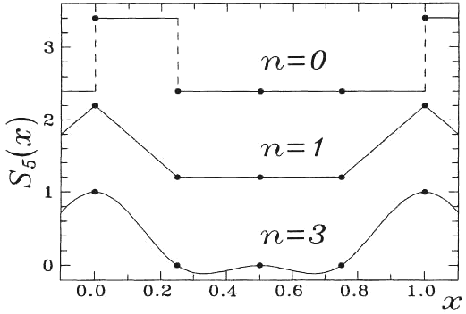
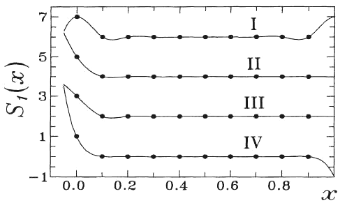
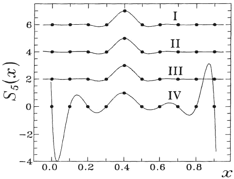
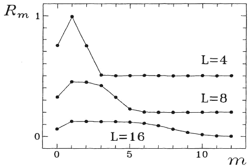
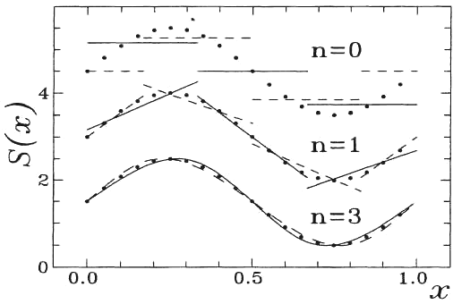

<!--
prenita el:
Fonto: Scienca Revuo Vol. 46 (1995)(1) -166 pp. 20-38.     
Aŭtoro: D-ro Ivan L. Andronov, Odesa Ŝtata Universitato, katedro de astronomio, park im. T.G. Ŝevĉenko, 
    270014 Odessa, Ukrainio, root@astro.odessa.ua
STEB: https://www.eventoj.hu/steb/matematiko/apliko-de-splajn-funkcioj/apliko-de-splajn-funkcioj.htm
-->

<!--
simboloj en formuloj:
https://www.cmor-faculty.rice.edu/~heinken/latex/symbols.pdf
https://math.meta.stackexchange.com/questions/5020/mathjax-basic-tutorial-and-quick-reference
-->

<blockquote>
Ni revuas diversajn flankojn de uzado de matematika aparato de
splajn-funkcioj: interpolado, glatigado de tabele determinataj funkcioj;
numera integralado de funkcioj kaj ĝiaj kvadratoj; komparo kun rezultoj
de [Fourier]{.maldense}-a analizo. Novaj metodoj de serĉo de periodo de varia signalo
kaj de restarigado de signalo influita per "aparata funkcio" estas
proponitaj.
</blockquote>

## 1. Enkonduko

Dum lasta tempo la sciencistoj el diversaj landoj tre interesiĝas pri
tie ĉi nomataj splajn-([spline]{.maldense}) funkcioj, aparte pri la "kubaj
splajnoj" ([Ahlberg]{.maldense} k.a. 1967, [Kornejĉuk]{.maldense} 1984, [Marĉuk]{.maldense} 1980, [Zavjalov]{.maldense}
k.a. 1980 kaj aliaj monografioj). Uzado de tiaj ĉi funkcioj estas tre
efektiva kaj havas kelkajn avantaĝojn kompare kun la aliaj metodoj.

En tiu ĉi artikolo ni mallonge diskutas kelkajn plej uzatajn aplikojn de
la metodo. Post difino de splajnoj (sekcio 2) ni priskribos metodon de
glatigo de pereksperimente mezuritaj valoroj de la funkcio (sekcio 3),
de komputora integralado funkcioj (sekcio 4) kaj ĝiaj kvadratoj (sekcio
5). En sekcio 7 ni diskutas [Fourier]{.maldense}-spektron de kubaj splajn-funkcioj
kaj komparas splajnajn kaj trigonometriajn aproksimaĵojn. Bonaj
interpolaj proprecoj de splajnoj povus esti uzataj por la restarigado de
funkcioj tiel, ke oni aplikas valorojn influitajn per la mezurilo
(sekcio 6) kaj por la esploro de eblaj periodaĵoj de varia signalo
(sekcio 8).

## 2. Polinomaj splajnoj

### 2.1 Difino

La polinoma splajno de potenco $n$ kaj difekto $k$ estas
la funkcio, kia estus kalkulita per la formulo (vidu cititajn
monografiojn):

[(1)]{.fno #e-1}  $S(x)=B_{j0} + B_{j1}h+...+B_{jn}h^n$,

kie $h=x-x_j; j=l$, se $x_l≤x<_{l+1}; x_l, l=1...L$
-- la argumentoj de tie ĉi nomataj "karakterizaj punktoj" de splajno.
Estas notinde, ke nun ni uzas $L=N$ (kvanto da interpolitaj
punktoj), sed eble $N≥L$ (vidu sekcio 3). Ekster la intervalo
$\left[x_1, x_L\right]$ ekzistas du eblecoj por kalkulo de 
$j$:
se splajno estas neperioda, $j=L$, se $x<x_1$, kaj
$j=L$, se $x≥x_L$. Por splajno kun la periodo
$P,j=L$ por ambaŭ okazoj, sed $h=P+x−x_L$, se
$0≤x≤x_1$. Por facileco de sekvaj esploroj, oni numeras
"karakterizajn punktojn" laŭ la ordo de pliiĝo da argumentoj:
$x_1<x_2...<x_L$. Parametro $n$ estas la potenco de
polinomo ([1](#e-1)). Difekto $k$ montras al ni, kiel "glata" estas
splajno: ĉiaj derivatoj de splajno de potenco ĝis $(n−k)$
inkluzive estas kontinua eĉ en "karakterizaj punktoj".

Ĉi tie ni devas skribi kelkajn notojn. La polinomo ĉie havas kontinuajn
derivatojn de ĉia potenco. Oni povas skribi ankaŭ, ke la polinomo havas
difekton $k=0$. Formale oni plusas novan karakterizaĵon
$−k$, sed praktike tio ĉi signifas, ke splajnoj estas pli vasta
klaso.

Splajnoj estas kompleksaj funkcioj. Por diversaj argumentoj, la funkcioj
uzataj por kalkulado estas diversaj, kontraŭ maniere kompare kun ĉiaj
analitikaj funkcioj. Problemoj de nepolinomaj splajnoj estas interesaj
por teoriistoj (ekz. [Laurent]{.maldense} 1972), sed polinomaj splajnoj, kiaj estas
nur parto de ĉiaj splajnoj, estas la plej ofte uzata parto, kaj ni
diskutas nur ilin.

### 2.2 Ekzemploj

Splajnoj estis tre ofte uzitaj, sed ne havis tian ĉi nomon. Ekz. splajno
de nula potenco (Fig. [1](#bld-1), $n = 0$), laŭ difine estas konstanta
funkcio en ĉiu subintervalo kun (eble) diversaj valoroj en ĉiu. Difekto
$k=1$, tial la funkcio ne estas kontinua, sed la derivato de
potenco (−1 = integralo) jes estas tia. "Histogramo"
montranta kiomojn da ia fizika karakterizaĵo en subintervaloj povas esti
la plej uzata ekzemplo. Tiuj ĉi splajnoj $(n=0, k=1)$ ankaŭ
estas uzataj por serĉo de periodaĵoj de varia signalo (metodo de
[Jurkevich]{.maldense} 1971) aŭ por aproksimado de rentgenaj observoj per kosmaj
sputnikoj (ekz. [Hearn]{.maldense} kaj [Richardson]{.maldense} 1977).

La splajnoj $(n=1, k=1)$ estas linioj interligantaj
"karakterizajn punktojn" (fig. [1](#bld-1), "$n=1$"). Ili estas ofte
uzataj por la interpolado de funkciaj valoroj, presitaj en tabeloj.

Tamen la plej ofte uzataj funkcioj en modernaj kalkuloj estas kubaj
$(n=3, k=1)$ splajnoj. Ili estas la plej glataj funkcioj, kiuj
havas en intervalo $\left[x_1, x_L\right]$ kontinuan derivaton de
potenco 2 kaj kiaj interpolas fiksitajn punktojn, tial en tia ĉi klaso
da funkcioj, la kuba splajno minimumigas integralon

[(2)]{.fno #e-2} $\displaystyle Z=\int_{x_1}^{x_L} \ddot{y}^2(x)dx$

(ekz. [Forsythe]{.maldense} k.a. 1977).

### 2.3 Bazaj splajn--funkcioj

Iu splajno kun fiksitaj argumentoj de "karakterizaj punktoj"
$x_1...x_L$ povas esti kalkulita kiel

[(3)]{.fno #e-3} $\displaystyle S(x)=\sum_{j=1}^L C_jS_j(x)$

kie $c_j$ estas koeficientoj (ĉi-okaze egalaj al la valoroj de
funkcio $y_j=y(x_j)$), kaj $S_j(x)$ -- la "bazaj
funkcioj" difinitaj laŭ kondiĉoj

[(4)]{.fno #e-4} $\displaystyle S_j(x_i)=\delta_{ij} = \left\{
    \begin{array}{l}
        0, \text{se}\; i\neq j \\ 
        1, \text{se}\; i=j
    \end{array}\right.$

 
{#bld-1}\
**Fig. 1.** Periodaj $(P=1)$ bazaj splajnoj $S_1(x)$ por $L=4$ egaldistancaj laŭ argumento "karakterizaj punktoj" kaj difekto $k=1$ por diversaj $n$.

Kompreneble, ke ekzistas senfina nombro da funkcioj havantaj tian ĉi
proprecon, kaj ĉiaj tiaj funkcioj povas esti uzataj por la aproksimado.
Tamen, se ni fiksus *klason* de funkcioj, la bazaj funkcioj ekestus
determinataj. Se $S_j(x)$ estas splajno, la linia kombinacio ([3](#e-3))
estas ankaŭ la splajno de la samaj valoroj de $n$.

### 2.4 Kial komputi koeficientojn de splajnoj?

Antaŭe ni diskutis abstraktajn formulojn priskribantajn kunajn
proprecojn. Sed por praktika apliko necesas havi klaran metodon de
komputado de parametroj $B_{jm}$ el ekvacio ([1](#e-1)).

Por la plej simpla okazo $n=0, k=1$, oni povas skribi
$B_{j0}=y_j$:

[(5)]{.fno #e-5} $y(x)=y_j$,  

kie $j$ estas determinata laŭ menciitaj kondiĉoj. Se
$n=1, k=1$,

[(6)]{.fno #e-6} $y(x)=y_j\overline{w}+y_{j+1}w$,

kie $w=h/h_j, h=x−x_j, h_j=x_{j+1}−x_j, \overline{w}=1−w$. Laŭ
[Forsythe]{.maldense} k.a. (1977), okaze de $n=3, k=1$,

[(7)]{.fno #e-7} $y(x)=y_j\overline{w}+y_{j+1}w+h_j^2((\overline{w}^3− \overline{w})\beta_j+(w^3−w)\beta_{1+1})$, 

kie la valorojn de parametroj $β_j$ oni povas komputi, solvante
sistemon de $L$ liniaj ekvacioj:

[(8)]{.fno #e-8}  $\displaystyle\begin{pmatrix}
 2(h_L+h_1) & h_1 & 0 & 0 & \cdots & 0 & h_L \\
 h_1 & 2(h_1+h_2) & h_2 & 0 & \cdots & 0 & 0 \\
 0 & h_2 & 2(h_2+h_3) & h_3 & \cdots & 0 & 0 \\
 \vdots & \vdots & \vdots & \vdots & \ddots & \vdots & \vdots \\
 h_L & 0 & 0 & 0 & \cdots & h_{L-1} & 2(h_{L-1}+h_L)
\end{pmatrix} \times$

$$\times\begin{pmatrix}\beta_1\\\beta_2\\\beta_3\\ \vdots\\ \beta_L\end{pmatrix}
= \begin{pmatrix}D_1-D_L\\D_2-D_1\\D_3-D_2\\ \vdots\\ D_L-D_{L-1}\end{pmatrix}$$

(perioda splajno, kian ni markas kiel "slajno de tipo I", aŭ

[(9)]{.fno #e-9}  $\displaystyle\begin{pmatrix}
 -h_1 & h_1 & 0 & 0 & \cdots & 0 & 0 \\
 h_1 & 2(h_1+h_2) & h_2 & 0 & \cdots & 0 & 0 \\
 0 & h_2 & 2(h_2+h_3) & h_3 & \cdots & 0 & 0 \\
 \vdots & \vdots & \vdots & \vdots & \ddots & \vdots & \vdots \\
 0 & 0 & 0 & 0 & \cdots & h_{L-1} & -h_{L-1})
\end{pmatrix} \times$

$$\times\begin{pmatrix}\beta_1\\\beta_2\\\beta_3\\ \vdots\\ \beta_L\end{pmatrix}
= \begin{pmatrix}h_L^2\Delta_1\\D_2-D_1\\D_3-D_2\\ \vdots\\ -h_{L-1}^2\Delta_{L-3}\end{pmatrix}$$

(slpajno II) aŭ $β_1=β_L=0$,

[(10)]{.fno #e-10}  $\displaystyle\begin{pmatrix}
  h_1 & 0 & 0 & \cdots & 0 & 0\\
  2(h_1+h_2) & h_2 & 0 & \cdots & 0 & 0 \\
  h_2 & 2(h_2+h_3) & h_3 & \cdots & 0 & 0 \\
 \vdots & \vdots & \vdots & \vdots & \ddots & \vdots & \vdots \\
  0 & 0 & 0 & \cdots & h_{L-2} & 2(h_{L-2}+h_{L-1})
\end{pmatrix} \times$

$$\times\begin{pmatrix}\beta_2\\\beta_3\\\beta_4\\ \vdots\\ \beta_{L-1}\end{pmatrix}
= \begin{pmatrix}D_2-D_1\\D_3-D_2\\D_4-D_3\\ \vdots\\ D_{L-1}-D_{L-2}\end{pmatrix}$$

(splajno III), kie $D_j=(y_{j+1}−y_j)/h_j, j=1...L−1$;
$D_L=(y_1−y_L)/h_L, h_L=P+ x_1−x_L$ (indekso $L$ nur
por periodaj splajnoj I), kaj

[(11)]{.fno #e-11}  $\displaystyle\Delta_j = \frac{1}{x_{j+3}-x_j}\left(\frac{D_{j+3}-D_{j+2}}{x_{j+3}-x_{j+2}} - \frac{D_{j+2}-D_{j+1}}{x_{j+2}-x_{j+1}}\right)$

estas aproksimaĵo por la tri-potenca derivato de aproksimata funkcio
(tia ĉi valoro estas preciza, se la funkcio estas polinomo
$(n≤3, k=0))$.

Uzante ekvacion ([7](#e-7)), oni povas skribi derivatojn:

[(12)]{.fno #e-12}  $\begin{align}
\displaystyle y'(x)&= \frac{d}{dx}y(x) = D_j+h_j(-(3\overline{w}^2-1)\beta_j+(3w^2-1)\beta_{j+1})\\
\displaystyle y''(x)&=\frac{d^2}{dx^2}y(x)=6(\beta_j\overline{w})-\beta_{j+1}w)\\
\displaystyle y'''(x)&=\frac{d^3}{dx^3}y(x)=6\frac{\beta_{j+1}-\beta_j}{h_j}
\end{align}$

aŭ, kompare kun ekv. ([1](#e-1)), por la karakterizaj punktoj,

[(13)]{.fno #e-13}  $\begin{align}
\displaystyle y'(x_j)&=B_{j1}=D_j−h_j(2\beta_j+\beta_{j+1})\\
\displaystyle y''(x_j)&=2B_{j2}=6\beta_j\\
\displaystyle y'''(x_j)&=6B_{j3}=6(\beta_{j+1}−\beta_j)/h_j,\quad j=1,...,L−1
\end{align}$

Por $j=L$ estas du eblecoj: por la perioda splajno I oni povas
simple uzi indekson 1 por $(L+1)$, kaj por la splajnoj II kaj
III

[(14)]{.fno #e-14}  $\begin{align}
\displaystyle y'(x_L)&=D_{L−1}+h_{L−1}(\beta_{L-1}+2\beta_L)\\
\displaystyle y''(x_L)&=6\beta_L\\
\displaystyle y'''(x_L)&=y'''(x_{L−1})
\end{align}$

Estas notinde, ke la splajno III \[vere, red.\] minimumigas integralon ([2](#e-2)). Tiu ĉi
splajno estas ofte nomata kiel "natura splajno", la plej glata sence
de ekv. ([2](#e-2)) funkcio. Sed tiu ĉi splajno ne estas la plej bone
aproksimanta funkcio --- ni misaproksimas du-potencan derivaton de
funkcio apud limoj de intervalo: $y''(x_1)=y''(x_L)=0$. Tia
ĉi kondiĉo ne estas \[vera, red.\] por ĉiuj funkcioj. Pro tio *Forsythe k.a.*
(1977) proponis uzi aliajn limkondiĉojn: aproksimi tri-potencan
derivaton apud limoj uzante kvar apudajn "karakterizajn punktojn",
alivorte: aproksimi tiujn ĉi kvar punktojn per polinomo
$(n=3, k=0)$, kaj uzi tia maniere kalkulitajn derivatojn
$y'''(x_1)$ kaj $y'''(x_L)$. Tiu ĉi splajno II
aproksimas analitikajn funkciojn pli bone, ol la splajnoj III (vd. ankaŭ
*Andronov* 1985a, 1986). Por komparo, bazaj funkcioj por polinomo,
interpolanta ĉiujn punktojn estas

[(15)]{.fno #e-15}  $\displaystyle S_i(x)=\prod_{j\neq i}^{L}\frac{x-x_j}{x_i-x_j}$

Tiu ĉi *Lagrange*-a polinomo (funkcio IV laŭ nia signifo) aproksimas
"karakterizajn punktojn", sed inter ili la variaĵoj de polinomo povas
esti multoble pli grandaj kompare kun la variaĵoj de funkcio (fig. [2](#bld-2),
[3](#bld-3)).

{#bld-2}\
**Fig. 2.** Bazaj funkcioj (I-IV) por $L=10$ kaj $j=1$.

{#bld-3}\
**Fig. 3.** Bazaj funkcioj (I-IV) por $L=10$ kaj $j=5$.

## 3. Glatigaj splajnoj: du manieroj de komputo

### 3.1 Metodo de "ĉiupunkta" splajno

Tre ofte oni devas aproksimi eksperimentajn valorojn per ia glata
funkcio. Uzante splajnojn, tiu ĉi tasko povas esti solvata dumaniere.
Pli malnova (kaj pli uzata) metodo bazas sin sur la minimumigado de sumo

[(16)]{.fno #e-16}  $\displaystyle Z_1=\lambda^2 \int_{x_L}^{x_1}|y^{(m)}(x)|^2dx+\sum_{i=1}^Np_i(y_i-s(x_i))^2$

kie $p_i$ estas ia "kontribua koeficiento" dependa de
precizeco de valoro $y_i$; potenco de derivato $m$ estas
2 (*Marĉuk* 1980) aŭ 3 (*Vondrak* 1969, *Picchio* 1981); $λ^2$
--- ia parametro karakterizanta gradon de aproksimeco inter punktoj kaj
aproksimanta kurbo. Se $λ^2=0$, la "glatiga" funkcio estas
interpolanta splajno (kun "karakterizaj punktoj" ĉe la samaj
argumentoj, kiel "eksperimentaj punktoj"). Se $λ^2\neq 0$, la
funkciaj valoroj ĉe "karakterizaj punktoj" estas variigitaj, kaj la
splajno interpolas tiujn "korektitajn" punktojn. En tiu ĉi metodo ne
estas tute klara la fizika senco de la parametroj $λ^2$ kaj
$p_i$. Variigante ĝiajn valorojn, oni povas komputi multajn
splajnojn, tial estas necese ellabori konkretajn kriteriojn por tio.

### 3.2 La metodo de "malplej grandaj kvadratoj"

Bazaj splajn-funkcioj ([4](#e-4)) povas esti uzataj por komputado de
koeficientoj $C_j$ (ekvacio ([3](#e-3))) laŭ kondiĉo, ke

[(17)]{.fno #e-17}  $\displaystyle R=\sigma_{O-C}^2=\sum_{i=1}^Np_i\left(y_i-\sum_{j=1}^LC_jS_j(x_i)\right)^2$

estas minimuma (se aliaj parametroj havas la samajn valorojn). Kontraŭ
la metodo priskribita en sekcio 3.1, tie ĉi la "karakterizaj punktoj"
povas havi argumentojn ne egalaj al argumentoj de "eksperimentaj
punktoj" (ekz. [Andronov]{.maldense} 1985a). Oni povas skribi sistemon de
$L$ "normalaj ekvacioj"

[(18)]{.fno #e-18}  $\displaystyle \frac{\partial R}{\partial C_m}=0$

aŭ

[(19)]{.fno #e-19}  $\displaystyle \sum_{j=1}^LA_{mj}C_j=Q_m$

ke

[(20)]{.fno #e-20}  $\begin{align}
\displaystyle  A_{mj}&=\sum_{i=1}^Np_iS_m(x_i)S_j(x_i)\\
\displaystyle  Q_{m}&=\sum_{i=1}^Np_iS_m(x_i)y_i
\end{align}$

Se la valoroj $y_i$ estas determinataj kun la sama precizeco,
$p_i=const=1/N$. Ĉi-okaze oni povas komputi
precizecon de la koeficientoj $C_j$ laŭ ekvacio

[(21)]{.fno #e-21}  $\displaystyle \sigma_i=\sqrt{\frac{NR}{N-L}}\sqrt{V_{jk}}$

kie $(V_{jk})$ estas matrico inversa rilate al la matrico
$(A_{mj})$:

[(22)]{.fno #e-22}  $\displaystyle\sum_{j=1}^LA_{mj}V_{jk}=\delta_{mk}$

(ekz. *Ceseviĉ* 1970). Laŭ la difino de bazaj funkcioj ([4](#e-4)),
$\sigma_j$ estas precizeco de la komputitaj valoroj $S(x_j)$.

Estas notinde, ke por neperiodaj funkcioj (II-IV, 3), la valoro de
$\sigma_j$ pliiĝas ĉe la limoj de intervalo. Kompare malgranda valoro
de $\sigma_j$ apud centro de intervalo por interpolanta *Lagrange*-a
polinomo (IV) estas ligita kun la pli granda sentiveco de tiu ĉi funkcio
de malgrandaj variaĵoj de aproksimita funkcio. Tamen ĉe la limoj de
intervalo, la valoroj $\sigma_j$ multoble pliiĝas ankaŭ por la
funkcio (IV). Por fiksita tipo de funkcio, la valoroj $\sigma_j$
estas pli malgrandaj, se la kvanto da "glatigataj" punktoj estas pli
granda apud tia "karakteriza punkto".

La FORTRAN-lingvaj programoj uzantaj la menciitajn metodojn estas
publicitaj fare de l\'aŭtoro (1985).

## 4. Integralado de funkcioj per splajnoj

Laŭ la ekvacioj ([3](#e-3)), ([4](#e-4)), oni povas skribi

[(23)]{.fno #e-23}  $\displaystyle \int_\alpha^\beta S(x)dx=\sum_{j=1}^Ly_jG_j$,

kie

[(24)]{.fno #e-24}  $\displaystyle G_j=\int_\alpha^\beta S_j(x)dx$.

Se la argumentoj $x_j$ da kelkaj aproksimataj funkcioj estas la
samaj, oni povas komputi koeficientojn $G_j$ kaj post multfoje
(se necese) kalkuli integralojn ([23](#e-23)) kun diversaj vektoroj
$y_j$. Tiuj ĉi "kvadraturaj" formuloj estas ĉiam uzataj
(metodoj de [Newton-Cotes]{.maldense}, [Ĉebiŝev]{.maldense} (vd. ekz. [Marĉuk]{.maldense} 1980, [Krilov]{.maldense}
1959), sed bazaj funkcioj ankaŭ povas esti splajnoj.

Por plej simpla (kaj ofta) okazo, "karakterizaj punktoj" estas
egaldistancaj laŭ argumento; kaj la integralon ([23](#e-23)) oni povas skribi
tial

[(25)]{.fno #e-25}  $\displaystyle I=\int_\alpha^\beta S(x)dx=(\beta-\alpha)\sum_{j=1}^L g_jy(x_j)$,

kie

[(26)]{.fno #e-26}  $\displaystyle g_j=\int_0^1 S_j(x')dx',\quad x_j=\alpha+\frac{j-1}{L-1}(\beta-\alpha)$.

En tab. [1](#tab-1) ni skribis koeficientojn $g_j$ por $L=9$,
polinomo IV (ekz. [Dimarskij]{.maldense} k.a. 1963) kaj splajnoj II, III
([Andronov]{.maldense} 1986).

[Tab. 1]{#tab-1}. Koeficientoj por kvadraturaj formuloj de la funkcioj II-IV

|   $E$            | II |      III  |   IV   |
|---|---:|---:|---:|
|   $E_1, E_9$     | 36139 |   1071  |  989  |
|   $E_2, E_8$     |132060 |  3080   | 5888  |
|   $E_3, E_7$     | 89886 |   2618  |  −928 |
|   $E_4, E_6$     |109340 |  2744   | 10496 |
|   $E_5$          |103518 |  2702   | −4540 |
|   $E$            |838368 |  21728  | 28350 |

Ĉiujn koeficientojn oni povas skribi tial

[]{.fno} $\displaystyle g_j=E_j/E,\quad E=\sum_{j=1}^L E_j$.

Estas notinde, ke $g_j=g_{L+i−j}$.

La glatigaj splajnoj ankaŭ povas esti uzataj por integralado (vidu
[Andronov]{.maldense} 1986 por detaladiskuto kaj FORTRAN-lingvaj programoj).

## 5. Integralado de kvadratoj de funkcioj

Por iuj taskoj oni devas komputi integralon de funkcia kvadrato.
Splajnoj ankaŭ estas uzeblaj por tiu ĉi celo. La tuta integralo estas la
sumo de integraloj tra subintervaloj. Por kuba splajno

[(27)]{.fno #e-27}  $\begin{array}{}\displaystyle\int_0^h(b+ct+dt^2+et^3)^2dt=b^2h+bch^2+\frac{(c^2+2bd)h^3}{3}+\\ \displaystyle+\frac{(be+cd)h^4}{2}+\frac{(2ce+d^2)h^5}{5}+\frac{deh^6}{3}+\frac{e^2h^7}{7}\end{array}$

kie $h=x−x_j; b=B_{j0}, c=B_{j2}, e=B_{j3}$. Se $x=x_{j+1}$,
oni povas ankaŭ uzi la ekvacion ([7](#e-7)). Tial

[(28)]{.fno #e-28}  $\displaystyle\int_{x_j}^{x_{j+1}}S^2(x)dx=h_j\sum_{k=0}^3\sum_{l=0}^3 G^{kl}Y_kY_l$

kie $Y_0=y_j, Y_1=y_{j+1}, Y_2=h^2_j\beta_j, Y_3=h^2_j\beta_{j+1}$, kaj

[(29)]{.fno #e-29}  $\displaystyle G^{kl}=\frac{1}{210}\begin{pmatrix}70&70&-56&-49\\0&70&-49&-56\\0&0&16&31\\0&0&0&16\end{pmatrix}$

Se kalkuli simetrian matricon

[(30)]{.fno #e-30}  $\displaystyle T^{kl}=\frac{1}{2}(G^{kl}+G^{lk})$

oni povas uzi ĝin en ekv. ([28](#e-28)) anstataŭ $G^{kl}$. Tio ĉi signifas,
ke la matrico $T^{kl}$ estas la analogo de tie ĉi nomata "metrika
tensoro" uzata aparte en la relativeca teorio.

## 6. Restarigado de funkcioj

Ĉiuj valoroj ricevitaj per mezuriloj ne estas precizaj. Krom la eraroj
karakterizantaj precizecon, estas influo de mezurilo al la mezurata
proceso. En ĉiuj mezuroj ni uzas filtrilon (de tempo, spaco, ondlongo,
energio k.t.p.). En multaj okazoj ni povas skribi integralan ekvacion

[(31)]{.fno #e-31}  $\displaystyle y(x)=\int_{-\infty}^{+\infty}g(x')f(x-x')dx$.

Laŭ la ekvacioj ([3](#e-3),[4](#e-4)),

[(32)]{.fno #e-32}  $\displaystyle y_j=\sum_{m=1}^L U_{mj}f_m$

kie

[(33)]{.fno #e-33}  $\displaystyle U_{mj}=\int_{-\infty}^{+\infty}g(x')S_m(x_j-x')dx'$,
  
$y_j$ estas "mezuritaj" valoroj; $g(x')$ estas tie ĉi
nomata "aparata funkcio" dependa de proprecoj de mezurilo;
$f_m=f(x_m)$ -- la restarigita funkcio. Se oni aproksimas
funkcion $f(x)$ per fiksitaj bazaj funkcioj, komputante la
matricon $U_{mj}$, oni povas restarigi "influitajn" valorojn.
Oni ĉiam uzas por tiu ĉi celo nur metodon de rapida [Fourier]{.maldense}-a,
transformo (FFT -- [Fast Fourier Transform]{.maldense}, v. ekz. [Brault]{.maldense} kaj [White]{.maldense}
1971). Tamen kubaj splajnoj ankaŭ povas esti uzeblaj ([Andronov]{.maldense} 1987a).
En ambaŭ metodoj, la rezultoj forte dependas de uzata "lima
frekvenco". Okaze de polinomaj splajnoj tiun ĉi rolon ludas la distanco
inter "karakterizaj punktoj" de splajno (v. ankaŭ sekcion 7).
"Glatigaj splajnoj" montras pli bonajn rezultojn kompare kun la
"interpolantaj", tial "glatigo" funkcias kiel "reguligo". La nura
malavantaĝo de tiu ĉi metodo estas ligita kun malfacilaĵoj de kalkulo de
matricaj elementoj.

Alia metodo bazita sur la loka aproksimado de funkcio per polinomo
je kvara potenco (ankaŭ splajn-aproksimado: $n=4, k=4$)
estis proponita fare de l\'aŭtoro (1985b).

## 7. [Fourier]{.maldense}-a spektroj de splajnoj

Se la funkcio estas aproksimata per la formulo

[(34)]{.fno #e-34}  $y(x)=C_0+C_1s_1+C_2c_1+C_3s_2+C_4c_2+...+C_{L−1_sM}+C_Lc_M$

kie $L=2M+1, s_m=\sin(2\pi mx), c_m=\cos(2\pi mx)$ (argumentoj estas
transformitaj tiel, ke la periodo $P=1$), la koeficientojn
$C_j$ oni povas komputi, solvante sistemon de liniaj ekvacioj:

[(35)]{.fno #e-35}  $\begin{array}{}\begin{pmatrix}
N&\sum s_1&\sum c_1&\cdots&\sum s_M&\sum c_M\\
\sum s_1&\sum s_1s_1 &\sum c_1s_1&\cdots&\sum s_Ms_1 &\sum c_Ms_1\\
\sum c_1&\sum s_1c_1 &\sum c_1c_1&\cdots&\sum s_Mc_1 &\sum c_Mc_1\\
\vdots&\vdots&\vdots&\ddots&\vdots&\vdots\\
\sum s_M&\sum s_1s_M &\sum c_1s_M&\cdots&\sum s_Ms_M &\sum c_Ms_M\\
\sum c_M&\sum s_1c_M &\sum c_1c_M&\cdots&\sum s_Mc_M &\sum c_Mc_M
\end{pmatrix}\times\\
\times\begin{pmatrix}C_1\\C_2\\C_3\\ \vdots \\C_{2M}\\C_{2M+1}\end{pmatrix}
=\begin{pmatrix}\sum_y\\ \sum s_1y\\ \sum c_1y \\ \vdots \\ \sum s_My\\ \sum c_My\end{pmatrix}\end{array}$

kie

[(36)]{.fno #e-36}  $\displaystyle \sum s_M = \sum_{i=1}^N \sin(2\pi mx_i), \sum c_m= \sum_{i=1}^N \cos(2\pi mx_i)$,

k.t.p. Se $x_i$ estus kalkulata, tial $x_i=iJ/N+\text{const}$
($J\neq 0$ -- ĉiu entjero), la [Fourier]{.maldense}-a transformo estus

[(37)]{.fno #e-37}  $\displaystyle C_1=\frac{1}{N}\sum y;\quad C_{2m}=\frac{2}{N}\sum s_my;\quad C_{2m+1}=\frac{2}{N}\sum c_my$.

Oni povas ankaŭ skribi, ke

[(38)]{.fno #e-38}  $C_{2m}s_m+C_{2m+1}c_m = R_m \cos(2\pi mx_i-\phi_m)$  

kie $R_m$ kaj $\phi_m$ estas la amplitudo kaj fazo de
sinus-kurbo No $m$:

[(39)]{.fno #e-39}  $\begin{align}
  R_m\sin\phi_m &= C_{2m} \\
  R_m\cos\phi_m &= C_{2m+1}
\end{align}$

Ekz., sur fig. [4](#bld-4) estas desegnitaj [Fourier]{.maldense}-spektroj (dependeco
$R_m$ de $m$) por periodaj bazaj splajnoj kun $L$ = 4, 8 kaj 16). Pliigante $L$, oni povas pliigi
kontribuon de oscilaĵo kun grandaj $m$.

{#bld-4}\
**Fig. 4.** [Fourier]{.maldense}-spektroj da periodaj bazaj kubaj splajnoj $(n=3, k=1)$.

La "lima frekvenco" $m_0$ (montranta por kiaj $m>m_0$
la oscilaĵoj ne estas signifaj) dependas de kvanto da "karakterizaj
punktoj" $L$. El fig. [4](#bld-4), $m_0 \approx L/2+2±1$. Tial se valoroj
de $L$ estas la samaj por "splajna" kaj "trigonometria"
aproksimado, la splajnoj aproksimas "eksperimentajn" punktojn pli bone
iomete --- ili havas "ekstrajn oscilajojn" kun $m>L/2$.

Estas notinde, ke la grado de proksimeco inter punktoj kaj kurbo pliiĝas
kun pliiĝo de $L$. Tamen se pli multe da parametroj oni havas,
malpli precizaj estas ties valoroj. Tial oni povas serĉi "optimuman"
valoron de kvanto da komputataj parametroj.

## 8. Serĉo de periodo de varia signalo

La matematika tasko jenas: estas du vektoroj
$t_i, y_i,\; i=1 .. N$. Estas necese komputi parametrojn 
$T_, P, C_1...C_L$, por kiuj la valoro de tie ĉi nomata "testa
funkcio"

$$Q(T_0,P; t_1...t_N; y_1...y_N; C_1...C_L)$$

havas ekstremon (v. [Pelt]{.maldense} 1980, [Heck]{.maldense} k.a. 1985, [Andronov]{.maldense} 1988 por
revuoj). Oni povas uzi ekvacion ([17](#e-17)). Tiam
$x_i = \text{dec}((t_i−T_0)/P)$, kie $x_i$ estas la fazo de
$i$−a punkto, $T_0$ -- "komenca epoko", $P$ --
testa periodo, $\text{dec}(x)$ -- decimala parto de
$x: 0 ≤ \text{dec}(x)<1$. Komputante la funkcion $Q$ por diversaj
periodoj, oni povas determini "plej bonan" periodon. Parametroj
$C_1...C_L$ por ĉia testa periodo estas komputataj per la
metodo de "malplej grandaj kvadratoj" (v. sekcion 3.2).

{#bld-5}\
**Fig. 5.** Splajnoj $(n=0, k=1; n=1, k=2; n=3, k=1)$ aproksimantaj la "testan" sinuson determinatan en 20 punktoj. Du kurboj estas desegnitaj por diversaj valoroj da "komenca epoko".

Bedaŭrinde, por ĉiuj splajnoj la funkcio $Q$ dependas de la
"komenca epoko" $T_0$ (v. fig. [5](#bld-5)). Tial estas necese pli foje
"glatigi" "glatigendajn funkciojn":

[(40)]{.fno #e-40}  $\displaystyle S^*(x)=\frac{1}{K}\sum_{k=1}^K(S(x,k)$

kie $x_{1k}=(k-1/(KL)$, $x_{lk}=(l-1)/L+x_{1k}$ estas argumentoj de
"karakterizaj punktoj" de splajno $S(x,k)$ Por ĉiu $k$
estas determinitaj la parametroj $C_j$, kaj "glatigata" (laŭ
([39](#e-39))) kurbo estas uzata en ekv. ([17](#e-17)) anstataŭ "\[vera, red.\] splajno" $\sum_j C_jS_j(x_i)$.

La precizeco de kurba valoro ĉe argumento $x$ povas esti
kalkulata per la formulo

[(41)]{.fno #e-41}  $\displaystyle\sigma^2(x)=\frac{1}{K}\sum_{k=1}^K(S(x,k)-S^*(x))^2$

Splajno $(n=0, k=1)$ estas uzata en la metodo de [Jurkevich]{.maldense}
(1971); $(n=1, k=2)$ -- de [Marraco]{.maldense} kaj [Muzzio]{.maldense} (1980); 
$(n=3,k=1)$ -- de [Andronov]{.maldense} (1985a, 1988). Fazaj kurboj por tiuj ĉi
metodoj estas montrataj en fig. [5](#e-5). Pli detale la metodo estas
priskribita fare de l\'aŭtoro (1987b) kaj unue uzata en astronomio per
[Andronov]{.maldense} kaj [Richter]{.maldense} (1987).

## 9. Finaj rimarkoj

La priskribitaj taskoj ne estas ĉiuj aplikoj de aparato de
splajn-funkcioj. Estas multaj monografioj pri tiu ĉi temo (ekz.
[Steĉkin]{.maldense} kaj [Subbotin]{.maldense} 1976, [Topoljanskij]{.maldense} kaj [Krilova]{.maldense} 1977 pri
metodoj de solvado de diferencialaj ekvacioj uze de splajnoj). Tamen ni
volis nur montri diversajn problemojn kaj direktojn ligitajn kun
splajnoj. Por ĉiuj taskoj ekzistas multaj solvoj, kaj aperadas novaj
flankoj de tiu ĉi disvolvata metodo.

Splajnoj ne estas analitikaj funkcioj --- ĝiaj derivatoj ne estas
kontinuaj ĉe "karakterizaj punktoj". Ili ne havas klaran fizikan
sencon (kiel ekz. [Fourier]{.maldense}-oscilaĵoj), tial ni devas ne forgesi, ke
splajnoj estas ne granda fizika *invento*, sed signifa kaj fruktodona *ilo*
de komputora matematiko.

### 10 Literaturo

-   Ahlberg J. H., Nilson E. N., Walsh J. L. (1967): The Theory of
    Splines and their Applications. --- Academic Press. New York.
-   Andronov I. L. (1985a): Opredelenie Parametrov Sglaĵivajuŝĉego
    Splajna s Zadannimi Znaĉeniami Argumenta. --- Preprinto UkrNIINTI,
    131-Uk85Dep., 38p., Kiev
-   Andronov I. L. (1985b): O Zavisimosti Krivoj Bleska AM Gerkulesa ot
    Svetimosti. --- Pisjma v Astronomiĉeskij Ĵurnal, 11, 203
-   Andronov I. L. (1986): Ob Integrirovanii Splajn-Funkcij. Preprinto
    UkrNIINTI, 358-Uk86Dep., 64p., Kiev
-   Andronov I. L. (1987a): On the Restoration of Functions from the
    Distorted Values by Using the Cubic Spline-Function Technique. ---
    International Ernst Abbe Conference on Optics. Abstracts, Jena,
    p.48.
-   Andronov I. L. (1987b): Smoothing the \'Smoothing\' Cubic
    Spline-Functions. --- Contrib. Astron. Inst. Czechoslovak., 20, 161.
-   Andronow I. L. (1989): Über Periodensuchverfahren für veränderliche
    Signale. --- Die Sterne, 65, 20.
-   Andronov I. L., Richter G.A. (1987): V 361 Lyrae : An Exotic Binary
    System with a \'Hot Spot\' Between the Components? --- Astronomische
    Nachrichten, 308, 235.
-   Brault J. W., White O. R. (1971): The Analysis and Restoration of
    Astronomical Data via the Fast Fourier Transform. --- Astronomy &:
    Astrophysics, 13, 169.
-   Ceseviĉ V. P. (1970): Peremennie Zvezdi i Sposobi ih Issledovania.
    Pedagogika, Moskva.
-   Dimarskij J. S., Lozinskij N. N., Makuŝkin A. T., Rosenberg V. J.,
    Erglis V. R. (1963): Spravoĉnik Programmista, Sudpromgiz, Leningrad.
-   Forsythe G. E., Malkolm M. A., Moler C. B. (1977): Computer Methods
    for Mathematic Computation. --- Prentice-Hall, Inc, N. J.
-   Hearn D. R., Richardson J. A. (1977): The X-ray Light Curve of AM
    Herculis. --- Astrophys. J., 213, L115.
-   Heck A., Manfroid J., Mersh G. (1985): On Period Determination
    Methods. Astronomy & Astrophysics Suppl., 59, 63.
-   Jurkevich I. (1971): A method of Computing Cyclic Phenomena. ---
    Astrophysics & Space Science, 13, 154.
-   Kornejĉuk N. P. (1984): Splajni v Teorii Pribliĵenia, Nauka, Moskva.
-   Krilov V. I. (1959): Priblijennoe Viĉislenie Integralov, Fizmatgiz,
    Moskva.
-   Laurent P. J. (1972): Approximation et Optimisation. --- Hermann,
    Paris.
-   Marraco H. G., Muzzio J. C.(1980): An Improved Method to Derive
    Periods of Cyclic Phenomena. --- Publ. Astron. Society Pacific, 92,
    700.
-   Marĉuk G. I. (1980): Metodi Viĉisliteljnoj Matematiki, Nauka,
    Moskva.
-   Pelt J. E. (1980): Ĉastotnij Analiz Astronomiĉeskih Vremennih
    Rjadov, Valgus, Tallinn.
-   Picchio G. (1981): Minimum of Light Curves from a Spline-Smoothing
    Technique. --- Astronomy and Astrophysics, 94, 52.
-   Steĉkin S. B., Subbotin J. N. (1976): Splajni v Viĉisliteljnoj
    Matematike. --- Nauka, Moskva.
-   Topoljanskij D. B., Krilova T. V. (1977): Priloĵenia Kubiĉeskih
    Splajnov dlja Priblijennogo Reŝenia Graniĉnih Zadaĉ. Dnepropetrovsk.
-   Vondrak I. (1969): A Contribution to the Problem of Smoothing
    Observational Data. --- Bull. Astron. Inst. Czechoslovak.- 20, 6, p.
    349.
-   Zavjalov J. S., Kvasov B. I., Miroŝhiĉenko V. L. (1980): Metodi
    Splajn-Funkcij. --- Nauka, Moskva.
