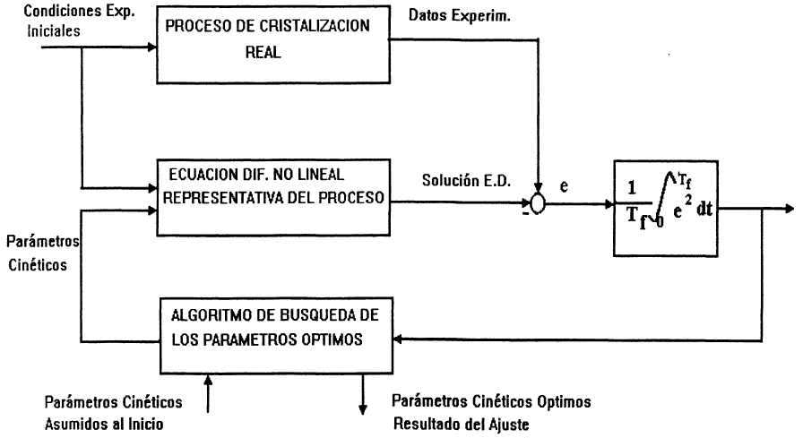
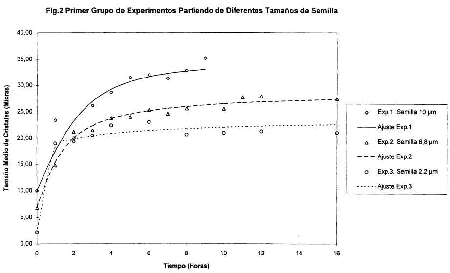

<!--  
prenita el:
Aŭtoroj: Dr. Arturo Toledo (CU)^(1)^ --- Lic. Maria del C. Muñoz (CU)^(1)^ Dr. Miguel Bonera (CU)^(1)^ --- Lic. Hilda Rodriguez (CU)^(1)^ Lic. Nelson Sierra (CU) ^(1)^ --- Ing. Daniel Amaro (CU) ^(2)^ --- Dr. Victor Trejo (CU) ^(3)^ 

Fonto: Scienca Revuo 48 (1997) (3) pp. 30-39, 49, 51-55. 
STEB: https://www.eventoj.hu/steb/medicino/insulina-kristaligxo/kristal.htm

-->

## Resumo

Konsidere al la signifo de la insulinkristalizo por la formuligo de
injekciaĵoj kun malakcela efiko tiu fenomeno estas denove traktata kaj
eksperimente kaj matematike.

Por la alproksimigo al la eksperimentaj datumoj estis elektita
fenomenologa modelo sendependa de la kristalgrandeco, kiu samtempe
liveras la karakterizajn kinetikajn parametrojn.

## Enkonduko

La karakterizo de la kristaliĝo-fenomeno konsidere al iu ajn apliko
estas relative kompleksa, sed necesa tasko; ĝi estas senkondiĉa bazo por
la evoluo de tiurilataj produktado-teknologioj kune kun la plibonigo aŭ
reorganizo de la koncerna instrumentaro por la produktado-procedoj.

La kutima praktiko konsistas el la formuligo de adekvataj modeloj, kiuj
reprezentas la tiurilatajn leĝojn de la kreskado-kinetiko. Tiuj modeloj
devas esti alproksimigotaj al la eksperimentaj datumoj por tiel fiksi la
identigajn parametrojn de la elektita modelo. Tiu duonempiria procedo
plifaciligas la aplikon de specifaj optimumigaj kriterioj por la
sinsekvo de la kristaliza procedo.

Pri la kristaliĝa fenomeno de multnombraj organikaj kaj anorganikaj
substancoj ekzistas dekoj da studoj. Ili estas resumitaj de [Tavare]{.maldense}
(1987) kaj kompletigitaj per la esploroj pri sistemoj de pli granda
komplekseco kiel ekz. peptidoj, polipeptidoj kaj proteinoj ([Grabenbauer]{.maldense}
k. [Glatz]{.maldense}, 1981; [Nelson]{.maldense} k. [Glatz]{.maldense}, 1985; [Rohani]{.maldense} k. [Chen]{.maldense}, 1993).

La insulino povas esti rigardata tiu proteino, kiu estas plej detale
ekzamenita, post kiam [Abel]{.maldense} en 1928 sukcesis gajni ĝin unuafoje en
kristalizita formo. Tamen ekzistas en la literaturo malmultaj aktualaj
traktatoj aŭ novaj studoj, kiuj rilatas al la fenomeno de tiu
kristaliĝo. Gravaj tiurilataj esploradoj estis efektigitaj de
[Hallas-Møller]{.maldense} (1952), [Schlichtkrull]{.maldense} (1956a, b) (1957a, b, c, d, e)
(1958) kaj plej aktuale de [Brange]{.maldense} k. a. (1987) kaj [Feldmeier]{.maldense} k. a.
(1991a, b), kiu tamen en strikta senco ne intencis unuecan aplikon.

Kiel jam elmontrite en pli fruaj esploroj ([Toledo]{.maldense} k. a. (1995a, b)) la
kristalizo de insulino ĉefrolas ĉe la produktado de ties injekciaĵoj. La
specifa kristalkvanto kaj la grandeco-distribuo je dozo efikas ĝuste la
deziratan malakcelan efikon ĉe la terapio de insulindependaj diabetuloj.

La prezentita studo re-pritraktas la fenomenon de la insulinkristaliĝo
kun la celo, eklabori kinetikajn parametrojn de la kristalkreskado. Por
ricevi tiurilatajn kinetikajn datumojn normale estas aplikataj teknikoj,
kiuj bezonas specifajn procedojn kaj instrumentarojn por la mezurado de
la grandecodistribuo de la partikloj dum la kristalizado kaj por la
koncentreco-determinado de la kvoto solvita en la solvaĵo. Sed tia
ekipado, antaŭ ĉio rilate al la proteinanalizo, estas multekostega.

Konsidere al tiuj realaĵoj estis elektita tia procedo por la ekkalkulado
de la kinetikaj kristaliĝoparametroj, kiu eliras de la variado de iu
meza kristalgrandeco dum la tempopaso. Tiuj datumoj reprezante la
kristalan fazon estis tiam enkondukataj en nelinearan
diferencialekvacion priskribantan la kreskadotendencon de la kristaloj,
kiu estis derivita surbaze de procezspecifaj apartecoj.

## Materialoj kaj metodoj

### 1. Teoriaj bazaĵoj

Ĉe la produktado de kristalaj insulinsuspensiaĵoj por farmacia uzo
evoluiĝas la ricevado de monodispersaj kristaloj laŭ la aldonado de
certa nombro de kristalkernoj je la komenco de la proceso
([Schlichtkrull]{.maldense}, 1957b), per kiu estas sekurigita, ke la kristaloj kaj
atingas la deziritan finan grandecon kaj estas samtempe reduktita al
minimumo la ekekzisto de sekundara kernestiĝo.

La kemia konsisto de la kristaliza medio, ties fabrikado kaj preparado
estis priskribitaj principe de [Schlichtkrull]{.maldense} k. [Nering]{.maldense} (1957). La
pH-valoro de la medio estas fiksenda al la isoelektra punkto 5,45 -5,55,
kaj tiam estas enkondukitaj la kristalkernoj, komune nomitaj ĝermoj aŭ
ĝermiza medio.

Ĉe la kristaliza procezo, kiu okazas sen enĝermizo, precipitiĝas
dekomence ĉirkaŭ 95 % de la insulino en la formo de agregaĵoj. En la
sekvanta likvaĵofazo solviĝas laŭgrade tiu ĉi amorfa insulino ene de unu
horoj kaj iniciatas pli poste la kreskiĝon de la kristaloj. La
kristaliza fazo evoluiĝas je la komenco rapide kaj diminuiĝas ĝis atingo
de la ekvilibrostato. En ĉi tiu punkto evidentiĝas ĉirkaŭ 92 % de la
insulino en kristala formo, dum ĉirkaŭ 3 % restas en solvita kaj la
resto en amorfa formo.

La enĝermizo kontraŭe rapidigas la transiron el la amorfa en la solvitan
kaj fine en la kristalinan staton. La originala amorfa precipitaĵo
solviĝas en tiu ĉi kazo praktike dum 15 minutoj kaj la insulinmolekuloj
transformiĝas en tiun kristalinan strukturon, kiu ekmontras la plej
grandan stabilecon.

Ĉi tiu fenomeno devas esti interpretata kiel dinamika procezo de
mastransferado, kiu trairas du sinsekvajn stadiojn. Tiuj korespondaj
statoj povas esti reprezentataj per tri nelinearaj diferencialekvacioj
rilate al la respektiva agregaĵostato de la insulino.

Supoze ke la transiro el la amorfa en la solvitan staton okazas kvazaŭ
sen tempoperdo kaj neglekte spontanan kernestiĝon ĉe la enĝermizo, la
tuta sinsekvo de la insulinkristaliĝo povas esti reprezentata pere de
leĝo de empiria ebleco. La precipitado de la solvito en la
kristalkeraojn de la ĝermiza medio povas esti esprimita per jena
formulo:

[(1)]{.fno #e-1} $\displaystyle \frac{dW}{dt}=K_GA_T\sigma^g$

en kiu $K_G$ kaj $g$ estas la kinetikaj bazaj parametroj. $A_T$

[(2)]{.fno #e-2} $\displaystyle \frac{d\overline{L}}{dt}=k_g\sigma^g$

kie $g$ estas la koeficiento de la kinetika kreskado; $k_g$ estas
la koeficiento totala de la lineara kreskado, kiu dependas principe de
la temperaturo, de la hidrodinamikaj premisoj kiel la turnrapideco kaj
ankaŭ de la ĉeestado de malpuraĵoj aŭ de fremdsubstancoj en la medio.
$\sigma$ estas difinenda en konvena formo kiel supersatureco rilate al
la iniciala enhavo de insulino en la kristaliza medio antaŭ la ĝermizo
laŭ jena formo:

[(3)]{.fno #e-3} $\displaystyle\sigma=\frac{c c^*}{c_0}$

La kvanto de la insulino, transferita dum la procezo el la solvaĵo en la
kristalan fazon, povas esti formulita per jena materialbilanco:

[(4)]{.fno #e-4} $\displaystyle -V\frac{dc}{dt}=\frac{dW}{dt}$

kie $V$ estas la volumo de la kristaliza medio, kiu povas esti
rigardata konstanta. Transformante la antaŭan ekvacion en funkcion de la
supersatureco, donita en ekvacio ([3](#e-3)), kaj integrante ĝin rezultiĝas:

[(5)]{.fno #e-5} $\displaystyle\sigma=\sigma_0-\frac{1}{I}(W-W_0)$

kie $\sigma_0$ estas la iniciala relativa supersatureco en la kristaliza
medio kaj $I = c_0V$ prezentas la inician kvanton de insulino en la
medio.

Supozante ke la formfaktoro de la kristaloj, post la ĝermizo, estas
konstanta dum la kristaliĝo, la laŭmasa kreskado de la kristala
komponanto povas esti formulita en terminoj de la averaĝa grandeco
$\overline{L}$ per jena rilato:

[(6)]{.fno #e-6} $\displaystyle W=W_0(\overline{L}/\overline{L}_0)^3$

kie $W_0$ kaj $\overline{L}_0$ reprezentas la kernmason de la ĝermoj kaj ĝian
averaĝan grandecon.

Kombinante la ekvaciojn ([5](#e-5)) kaj ([6](#e-6)) estas eble ricevi la rilaton inter
la averaĝa grandeco de la kristaloj kaj la relativa supersatureco laŭ
jena formulo:

[(7)]{.fno #e-7} $\displaystyle\sigma=\sigma_0-\frac{W_0}{I}\left[(\overline{L}/\overline{L}_0)^3-1\right]$

Per substituo en la ekvacion ([2](#e-2)) rezultiĝas fine:

[(8)]{.fno #e-8} $\displaystyle\frac{d\overline{L}}{dt}=k_g\left(\sigma_0-\frac{W_0}{I}\left[(\overline{L}/\overline{L}_0)^3-1\right]^g\right)$

Tiu rezulto respondas al normala ne-lineara diferencialekvacio, kiu
priskribas la kreskado-dinamiko de la averaĝa grandeco de kristaloj dum
la procezo de la kristaliĝo.

### 2. Alkonformigo al la eksperimentaj datoj

Kun la intenco, testi la validon de la matematika modelo kaj obteni
samtempe la karakterizajn kinetikajn parametrojn $k_g$ kaj $g$,
estis konceptita procedo por alĝusti la ekvacion ([8](#e-8)) al la informacio
ricevita per la varieco de la averaĝa grandeco de kristaloj $\overline{L}$ en
respekto al la tempo en la diferencaj eksperimentaj provoj. Tiu procedo
estas skeme ilustrita en figuro [1](#bld-1).

{#bld-1}

La normala ne-lineara diferencialekvacio, kiu priskribas la
kristaliĝprocezon asertas la kinetikajn parametrojn, ricevitaj per
sinsekvaj iteracioj, kiel rezulto de optimumiga metodo per aŭtomatigita
provado. Per tiu ĉi procedo estas efektivigeble la minimumigo de la
devioj de la eksperimentaj datoj pri $e$ rilate al la teoriaj valoroj,
kiuj respondas laŭtempe al la daŭro de la eksperimento $T_f$, je kiu
estas uzita jena kriterio kiel objektiva funkcio (F.O.) por la
minimumigo:

[(9)]{.fno #e-9} $\displaystyle F.O.=\frac{1}{T_f}\int_0^{T_f}e^2dt$

La kombinado de ambaŭ numeraj teknikoj estis efektivigita simultane kaj
komputoro-apogite per la sistemo MATHLAB 4.2.

### 3. Eksperimentaj procedoj

Estis efektivigita unua serio de provoj por la kristaliĝo de insulino
elirante de la enkonduko de antaŭe fíksitaj volumoj de ĝermaj kernoj
ricevitaj per du diferencaj procedoj, kiuj estas priskribitaj de
[Schlichtkrull]{.maldense} k. [Nøring]{.maldense} (1958). En tiu kazo oni uzis tri preparaĵojn de
ĝermoj, kies grandecodistribuo je kernoj elmontris --- el ambaŭ procedoj
de ĝermricevado --- ĉiufoje averaĝan grandecon de 10; 6,8 kaj 2,2
*μ*m.

En dua serio de provoj estis efektivigita --- el ebla du --- nur tiu
metodo por la ricevo de ĝermoj, kiu sekurigis averaĝan grandecon de la
kernoj inter 1 \... 2 *μ*m ([Schlichtkrull]{.maldense}, 1957b). En ĉi tiu kazo
oni ricevis tri preparaĵojn da ĝermoj kun distribuo de la grandeco inter
1 \... 1,5 *μ*m por la efektivigo de la kristalizo-eksperimentoj.

En ĉiuj eksperimentoj oni preparis la kristalizan medion kun enhavo de
1% p/v de altgrade purigita porko-insulino; 7% p/v $\ce{NaCl}$; inter 8 \... 9
mg de $\ce{Zn^{2+}}$ je gramo de insulino por certigi la proporcion de 4
$\ce{Zn^{2+}}$ je insulinheksamero; 0,1 M $\ce{CH3COONa\cdot 3H2O}$ kaj sufiĉe da $\ce{NaOH}$ de
koncentreco 2N por alĝustigi la pH de la medio inter 5,45 \... 5,5, kio
respondas al la punkto isoelektrika de la insulino. La uzita insulino
estis liverita kaj certifikita de DIOSYNTH. La aliaj substancoj estis
liveritaj kaj certifikitaj de BDH kiel reakciaĵoj por analitika uzo. La
pH-mezuradoj estis efektivigitaj per la digitala pH-metrilo RADIOMETER
je precizeco ±0,01.

En la kristalizan medion --- unufoje preparita --- estis tiam
enkondukita ĉiufoje certa kvanto de ĝermoj, kiu estis determinata per la
procedo laŭ la priskribo de [Schlichtkrull]{.maldense} k. [Nering]{.maldense} (1957) kaj [Brange]{.maldense}
k.a. (1987). Dum la kristaliĝo-procezo oni elprenis specimenojn je
specife fiksitaj tempoj por determini la distribuon de la
kristalgrandeco per la optika mikroskopo OLYMPUS BH-2. Post kiam
precizeco kaj reprodukteco de la dispozicio estis kontrolitaj oni
aplikis tian nombradon-teknikon, per kiu oni devis nombri kaj mezuri pli
ol 100 kristalojn, izolitaj en t. n. [FÜCHS]{.maldense}-kamero, por determini la
numeran procentaĵon de la akumulita kaj diferenciala distribuo en ĉiu de
la unuopaj provoj. Simultane estis determinita la averaĝa grandeco per
la kvociento el la ekkomenca momento $M_1$ kaj la nula momento
$M_0$ laŭ jena formulo

[(10)]{.fno #e-10} $\displaystyle \overline{L}=\frac{M_1}{M_0}=\frac{\int_{L_{min}}^{L_{max}}nLdL}{\int_{L_{min}}^{L_{max}}ndL}$

## Diskuto de la rezultoj

La figuroj ([1](#bld-1)) kaj ([2](#bld2)) elmontras grafike la konformecon de la proponita
matematika modelo kun la datoj ricevitaj el la diferencaj eksperimentoj.
La tabulo I elmontras laŭ sama metodo la respondajn kinetikajn
parametrojn kiel rezulto de la realigitaj konformigoj same kiel la
kvalito-indekson de la konformeco, eksprimita numere per la efektiva
optimumiga kriterio (F.O.).

{#bld-2}

### Tabelo 1: Kinetikaj parametroj akiritaj el la faritaj alĝustigoj

------------- ---------------------------------- ---------------------- -------------------
eksperimento  koeficiento $k_g (\pu{\mu m/h})$   kinetika ordo $g$      alĝustiga indico
1             8,5                                1,7                    6,23
2             11,0                               3,5                    0,4
3             65,0                               10,6                   0,7
4             65,0                               12,9                   10,3
5             65,0                               14,5                   6,7
6             65,0                               14,3                   2,0
------------- ---------------------------------- ---------------------- -------------------

En ĉiuj kazoj estas konstateble, ke la teoria modelo reproduktas en bona
grado la tendencojn de la kristalkreskado kun pli-malpli konformeca
grado, kiu estas fundamente donita laŭ eraroj inheraj al ĉiu
eksperimenta mezurado.

En la unua grupo de eksperimentoj montriĝas, ke la koeficiento de la
kinetika ordo $g$ des pli kreskas, ju pli oni uzas ĝermojn kun pli
malgranda averaĝa grandeco, kio estas la konsekvenco el la konsiderinda
pligrandiĝo de la specifa surfaco de la kernoj en inversa rilato al ĝia
grandeco. Konforme kun la ekvacio ([1](#e-1)) la masotransfero al la kernoj
estas favorigita kaj tiel la procezo de la kristaliĝo evoluiĝas pli
rapide.

Samfoje oni observas similan influon rilate al la koeficiento totala de
la kreskado $k_g$, kvankam ĉiuj eksperimentoj efektiviĝas ĉe la
ĉirkaŭeja temperaturo de 20 °C kaj ĉe konstanta turnmovigo de 85
rotacoj/m. Tamen, la hidrodinamikaj kondiĉoj en la kristaliza medio
ŝajnas esti favorigitaj ankaŭ per la pli forta malgrandiĝo de la averaĝa
grandeco de la kristalkernoj, ĉar la kvanteco de la ĝermoj enkondukendaj
por ricevo de sama finfina grandeco estas pli malmulta. Ne tute
ekskludebla estas ankaŭ ebla rilato inter la grandeco kaj la
kristalformo, kiu montriĝis dum la mezurado per la mikroskopo superrege
romboedra.

Ĉe la eksperimentoj 3, 4, 5 kaj 6, en kiuj oni uzis averaĝan grandecon
de ĝermoj inter 1 kaj 2,2 µm, oni determinis egalan valoron pri la
totala kreskado-koeficiento je 65,0 kaj pri la koeficiento de la media
kinetika ordo je 13,08 kun la \[norma, red.\] devio de ±1,80, kio signifas tute
klare pli altajn valorojn ol estas normale menciitaj en la literaturo
pri aliaj substancoj, kiuj rangas ĝenerale inter 0 kaj 2,5. Evidentiĝas
konsekvence, ke sub la kondiĉoj, sub kiuj la kristala komponanto en la
insulin-formulaĵoj de la tipo LENTARD normale estas atingita kaj sur
kiuj tiuj eksperimentoj baziĝas, la kristaliĝa procezo evoluiĝas sufiĉe
rapide.

En la eksperimentoj 5 kaj 6 kontraŭe la kristalkreskado estis ne sufiĉa
por atingi komplete la establitan rangon de la kristalgrandeco inter 10
kaj 40 µm ĉe tiu tipo de formulaĵo; povas esti ke ĉe tiuj specifaj
eksperimentoj evoluiĝis kondiĉoj, kiuj favorigis la estiĝon de iu
sekundara kernestiĝo.

## Konkludoj

Kiel fina rezulto montriĝis la proponita matematika modelo, baziĝanta
sur la leĝo de MacCabe pri la lineara kreskado, sendependa de la
partiklo-grandeco kaj kun antaŭe realigitaj konsideroj, reproduktas en
bona mezuro la procezon de la insulinkristalizo, kiu normale efektivigas
la ricevon de la kristala komponanto ĉe la formuligo de la
Zinko-Insulino kun prokrasto-efekto; la kristaliĝa procezo funkcias
fakte en maniero relative rapida komparita kun aliaj kristaliĝaj
procezoj, kiuj estas konataj rilate al aliaj organikaj kaj neorganikaj
substancoj, kiuj elmontras pli malgravajn kompleksecojn.

Tamen rekomendiĝas koncerne venontajn esplorojn la evoluon de pluaj
tíurilataj matematikaj modeloj, kiuj inkluzivos, sub la samaj
eksperimentaj kondiĉoj, kaj la influon de la kristalgrandeco sur la
kreskorapideco kaj la nukleiĝorapidecon.

## Redakcia postvorto

Pro la verkado de intermedia germanlingva teksto de la hispana originalo
la redakcio kore dankas d-ron [André Herrmann]{.maldense}, docento pri hispana lingvo
ĉe la Federacia Teknika Altlernejo, Zuriko. La esperantlingva traduko
baziĝas grandparte sur tiu teksto, kiun pruvis el medicina vidpunkto
d-ro med. [Christian Jordi]{.maldense}, prezidanto de [MediCuba-Schweiz]{.maldense}. La
esperantlingvan tradukon aranĝis la sekretario de ISAE.

La redaktanto limigis la tradukon al la referaĵo mem kaj al la
nomenklaturo; literaturlisto, tabelo, grafikaĵoj kaj diagramo aperas nur
en la *sekvanta* originalteksto, ĉar por fakuloj kaj
interesatoj tiurilataj citaĵoj kaj prezentaĵoj estas evidentaj kaj el si
mem kompreneblaj.

### Nomenklaturo

------------------ ----------------------------------------------------------
$A_T$              Totala surfaco de la kristaloj ($\pu{m^2}$)
$c$                Koncentreco de insulino en la medio ($\pu{g/mL}$)
$c^*$              Ekvilibra koncentreco de insulino en la medio ($\pu{g/mL}$)
$c_0$              Inicia koncentreco de insulino ($\pu{g/mL}$)
$e$                Devio de la kristalgrandeco for de la teoria valoro ($\pu{\mu m}$)
$g$                Koeficiento de la kinetika ordo
$I$                Inicia maso de insulino en la medio ($\pu{g}$)
$k_g$              Koeficiento totala de la lineara kreskado ($\pu{\mu m/h}$)
$K_g$              Koeficiento totala de la masotransiĝo ($\pu{g/m^2h}$)
$L$                Grandeco de la kristaloj ($\pu{\mu m}$)
$\overline{L}$     Grandeco averaĝa de la kristaloj ($\pu{\mu m}$)
$\overline{L}_0$   Grandeco averaĝa de la ĝermoj ($\pu{\mu m}$)
$L_{min}$          Grandeco minimuma en la distribuaĵo ($\pu{\mu m}$)
$L_{max}$          Grandeco maksimuma en la distribuaĵo ($\pu{\mu m}$)
$M_0$              Momento nula de la diferencialdistribuo
$M_1$              Momento ekkomenca de la diferencialdistribuo
$n$                Denseco de la kristalaro ($\pu{nombro/\mu m .. mL}$)
$t$                Tempo (horo)
$T_f$              Daŭro de la eksperimento
$V$                Volumo de la likvaĵo ($\pu{mL}$)
$W$                Kristalmaso ($\pu{g}$)
$W_0$              Maso de la kernoj por la ĝermizo ($\pu{g}$)
------------------ ----------------------------------------------------------

Simboloj grekaj

------------ ---------- ------------------------------------------------------------------
$\sigma$     sigma      Supersatureco rilate al la iniciala maso de insulino en la medio
$\sigma_0$   sigma~0~   Supersatureco relativa iniciala en la medio
------------ ---------- ------------------------------------------------------------------

## Bibliografio

1.  **Brange, J. et al.** \'Galenics of Insulin. The Physico-Chemical
    and Pharmaceutical Aspcets of Insulin and Insulin Preparations\',
    Springer-Verlag Publisher, Berlin Heidelberg, pp 17-12 (1987)
2.  **Feldmeier, H.G. et al.** \'Untersuchugen zum
    Kristallisationsverhalten von Chromatographisch Gereinigtem
    Schweineinsulin\', *Pharmazie* 46, 579-582 (1991a)
3.  **Feldmeier, H.G. et al.** \'Quantitative Bestimmung des
    Kristallinen Insulins in Insulin-Zink-Suspensionen als
    Inprozeß-Kontrolle\', *Pharmazie* 46, 517-519 (1991b)
4.  **Grabenbauer, G.C. y C.E. Glatz** \'Protein Precipitation Analysis
    of Particle Size Distribution and Kinetics\', *Chem. Eng. Comm.* 12,
    103-119 (1981)
5.  **Hallas-Møller, K. et al.** \'Crystalline and Amorphous
    Insulin-Zinc Compounds with Prolongued Action\', *Science* 116,
    394-399 (1952)
6.  **Nelson, C.D. y C.E. Glatz** \'Primary Particle Formation in
    Protein precipitation\', *Bioteck Bioeng.* 27, 1434-1444 (1985)
7.  **Rohani, S. y M. Chen** \'Aggregation and Precipitation Kinetics of
    Canola Protein by Isoelectric Precipitation\', *Can. J. Chem. Eng.*
    71, 689-698 (1993)
8.  **Schlichtkrull, J.** \'Insulin Crystals I. The Minimuin
    Mole-fraction of Metal in Insulin Cristals Prepared with Zn^2+^,
    Cd^2+^, Co^2+^, Ni^2+^, Cu^2+^, Mn^2+^, or Fe^2+^\', *Acta Chem.
    Scand.* 10, 1455-1458 (1956a)
9.  **Schlichtkrull, J.** \'Insulin Crystals II. Shape of Rhombohedral
    Zinc-Insulin Crystals in relalion to Species and Crystallisation
    Media\', *Acta Chem. Scand.* 10, 1459-1464 (1956b)
10. **Schlichtkrull, J.** \'Insulin Crystals III. Determination for the
    Rhombohedral Zinc-Insulin Cell by Combined Microscopical and
    Chemical Examinations\', *Acta Chem. Scand.* 11, 291-298 (1957a)
11. **Schlichtkrull, J.** \'Insulin Crystals IV. The Preparation of
    Nuclei, Seeds and Monodisperse Insulin Crystals Suspensions\', *Acta
    Chem. Scand.* 11, 299-302 (1957b)
12. **Schlichtkrull, J.** \'Insulin Crystals V. The Nucleation and
    Growth of Insulin Crystals\', *Acta Chem. Scand.* 11, 439-460
    (1957c)
13. **Schlichtkrull, J.** \'Insulin Crystals VI. The Anisotropic Growth
    of Insulin Crystals\', *Acta Chem. Scand.* 11, 484-486 (1957d)
14. **Schlichtkrull, J.** \'Insulin Crystals VII. The Growth of Insulin
    Crystals\', *Acta Chem. Scand.* 11, 1248-1256 (1957e)
15. **Schlichtkrull, J. y I.M. Nøring** \'Process of Producing Insulin
    Crystals of Substantially Uniform Size and Composition Thereof\', US
    Patent No. 2,799,622 (1957)
16. **Schlichtkrull, J. y I.M. Nøring** \'Process for Crystallization of
    Insulin Using Freeze Dried Insulin as Sceding Material\', US Patent
    No. 2,819,999 (1958)
17. **Schlichtkrull, J.** \'Insulin Crystals. Chemical and Biological
    Studies on Insulin Crystals and Insulin-Zinc Suspensions\', Thesis,
    first edn. Ejnar Munksgaard Publisher, Copenhagen pp 17-71 (1958)
18. **Tavarc, N.S.** \'Batch Crystallizers: a Review\', *Chem. Eng.
    Comm.* 61, 259-318 (1987)
19. **Toledo, A. et al.** \'Cristalización de Insulina: Importancia del
    Semillamiento en la Calidad del Producto Final\', *Rev. Cubana
    Farm.* 29, 12-16 (1995a)
20. **Toledo, A. et al.** \'Cristalización de Insulina: Factores que
    Influyen en la Cinética de Crecimiento\', *Rev. Cubana Farm.* 29,
    17-21 (1995a)

