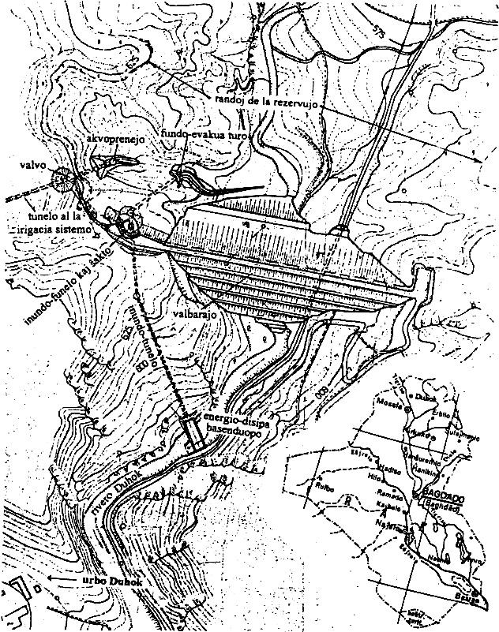
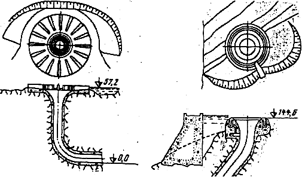
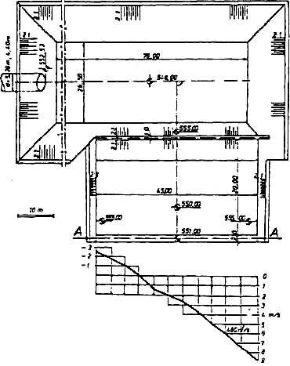
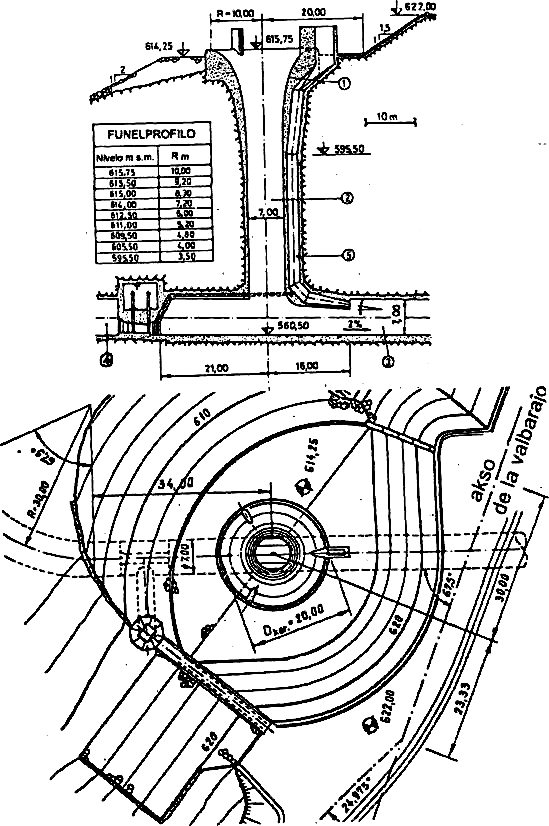
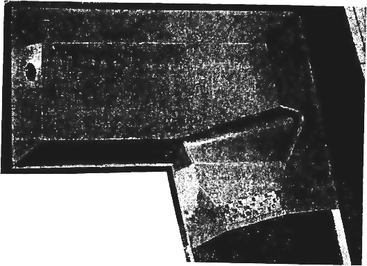
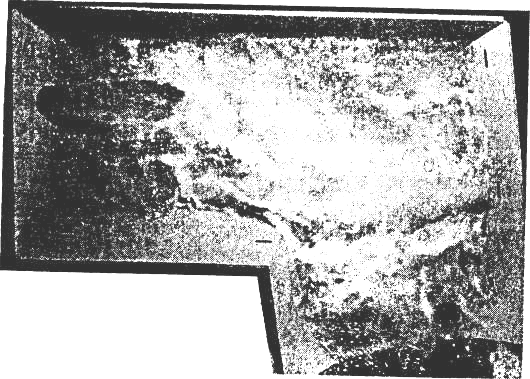
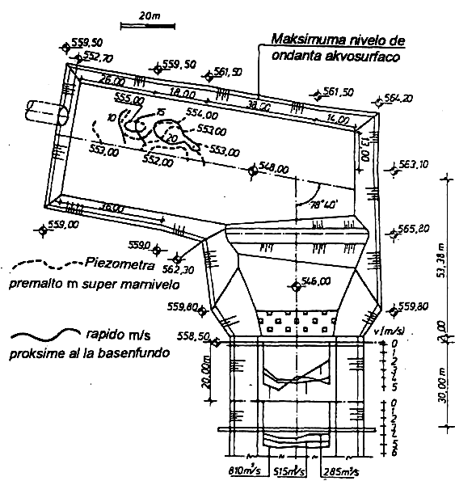
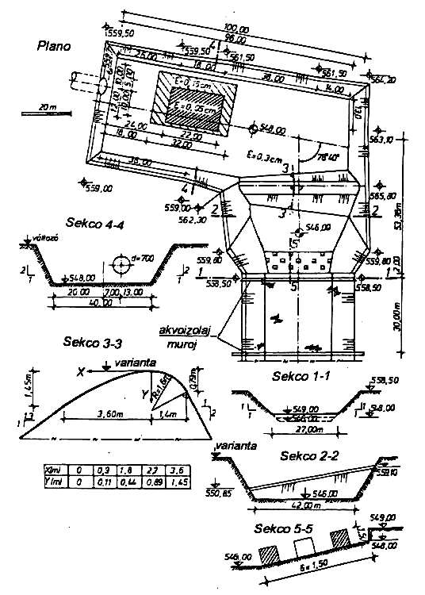
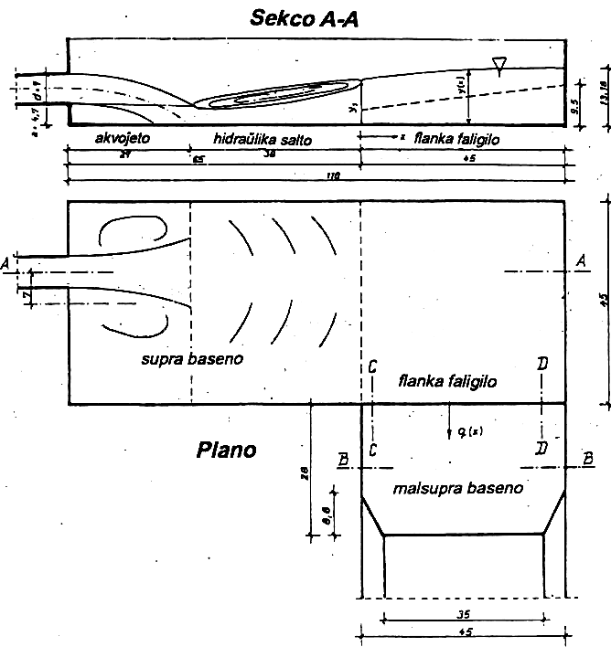

<!--

Fonto: Scienca Revuo 50 (1999) (4) pp. 21-35.
Aŭtoro: HASZPRA Ottó (HU)
STEB: https://eventoj.hu/steb/ingxenierado/hidrologio/modeleksperimento/modeleksperimentoj_pri_hidroteknikaj_objektumoj.htm

-->

Sur la sekvaj paĝoj mi konigos esploron, kiu esperantlingve estas
ankoraŭ ne publikigila kaj parte ankoraŭ daŭras. La prezentadon mi faros
ĉefe surbaze de pli fruaj referencoj \[[Haszpra]{.maldense} 1982a; [Haszpra, Kalina]{.maldense}
1982; [Haszpra, Kalina, Papp]{.maldense} 1982; [Haszpra, Papp]{.maldense} 1982; [Hayde]{.maldense} 1995; [Papp]{.maldense}
1993\], sed en iom popularscienca formo.

## 1. La hidroteknika objektumaro de la akvorezervujo de Duhok

Inter miaj sciencaj eksportlaboroj la plej interesa estis la
modeleksperimentoj pri la objektumoj de la *vala akvorezervejo* de
[Duhok]{.maldense} en la norda montara regiono de Irako, ĉ. 600 m-ojn
alte super la marnivelo (Fig. [1](#bld-1)). La planojn de la objektumaro faris la
bulgara firmao [Vodprojekt]{.maldense}, Sofia. La modelstudojn mi kaj miaj
kunlaborantoj faris en la hidraŭlika laboratorio de la Hidroteknika
Katedro de la Budapeŝta Teknika Universitato en 1980-82, gajninte per
nia oferto la internacian konkurson anoncitan de la Iraka Irigacia
Ministerio.

{#bld-1}\
Fig. 1. Mapo pri la lokigo de la hidroteknikaj objektumoj de la vala akvorezervejo de [Duhok]{.maldense} laŭ la originalaj planoj, kun orientiga mapo de Irako (Poŝatlaso 1971) kun aldono de la urbo [Duhok]{.maldense}

Al la planita akvorezervejo-komplekso apartenis la sekvaj hidroteknikaj
objektumoj:

-   **valbaraĵo**, ĉ. 70 metrojn alta, konsistanta el
    a.  akvoizola *argilkerno* kaj
    b.  ties filtril-, balast- kaj ŝlim-*kovraĵoj*;
-   **fundo-evakua objektumaro konsistanta el**
    c.  *fundo-evakua tur(ŝakt)o* kaj
    d.  akvo-forkonduka *tunelo*, ĉe la fino kun
    e.  *valvo* aliĝanta al la inundo-tunelo (vidu sub h), kiuj
        --- dum la konstruado devojigas la alvenantan akvon de la supra
        (almonta) sekcio de la rivero Duhok por malebligi la subakviĝon
        de la konstrutereno, kaj poste --- dum la normala funkciado de
        la objektumaro servas por eventualaj partaj aŭ ĝisfundaj
        malplenigoj de la rezervujo;
-   **inundo-dekonduka objektumaro** kun maksimuma kapacito de 810
    m^3^/s (kiu povas okazi --- laŭ hidrologia probablo-kalkulo ---
    unufoje dum 10 mil jaroj), konsistanta el
    f.  akvotransfaliga *inundo-funelo*,
    g.  *inundo-ŝakto*,
    h.  *inundo-tunelo* kaj
    i.  *energio-disipa basenduopo* lasantaj la troan akvon al la
        naturstata riverejo malsupre (alvale) de la valbaraĵo (vidu pli
        poste);
-   **akvoprenejo** (kun kapacito de 19,5 m^3^/s ĉe normala akvonivelo
    615,75 m s.m. de la rezervujo) provizanta la akvon por irigacio tra
    j.  *kluzvalvo*, poste
    k.  *tunelo* kaj ĉefine
    l.  *cilindra* valvo Howell-Bunger al la irigacia ĉefkanalo.
        La cilindra valvo estas kompletigita per
    m.  *flankaj sifonoj* (kun suma kapacito de 8,4 m^3^/s)
        kondukantaj eventualan troan akvon tra
    n.  *tubo* al
    o.  *energio-disipa ĉambro* kaj el tiu rekte en la fluejon de
        proksima uedo. El la listigitaj objektumoj mi okupiĝos nur pri
        la *inundo-dekonduka objektumaro* kaj kun speciala atento
        pri la *energio-disipa basenduopo*.

## 2. La inundo-dekonduka objektumaro

Se la rezervujo estas plena, eble eĉ ĝis la kronnivelo (615,75 m s.m.)
de la akvo-transfaliga inundofunelo, kaj plua pluvo falas sur la
akvokolekta areo, la akvonivelo de la rezervujo superas tiun
kronnivelon, kaj la akvo komencas transfali super la krono de la funelo
kaj falas en la ŝakton. Tiu transfaligo malebligas, ke la akvonivelo
leviĝu super 618,80 m s.m., do eĉ la plej altaj ventego --- kaŭzitaj
ondoj ne atingos la kronon de la valbaraĵo mem (622,00 m s.m.). La
funelon kun la ŝakto oni planis en la deklivon de la monto.

Laŭ la fakliteraturo de tiu tempo \[[Slisskij]{.maldense} 1979\], tian funelon oni
ĉirkaŭprenis per pli malpli duoncirklo-forma golfo kavigita en la
montdeklivon (Fig. [2](#bld-2)), ke la fluo plej senobstakle alfluu la funelon el
ĉiuj direktoj, donante la necesan glutkapablon al la plej
malgrand-diametra --- do plej malmultekosta --- funelo. Tia aranĝo estis
planita ankaŭ por la Duhoka transfaliga funelo (Fig. [3](#bld-3)).

{#bld-2}\
Fig. 2. Du golf-aranĝoj por transfaligaj inundo-funeloj en la monta deklivo

{#bld-3}\
Fig. 3. La planita aranĝo de la inundo-funelo en la monto-deklivo\
(1. inundo-funelo, 2. inundo-ŝakto, 3. inundo-tunelo, 4. fino de fundo-evakua
                              tunelo, 5. aeruma ŝakto)

Niaj eksperimentoj en modelo, laŭ skalo 1:50, tamen montris, ke la
plejparto de la planita golfo estas morta zono, kie la akvo preskaŭ ne
moviĝas, do la golfo estas superflua. Mi movis la komunan akson de la
tunelo kaj ŝakto 10 metrojn laŭ la akso de la inundo-tunelo kontraŭflue
kaj do lasis --- kun iom da reguligo --- la naturan deklivon de la
monto. La glutkapablo de la funelo ĉe la sama akvonivelo restis praktike
la sama (Fig. [4](#bld-4).).

{#bld-4}\
Fig. 4. La aranĝo proponita de mi de la inundo-funelo kaj ŝakto en la monta deklivo

Per tiu ununura modifo de la planoj ni ŝparis al la mendinto --- la
Iraka Irigacia Ministerio --- tiom da mono (la prezon de la granda
ekskavado en la roko por fari la golfon), kiu kovris la tutan koston de
ĉiuj niaj eksperimentoj kaj studoj, kvankam laŭ la kontrakto eĉ ne estis
lanĉita la ideo de tiaspeca ŝanĝeblo.

Koncerne la 55 metrojn profundan inundo-ŝakton (por kiu laŭ niaj teoriaj
kaj model-studoj la necesa diametro estas 8,15 m) kaj la 390 metrojn
longan inundo-tunelon (diametro 7,00 m), mi nur mencias, ke per konvena
aerumado kaj preskribo de permesebla malglateco *ε* de la muroj
de la funelo, de la ŝakto kaj de la tunelo (Fig. [4](bld-4)) ni certigis la
eviton de la kavitacia erozio de la funelo-, ŝakto- kaj tunelo-muroj,
kiun povus kaŭzi la granda rapido (ĝis ĉ. 25 m/s) kaj malalta premo de
la fluo.

## 3. La rompit-aksa energio-disipa basenduopo

El hidraŭlika vidpunkto mi konsideris la plej interesa la efikan kaj
sekuran formadon de la rompit-aksa basenduopo inter la fino de la tunelo
kaj la natura fluejo de la malsupra (alvala de la valbaraĵo) sekcio de
la rivero [Duhok]{.maldense}. La rompit-aksa basenduopo estis originala ideo de la
planintoj (Fig. [5](#bld-5).) ne konata en la tiutempa literaturo \[[Grisin]{.maldense} 1970,
[US Bureau]{.maldense} 1965\], sed en la planita formo ĝi ne bone funkciis (Fig. [5](#bld-5)).
Surbaze de la mezuroj en la modelo (tiam la forkondukenda maksimuma
akvoflukso estis nur 480 m^3^/s), la rapido de la akvo forlasanta la
duan basenon ĉe la maldekstra rando estis ĉ. 10 m/s kaj ĉe la dekstra
rando ĉ. 3 m/s, sed kontraŭdirekte. Do estiĝis granda vortico, kiun la
natura fluejo de la rivero, eĉ se plena de rokoj, ne povis toleri sen
grava erozio minacanta per subkavado la objektumon mem.

{#bld-5}\
Fig. 5. La unue planita energio-disipa basenduopo kun la mezurita rapido-distribuo tra la elpaŝa sekco A-A

{#bld-6}\
Fig. 6. La energio-disipa basenduopo proponita surbaze de la modeleksperimentoj. Supre: senakve. Malsupre: okaze de la trafluo de la maksimuma akvoflukso 810 m^3^/s, kun probablo 0,0001

En intertempa raporto ni vokis la atenton de la mendinto, ke la
maksimuma akvoflukso, kiu havas probablon de 0,001 (t.e. ke ĝi estas
atendebla unu fojon dum 1000 jaroj), estas tro malalta el vidpunkto de
sekureco, ĉar malsupre de la valbaraĵo troviĝas dense loĝata tereno, la
urbo [Duhok]{.maldense}. Laŭ la normoj de pluraj landoj la konsiderenda akvoflukso
devas havi la probablon 0,0001 (unufoje dum 10000 jaroj). La internacia
ekspertizkomisiono (konsistanta el monde konataj usona, franca kaj
norvega fakuloj) de la iraka ŝtata Organizaĵo por Valbaraĵoj konsentis
kun tio kaj preparis skizajn planojn, laŭ kiuj ni rekonstruis niajn
modelojn kaj ripetis la eksperimentojn. Certaj modifoj en la planoj
estis ankoraŭ necesaj.

Surbaze de la modelstudoj mi trovis bonaj sekvajn modifojn: la
basenduopo ŝoviĝu laŭflue dekstren per 7 metroj rilate al la akso de la
inundo-tunelo, do estu 7 metra distanco inter la aksoj de la
inundo-tunelo kaj la supra energio-disipa baseno, krome la flanka
faligilo de la supra baseno havu kronon ne horizontalan, sed deklivan,
leviĝantan laŭflue de la dekstra rando ĝis la maldekstra, kaj akson ne
paralelan al la akso de la supra baseno, sed ortan al la akso de la
malsupra baseno (Fig. [6](#bld-6)). Ĉi kaze --- laŭ la modeleksperimentoj --- la
elpaŝo de la akvo el la malsupra baseno en la naturan riverejon okazas
praktike kun homogena rapido-distribuo, ne nur ĉe la maksimuma
akvoflukso, kiu leviĝis al 810 m^3^/s, sed ĉe ĉiuj aliaj. La maksimuma
rapido ĉe la elpaŝo nenie superpaŝas 4 ĝis 5,5 m/s, kion la natura
riverejo, nature kovrita de ŝtonpecoj, povas elteni (Fig. [7](#bld-7)).

{#bld-7}\
Fig. 7. Rezultoj de rapido- kaj premo-mezuradoj en la proponita basenduopo. En la supra baseno okaze de la akvoflukso 810 m^3^/s, en la malsupra baseno okaze de la akvofluksoj 810, 515 kaj 285 m^3^/s (kun probabloj 0,0001 0,001, 0,01, do atendeblaj unufoje dum 10000, 1000 kaj 100 jaroj, respektive)

Oni devas zorgi, ke la fundo kaj muroj de la objektumo ne suferu
kavitacian erozion pro la altaj rapidoj kaj la tro malaltaj premoj, do
ni studis la premon kaj la rapidon sur, kaj proksime al, la deakve
atakataj surfacoj de la du basenoj. Surbaze de la rezultoj mi preskribis
la necesan glatecon (la permeseblan maksimuman malglatecon *ε*)
en la diversaj zonoj de la betonaj surfacoj de la basenduopo.
Konsiderinte la varian nivelon de la ondanta akvosurfaco en la basenoj,
mi preskribis ankaŭ la necesan altecon de la deklivaj muroj limantaj la
basenojn (Fig. [8](#bld-8)).

{#bld-8}\
Fig. 8. La permesitaj malglatecoj *ε* en la diversaj zonoj kaj la necesaj plej altaj punktoj de la deklivaj muroj de la basenduopo, kun ĉiuj geometriaj detaloj

La supre skizita aranĝaĵo akiris tutan aprobon de la internacia
ekspertizkomisiono kaj la irakaj aŭtoritatoj, kaj ankaŭ de la internacia
konferenco de la Brita Hidromekanika Esplor-Asocio (BHRA) en
septembro 1982. Dum ĉi lasta oni prezentis --- la unuan fojon en la
literaturo --- novan rompitaksan energio disipan objektumon \[[Ackers, O\'Garra]{.maldense} 1982\],
tre spritan por pura akvo, nur --- kiel notis alparolintoj --- hazardaj
flosaĵoj, arbobranĉoj kaj arbotrunkoj ktp., precipe okaze de superakvoj,
povus ĝin ŝtopi kaj la akvo elpaŝanta flanken el la objektumo povus tiun
sublavi kaj detrui. Tia danĝero ĉe nia solvo nenimaniere aperas, ĉar la
energio-disipo okazas tute pro la interna froto de la akvoamaso, kaj en
la tre danĝera, rapidflua supra baseno ni ne aplikis dentecajn aŭ
pilierecajn elementojn sur kiuj la flosaĵoj povas kaptiĝi. Mi mencias,
ke la akvo elfluanta (elĵetita) el la inundo-tunelo kunportas *ĉiusekunde*
tiel grandan kinetan energion kiel 1000 aŭtomobiloj po 810 kilogramaj,
kurantaj per la rapido de 76 km/h, t.e. 182 MW (megavatoj). Post la
elfluo el la malsupra baseno la kineta energio *ĉiusekunde* kunportata de
la akvo egalas al la energio de la sama aŭtomobilaro paŝanta per la
rapido de 18 km/h, t.e. nur 10 MW. La diferenco, 172 MW, disipiĝis,
plejparte kreskigis la varmoenergion de la akvo mem. Pro la alta specifa
varmkapacito \[4,2 kJ/(kgK)\] de la akvo, la temperaturo de la akvo
elfluanta el la malsupra baseno estos ne pli ol 0,5 Celsius-gradojn pli
alta ol ĉe elfluo el la inundo-tunelo.

La valbaraĵo de [Duhok]{.maldense} estis intense konstruata de Pakistana
konstrufirmao jam en 1981, kiam mi persone vizitis ĝin, kaj verŝajne
finita laŭ la planoj en 1983 aŭ 1984. Mi legis anoncon pri anglalingva
*Internacia Simpozio pri Erozio kaj Sedimentiĝo en Arabaj Landoj* aranĝota
en Bagdado en februaro 1986, en kies programo estis vizito ankaŭ al la
valbaraĵo de [Duhok]{.maldense}, do ĝi certe finkonstruiĝis kaj ekfunkciis.

## 4. Kurantaj esploroj

Post la sukcesa solvo de la konkreta tasko de [Duhok]{.maldense}, mi rekomendis al
miaj kunlaborantoj studi pli la tutan energio-disipan fenomenon ĉe
rompit-aksaj energio-disipaj baseno-sistemoj por atingi ĝeneralan
kalkulmetodon de tiakarakteraj objektumoj.

Komence de la 90-aj jaroj, sub mia gvido, unu el miaj kunlaborantoj
komencis la studojn \[[Papp]{.maldense} 1993\], sed poste forlasis la universitaton
kaj iris al la konstruindustrio. Surbaze de la faritaj
modeleksperimentoj alia kolego kreis unuan teorian proksimumadon de la
energio-disipa fenomeno en rompit-aksaj basenduopoj \[[Hayde]{.maldense} 1995\].

{#bld-9}\
Fig. 9. Divido de la energio-disipa fenomeno en tri sekciojn

Konigo de la kalkulmetodo ne konformas al ĉi tiu iom popularkaraktera
periodaĵo. La esenco estas, ke la fenomeno en la supra baseno estis
dividita en tri subfenomenojn (Fig. [9](#bld-9)):

1.  akvoĵeto kaj libera falo el la tunelo en la supran basenon,
2.  tridimensia akvosalto (hidraŭlika salto) en la supra baseno kaj
3.  flankenfalo el la supra baseno trans, kaj per homogena
    flukso-distribuo laŭ, la kronlinio de la flankfalilo al la malsupra
    baseno,

kiuj tri subfenomenoj unuope estis pli facile trakteblaj. Kun la
homogena flukso-distribuo kiel enpaŝa limkondiĉo, ankaŭ la malsupra
baseno estas kalkulebla klasikmetode.

De 1999 pli preciza traktado de la fenomeno estas en kuranta doktora
(Ph.D) programo, finota eble en la jaro 2000 aŭ 2001.

------------------------------------------------------------------------

## Referencoj

1.  Ackers, P., O\'Garra, R.W. (1982): A novel angled-entry stilling
    basin. Papers presented at the International Conference on the
    hydraulic modelling of civil engineering structures. BHRA Fluid
    Engineering, Coventry, September.
2.  Britannica Atlas (1996). Encyclopaedia Britannica Inc, Chicago,
    London & c.
3.  Grišin (red.) (1979): Gidrotehničeskie sooruženie. Vysšaja Škola,
    Moskva.
4.  Haszpra O. (1982a): Final Report on the Hydraulic Model Tests of the
    Duhok Dam Project. TESCO-BME Department of Hydraulic Eng., Budapest,
    28 January.
5.  Haszpra O. (2000 aŭ 2001): Néhány hidraulikai probléma a
    vízépítésben. Székfoglalók 1999. Magyar Tudományos Akadémia,
    Budapest (sub redaktado).
6.  Haszpra O., Kalina E. (1982): Egy 70 m magas iraki völgyzárógát
    árapasztó túlfolyójának vizsgálata. A Magyar Hidrológiai
    Társaság III. Orsz. Vándorgy. (Debrecen), II. köt.: Vízépítés. MHT,
    Budapest.
7.  Haszpra O., Kalina E., Papp G. (1982): A 70 m high morning glory
    spillway and its broken-axis stilling basin system. British
    Hydromechanics Research Association, International Conference on The
    Hydraulic Modelling of Civil Engineering Structures, Coventry.
8.  Haszpra O., Papp G. (1982): Egy 70 m magas iraki völgyzárógát 810
    m^3^/s kapacitású törttengelyû energiatörõ mûtárgyának
    modellkísérletei. A Magyar Hidrol. Társaság III. Orsz.
    Vándorgy., II. köt.: Vízépítés. MHT, Budapest.
9.  Hayde L. (1995): Törttengelyű energiatörő medencerendszerek
    hidraulikai vizsgálata. Egyetemi doktori értekezés. BME Vízép.
    Tansz. Budapest, április.
10. Hayde L. (2000): Hydraulics of double stilling basin systems.
    Periodica Polytechnica (sub redaktado).
11. Papp G. (1993): A törttengelyű energiatörő medencerendszer
    kismintavizsgálata. Hidrológiai Közlöny 5.
12. Poŝatlaso de la mondo en Esperanto (1971), Kartografie, Praha.
13. Serta Gratulatoria in Honorem Juan Régulo, Vl. II: Esperantismo (1987).
    Universidad de La Laguna.
14. Slisskij, S. M. (1979): Gidravličeskie rasèoty vysokonapornyh
    gidrotehničeskih sooruženij. Energija, Moskva.
15. US Bureau of Reclamation (1965): Design of Small Dams. US Department
    of Interior, Washington.
