```{=html}
  <style>
    .tab-spaca table{
      border-collapse: separate; 
      border-spacing: 0 12px;
    }
  </style>
```

<!--

Fonto: Scienca Revuo 50 (1999) (4); kromkajero: Printempo 2001. \
Tekstaro por Sanmarinaj Universitataj Sesioj, SUS, fakaro 5.1
Naturscienco

Aŭtoro: Prof. Dr. R. Sachs 
STEB: https://eventoj.hu/steb/medicino/medicina-parazitologio/medicina-parazitologio.htm
-->

<!--
## Enhavo

  ----------------------------------- -----------------------------------
  [Enkonduko](#en)\                   [II. Trematodoj](#ii)\
  [Terminaro](#ter)\                  [1. Distomoj en la sango](#ii1)\
  \                                   [1.1 Sĥistosomozo
  [I. Cestodoj](#i)\                  (Bilharciozo)](#ii11)\
  [1. Malsanoj pro adoltaj            [2. Intesta distomozo](#ii2)\
  cestodoj](#i1)\                     [2.1 Fasciolopsozo](#ii21)\
  [1.1 Teniozo](#i11)\                [2.2 Malpli gravaj
  [1.2 Difilobotriozo](#i12)\         intestodistomoj](#ii22)\
  [1.3 Himenolepidozo](#i13)\         [3. Hepata distomozo](#ii3)\
  [1.4 Dipilidiozo](#i14)\            [3.1 Klonorĥidozo](#ii31)\
  [2. Malsanoj pro larvaj             [3.2 Opistorĥidozo](#ii32)\
  cestodoj](#i2)\                     [3.3 Malpli gravaj
  [2.1 Cisticerkozo](#i21)\           hepatodistomoj](#ii33)\
  [2.2 Eĥinokokozo](#i22)\            [4. Pulma distomozo](#ii4)\
  [2.3 Cenurozo](#i23)\               [4.1 Paragonimozo](#ii41)[\
  [2.4 Sparganozo](#i24)              ](#ii)[Postparolo](#post)\
                                      [Bibliografio](#bibl)

  ----------------------------------- -----------------------------------
-->

## Enkonduko

Tiu ĉi kompendio, kiu aperas kiel "Faka Kromkajero Printempo 2001" de
Scienca Revuo volas peri fakan superrigardon super speciala kampo de
parazitologio. Pro sia signifo kiel patogeno de homo kaj hejmaj bestoj,
la helmintoj interesis, dum la lastaj cent jaroj, en ĉiam pli alta grado
la kuracistojn, veterinarojn kaj biologojn. Ĉe la platvermoj la
"generacia ŝanĝo" vere estas stranga fenomeno, nome ke la idaro ne
maturiĝas en la sama organismo, en kiu disvolviĝas la ilin produktantaj
adoltoj. PIV klasifikas cestodojn kaj trematodojn kiel du ordojn en la
klaso plathelmintoj ([Platyhelminthes]{.maldense}). En multaj anglalingvaj
kaj germanaj lernolibroj tamen ilia klasifikado estas en du klasoj kadre
de filumo aŭ subfilumo de plathelmintoj.

Komuna baza konstruaĵo kaj ĉefa histoelemento de la platverma korpo
estas la parenĥimo. En tiu histo konsistanta el relative
nediferenciĝintaj ĉeloj kaj okazaj muskolaraj fibroj troviĝas la nerva,
ekskretoria kaj seksa sistemoj. Mankas sangovazoj kaj specialaj
spirorganoj. Platvermoj estas primare hermafroditaj; nur kelkaj specioj
estas unuseksaj kun estiĝo de masklaj kaj femalaj individuoj (ekz.
sĥistosomoj). Dum inter la trematoda grupo troviĝas *kaj*
eksteraj *kaj* internkorpaj parazitoj, la ĉestodoj vivas
senescepte endoparazite en la gastiganta korpo.

Plua alloga stimulo por pristudado de la parazita mondo estas la unika
adaptiĝo, kiun tiu sistematike tute diferenca grupo de vivestaĵoj sub
premo de specialaj ekzistokondiĉoj evoluis rilate al formo, vivmaniero,
disvolviĝo de komplikaj kontaĝvojoj por la elekto de diversspecaj
gastigantoj, same kiel ankaŭ la specifa reago de la respektiva
gastiganto kontraŭ la parazita infestado. Tiu alterna interdependeco kaj
kvazaŭa "ludo por postvivado" forte altiras ĉiun biologie interesatan
personon.

Preskaŭ ĉiuj hompatogenaj trematodoj normale estas parazitoj de bestoj.
Ili nur esceptokaze infektas la homon, sed ili povas kaŭzi masivajn
infektojn pro lokaj manĝokutimoj. La plimulto de cestodozoj kaj
trematodozoj estas pernutraĵe akiritaj zoonozoj. Same kiel por la bovaĵa
kaj porkaĵa tenioj tiel ankaŭ por la sĥistosomoj la homo estas la
ununura fina gastiganto.

La plej grava kaŭzo por studi la vivociklojn de parazitoj tamen estas
kaj restas, ke speciale ĉe helmintaj rnalsanoj, kiuj endanĝerigas la
homon, validas la ĝenerala komunpopola eldiro, ke "ju pli bone estas
konata la malamiko, des pli bone li povas esti kontraŭbatalata". Tiu ĉi
libro do celas, doni al studento kaj leganto enkondukan konon de la
multnombraj aspektoj de parazita infekto.

La hompatogenaj platvermoj speciale taŭgas por la ĝenerala kompreno, ke
infektiĝo de la homo ofte dependas de neglekto aŭ forgeso de bazaj
higienaj sanreguloj. Pernutraĵe akiritaj zoonozoj povas esti en multaj
okazoj evitataj per sindeteno de konsumado de neveterinare ekzamenitaj
krudaj aŭ ne sufiĉe kuiritaj viandnutraĵoj, kaj kontaktzoonozoj povas
esti samgrade kontrolataj pere de pli disciplina rilato inter homo kaj
besto.

::: {style="text-align:right"}
R. Sachs
:::

## Terminaro de ne-PIV-aj fakvortoj

(A: angle, G: germane, G: greke)

:::{.tab-spaca}
  ----------------------------------- -----------------------------------
  **celomo**                          A: [coelom]{.maldense}, G:
                                      [Zölom]{.maldense} (Gr.
                                      [kailoma]{.maldense} malplena)\
                                      --- korpa kavaĵo (ekz. senceloma
                                      distomo)

  **cenuro**                          A: [coenurus]{.maldense}, G:
                                      [Zönurus]{.maldense} (Gr.
                                      [koinos]{.maldense} = ĝenerala,
                                      [oura]{.maldense} = vosto)\
                                      --- cistoforma cestoda larvo, el
                                      kies vando elkreskas multaj idaj
                                      cistoj

  **cerkario**                        A: [cercaria]{.maldense}, G.
                                      [Zerkarie]{.maldense} (Gr.
                                      [kerkos]{.maldense} = vosto)\
                                      --- globoforma unua larvo de
                                      trematodo kun vosto

  **koracidio**                       A: [coracidium]{.maldense}, G:
                                      [Korazidium]{.maldense} (Gr.
                                      [korax]{.maldense} = korniko,
                                      [idion]{.maldense}, dim.)\
                                      --- larva stadio de certaj cestodoj
                                      kiu havas ciliojn kaj pluevoluas en
                                      la unua intera gastiganto al
                                      procerkoida stadio

  **metacestodo**                     A: [metacestode]{.maldense}, G:
                                      [Metazestode]{.maldense} (Gr.
                                      [meta]{.maldense} = post,
                                      [kestos]{.maldense} = zon(rimen)o,
                                      [eidos]{.maldense} = aspekto)\
                                      --- "vezikovermo", cista larva
                                      stadio de cestodo

  **onkosfero**                       A: [oncosphere]{.maldense}, (G:
                                      [Onkosphäre]{.maldense} (Gr.
                                      [onkos]{.maldense} = hoko,
                                      [sthaira]{.maldense} = globo)\
                                      --- larva stadio de cestodo
                                      antaŭanta cisticerkon

  **prepatentperiodo**                A: [prepatent period]{.maldense}, G:
                                      [Präpatenz]{.maldense} (Gr.
                                      [prae]{.maldense} = antaŭ,
                                      [patens]{.maldense} = aperta)\
                                      --- la tempodaŭro inter infekto per
                                      helminta larvo ĝis apero de ovoj en
                                      la gastiganta fekaĵo (evolutempo de
                                      larvo ĝis maturiĝo kaj
                                      ovoproduktado de adolta femalo)

  **protoskolekso**                   A: [protoscotes]{.maldense} aŭ
                                      [proscolex]{.maldense}, G:
                                      [Protoskolex]{.maldense} (Gr.
                                      [pro]{.maldense} = antaŭ,
                                      [skoles]{.maldense} = verma kapo)\
                                      --- ronda cisto kun likvaĵplena
                                      kavaĵo = evolustadio de tenio

  **pentastomido**                    A: [pentastomid]{.maldense}, G:
                                      [Pentastomid]{.maldense} (Gr.
                                      [penta]{.maldense} = kvin,
                                      [stomo]{.maldense} = buŝo)\
                                      --- membro de la [Pentastomida,
                                      parazitoj kiuj estas klasilitaj laŭ
                                      la biologia sistemo inter la vermoj
                                      kaj la artropodoj]{.maldense}

  **plerocerkoido**                   A: [plerocercoid]{.maldense}, G:
                                      [Plerozerkoid]{.maldense} (Gr.
                                      [pleres]{.maldense} = plena,
                                      [kerkos]{.maldense} = vosto)\
                                      --- longigita vermoforma larvo de
                                      certaj cestodoj en la dua intera
                                      gastiganto

  **procerkoido**                     A: [procercoid]{.maldense}, G:
                                      [Prozerkoid]{.maldense} (Gr.
                                      [pro]{.maldense} = antaŭ,
                                      [kerkos]{.maldense} = vosto,
                                      [cidos]{.maldense} = formo)\
                                      --- frua larva formo de certaj
                                      cestodoj en la unua intera
                                      gastiganto

  **zoonozo**                         A: [zoonosis]{.maldense}. G:
                                      [Zoonose]{.maldense} (Gr. [zoon]{.maldense}
                                      = besto, _-ozo_ = malsano)\
                                      --- malsano komuna al homo kaj
                                      besto kun reciproka kaj
                                      interŝanĝebla infektokapablo
  ----------------------------------- -----------------------------------
:::

### Dankesprimo

<blockquote>
Mi estas danka al Inĝ. Jozefo [Wozniczka]{.maldense} por kritika kaj korektiga
tralego de la manuskripto kaj valoraj sugestoj por pli bona kompreno de
la fakscienca teksto ankaŭ por nefakuloj kaj laikoj. Grandegan dankon mi
ŝuldas al d-ro [Josef Kavka]{.maldense}, kies nelacigebla terminologia helpo formis
tiun broŝuron al lingve kontrolita parazitologia lernolibro por
studentoj.
</blockquote>

## Helmintozoj

### Hompatogenaj platvermoj

#### I. Cestodoj

##### Difino

Cestodoj estas plataj vermoj kun kapo, kolo kaj ĉeno da proglotidoj. Ĉiu
proglotido havas kompletan masklan kaj femalan seksaparatojn. Ne
ekzistas intesta kanalo. La nutraĵo estas sorbata tra mola haŭto
(kutiklo). La unuopaj proglotidoj tamen estas ligitaj unu kun la alia
per nervofibroj. La longo de cestoda ĉeno povas esti inter kelkaj
milimetroj ĝis pluraj metroj (Bildoj [5(#bld-5)] kaj [6](#bld-6)).

##### Malsaniga efiko

Escepte de la tre malgranda cestodo [Hymenohpis nana]{.maldense}
(himenolepido nana) la evolua ciklo de la hompatogenaj cestodoj estas
karakterizataj per tio, ke la larvaj stadioj disvolviĝas en alia
gastiganto ol la adoltaj vermoj. La generacia ŝanĝo de la parazito do
estas devige konektita kun ŝanĝo de gastiganto. La "intera gastiganto"
estas la portanto de la larvaj stadioj, la "fina gastiganto" estas la
portanto de la plenkreska, adolta, ovoproduktanta parazito.

En la evoluciklo de cestodoj, la homo povas roli kiel fina gastiganto aŭ
kiel intera gastiganto. Sed ankaŭ tie ĉi ekzistas escepto: nome ĉe la
porkaĵa cestodo [Taenia solium]{.maldense} (tenio solia). Tiu ĉi tenio
okazas ĉe la homo *kaj* kiel adolta vermo (kaŭzanta teniozon) *kaj* kiel
larvo (kaŭzanta cisticerkozon). La porkaĵa tenio sekve de tio troviĝas,
de tempo al tempo, en la sama homo en ambaŭ evolustadioj: kaj kiel larvo
kaj kiel adolto.

Konforme al tio oni distingas ĉe la homo:

-   **malsanoj pro adoltaj cestodoj**
    -   teniozo pro tenio saginata ([Taenia saginata]{.maldense}) kaj tenio
        solia ([Taenia solium]{.maldense})
    -   difilobotriozo pro difilobotrio lata ([Diphyllobotrium
        latum]{.maldense})
    -   himenolepidozo pro himenolepido nana ([Hymenolepis nana]{.maldense})
        kaj himenolepido diminuita ([Hymenolepis diminuta]{.maldense})
    -   dipilidiozo pro dipilidio kana ([Dipylidium caninum]{.maldense})

-   **malsanoj pro cestodaj larvoj**
    -   cisticerkozo pro tenio solia ([Taenia solium]{.maldense})
    -   eĥinokokozo pro eĥinokoko cista ([Echinococcus cysticus]{.maldense})
        kaj eĥinokoko alveola ([Echinococcus alveolaris]{.maldense})
    -   cenurozo pro tenio multicipa ([Taenia multiceps]{.maldense})
    -   sparganozo pro diversaj cestodaj specioj el la difilobotria
        grupo.

##### Biologiaj karakterizoj de cestodoj

Cestodoj estas parazitoj de la intesto ĉe ĉiuj klasoj de vertebruloj.
Ili nutras sin en la digestodukto per sorbado (tra la parazita
tegumento) de la bezonataj nutraĵeroj el la gastiganta intestoenhavo.

La cestodo konsistas el ĉeno da proglotidoj konektitaj per ekskrecia kaj
nerva sistemo. La plej malantaŭaj (aŭ finaj) segmentoj aperas
sendigestitaj, memage moviĝemaj en la fekaĵo ([Taenia saginata, T.
solium, Dipylidium caninum]{.maldense}) aŭ ili malkombiniĝas jam en la
intesto kun la sekvo, ke la konfirmo de la infekto estas ebla per
demonstrado de la ovoj ([D. latum, H. nana, H. diminuta]{.maldense}).

La kapo de cestodo (skolekso) estas provizita per specialaj adheriĝaj
strukturoj (suĉilaj pelvetoj, suĉilaj fosaĵoj, kronoj kun hoketoj) por
alkroĉiĝi al la intesta mukozo. Tuj malantaŭ la kapo troviĝas la cestoda
genera centro, nomata "tenia kolo", de kie formiĝas kaj kreskas la
proglotidoj. Por identigo laŭ specio utilas la formo kaj karakterizaĵoj
de la skolekso, hoketoj, utero kaj ovoj.

### 1. Malsanoj pro adoltaj cestodoj

#### 1.1 Teniozo

##### Difino

Infekto de la homo pro la cestodaj specioj tenio saginata aŭ tenio solia
en la maldika intestokanalo. Ĉar la unua okazas ekskluzive post manĝo de
kruda, per la larvaj stadioj infektita bovaĵo pravigas la nomo "bovaĵa
tenio". Infekto per la dua okazas ekskluzive post ingesto de infektita
kruda aŭ nesufiĉe kuirita porkaĵo, pravigas la identigo "porkaĵa
tenio" --- aŭ el vidpunkto de kuracisto kaj veterinaro pli precize:
"per bovaĵo aŭ porkaĵo akirita tenio".

##### Geografia distribuo

Tutmonda. Diferenca infekto-ofteco laŭ homaj nutraĵokutimoj. La porkaĵa
tenio, ekzemple, estas nur tre malofta en muzulmanaj landoj.

##### Evoluciklo kaj epidemiologio (Bildo [1](#bld-1))

+:---------------------------------------------------------------------:+
| 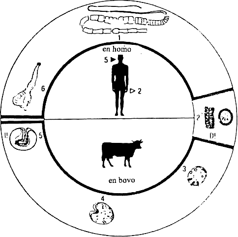                                         |
+-----------------------------------------------------------------------+
| \                                                                     |
| **Bildo 1. Tenio saginata ([**Taenia saginata**]{.maldense}):**\                 |
| Plenkreska cestodo (1) vivas en la maldika intesto de homo. La        |
| eligita matura proglotido (2) enhavas ovojn, kiuj estas infektaj por  |
| bovoj. La onkosfero (3) liberiĝas en la bova intesto, enpenetras la   |
| mezenterajn sangovazojn kaj pluevoluas (4) en la muskolaro al         |
| infektokapabla cisticerko (5), kiu malfaldiĝas (6) en la homa intesto |
| kaj pluevoluas al adolto (1).    \                                    |
| (D! = diagnostika pruvo; I! = infekta stadio)                         |
+-----------------------------------------------------------------------+

La vermo vivas alkroĉite en la mukozo de la maldika intesto. La maturaj
segmentoj estas forpuŝataj plej ofte unuopaj, sed pookaze ankaŭ kiel
mallongaj proglotidĉenoj, kaj estas eligataj kun la fekaĵo. De tempo al
tempo, proglotidoj spontanee elrampas el la anuso kaj estas trovataj en
la littolaĵo aŭ subvestoj. Tenio saginata forigas ĉiumonate ĉirkaŭ 400
maturajn segmentojn, ĉiu enhavanta ĝis 100 000 ovojn. Ĉiu ovo (2)
entenas tuj evolukapablan larvon kiu nomiĝas onkosfero (3) aŭ "seshoka
embrio" pro la globoforma aspekto kaj videblaj hoketoj. Ovo de tenio do
estas senpere infekta por intera gastiganto. Tial okazas ankaŭ akcidenta
meminfekto de portanto de la porkaĵa tenio, kiam pro kontraŭperistalta
moviĝo de la duodeno, regurgito aŭ forta vomado maturaj segmentoj kun
infektokapablaj ovoj eniras la stomakon.

La cestodaj ovoj estas tre rezistokapablaj en korpo-eksteraj medioj kaj
restas vivaj sub favoraj kondiĉoj (humideco, ombro) ĝis kvar monatojn.
Ĝenerale la infektiĝo okazas perbuŝe dum ingesto de ovoj dum nutrado. En
la maldika intesto eloviĝas la onkosferoj (3). Tiuj unuaj larvostadioj
enpenetras la intestan mukozon kaj la mezenterajn vejnojn, kiuj
transportas ilin per la sangofluo en ĉiujn organojn. Post 1-3 tagoj la
larvoj jam estas establiĝintaj en la koncerna histo de prefero, kaj
pluevoluas (4) al dua larvo-stadio, la cisticerko (5) en kiu jam
troviĝas la enfaldita skolekso de la estonta cestodo kun suĉiloj kaj
krono kun hoketoj. En la bova muskolaro la cisticerkoj estas evoluintaj
al infekta stadio jam tri semajnojn post ingesto de ovoj.

La cisticerkoj de la bovaĵa kaj porkaĵa tenioj estas pizograndaj,
rondaj, vezikecaj malgrandaj cistoj kaj troviĝas precipe en la muskola
histo de la bova lango, laringo, diafragmo, koro, dorso kaj femura
muskolaro. Ili tamen ankaŭ pookaze troviĝas en okulo, centra
nervosistemo, hepato kaj pulmo. Infektiĝo de ventrikloj aŭ ĉebazaj
cisternoj de cerbo povas disvolviĝi al ĉirkaŭ 20 centimetroj grandaj
misformiĝoj de cisticerko. Ĉe homa infektito tio estas konata kiel
cisticerko racemoza ([Cysticercus racemosus]{.maldense}) kaj preskaŭ
ekzkluzive kaŭzita de la porkaĵa teniolarvo.

La cisticerkoj de [Taenia saginata]{.maldense} restas infektaj ĝis 9 monatojn, tiuj
de [T. solium]{.maldense} ĝis 6 jarojn. La homo infektas sin per ingesto de nesufiĉe
boligita, kruda aŭ ne sufiĉe longe frostita, fumaĵita aŭ sekigita
viando, en kiu la cestodaj larvoj postvivis la diversajn
konservadprocedurojn. En la maldika intesto la cisticerko malfaldas la
skolekson (6), tiu alkroĉas sin al la mukozo, la vezikeca konekthista
cisto estas digestata, kaj el la skolekso respektive ties genera parto
ĝuste malantaŭ la skolekso, la "tenia kolo", elkreskas la proglotidoj.
Post ĉirkaŭ 4 monatoj aperas la unuaj maturaj segmentoj en la fekaĵo
(latentperiodo). Sen apliko de kuraciloj la vivodaŭro de cestodo en la
maldika intesto de homo daŭros ĝis 20 jarojn.

##### Patogenezo kaj klinikaj signoj

La enorma longo de la parazito estas en kontrasto al la preskaŭ ne
rimarkeblaj klinikaj simptomoj, kiujn ĝi kaŭzas. Nur tre malofte la
infektito plendas pri okaza ventrodoloro, ŝanĝo inter konstipo kaj
diareo, kaj manko de apetito. Plej ofte oni serĉas kuracistan helpon nur
tiam kiam aperas la unuaj teniaj proglotidoj en la fekaĵo. Tenio
saginata tial estas rigardata kvazaŭ "nemalsaniga parazito". En
antaŭaj tempoj oni fakte intence infektis iom korpulentan homon per
bovaĵtenia parazito kiel "maldikigan rimedon". Kontraŭe, la portanto
de porkaĵa tenio (tenio solia) estas danĝero por si mem kaj por aliaj en
la sama domo vivantaj enloĝantoj pro ebla transdono de la cisticerkozo.

##### Diagnozo

Kontirmo de proglotidoj en la fekaĵo. Por identigo de la koncerna
tenio-specio oni premu unuopan segmenton inter du vitraj objektportiloj
kaj enordigu ĝin post mikroskopa ekzameno al la koncerna specio laŭ la
malsamaspekta disbranĉiĝo de la utero en la du teniospecioj (Bildoj [5](#bld-5)
kaj [6](#bld-6)). La uteroj ne havas naturan malfermaĵon, ili estas
"senelirejaj", kaj la ovoj nur liberiĝos el la proglotido post rompiĝo
de la segmento.

#### 1.2 Difilobotriozo

##### Difino

Infekto de la homa intesto pere de dilifobotrio lata ([Diphyllobotrium
latum]{.maldense}), la fiŝaĵa cestodo. Kontraste al la aliaj vermo-infektoj,
tiu ĉi malsano okazas precipe en landoj de mezvarmaj kaj malvarmaj
klimatozonoj.

##### Geografia distribuo

Speciale ofta en la norda kaj nordorienta Eŭropo. Laŭdire 45% de la
fiŝistoj ĉe la rivero Volgo estas infektitaj. En Azio estas fokusoj en
Siberujo, la Manĝurio kaj en Japanujo. En la norda Ameriko la malsano
okazas en la nordusona marebenaĵo kaj en Kanado. La nombro de infektitaj
personoj estis meze de la 20a jarcento (ĉirkaŭ 1950) pli ol dek
milionoj. Sed tiu nombro certe malplialtiĝis pro la kreskanta konsumado
de malaltglaciigita fíŝaĵo.

##### Evoluciklo kaj epidemiologio (Bildo [2](#bld-2))

  -----------------------------------------------------------------------
            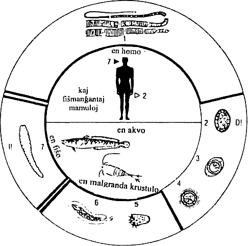

                                     \
   **Bildo 2. Difilobotrio lata ([**Diphyllobotrium latum**]{.maldense}):**\
  La plenkreska cestodo (1) eligas ovojn (2) en kiuj evoluas koracido (3)
  kun cilia randaĵo (4). En ĝi troviĝas onkosfero (5), kiu pluevoluas en
    la "unua intera gastiganto" al procerkoido (6). Post ingesto per
   "dua intera gastiganto" la procerkoido disvolviĝas al plerocerkoido
   (7), kiu estas la infekta stadio por la "fina gastiganto" (homo kaj
                            aliaj vertebruloj).
  -----------------------------------------------------------------------

La adolta vermo (1) vivas en la maldika intesto de la fina gastiganto
(homo, hundo, urso). La ovoj liberiĝas el la maturaj segmentoj en la
intesto (diagnozo tial nur per fekaĵekzamena konfirmo). La ovoj (2) de
difilobotrio havas malgrandan kovrilon, nomita "operkulo". Pro tio ili
ege similas al trematodaj ovoj (kies speciala karakterizaĵo estas
tiuspeca operkulo).

Same kiel ĉe la trematodoj, la evoluo de la larvo al koracidio (3, 4)
okazas ekskluzive en akva medio kaj daŭras, depende de la temperaturo
kaj klimatokondiĉoj, dek tagojn ĝis kvar semajnojn. La koracidioj
eloviĝas en malprofunda akvo.

Por pluevoluado la koracidio devas atingi la inteston de la "unua
intera gastiganto", nome etan krustulon el la genro [Cyclops]{.maldense} aŭ
[Diaphorus]{.maldense}, en kiu la cilia krono estas digestata. La koracidio
transformiĝas al onkosfero (5). Dum evoluperiodo de 16-18 tagoj en la
krustulo disvolviĝas procerkoido (6). Unusola krustulo povas enteni kvin
procerkoidojn; pli alta infektoŝarĝo mortigas la malgrandan "unuan
interan gastiganton". La procerkoido povas nur pluevolui post engluto
pere de fiŝo, kiu transprenas la rolon de "dua intera gastiganto".

La kolbasoforma procerkoido senpere enpenetras la intestan vandon de la
fiŝo kaj setladas en ties muskolaro, grasa histo, hepato kaj gonadoj.
Tie ĝi konsiderinde kreskas, evoluas en skolekson kaj fariĝas vermoforma
vivaĵo 6 milimetrojn longa, kiu nomiĝas plerocerkoido (7) aŭ spargano.
En predantaj fiŝoj, ekz. ezokoj, povas okazi kumuliĝado da infektaj
larvoj de la fiŝaĵa cestodo pro tio, ke la sparganoj denove (sen plua
disvolviĝo) enmigradas la fiŝmuskolaron. La ezoko tiel fariĝas "akumula
aŭ stokanta gastiganto". La homo, same kiel viandmanĝantaj mamuloj,
infektiĝas per kruda aŭ nesufiĉe boligita fiŝaĵo, kiu entenas la
infektajn plerocerkoidojn.

Protekton kontraŭ infekto nur garantias intensa kuirado aŭ profunda
frostigado (minimume 48 horojn ĉe minus 9 gradoj laŭ Celsio) de la
fiŝaĵo. Sen tio, la viva spargano, post ingesto, kroĉas sin al la homa
maldikintesta mukozo kaj rapide kreskas al adolta vermo: jam post 18
tagoj la tipaj fiŝcestodaj ovoj estas demonstreblaj en la fekaĵo de la
fina gastiganto. Estas interese, ke difilobotrio en sia longeco povas
bone adaptiĝi al koncerna fingastiganto.

##### Patogenezo kaj klinikaj signoj

Kiel ĉe tenioj, ankaŭ ĉe portantoj de la fiŝaĵa cestodo preskaŭ ne
montriĝas gravaj simptomoj. Tio ege kontrastas al la enorma longo de la
parazito (Bildo [5](#bld-5)). En nur la duono de la infektokazoj estas menciita
senapetiteco aŭ diareoj. Tamen estas karakterizaĵo, en kontrasto al la
aliaj cestodaj infektoj, ke difilobotrio tre sukcese konkurencas "kun
la intesta mukozo" pri rapida sorbado de vitaminoj kaj folacido, kaj
vitamino C.

La sekvo estas progresema hiperĥroma anemio, kiu speciale vidiĝas dum
vitamino-B~12~-malriĉa nutrado. Aliflanke oni trovis ĉe fiŝistoj en
Orient-Prusujo --- spite de amasa difilobotriozo --- neniam anemion. La
kaŭzo: ili kutimas manĝi precipe fiŝhepaton per kiu ili infektiĝas ---
sed samtempe daŭre kompensas siajn vitamino-B~12~-deficiton.

##### Diagnozo

Konfirmo de la ovoj en la fekaĵo. Difilobotrio estas vere ovoproduktanta
maŝino (plurajn centmilojn da ovoj tage). Pro tio la pruvo de la ĉeesto
de ovoj sukcesas plej ofte jam sen iu ajn speciala fekaĵa
pliriĉigmetodo.

#### 1.3 Himenolepidozo

##### Difino

Intesta infekto kun la etaj cestodospecioj himenolepido nana
([Hymenolepis nana]{.maldense}) kaj himenolepido diminuita ([H.
diminuta]{.maldense}). Ĉar ambaŭ specioj provokas similajn simptomojn kaj
havas preskaŭ identajn geografiajn distribuojn, ili estos kune
pritraktataj. Iliaj evolucikloj tamen estas diferencaj.

##### Evoluciklo de himenolepido nana (Bildo [3](#bld-3))

  -----------------------------------------------------------------------
            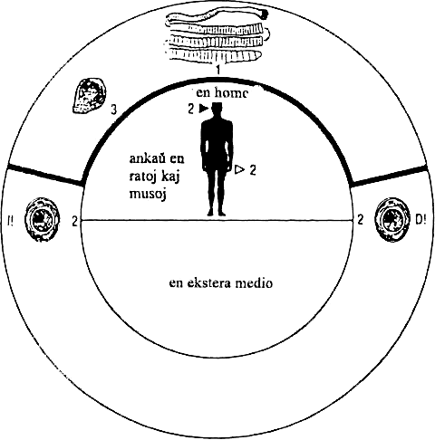

      **Bildo 3. Himenolepido nana ([**Hymenolepis nana**]{.maldense}):**\
   Plenkreska cestodo vivas en homa intesto. Per fekaĵo eligita ovo (2)
  estas senpere infekta por la homo mem pro enhavanta onkosfero (2), kiu
       pluevoluas en la intestokanalo histo al cisticerkoido (3) kaj
                        disvolviĝas al adolto (1).
  -----------------------------------------------------------------------

La evoluo okazas sen ŝanĝo de gastiganto. La fina kaj samtempe intera
gastiganto (homo, muso) infektas sin per engluto de la cestodaj ovoj
(2). En la intesto eloviĝas ciliata larvo, enpenetras la intestan
mukozon kaj kreskas al stadio de cisticerkoido (3), kiu jam 3-4 tagojn
post la infektiĝo refaldas la skolekson, remigradas en la intestan
kanalon, alkroĉiĝas per la skolekso al la mukozo kaj plukreskas al
stadio de adolta vermo (1). Ĉirkaŭ 2-3 semajnojn post la infektiĝo
komenciĝas la produktado de ovoj de tiu plej malgranda specio el la
grupo de cestodoj (Bildo [5](#bld-5)). La proglotidoj (0,3 mm longaj, 1 mm larĝaj)
diseriĝas en la intesto, la ovoj aperas do libere en la fekaĵo. Ĝenerale
la natura vivodaŭro de la parazito estas proksimume unu monato.

##### Evoluciklo de himenolepido diminuita

La infektita fina gastiganto (homo, rato) eligas la ovojn, kiujn
ingestas puloj aŭ skaraboj. En la insekta intesto eloviĝas la onkosfero,
traboras la intestan vandon kaj maturiĝas en la abdomena kavaĵo al
cisticerkoido. La homo infektiĝas per hazarda engluto de insektoj (ekz.
dum manĝado de neboligitaj cerealoj aŭ sekigitaj fruktoj). La
liberiĝinta cisticerkoido sin fiksas per la skolekso al la intestovando
kaj maturiĝas dum kelkaj semajnoj al plenkreska vermo (20-60 mm longa,
3.5 mm larĝa). Nur malofte troviĝas pli ol unu aŭ du vermoj ĉe
infektito. La natura vivoperiodo de [H. diminuta]{.maldense} apenaŭ superas
5-7 semajnojn.

##### Klinikaj signoj kaj diagnozo

En multaj kazoj la infekto restas sensimptoma. Iafoje estas
senapetiteco, diareoj, urtikario kaj ventrodoloroj. Ofte aperas negrava
eozinofilio. Konfirmo de la ovoj en fekaĵa specimeno.


#### 1.4 Dipilidiozo

##### Difino

Kosmopolita infekto kaŭzita de dipilidio kana ([Dipylidium
caninum]{.maldense}), multloke la plej ofta cestodo de la hundo kaj tial
nomata ĝenerale ankaŭ "hundotenio".

##### Evoluciklo kaj epidemiologio

Tiu parazito distingiĝas de la homspecifaj specioj en tio, ke ĝia larva
stadio (same kiel himenolepido diminuita) evoluas en insekto, ekz. en
pulo. La adolta parazito preferas la hundon, sed ankaŭ okazas en ŝakalo
kaj vulpo, malpli ofte en kato; homoj nur hazarde infektiĝas. La adolta
vermo estas 20-40 cm longa kaj ĉirkaŭ 5 cm larĝa. Pro la karakteriza
formo de la maturaj segmentoj kiel kukuma kerno ĝi estas ankaŭ konata
sub la nomo "kukumkernforma tenio".

Kiel interaj gastigantoj rolas pulo ([Ctenocephalus canis]{.maldense} kaj
[Pulex irritans]{.maldense}) kaj aliaj ektoparazitoj vivantaj en la besta
felo kaj nutrantaj sin de haŭtaj ĉeloj kaj haroj kiel ekz. triĥodekto
([Trichodectes canis]{.maldense}). Estas la pula aŭ triĥodekta vermoforma
larvo, kiu ingestas la tenian ovon. La onkosfero eloviĝas, traboras la
intestan vandon de la insekta gastiganto kaj invadas ties grasan
ventrohiston (5 tagoj). Tie ĝi rondvagadas kaj nur post maturiĝo de la
pulo mem pluevoluas al cisticerkoido (18 tagoj). Post ingesto per taŭga
fina gastiganto la cisticerkoido disvolviĝas en ties maldika intesto dum
tempodaŭro de 15-20 tagoj al adolta tenio.

Homo infektiĝas pro tro intima kontakto kun siaj hejmaj bestoj. Estas
kompreneble plej ofta infekto de infanoj, kiuj hazarde englutas
infektitan pulon dum ludado kun hundo.

##### Diagnozo

Konfirmo de la kukumkernformaj proglotidoj en la fekaĵo. Nur tre malofte
estas demonstreblaj la ovoj, ĉar la segmentoj ĝenerale ne rompiĝas en la
intesto.


### 2. Malsanoj pro larvaj cestodoj

#### 2.1 Cisticerkozo

##### Difino

Infektiĝo de la homo per la infektaj larvoj (cisticerko celuloza) de la
porkaĵa tenio [Taenia solium]{.maldense} (tenio solia).

##### Evoluciklo kaj epidemiologio

La homo infektiĝas pere de ingesto de teniaj ovoj de ekstere aŭ per
meminfektiĝo, kiam pro kontraŭperistaltaj moviĝoj de la intestaro
maturaj segmentoj estas transportataj reen en la stomakon de la
infektito mem. Ĉe pli ol 25% de la cisticerkozopacientoj validas tiu
anamnezo. En la intesto eloviĝas la onkosferoj jam 24-72 horojn post
ingesto de la ovoj. Ili enpenetras la mukozon kaj la mezenterajn
vejnojn, kaj estas distribuotaj pere de la sangofluo en ĉiujn organojn.

Sekve de tio la cisticerkoj povas troviĝi en ĉiuj organoj, sed oni povas
ekkoni certajn preferatajn korpohistojn kaj organsistemojn: subhaŭta
histo, muskolaro de la nuko, lango, pleŭro, okulo kaj la ĉirkaŭokula
histo, cerbo kaj kavernoj de la centra nervosistemo (vd. ĉapitron
"teniozo": cisticerko racemoza). Proksimume du monatojn post la hista
invado la cisticerkoj estas ĝisfine evoluintaj al infekta stadio. Ili
atingas grandon de 1-2 cm diametre, en la cerbo eĉ 3-6 cm diametre.

##### Patogenezo kaj klinikaj signoj

La establiĝo de cisticerkoj en diversaj histoj kaŭzas alergian
inflamreagon, kiu montriĝas unue per estiĝo de konektivhista kapsulo kaj
poste per amasiĝo de ĉel-infiltraĵoj, kiuj konsistas el eozinofilaj kaj
neŭtrofilaj granulocitoj, limfocitoj, plasmoĉeloj kaj ankaŭ gigantĉeloj.
En la cerbo la cisticerkovezikon ĉirkaŭas neŭroglio. Nur en la okulo
mankas konektivhista kaj ĉela infiltraĵo: tie disvolviĝas la cisticerkoj
senkapsule en la vitreo aŭ en la antaŭa okulĉambro.

###### Cerba cisticerkozo
okazigas diversajn klinikajn simptomojn laŭ la lokiĝo de la cisticerko.
Ĉe la duono de la kazoj ekestas epilepsio, kiu montriĝas kelkaj
sernajnoj post la infektiĝo. Dum lokalizado de 1a cisticerkoj en la
akvodukta regiono de la cerbo povas, kaŭze de okluzio, estiĝi interna
hidrocefalo kaj simptomoj de cerba tumoro.

###### Cisticerkozo de la molaj partoj
preskaŭ neniam kondukas al videblaj simptomoj, sed estas malkovrita
radiografie (sklerotaj resp sklerodermaj cisticerkoj en muskolaro kaj
subhaŭto) aŭ serologie kadre de ekzameno pro eozinofilio. Okaze la
pacientoj hazarde mem palpadas la etajn nodojn en subhaŭto aŭ muskolaro.

###### Okula cisticerkozo
evidentiĝas per kvazaŭ daŭre ŝanĝanta "ombrovido". Pro aldonaj
alergiaj inflamreagoj povas ekesti uveito, retinito, ĥoreito kaj
palpebra konjunktivito.

###### Cisticerkozo de la koro
povas kaŭzi, laŭ la lokaliĝo en la miokardo, diversspecajn korafekciojn.

##### Diagnozo

Kontfirmo pere de ekzameno de palpeblaj subhaŭtaj nodoj (biopsio).
Rentgena pruvo de sklerodermaj cisticerkoj eblas plej frue 4-5 jarojn
post la infektiĝo. Cisticerkoj en la centra nervosistemo videbliĝas per
komputiltomografia ekzameno.


#### 2.2 Eĥinokokozo

##### Difino

Iniekto de la homo per la larvaj stadioj de la eĥinokoka cestodo. La
adoltaj vermoj estas parazitoj de karnovoruloj kaj estas ricevintaj
(bedaŭrinde) aliajn nomojn ol iliaj larvostadioj ĉe la homo, nome

|adolta vermo   |larva stadio|
|---|---|
|[Echinococcus **granulosus**]{.maldense} (eĥinokoko granuloza)     |[Echinococcus **cysticus**]{.maldense} (eĥinokoko cista)|
|[Echinococcus **multilocularis**]{.maldense} (eĥinokoko multloka)  |[Echinococcus **alveolaris**]{.maldense} (eĥinokoko alveola)|

Ĉar ambaŭ infektoj difcrenciĝas koncerne epidemiologion, distribuon kaj
prognozon ili estas aparte pritraktotaj.

#### a) Cista eĥinokokozo

##### Distribuo

Eĥinokokozo de la cista tipo troviĝas sporade kaj mondskale; ĝin kaŭzas
eĥinokoko granuloza. Multnombraj infektoj okazas en landoj kun intensa
ŝafbredado: Aŭstralio, Nova Zelando, Argentino, Irano, Hindujo (la nuna
Barato), Hispanujo. Tio estas intime ligita kun la parazita evoluciklo.

##### Evoluciklo (Bildo [4](#bld-4))

  -----------------------------------------------------------------------
            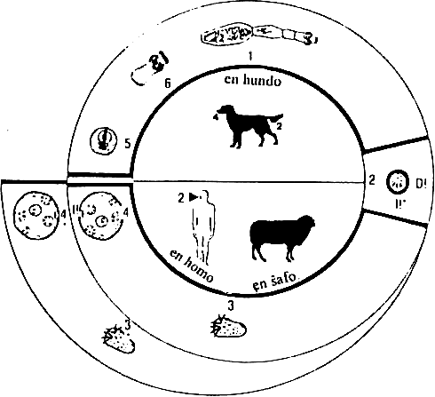

                                     \
              **Bildo 4. Eĥinokoko granuloza ([**Echinococcus
                         granulosus**]{.maldense}):**\
  Plenkreska vermo (1) en la maldika intesto de hundo produktas ovojn (2)
   per kiuj infektiĝas la intera gastiganto (muso, ŝafo, bovo, homo). La
    eloviĝinta onkosfero (3) disvolviĝas al hidatido (4). En ĝi evoluas
     proskoleksoj (5) kiuj malfaldiĝas (6) kaj kreskas al adolto (1).
  -----------------------------------------------------------------------

La fina gastiganto por la adolta eĥinokoko granuloza (1) estas hundoj
kaj hundsimilaj karnovoruloj. La malgranda cestodo (3-8 mm longa,
maksimume 0.6 mm larĝa, nur 3-4 segmentoj) lokiĝas en la supra duodeno,
kie ĝi maturiĝas 6-10 semajnojn post ingesto de infektaj
eĥinokokovezikoj kaj havas vivodaŭron de ĉirkaŭ 3-6 semajnoj. De tempo
al tempo deiĝas la fina (matura) proglotido, kiu enhavas ĝis ekstremo da
1000 ovoj. La segmento rompiĝas jam en la dika intesto kaj la
liberiĝintaj ovoj estas eligataj kun la fekaĵo.

Ŝafo, sed ankaŭ aliaj herbovoraj bestoj, infektiĝas pere de la ingesto
de plantmaterialo kontaktinfektita per tia hunda fekaĵo enhavanta
infektajn ovojn. La homo ĝenerale infektiĝas pro intima kontakto kun sia
hundo dum hazarda ingesto de ovoj algluiĝantaj al la hunda felo precipe
ĉirkaŭ la anuso. Jam en la momento de la eligado pere de la fina
gastiganto la ovoj (2) entenas la maturajn onkosferojn (3), kiuj tuj
post ingesto liberiĝas, enpenetras la mukozon kaj sangoflue verŝiĝas per
la porda vejno en la hepaton.

Onkosferoj, kiuj trapasas la hepatan filtron, eniras per la dekstra
korĉambro la pulmon kaj (se ili eskapas ankaŭ en ties kapilarsisteman
reton) per la arteria sangofluo fakte ĉiujn organojn. Konforme al
tiuspeca disseminado la hepato estas la plej ofta lokalizado (70%) de
cista eĥinokoko. Signife malpli ofta estas la infekto de la pulmo (20%)
kaj de aliaj organsistemoj (10%).

La onkosfero tre malrapide kreskas kaj evoluas al hidatido (4), t.e. pli
aŭ malpli granda eĥinokoka veziko kun genera kapacito. Tiu pligrandiĝas
en la hepato aŭ pulmo ĉiun jaron nur 1 ĝis 2 cm --- do tiom malrapide,
ke povas pasi 5-20 jaroj, ĝis kiam ekestos klinikaj simptomoj. Ĉe aliaj
lokiĝoj (centra nervosistemo, okulo) la spacopostulo de la parazito
tamen evidentiĝas multe pli frue.

La hidatido estas plena de hidatidlikaĵo kaj konsistas el tavole
lamelita ekstera vando, kiun mem ĉirkaŭas konektivhista kovraĵo kiel
inflamreaga produkto de la gastiganto. Interne algluiĝas al tiu ekstera
vando la tielnomata "genera tavolo", el kiu elkreskas (en la lumenon
de la veziko) granda nombro da "bredkapsuloj". Tiuj mem estas
vezikecaj cistoj en kies interno estiĝas la proskoleksoj (5), t. e.
enfalditaj etaj cestodaj kapoj kiuj malfaldiĝas (6) post engluto per
fina gastiganto en ties intesto kaj pluevoluas al nova cestodo (1). Post
kreviĝo de tiaj bredkapsuloj liberiĝas la proskoleksoj en la eĥinokokan
vezikon kaj videbliĝas tiom amase kvazaŭ sablo, pro tio nomita
"hidatida sablo".

Kiel sola cestodospecio, eĥinokoko do havas reproduktan kapaciton jam en
sia larva stadio. Povas ankaŭ okazi, ke la bredkapsuloj estiĝas en la
ekstera tavolo de la veziko, tiel ke ekestas "ekzogenaj bredkapsuloj"
--- kreskomaniero rigardata "normala" por la alveola eĥinokoko.

Eĥinokokaj vezikoj ĉe la homo povas atingi diametron ĝis grando de 40
centimetroj. La fina gastiganto infektas sin per ingesto de internaj
organoj, en kiuj troviĝas eĥinokokaj vezikoj. Post tio la proskoleksoj
(5, 6) adheriĝas en la komenca parto de la duodeno kaj kreskas al matura
cestodo (1) dum daŭro de ĉirkaŭ ok semajnoj.

##### Patogenezo kaj klinikaj signoj

Pro sia perfekta enkapsuliĝado kontraŭ la gastiganta histo kaj la tre
malrapida kreskado, la eĥinokokaj vezikoj povas resti nerimarkite tra
jaroj, eĉ tra jardekoj --- kondiĉe, ke ili estas "en tipa maniero"
lokataj: en hepato aŭ pulmo. Malsanosimpotomoj primare estiĝas pro
spacopostulo de la parazito, sed danĝero ankaŭ ekestas por infektita
persono pro alergia efiko de la hidatida likvaĵo, kiu en eta kvanto
daŭre difuziĝas tra la vezikovando kaj tiel konstante subtenas alergion.
Okaze de amasa elfluo de hidatidlikvaĵo el la veziko (traŭmo, ĥirurgia
interveno) povas sekvi severaj anafilaksiaj reagoj. Dum tio estas eble,
ke endogenaj idaj eĥinokokocistoj estas dissemataj, kun sekva metastaza
disvastiĝado de la cista eĥinokoko. Ĉe la homo ekzistas la tendenco al
skleriĝo de la cistovando. Kiam la cistoj estas mortintaj, oni ekkonas
tion pro ĉeso de la cista kreskokapablo.

#### b) Eĥinokokozo de la alveola tipo

##### Distribuo

Meza Eŭropo, Turkujo, Rusujo de Nigra Maro ĝis Siberujo, norda Japanujo,
sudorienta Azio, Aŭstralio, norda Ameriko, Alasko.

##### Evoluciklo kaj epidemiologio

La naturaj fingastigantoj de eĥinokoko multloka estas sovaĝeje vivantaj
hundecaj karnovoruloj, kiuj infektas sin per predado de la naturaj
interaj gastigantoj, nome sovaĝaj ronĝuloj. En Mezeŭropo la tipa
infektociklo okazas inter la kampara muso kaj vulpo. Hundo kaj kato
rolas kiel okazaj gastigantoj. La homo infektiĝas per hazarda ingesto de
eĥinokokaj ovoj, ekz. dum manĝado de kamparaj fruktoj aŭ beroj (ekz.
mirtelo aŭ arbara frago) kiuj estas kontaminitaj per fekaĵo de infektita
vulpo. Ĉasistoj povas infektiĝi dum senfeligo de tia vulpo. La
evoluciklo de [E. multilocularis]{.maldense} cetere samas al tiu de [F.
granulosus]{.maldense}.

##### Patogenezo kaj klinikaj signoj

La alveola eĥinokoko kreskas per ekzogena proliferado. Pro tio estiĝas
granda nombro da veziketoj, kiuj inter si estas apartigitaj per vitrecaj
membranoj. La unuopaj veziketoj entenas nur malmultajn skoleksojn kaj
nur parte estas likvaĵplenigitaj. La primara lokalizado de la alveola
eĥinokoko ĉiam estas la hepato, kie la cestodaj larvoj kreskas
enfiltriĝe same kiel hepata karcinomo. Laŭokaze deiĝas idaj veziketoj,
kiuj metastazas en aliajn organojn (pulmon, limfnodojn, cerbon). Post
pli longa ekzistado povas okazi centra fandiĝo de la tumoro. Neniam
okazas spontanea pereo de la parazitolarvo kaj pro tio ankaŭ neniam
spontanea resaniĝo de la infektito.

Klinike la alveola eĥinokokozo de la hepato ne diferencas de malrapide
kreskanta hepatĉela karcinomo. Estiĝas progresiva hepatomegalio
(pligrandiĝo de la hepato), iktero, kaj pro pordvejna hipertensio ankaŭ
splenomegalio (pligrandiĝo de la lieno). Sen terapio la prognozo estas
infaŭsta.

##### Diagnozo

Rentgenologie videbliĝas malklarkontura tumoreca maso. La serologia
diagnozo estas identa kun tiu por la malpli danĝera cista eĥinokoko, ĉar
la antikorpoj de [E. alveolaris]{.maldense} krucreagas kun la hidatida
likvaĵo de [E. cysticus]{.maldense}. Ne ĉiam montriĝas eozinofilio, sed la
seruma IgG ĉiam estas plialtigita.

#### 2.3 Cenurozo

##### Difino

Ĉe la homo temas pri malofta malsano pro infekto per larvoj de tenio
multicipa ([Taenia multiceps]{.maldense}) aŭ tënio seriala ([Taenia
scrialis]{.maldense}), kiuj atakas cerbon aŭ konektivan histon. Ambaŭ
specioj evoluas al speciala cista metacestoda formo, nome la cenuro.

##### Geografia distribuo

kosmopolita

##### Evoluciklo kaj epidemiologio

La adolta parazito en la intesto de la fina gastiganto (hundo, membroj
de la kaneda familio) estas 40-100 cm longa, la gravedaj segmentoj ---
plenaj de ovoj --- estas eligataj per la fekaĵo. Post ingesto de ovo
eloviĝas en la gastiganta intesto la onkosfero kaj enpenetras la
mezenterajn sangovazojn.

La larvo de tenio multicipa estas forte neŭrotropa kaj migras en la
cerbon, kie ĝi cistoforme kreskas ĝis grando de pomo, kiu nomiĝas
cenuro. Tio estas travidebla veziko, kiu kontraŭe al cisticerko (en kiu
troviĝas nur unu proskolekso) kaj eĥinokoka hidatido (en kiu troviĝas
sendependaj idaj vezikoj) enhavas el la vando elkreskantajn
proskoleksojn firme al la vando adheraj.

La granda nombro de la skoleksoj en la cenuroveziko respondecas pro la
ofte masiva infektiĝo ĉe la fina karnovora gastiganto kun grandega
nombro de adoltaj cestodoj --- tiom amase, ke ili povas kaŭzi konstipon.
La infekto de la homo okazas pere de ingesto de teniaj ovoj per
kontaminita nutraĵo.

Pro la cerba cenurozo plej ofte respondecas la larvo de tenio multicipa,
dum la metacestodoj de same kosmopolita tenio seriala kaj de al tropikaj
regionoj limigita tenio braŭna ([Taenia brauni]{.maldense}) preferas setladi
en la konektiva histo.

##### Diagnozo

Cerba cenurozo kaŭzas pro sia kresko prematrofion de la cerbohisto kun
fortaj kapdoloroj, naŭzo kaj morto. Diferencdiagnoze eblas cerba tumoro,
cisticerkozo, eĥinokokozo. Konektivhista cenurozo nur malofte kaŭzas
klinikajn simptomojn. Tio certe dependas de la lokiĝo. Ĉe infektitaj
ŝafoj estiĝas simptomkomplekso konata kiel "turnomalsano", t.e. la
malsana ŝafo daŭre rondcirkuladas kaj, kiam ĝi atingas iun ajn barilon
kiel muron, foston aŭ arbotrunkon, la infektita ŝafo senhelpe restas
premanta la kapon kontraŭ la obstaklon.


#### 2.4 Sparganozo

##### Difino

Infekto de la homo per la procerkoido aŭ plerocerkoido de diversaj
specioj de difilobotriaj specioj kaj parencaj cestodoj, kies finaj
gastigantoj estas hundspecaj rabobestoj (ne de la fiŝaĵa cestodo
[Diphyllobotrium latum]{.maldense}, kies fina gastiganto ja estas la homo).

##### Geografia distribuo

en Usono: difilobotrio mansonoida ([Diphyllobotrium
mansonoides]{.maldense}), en Azio (Japanujo, Ĉinujo, Aŭstralio, Koreo,
Vjetnamo, Gujano): difilobotrio mansona ([D. mansoni]{.maldense}), en
Afriko: difilobotrio tejlera kaj difilobotrio pretoria ([D.
theileri]{.maldense} kaj [D. pretoriensis]{.maldense}), kaj ĉe la bordo de la
Pacifika oceano de suda Ameriko: difilobotrio pacifika ([D.
pacificum]{.maldense}).

##### Evoluciklo kaj epidemiologio

La vivociklo similas al tiu de la fiŝaĵa cestodo [Diphyllobotrium
latum]{.maldense} sed la dua intera gastiganto estas serpentoj, ranoj kaj
mamuloj. La homo infektiĝas aŭ per hazarda engluto de malgrandaj
krustuloj de la genro ciklopo ([Cyclops]{.maldense}, apartenanta al la
planktonaj vivestaĵoj) dum akvotrinkado aŭ per manĝado de nekuiritaj
ranoj kaj serpentoj.

En kelkaj regionoj de sudorienta Azio oni kuracas vundojn kaj okulajn
malsanojn per surmetado de kruda ranofemuro sur la korpolezo. Dum tio la
plerocerkoido povas senpere infekti la homon. Sendepende de la
infektomaniero la homo fariĝas ĉiam la "dua intera gastiganto" kadre
de la evoluciklo de tiu cestodo.

##### Patogenezo kaj klinikaj signoj

Tute egalas, ĉu la infekto okazis per la procerkoido (pro senpera
ingesto de la eta ciklopa krustulo) aŭ per plerocerkoido (el infektitaj
amfibioj): sparganoj preteras la subhaŭtan kaj muskolaran histon kiel
lokaliĝon.

Tie ili atingas konsiderindan longon (8-36 cm) kaj larĝon (ĝis 1 cm). La
parazitoj aktive rondmigradas en la histo kaj kaŭzas kronikajn
recidiv-inflamajn ŝvelaĵojn. Ilia natura vivodaŭro en la homo estas
pluraj jaroj. Tipa formo estas la okula sparganozo, kiam la
cestodolarvoj lokiĝas en la ĉirkaŭokula histo.

##### Diagnozo

Konfirmo nur post eltranĉado kaj identigo de la spargano. Serologiaj
pruvmetodoj ne ekzistas. Preskaŭ ĉiam aperas modera eozinofilio.

[**Bildo 5**.]{#bld-5} **Morfologiaj kaj biologiaj karakterizaĵoj de cestodoj:**\
fina gastiganto, longo de plenkreska vermo kaj aspekto de skolekso.

```{=html}
<style>
  td img {
    border: none;
  }
  .b-5-6 td:not(:first-child) {
    text-align: center;
  }
</style>
```
:::{.b-5-6}
|Specio|Fina<br>gastiganto|Adolto|Skolekso|
|---|---|---|---|
|Difilobotrio lata ([Diphyllobotrium latum]{.maldense}) fiŝaĵa cestodo| homo, hundo, kato | 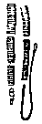 3-10 cm| <br>2,5 mm|
|Tenio saginata ([Taenia saginata]{.maldense}) bovaĵa cestodo| homo | 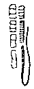<br>3-10 m| 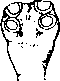<br>2 mm|
|Tenio solia ([Taenia solium]{.maldense}) porkaĵa cestodo|homo|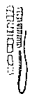<br>2-7 m | <br>1 mm|
|Eĥinokoko granuloza ([Echinococcus granulosus]{.maldense}) hundocestodo<br>Eĥinokoko multloka ([Echinococcus multilocularis]{.maldense}) vulpocestodo| hundo, ŝakalo, vulpo, lupo |<br>2-9 mm| <br>0,6 mm|
|Himenolepido nana ([Hymenolepis nana]{.maldense}) nana cestodo|homo, muso |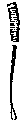<br>10-40 mm| 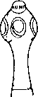<br>0,5 mm|

[**Bildo 6.**]{#bld-6} **Morfologiaj kaj biologiaj karakterizaĵoj de cestodoj:**\
fina proglotido, ovo, intera gastiganto kaj formo de larvo.

|Fina proglotulo|Ovo|Intera gastiganto|Larvo|
|---|---|---|---|
| 2-4×10-20 mm| 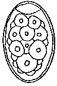 70×45*μ*| Krustulo, Fiŝo| 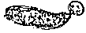 Procerkoido<br>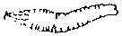 Plerocerkoido|
|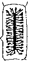 20×6 mm|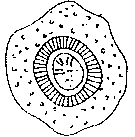35-40*μ* | Bovo|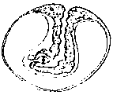Cisticerko bova|
|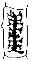 13×8 mm |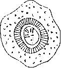35-40 *μ*| Porko, Homo| 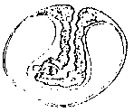 cisticerko celuloza|
|2-6×0,6 mm|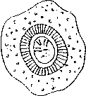 33-43*μ*| Ŝafo, Bovo, Homo|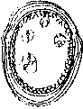 Hidatido|
|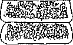 0,3×1 mm| 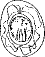 30-45*μ*|(Homo), (Muso)|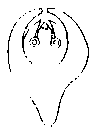 Cisticerkoido|
:::

#### II. Trematodoj

##### Difino

Trematodoj estas grupo de platvermoj (ankaŭ nomata distomoj aŭ
suĉvermoj) kiuj apartenas al la subklado plathelmintoj
([Platyhelmintes]{.maldense}). La dua grupo de tiu subklado estas la
cestodoj. La disdivido de trematodoj okazas en la sekva listigado laŭ
vidpunkto medicina, do iom deflanke de la sistematiko biologia.

Ĉiuj trematodoj vivas parazite kaj posedas tegumenton (ekstera
haŭttavolo). Ili ne estas segmentataj, sed bilatere simetriaj individuoj
kun grando de kelkaj milimetroj ĝis kelkaj centimetroj.

La pli fura, iom antikveca nomo "distomoj", do, dubuŝuloj (Greke:
[di]{.maldense} = du, [stomo]{.maldense} = buŝo) estis kaj ankoraŭ estas tre
taŭga, tamen en la hodiaŭa scienco preskaŭ forgesita termino: ĝi estiĝis
el miskompreno de la ĉeesto de entute du suĉiloj, el kiu fakte nur la
kapa suĉilo samtempe servas kiel buŝo dum la ventra suĉilo estas nura
adhera organo por alkroĉado.

Trematodoj estas hermafroditoj, t.e. en ĉiu unuopa vermo troviĝas
kompletaj maskla kaj femala seksaparatoj (escepto: sĥistosomoj).
Trematodoj havas (kontraŭe al 1a cestodoj) intestan kanalon, kiu tamen
ne havas elirejan anuson; la trematoda nutraĵo sekve estas parte
digestita, parte vomita.


:::{.tab-spaca}
  ----------------------------------- -----------------------------------
  **Lokiĝo en organo/organisistemo**  **Kaŭzanta aganto**

  Vejnoj                              sĥistosomo hematobia ([Schistosoma
                                      haematobium]{.maldense})\
                                      sĥistosomo interkalata
                                      ([Schistosoma
                                      intercalatum]{.maldense})\
                                      sĥistosomo mansona ([Schistosoma
                                      mansoni]{.maldense})\
                                      sĥistosomo japana ([Schistosoma
                                      japonicum]{.maldense})

  Intesto                             fasciolopso buska ([Fasciolopsis
                                      buski]{.maldense})\
                                      specioj de helerofio ([Heterophyes
                                      spp.]{.maldense})\
                                      specioj de metagonimo ([Metagonimus
                                      spp.]{.maldense})\
                                      specioj de eĥinoslomo ([Echinostoma
                                      spp.]{.maldense})\
                                      Gastrodiskoido homa
                                      ([Gastrodiscoides hominis]{.maldense})

  Hepato                              klonorĥo ĉina ([Clonorchis
                                      sinensis]{.maldense})\
                                      opistorĥo kata ([Opisthorchis
                                      felineus]{.maldense})\
                                      opistorĥo vivera ([Opisthorchis
                                      viverrini]{.maldense})\
                                      fasciolo hepata ([Fasciola
                                      hepatica]{.maldense})\
                                      fasciolo giganta ([Fasciola
                                      gigantica]{.maldense})\
                                      dikrocelio dendritika
                                      ([Dicrocoelium dendriticum]{.maldense})

  Pulmo                               specioj de paragonimo ([Paragonimus
                                      spp.]{.maldense})
  ----------------------------------- -----------------------------------
:::

##### Evoluciklo de trematodoj

Escepte de la sĥistosomoj ĉiuj hompatogenaj trematodoj estas
hermafroditaj. Por sukcesa vivocikla trapaso ĉiam estas bezonata nesala
akvo, kiun la parazitoovoj nepre devas atingi. En la ovoj evoluas (aŭ
estas evoluiĝinta jam dum fekaĵa eligado) ciliaj larvoj, la tielnomataj
miracidioj kiuj, sub influo de lumo, eloviĝas.

Por pluevoluado la miracidioj enpenetras taŭgan "unuan interan
gastiganton" (kiu ĉe ĉiuj trematodoj estas iu dolĉakva limako) en kiu
la miracidio transformiĝas al stadio de redio, poste al stadio de
patrina sporocisto, kiu produktas idajn sporocistojn. El ĉiu ida
sporocisto estiĝas multnombraj cerkarioj.

La cerkarioj aŭ aktive forlasas la limakon aŭ estas eligataj kun limaka
mukosekreciaĵo en formo de etaj mukobuloj. Cerkarioj posedas malgrandan
voston, kiu servas por formovigo. Kun la estiĝo de la cerkarioj finiĝas
la eksterkorpa disvolviĝo de la sĥistosomoj: la sĥistosomaj cerkarioj
jam estas infektaj por la homo.

Ĉe ĉiuj aliaj hompatogenaj trematodoj estas bezonata plua gastiganto, iu
nesalakva vivestaĵo aŭ certa speco de akvoplanto (por alkroĉiĝo). En tiu
"dua intera gastiganto" okazas transformiĝo de la cerkario en
"atendostadion" (ofte protekte enŝelita) de larvo, kiu nomiĝas
metacerkario, kaj kiu estas la infekta stadio por varmsangaj bestoj
inklude homon.

La fina gastiganto infektas sin per tiaj metacerkarioj per hazarda
engluto de al akvoplantoj adherantaj infektaj larvoj aŭ pere de ingesto
de metacerkarioinfektitaj dolĉakvaj bestetoj (krabo, salikoko). La
pluevoluado en la fina gastiganto (homo, predanta mamulo) al adolta
stadio de la unuopaj trematodospecioj estas tiom diferenca, ke tute ne
eblas komuna prezentado. La plej diversaj evolumanieroj do estas
prezentotaj sub la respektivaj specialaj ĉapitroj.

### 1. Malsanoj pro distomoj en la sango

#### 1.1 Sĥistosomozo aŭ bilharciozo (urogenitala sĥistosomozo kaj intesta sĥistosomozo)

##### Difino

Infekto de la homo fare de sĥistosomo hematobia, s. mansona, s. japana
aŭ s. interkalata. En la germanlingva scienco, la malsano origine
ricevis sian nomon laŭ d-ro Bilharz, la unua malkovrinto de la medicina
ligiteco inter parazito, limako kaj homo; intertempe venkis la en
Britujo kaj Usono preferata nomiĝo de la intekto laŭ la parazito mem
kiel ĝenerale uzita nomo kaj por kuracista difino de la malsano.

##### Geografia distribuo

Mondskale ĉirkaŭ 200 milionoj da homoj estas infektitaj. La hematobia
sĥistosomozo okazas en tropika Afriko, la delto de la rivero Nilo,
malgrandaj fokusoj en Maroko, Alĝerio, Tunizio, Libio, Sudafriko (je la
pacifika marbordo), Madagaskaro kaj en la aziaj landoj: Irako, Irano,
malgrandaj fokusoj en Saŭdarabujo, Jemeno, malgranda fokuso en Hindujo
sude de la urbo Bombajo.

La mansona sĥistosomozo okazas en Afriko sude de Saharo, malgrandaj
fokusoj en. Sudano, Nilodelto, Sudafriko; en Sudameriko en Brazilo,
Venezuelo kaj regiono de la maro Kariba.

La interkalata sĥistosomozo en Afriko troviĝas kiel malgrandaj fokusoj
en Gabono, Kamerunio kaj Zairio, dum la japana sĥistosomozo estas tipa
azia infekto en suda Ĉinujo, Kamboĝo, Tajlando, la Filipinaj insuloj kaj
Sulaveso.

##### Evoluciklo (Bildo [7](#bld-7))

  -----------------------------------------------------------------------
            

    **Bildo 7. Sĥistosomo mansona ([**Schistosoma mansoni**]{.maldense})**\
    La freŝe demetita parazita ovo (1) en la fingastiganta vejno devas
     penetri tra la sangovazan vandon por atingi la intestan internon
    (lumenon). Per fekaĵo eligita ovo kun miracido (2) liberiĝas en la
  intera gastiganto (3) kaj transformiĝas al juna patrina sporocisto kun
  ĝermoĉeloj (4) el kiuj disvolviĝas idaj sporocistoj kun cerkarioj (5).
     La forkovosta cerkario (6) estas senpere infekta por la homo kaj
    traboras ties haŭton kaj kreskas al adolta stadio en la mezenteraj
                                sangovazoj.
  -----------------------------------------------------------------------

La adoltaj sĥistosomoj vivas (ĉiam masklo kaj femalo duope en paro, tial
ili ankaŭ estas konataj sub la nomo "paraj distomoj") en la vejnoj de
la pelvaj organoj de la homo: sĥistosomo hematobia en la vezikaj vejnoj,
dum sĥistosomo mansona kaj sĥistosomo interkalata preferas la
forkondukantajn vejnoj de la dika intesto kaj sĥistosomo japana la
forkondukantajn vejnojn de la maldika intesto.

La maskla vermo estas foliece plata kaj faldas sian korpon tiel, ke la
ventra parto formas kanalon, kiu servas por ĉirkaŭpreni la nematodforman
rondan femalon (7). Sĥistosomparo estas ĉirkaŭ 2 cm longa kaj 0.5 mm
dika.

En tiu permanenta kopulaciada fazo ili dumvive restas, kun escepto de la
mallongaj periodoj, kiam la femaloj demetas siajn ovojn (1) en la
periferiajn vejnojn de la urina veziko (sĥ. hematobia) respektive
intestaro (sĥ. mansona, sĥ. interkalata, sĥ. japana).

La natura vivodaŭro de la adoltaj sĥistosomoj estas 25-30 jaroj. Pro
toksa damaĝo de la vejnovando kelkaj ovoj enpenetras la submukozan
histon de la veziko kaj de la intestovando, kaj estas eligataj --- sub
hemoragio pro histodamaĝo --- en la vezikan respektive intestan lumenon.
Fine mortas ĉiuj ovoj, kiuj estas restintaj en la korpa histo aŭ ne
estas atingintaj akvon en tempodaŭro de 3 semajnoj post eligado kun la
urino aŭ intesta fekaĵo. En kazo de [S. mansoni]{.maldense} kaj [S.
japonicum]{.maldense} kelkaj ovoj estas portataj per la pordvejna sangofluo
en la hepaton, mortas tie kaj kaŭzas en la hepato gravajn inflamreagojn
(vd. patogenezo).

En la akvo eloviĝas la miracidio (3) sub certa efiko de la lumo. Ĝi
enpenetras taŭgan limakon per ties spira malfermaĵo kaj setladas en la
limaka mezintesta glando. Tie okazas tre alta multiĝo dum sekva evoluado
tra pluraj stadioj (4, 5) ĝis fina disvolviĝo al cerkario (6). Post 5-12
semajnoj (depende de la akvotemperaturo) la cerkarioj forlasas la ege
malsanan limakon. La sĥistosomaj cerkarioj havas forkitan longan
vosteton kaj estas 0,5 mm longaj. Ĉe la kapo estas borglandoj helpe de
kiuj ili kapablas penetri tra la (nedifektitan) epidermon de fina
gastiganto. Cerkarioj perdas sian infektokapablon en tempodauro de 48
horoj post la eksterlimaka libera vivo. Tio signifas, ke senlimake
ĉerpata akvo devas esti uzata nur minimume 2 tagojn poste. Cerkarioj
penetras la homan haŭton en tempodaŭro de 10 sekundoj, forĵetas la
forkovoston kaj aktive enpenetras haŭtvejnon.

Ek de tiu momento la senvostaj larvoj nomiĝas "sĥistosomuloj" kiuj
pere de vejna sangofluo tra la pulmosistemo eniras la arterian
sangociklon kaj per tiu la kapilaran reton de la tuta organo. Post
kelkaj tagoj la sĥistosomuloj troviĝas en la intrahepataj branĉoj (nur
tiuj povas pluevoluadi) kaj maturiĝas dum tempodaŭro de du semajnoj al
adoltaj distomoj. Nun komenciĝas migrado kontraŭdirekten de la
sangofluo, dum kiu [S. japonicum]{.maldense} migras en la supran, [S.
mansoni]{.maldense} kaj [S. intercalatum]{.maldense} en la mezan kaj malsupran
mezenteran vejnon; [S. haematobium]{.maldense} havas pli longan vojon ĝis la
vezikaj vejnoj.

Tial diferenciĝas konsiderinde la tempodaŭro dum kiu la diversaj
sĥistosomoj atingas siajn destinlokojn: sĥ. japana post 1-2 semajnoj,
sĥ. mansona kaj sĥ. interkalata post 3-4 semajnoj, sĥ. hematoba post 7-9
semajnoj. Baldaŭ poste komenciĝas la produktado de ovoj, tiel ke inter
la infekto kaj konfirmo de la ĉeesto de ovoj (latentperiodo) pasas ĉe
sĥ. japana 5-6 semajnoj.

##### Patogenezo kaj klinikaj signoj

Laŭ la lokiĝo de sĥistosomoj kaj precipa loko de la ovodemetado
diferenciĝas la pere de [S. gaematobium]{.maldense} kaŭzita "urogenera
bilharciozo" kaj la pere de [S. mansoni, S. japonicum]{.maldense} kaj [S.
intercalatum]{.maldense} kaŭzita "intesta respektive hepata bilharciozo".
La simptomoj, kiuj ekestas pro la invado kaj migrado de la junaj
distomoj estas kompareblaj, sed la simptomoj de la establiĝintaj
infektoj kaj la postaj sekvoj estas tute diferencaj.


### 2. Malsanoj pro intestaj distomoj *(intesta distomozo)*

#### 2.1 Fasciolopsozo

##### Difino

Infekto de homo kun la trematodspecio fasciolopso buska ([Fasciolopsis
buski]{.maldense}), la "giganta intestodistomo". Ĝi estas la plej grava
intesta trematodo rilate al klinikaj simptomoj kaj ofteco de infekto.
Krome okazas en la homo tuta vico da pli malgrandaj intestotrematodoj.
Ties malsanigaj efikoj estas malpli gravaj, ĉar pro la malgrando
ekaperas klinikaj simptomoj nur dum masivaj infektiĝoj, kaj la parazitoj
havas geografie nur lokan signifon.

##### Geografia distribuo

Endemia en la sekvaj orientaziaj landoj: Ĉinujo, Tajvano, Tajlando,
Vjetnamo kaj orienta Pakistano. Kelkaj fokusoj en Laoso, Kamboĝo, Birmo
kaj Koreo. En tiuj regionoj estas 10 milionoj da personoj infektitaj.

##### Evoluciklo (Bildo [8](#bld-8))

  -----------------------------------------------------------------------
            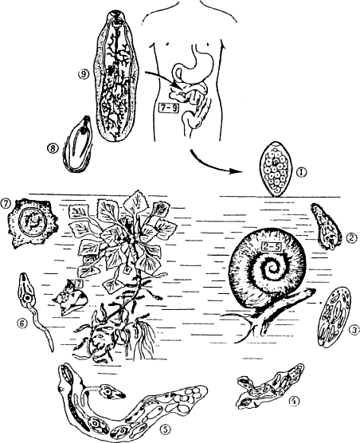

    **Bildo 8. Fasciolopso buska ([**Fasciolopsis buski**]{.maldense}):**\
  Nematura ovo (1) en kiu poste evoluas miracidio (2), per kiu infektiĝas
   limako. En tiu "unua intera gastiganto" disvolviĝas sporocistoj kun
   redioj (3) kiuj transformiĝas al patrinaj redioj kaj produktas idajn
   rediojn (4), el kiuj estiĝas cerkarioj (5). La cerkario (6) adheriĝas
       al akvoplanto (kiu servas kiel "dua intera gastiganto") kaj
  pluevoluas al encistigita metacerkario (7). Post ingesto, juna distomo
      liberiĝas el la metacerkaria ŝelo (8) kaj pludisvolviĝas en la
                       intestokanalo al adolto (9).
  -----------------------------------------------------------------------

La ovoj (140 × 80 *μ*m), kun operkulo) estas eligataj kun la
fekaĵo (1). Disvolviĝo de la miracidio (2) nur eblas en varma akvo (21
38deg;C) kaj daŭras 16-77 tagojn. La miracidioj enpenetras dolĉakvajn
limakojn, transformiĝas al sporocistoj kun redioj (3) kiuj evoluas al
patrinaj (4) kaj idaj redioj (5) el kiuj fine disvolviĝas la cerkarioj
(6). Tiu ciklo daŭras ĉirkaŭ unu monaton post kiam la cerkarioj (0,7 mm
longaj) forlasas la limakon.

La cerkarioj nun adheras al akvoplantoj, ekz. la akvonuksoj [Trapa
natans]{.maldense} kaj [Trapa bicornis]{.maldense}. Tiuj plantoj servas kiel
homa nutraĵo, sed ankaŭ estas uzataj kiel furaĝo por porkoj. Porkoj tial
estas plej gravaj kromaj gastigantoj por [Fasciolopsis buski]{.maldense}.

Post adheriĝo la cerkarioj perdas la vostetojn kaj fotmas malmolan
ŝelon: ili encistiĝas al stadio de metacerkario (7). La homo intektiĝas
dum malfermo de la nuksoj per la dentoj kaj hazarda engluto de la
ekstere algluiĝantaj metacerkarioj. En la duodeno digestiĝas la cista
ŝelo kaj la liberigita juna distomo (8) alkroĉas sin al la mukozo de
duodeno aŭ jejuno, kaj atingas post 2½-3 monatoj (latentperiodo) seksan
maturecon. Unusola intestodistomo (2,0-7,5 × 0,8-2,0 cm) produktas ĝis
25000 ovojn/tage.

##### Patogenezo kaj klinikaj signoj

Ĉe la alkroĉiĝlokoj de la parazitoj estiĝas lezoj de la mukozo kaj
alergiaj inflamfokusoj. De granda signifo por la patogenezo estas ankaŭ
la toksaj metabolproduktoj de la distomoj. La gravecon de la klinika
bildo decide influas la parazitonombro. Malmultaj vermoj ne kaŭzas
simptomojn, mezgrada infektiĝo (ĝis 100 distomoj) kaŭzas ventrodoloron,
diareojn, avidan malsategon. Altgrada infektiĝo (pli ol 100 parazitoj)
povas aldone kaŭzi obstrukcon, edemojn kaj asciton kun letaleco.
Eozinotllio kiel konstanta klinika signo estiĝas nur dum intensa infekto
konstanta klinika signo.

##### Diagnozo

Konfirmo kaj identigo de la ovoj en fekaĵa specimeno.

#### 2.2 Malpli gravaj intestodistomoj

|Nomo de la parazito |Geografia distribuo|  Grando de la ovoj |Longo de la adolto
|---|:---:|:---:|:---:| 
|eĥinostomo ilokana ([Echinostoma ilocanun]{.maldense}) | orienta Azio |      100 × 60 *μ*m  |     3,0 - 6,5 mm|
| metagonimo jokogava ([Metagonimus yokogawi]{.maldense})|  orienta Azio | 27 × 16 *μ*m|   ĝis 2,5 mm|
| gastrodiko homa ([Gustrodiscus hominis]{.maldense})|  Vjetnamo kaj  Indonezio|     160 × 60  *μ*m  |   10 mm|
|vatsonio vatsona([Wutsonius watsoni]{.maldense})|   okcidenta Afriko | 130 × 80 *μ*m| 10 - 50 mm|

### 3. Malsanoj pro distomoj en la hepato *(hepata distomozo)*

De la hompatogenaj hepatdistomoj ludas la plej gravan rolon klonorĥido
ĉina ([Clonorchis sinensis]{.maldense}), opistorĥido kata ([Opisthorchis
felineus]{.maldense}) kaj opistorĥido vivera ([Opisthorchis
viverrini]{.maldense}). Ĉar iliaj evolucikloj kaj la klinikaj signoj similas
unu la alian kaj ĉar aldone la ovoj estas preskaŭ ne distingeblaj, ili
estas komune pritraktotaj. La aliaj hepatodistomoj ([Dicrocoelium
lancolatum, Fasciola hepatica]{.maldense} kaj [Fasciola gigantica]{.maldense})
estas parazitoj de herbovoraj bestoj kaj nur en esceptaj okazoj rolas
kiel infektokaŭzo por homo.

#### 3.1 Klonorĥidozo

##### Difino

Infekto de la hepataj duktoj per la ĉina hepatodistomo [Clonorchis
sinensis]{.maldense}.

##### Geografia distribuo

Klonorĥido ĉina --- Japanujo, Ĉinujo, Koreo


#### 3.2 Opistorĥidozo

##### Difino

Infekto de la hepataj duktoj per la kata ([Opisthorchis
felineus]{.maldense}) kaj vivera opistorĥo ([Opisthorchis
viverrini]{.maldense}).

##### Geografia distribuo

Opistorĥido kata --- orienta Eŭropo, azia parto de Rusujo

Opistorĥido vivera --- Tajlando, Laoso, Kamboĝo, Malaja Federacio,
Borneo

##### Evoluciklo (Bildo [9](#bld-9))

  -----------------------------------------------------------------------
            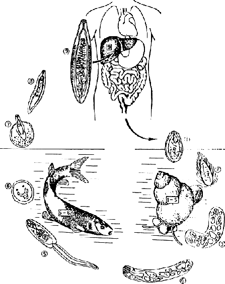

    **Bildo 9. Opistorĥido fela ([**Opisthorchis felineus**]{.maldense})**:\
  En la ovo (1) troviĝas miracidio (2) kiu liberiĝas en la "unua intera
  gastiganto" kaj evoluas al sporocisto (3) kaj redio (4), kiu produktas
   cerkariojn (5). La longvosta cerkario estas infekta por "dua intera
    gastiganto", en kiu ĝi disvolviĝas al metacerkario (5), kiu estas
  infekta por la "fina gastiganto". Post engluto liberiĝas juna distomo
  (8) el la metacerkaria ŝelo (7) kaj kreskas en la fingastiganta hepato
                          ĝis adolta stadio (9).
  -----------------------------------------------------------------------

La relative malgrandaj ovoj (1) atingas la inteston laŭlonge la
eksterhepatan grandan galdukton ([Ductus choledochus]{.maldense}) kaj estas
eligataj per la fekaĵo. En nesala akvo certaj limakoj ingestas la ovojn,
post certa tempodaŭro eloviĝas miracidio (2) kaj kreskas ĝis 1,5 mm
longa sporocisto (3) el kiu disvolviĝas redio (4). El tiu pluevoluas en
daŭro de ĉirkaŭ 2 monatoj post infektiĝo la cerkario (5) kiu kapablas
aktive penetri fíŝan haŭton. Per encistado estiĝas en la fiŝa muskolaro
metacerkario (6) kiu post ĉirkaŭ 6 semajnoj estas evolukapabla en taŭga
fina gastiganto.

La infekto de la homo okazas post manĝo de kruda fiŝaĵo. Tiu krudfiŝaĵo
estas kutima nutraĵo en la distriburegionoj de hepatodistomoj. En la
duodeno liberiĝas (7) la metacerkario, enmigras la galduktojn, kie ĝi
maturiĝas post 2-3 semajnoj (prepatentperiodo). La natura vivodaŭro de
la parazitoj estas ĝis 30 jaroj. Adoltaj specimenoj de klonorĥido kaj
opistorĥido estas 15 mm longaj kaj 5 mm larĝaj.

##### Patogenezo kaj klinikaj signoj

La ĉeesto de hepataj distomoj en la galduktoj (okaze ankaŭ en la
galveziko) kaŭzas epitelian trokreskon kaj sekve galduktvandan fibrozon,
kiu pro ŝrumpado de la hepato kaj el tio rezultantaj atrofiaj simptomoj
malhelpas la forfluon de la gala likvaĵo. La infekta ŝarĝoalteco
determinas la klinikan bildon.

Dum daŭra infektebleco kumulas la parazitonombro. Ek de 50-200 vermoj
povas evidentiĝi simptomoj kiel ekz. senapetiteco, ventraj suferoj,
subiktero. Infekto kun pli ol 1000 hepatodistomoj havas malbonan
prognozon. Dum frua infektostadio estas karakteriza mezgrada eozinofilio
(gis 20%), dum akompanaj infektoj fare de bakterioj ekestos grava febra
galmalsano. Ties longa pluekzistado kaŭzos fibrozajn ŝanĝojn kaj fine
hepatan cirozon. Kiel tipa postsekvo de hepata distomozo povas estiĝi
primara galdukta karcinomo.

##### Diagnozo

Ovokonfirmo en fekaĵo. Ĉar la eligado de ovoj estas intermita, oni devas
ekzameni plurajn fekaĵerojn dum sinsekvaj tagoj. Okaze troviĝas ankaŭ
kompleta distomo en la fekaĵo. Diferencdiagnoze gravas lhepata
adenokarcinomo, ameba absceso kaj eĥinokokozo de la hepato.


#### 3.3 Malpli gravaj hompatogenaj hepatodistomoj

La sekva tabelo registras tri distomospeciojn de bestoj, kiuj nur
malofte estas trovataj ĉe la homo. Ili tamen havas tre grandan
veterinaran signifon.

----------------- --------------------- ------------------------ ----------------------
                  fasciolo hepata\      fasciolo giganta\        dikrocelio lanceta\
                  ([Fasciola            ([Fasciola               ([Dicrocoelium
                  hepatica]{.maldense}) gigantica]{.maldense})   lanceolatum]{.maldense})
----------------- --------------------- ------------------------ ----------------------
*Distribuo*       kosmopolita           Afriko/Azio/Usono        norda
                                                                 Afriko/Azio/Eŭropo

*Ovoj*            145 × 80 *μ*m         190 × 90 *μ*m            40 × 24 *μ*m

*Adoltoj*         20 - 40 mm            ĝis 7,5 mm               5-12 mm

*Gastiganto*      herbovoruloj          herbovoruloj             herbovoruloj

*Infektaĵo*       plantoj               plantoj                  plantoj, formikoj
----------------- --------------------- ------------------------ ----------------------


### 4. Malsanoj pro distomoj en la pulmo *(pulma distomozo)*

#### 4.1 Paragonimozo

##### Difino

Infekto de homo (kaj certaj rabobestoj) per trematodoj de la genro
[Paragonimus]{.maldense}. Ĝis antaŭnelonge nur paragonimo vestermana
([Paragonimus westermani]{.maldense}), la Azia pulma distomo, estis
rigardata hompatogena. Hodiaŭ estas konate, ke ankaŭ aliaj paragonimaj
specioj (ekz. paragonimo afrika, paragonimo uterobilatera) kaj pluraj
aliaj ankoraŭ ne detale identigitaj specioj rolas kiel malsanokaŭzantaj
parazitoj ĉe la homo.

##### Geografia distribuo

-   Paragonimo vestermana ([Paragonimus westermani]{.maldense}): endemie
    (ĝis 20% infektitoj) en Japanujo, Ĉinujo, Tajvano, Koreo, Tajlando
    kaj la Filipinaj insuloj. Sporade en Manĉurujo kaj Nepalo, same en
    Hindujo (la nuna Barato) kaj Indonezio;
-   Paragonimo skrjabina ([Paragonimus skrjabini]{.maldense}): Centra
    Ĉinujo;
-   Paragonimo afrika ([Paragonimus afrcanus]{.maldense}): Kamerunio (ĝis
    10% infektitoj), fokusoj en Niĝerio, Centrafrika Respubliko, Zairo,
    Kongolando;
-   Paragonimo uterobilatera ([Patagonimus uterobilateralis]{.maldense}) en
    Afriko: Liberio, Gvineo, fokusoj en Gabono kaj en suda Ameriko
    (Peruo).

##### Epidemiologio

Infektoj pro paragonimaj distomoj okazas en alta nombro tie, kie estas
kutima la manĝado de krudaj aŭ nesufiĉe kuiritaj dolĉakvaj kraboj kaj
salikokoj. En Koreo kaj Vjetnamio la elsuĉado de la gamboj forŝiritaj de
la kruda riverkraba korpo estas rigardata speciala delikataĵo; en
Japanujo la suko de krudaj kraboj validas kiel kuracilo; en Ĉinujo
kutimas manĝado de krudaj kraboj marinitaj en vino.

Certaj afrikaj triboj rigardas krudajn riverkrabojn kiel bonan rimedon
por plialtigi la fertilecon ĉe virinoj (en Kamerunio: 14% infektitoj pro
paragonimo afrika ĉe la femala sekso); la Biafra milito en Niĝerio
rezultigis altan infektonombron de paragonimo uterobilatera ĉe homoj,
kiuj pro malsato kontraŭkutime manĝis krudajn krabojn.

En ĉiuj regionoj, kie paragonimozo estas disvastiĝinta, la finaj
gastigantoj de la parazitoj estas sovaĝeje vivantaj karnovoruloj
(civeto, mungoto, krabmanĝantaj simioj); la homo kaj ties hejmaj bestoj
(kato, hundo) estas nur okazaj gastigantoj. La malsano ĉe homo do estas
zoonozo, t.e. reciproke inter homo kaj besto transmitebla infekto: en
tiu speciala kazo la homo infektiĝas pro misatento de bazaj higienaj
reguloj dum manĝado aŭ preparo de manĝaĵo (pernutraĵe akirita zoonozo).

##### Evoluciklo (Bildo [10](#bld-10))

  -----------------------------------------------------------------------
           

             **Bildo 10. Paragonimo vestermana ([**Paragonimus
                         westermani**]{.maldense}):**\
    Freŝe demetita parazitoovo (1) en kiu disvolviĝas miracidio (2) kiu
  infektas limakon. En tiu "unua intera gastiganto" evoluas spurocisto
   (3), kiu produktas patrinajn rediojn kun idaj redioj (4) en kiuj post
    maturiĝo evoluas cerkarioj (5). La ŝtumpvosta cerkario (6) infektas
  krabon kiel "duan interan gastiganton", en kies histoj ili pluevoluas
        al metakarioj (7), la parazita stadio infekta por la "fina
  gastiganto". La metacerkario pluevoluas post ingesto al juna distomo,
       kiu migras en la pulmon kaj tie kreskas al adolta stadio (8).
  -----------------------------------------------------------------------

La ovoj (80-120 × 50-70 *μ*m) havas netan operkulon (1) kaj estas
eligataj de la fina gastiganto (homo, hundo, sovaĝaj karnovoraj bestoj)
per fekaĵo aŭ sputo. Por pluevoluado necesas dolĉa (nesala) akvo, en kiu
disvolviĝas sub optimaj kondiĉoj ĉe 27 °C la miracidio (2) dum
tempodaŭro de 2 ĝis 6 semajnoj.

Post eloviĝo la miracidio estas vivkapabla maksimume nur 24 horojn: tio
signifas, ke ĝi devas trovi kaj enpenetri taŭgan limakon (kiel unuan
interan gastiganton) dum tiom mallonga tempo. En la limako okazas la
transformiĝo al la 0,5 mm longa sporocisto (3) el kiu evoluas patrinaj
redioj (4) kaj fine la idaj redioj (5). El tiuj lastaj disvolviĝas
ŝtumpvostaj cerkarioj (6) kiuj estas nur 0,2 mm longaj kaj globoformaj.
La manko de longa vosteto estas grava identiga karakterizaĵo de tiuspeca
cerkario.

La cerkarioj forlasas la limakon (plej frue 2½ monatojn post la infekto)
kaj estas ingestataj aŭ alimaniere enpenetras taŭgan dolĉakvan krustulon
kiel "duan interan gastiganton". En la brankoj kaj muskolaro de tia
kraba aŭ salikoka gastiganto la cerkario disvolviĝas al metacerkario
(7), kiu en kazo de paragonimo afrika estas encistita en dika duoble
konturita ŝelo, dum la metacerkarioj de paragonimo uterobilatera vivas
senĉele en la muskolaro de sia gastiganto (grava karakterizaĵo por
distingiga identigo).

Ses semajnoj post invado de krustulo la metacerkarioj estas
infektokapablaj por iuspeca fina gastiganto. Post ingesto, la infektaj
metacerkarioj elkapsuliĝas, traboras la duodenan vandon, migras tra la
ventra kavaĵo rekte al la diafragmo, kiun ili ankaŭ traboras, por fine
setladi en la pulma histo. Tie ili ĝenerale loĝas po du parazitoj en
unuopa cisto, tamen hermafroditaj.

Du ĝis tri monatoj post invado de la pulmo la distomoj estas seksmaturaj
kaj produktas ovojn (latentperiodo). La parazitoj intertempe estas
atingintaj grandon de 7-16 × 4-18 mm. La natura vivodaŭro de
pulmodistomoj estas 10 ĝis 20 jaroj.

##### Patogenezo kaj klinikaj signoj

Post ingesto de metacarkariojn enhavanta krustulo aŭ ĝia parto en
senkuirita aŭ ne sufiĉe rostita stato, la junaj parazitolarvoj liberiĝas
en la duodeno aŭ jejuno, traboras la intestan vandon kaj enpenetras la
ventran kavaĵon. Ilia plua vojo estas markita per evidenta kaj
celdirekta tropismo. Kvankam malofta, tamen povas okazi eksterpulma
setlado de la parazitoj survoje trans la peritonea kavaĵo: en lieno,
reno, mezentero, muskolaro. En la pulmo la plej ofta lokiĝo estas la
mezaj kaj subaj pulmoloboj. La enkapsuligitaj parazitocistoj en la
pulmohisto havas avelo- ĝis juglandograndon, kaj ĝenerale estas ligitaj
kun la branka spirsistemo. Pro tio la ovoj atingas la sputon kaj post
forglutado en la digestan kanalon fine ankaŭ la fekaĵon.

Kelkfoje okazas inflamo de la pleŭro, sed en malfrua malsanostadio la
cistoj estas sorbataj aŭ skleriĝas. La klinikaj simptomoj ne estas
karakterizaj: povas komence esti febro dum la transperitonea migrado de
la junaj parazitoj. La malsano fakte komenciĝas per katara, poste
muko-pusa bronĥito kun atakoj de tuso kaj elkraĉado de sango en la
tusaĵo, kiu treege similas tuberkulozon.

Rentgenologie estas videblaj forte limigitaj infiltraĵoj kaj cistaĵoj
1-2 cm diametre. El la eksterpulma setlado estas la plej danĝera la
cerba paragonimozo. En tiu kazo la simptomoj dependas de la fakta lokiĝo
de la parazito en la cerbo kaj inkluzivas kapdolorojn, vomadon,
epilepsion, ĝeneralan konfuziĝon kaj paralizon.

##### Diagnozo

Konfirmo de ĉeesto de la tipaj paragonimo-ovoj en sputo aŭ fekaĵo.
Rentgenologie diferenciga diagnozo estas tuberkulozo, tumoro aŭ absceso
de la pulmo, kaj pulma eĥinokokozo. Ĉe fermitaj pulmocistoj aĵ
eksterpulma paragonimozo povas helpi dum diagnozado la serologio kiel
ekz. la nerekta imunfluoreskado kaj elektroforezo.

La ĝusta interpretado de serologiaj reagoj tamen estas konsiderinde
malhelpataj pro grandskalaj krucreagoj kun aliaj trematodaj infektoj.
Tial la epidemiologia pristudado de la regiono havas treege grandan
valoron: nome la ekzameno de riverkraboj por metacerkarioj kaj
ekzamenado de fekaĵo de sovaĝaj karnovoraj bestoj por la tipaj orflavaj
ovoj kun bone videbla operkulo, por identigi la naturajn portantojn de
paragonimaj infektoj kaj pruvi la endemian karakteron de la malsano.

## Postparolo

### a) Terapio

Medicina kompendio ĝenerale aludas, post priskribo de la etiologiaj kaj
epidemiologiaj malsano-karakterizaĵoj de la infekto ankaŭ la terapion.
Tio almenaŭ estas eco de nacilingva kompendio pri parazitologio kaj
parazitaj malsanoj.

Terapio kiel aparta ĉapitro en internacilingva kompendio post priskribo
de la unuopaj infektoj estas vana entrepreno. Ĉar en ĉiu lando ekzistas
amaso da medikamentoj, kiuj estas registritaj sub naciaj nomoj. Noma
internacieco ekzistas eble ĉe plej ofta kaj mondvaste konata medikamento
kiel ekz. aspirino (kiu nomo troviĝas en PIV por salicil-acetata acido)
kiel kontraŭdolora kaj kontraŭfebra, sed jam sulfonamido aŭ teramicino
havas nur certatempan signifon.

Ankaŭ la efiko de medikamentoj ŝanĝiĝas kaj kelkaj baldaŭ malaperas de
la merkato por havigi lokon al aliaj. Tial la nomoj de medikamentoj,
diversaj en diversaj landoj, fakte nur balastas internacilingvan
kompendion.

Tiu ĉi kompendio celas al priskribo de la kaŭzanta aganto, nome la
parazito mem, kaj ties biologie interesa vivociklo, kies kono --- kaj la
apliko de tiu kono! --- jam altagrade povas eviti homan infekton. La
medikamenta kuracado de la unuopaj parazitaj infektoj devas esti kaj
resti en la manoj de kuracisto, kiu konas la nomojn kaj efikojn de la
plej bonaj kaj aktualaj rimedoj.

Tamen donas mallonga superrigardo pri la en Germanujo nuntempe uzataj
medikamentoj kontraŭ la antaŭe menciitaj parazitozoj pluan, ne malgravan
informon: nome pri la ŝajne "grupa efiko" de certaj substancoj.

Kontraŭ teniozo ekz. efikas niklosamido ([Niclosamid]{.maldense}), haveblaj
kiel Yomesan-tablojdoj de firmao [Bayer]{.maldense} (4 tablojdojn samtempe,
aŭ po 2 tablojdojn dum du sinsekvaj tagoj). Tiu terapio validas ankaŭ
okaze de difilobotriozo (kun kontraŭanemia prizorgado) kaj
himenolepidozo.

La larvaj infektiĝoj pro tenio kaj eĥinokoko kreas ĥirurgiajn
problemojn. En kazo de neoperacieblaj cistoj estas indikata ĥemoterapio,
aliaj studoj provis tiabendazolo ([Thiabendazole]{.maldense}) aŭ
prazikvantelo ([Praziquantel]{.maldense}). Tiu lastnomita substanco estas
nuntempe "la medikamento de elekto" okaze de preskaŭ ĉiuj trematodaj
infektoj: haveblaj kiel [Biltricide]{.maldense}-tablojdoj po 600 mg. Oni
rigardas efika la dozon 20 ĝis 40 mg/kg kiel unuopa dozo kontraŭ
sĥistosomozo, fasciolopsozo, klonorĥidozo, opistorĥidozo kaj
paragonimozo. Dum infekto pro la fasciolo hepata tamen ne validas
prazikvantelo sed konsilindas tetraĥloretileno
([Tetrachloaethylen]{.maldense}) 0,1 mg/kg kiel unu-opa dozo.

### b) Nomoj de la malsanoj

Laŭ Plena Vortaro de Esperanto (PV, 1954) p.39 -oz estas "internacia
substantiva sufikso signifanta malsanon kaŭzatan aŭ karakterizatan de la
ideo esprimita en la radiko". PIV (1987) iom pli detale difinas, ke
"-oz estas internacia sufikso uzata en medicino por signifi malsanon
kaŭzatan de difinita aganto (ekz. askaridozo), malsanon karakterizitan
per difinita patologia elemento (ekz. tuberkulozo), aŭ de difinita
organo (ekz. nefrozo, artrozo)". Estas pro tio, ke la esperantigo de
sciencaj nomoj de patogenoj ne povas rigardata lingva manio de unuopulo,
sed estas absolute necesa, deviga faro. Ĉar nur post tio eblas, nomi
ekzakte la pere de difinita aganto aŭ patologia elemento kaŭzitan
kondiĉon.

La por laikoj iom strangaj parazitonomoj en tiu ĉi kompendio baldaŭ
perdos sian strangecon por la leganto. Post iom da kutimiĝo al la
esperantigita ekvivalento li baldaŭ ekkomprenas la bezonon kaj frapos la
studanton la facileco, per kiu la koncernaj infektoj povas esti klare
indikataj per la senpera apliko de la Esperanta sufikso -oz.

La uzitaj esperantigitaj nomoj certe validas nur por tiu ĉi publikigaĵo
kaj devas atendi faksciencan kaj terminologian konfirmon de fakuloj,
antaŭ pli vasta uzado en esperantlingva fakliteraturaĵo. La nomoj de la
parazitaj infektoj do ne estas neologismoj, sed strikte aplikita kreiva
agmaniero uzante la nemiskompreneblan eblon de la Internacia Lingvo.

## Bililiografio

Dum kompilado de la kompendio multe helpis la studado de la sekvaj
lernolibroj:

-   Dönges J.: Parasitologie. Gg.Thieme-Verlag, Stuttgart/NewYork, 1988
-   Geyer H. & Bommer W.: Wurmerkrankungen des Menschen. W.
    Goldmann-Verlag, München, 1971
-   Krauss H. & Weber A.: Zoonosen. Deutscher Ärzteverlag. Köln 1986
-   Lapage G.: Mönnig\'s Veterinary Helminthology and Entomology,
    Bailli´re, Tindall & Cox, London, 1959
-   Piekarski G.: Lehrhuch der Parasitologie. Springer-Verlag,
    Berlin/Göttingen, 1954

La kompendiaj bildoj [1](#bld-1) - [4(#bld-4)] estas el [Krauss & Weber]{.maldense} (1986), kiuj referencas
al desegnaĵoj el [Geyer E. & Bommer]{.maldense} (1971). Bildoj [5](#bld-5) - [6](#bld-6) estas kompostitaj
el diversaj lernolibroj, kaj bildoj [7](#bld-7) - [10](#bld-10) estas el la priparazitologia
lernolibro de [Pickarski]{.maldense} (1975). La sekvajn vortarojn mi konsultis pri
terminologiaj kaj landnomaj demandoj:

-   Briquet Dr.: Esperanta Teknika Medicina Vortaro. Internacia Medicina
    Revuo, Bruxelles, 1932
-   Fulcher F. & Long B.: English-Esperanto Dictionnary. British
    Esperanto Association, London, 1985
-   Hradil J.: Esperanta Medicina Terminaro. Universala
    Esperanto-Asocio, 1979
-   Kruuse H-D. Großes Wörterbuch Esperanto-Deutsch. Helmit Buske
    Verlag, Hamburg, 1999
-   Reichenow E., Vogel H. & Weyer F.: Leitfaden zur Untersuchung der
    tierischen Parasiten des Menschen und der Haustiere. Joh. Ambros.
    Barth, Leipzig, 1969
-   Ŝulco R. & Bermano H.: Leksara kolekto de ofte uzataj propraj nomoj.
    Esperanto-Centro Paderborno, 1989
-   PIV : Plena Ilustrita Vortaro de Esperanto kun suplemento. Sennacia
    Asocio Tutmonda, Paris, 1987
-   PV : Plena Vortaro de Esperanto. Sennacieca Asocio Tutmonda, Paris,
    1947

------------------------------------------------------------------------

## Priaŭtora informo

La aŭtoro estis membro de la scienca stabo de *Bernhard-Nocht*-Instituto
por Tropikaj Malsanoj en Hamburgo/Germanujo ekde 1969 kaj habilitiĝis
kaj profesoriĝis ĉe la Hamburga Universitato. En 1976 li akiris la
Diplomon pri Tropika Medicino kaj Parazitologio (DTMP) kaj fariĝis
docento por medicina parazitologio ĉe la naturscienca fakultato.

Post multjara espolorlaboro en suda kaj orienta Afriko, profesoro Sachs
estis komisiita 1979 direktoro de la esplorlaboratorio de Hamburga
Tropika Instituto en Liberio/Okcidentafriko ĝis ties perforta fermo pro
intercivitana milito en 1990. Li emeritiĝis en aŭgusto 1992.

Protesoro Sachs estas membro de Akademio Internacia de la Sciencoj (AIS)
San Marino, kaj estis dum ses jaroj dekano de ties naturscienca sekcio.
En 1997 li estis elektata prezidanto de Internacia Scienca Asocio
Esperantista (ISAE), kies plej grava funkcio estas la eldonado de la
esperantlingva asocia ĵurnalo "Scienca Revuo".
