<!--
2 Scienca Revuo 1/2007 — GEOLOGIO INTERNACIA-10

Bohemia kratero

Petr RAJLICH

Adreso de la aŭtoro

privata: RNDr. Petr RAJLICH, CSc., deĵora: Jihoĉeskĉ muzeum v ĈesNeustupnĉho 1838 A kych Budejovicich, Dukelskd 1
CZ 15500 Praha 515 / ĈEĤIO CZ 37051 Ĉeskĉ Budĉjovice

Priaŭtora informo

Doktoro de natursciencoj, kandidato de geologiaj sciencoj, geologo de
mineral-kuŝejoj, struktur-geologo, meteorit-geologo, kustodo de geologiaj-mineralogiaj kolektoj en Sudbohemia muzeo.

Resumo ĉeĥlingva: Ĉesky krdter

Kosoĉivereĉny venec okolnich hor s kotouĉovym tvarem vnitini ĉisti Ĉeskĉho
masivu je mladym morfologickim projevem tuhĉho chovani rozmĉrnĉho pevnĉho
disku v litosfĉfe, periodicky stlaĉovanĉho pri jednotlivych orogenezich, Vjzkum
hornin a stavby ukazuje na to, Ze jde o pivodni zpevnĉny spodnoproterozoicky,
asymetricky, vicekruhovy meteoricky krater, ktery nazyvime Ĉesky krater.
popsdny jevy ŝokovĉ metamorf6zy v kremenech, grandtech, ve formĉ pseudotachyliti
v pivodich bridlicich, dale vyvoj prechodnĉ dutiny a alochtonni brekcie s ilomky
ultrabazik ze svrchniko plaste. Severni ĉast krdteru byla vyplnĉna proterozoikem. K
poimpaktnim hydrotermalnim projevim fadime vedle kfemiĉitfch vridlovcŭ,
bulizniki i sillimanit, kyanit a dalŝi silikaty vltavsko-dunajskyeh prahor. Mezozoicke
a kenozoickĉ stlaĉeni vytvofilo dneŝni hrdstovou stavbu.

-->

## Enkonduko

La romba montarkrono, ĉirkaŭanta la rondan formon de la bohemia
masivo, estas juna manifestiĝo de kompakta litosfera disko, kiun
periode kunpremadis unuopaj orogenezoj. Esplorado de ĝiaj rokaĵoj
kaj strukturo montris, ke temas pri origine solidigita paleoproterozoika, nesimetria, plurcirkla meteorit-kratero, nomata bohemia kratero.

## Morfologio

Laŭ la satelit-foto (Bildo [1](#bld-1)), la interna formo aspektas elipse, kun la
pli longa (ĉirkaŭ 290 km) akso orienta-okcidenta kaj la malpli longa
(240 km) norda-suda. Plue, en la suda duono videblas interna cirklo
de cirkle aranĝitaj ĝiboj ([Papagianis & El Baas]{.maldense}, 1988). Tiu ĉi interna
cirkloforma ĝibo diametre 100 km situas inter Prago kaj Budejovico.

Tiun ĉi dispozicion konfirmas la gravimetria reliefmapo (Bildo [2](#bld-2))
prilumita de oriente. Sur ĝi la plurcirkla strukturo estas plej bone
perceptebla, precipe en la norda, nordorienta kaj orienta partoj. 
Suda-parte ĝi videblas malpli.

Krom la nesimetrie situanta “centra“ ĝibo eblas observi reliefiĝon
(eble aperton de pli aĝaj dislokaĵoj) direktitan nord-nordorienten —
sud-sudokcidenten. La plej okulfrapa dislokaĵo, tranĉanta la “centran“ ĝiban cirklon, nomiĝas Blanica sulkego. Suda-parte videblas ties
forŝovo je 20 km laŭ la linio nordokcidenta-sudorienta.

La “centra“ ĝibo kun reliefa aĝa dislokaĵo estas analoga al la pli
juna (65 jarmilionojn aĝa), do pli bone konservita kratero [Chicxulub]{.maldense}
(Bildo [3](#bld-3)). Pluaj dislokaĵoj n.n.or. — s.s.ok. en la bohemia kratero situas rande de la “centra“ ĝibo kompariĝu al la kratero Teofilo sur la
Luno (Bildo [4](#bld-4)).

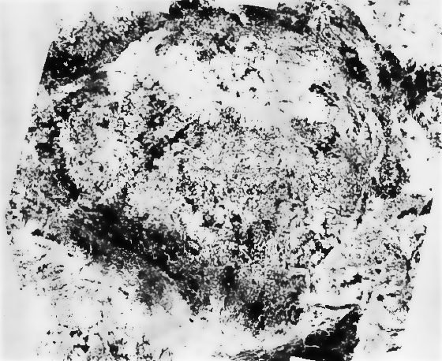{#bld-1}\
Bildo 1: Satelit-foto de Bohemio

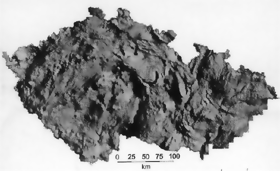{#bld-2}\
Bildo 2: Gravimetria mapo de la bohemia kratero

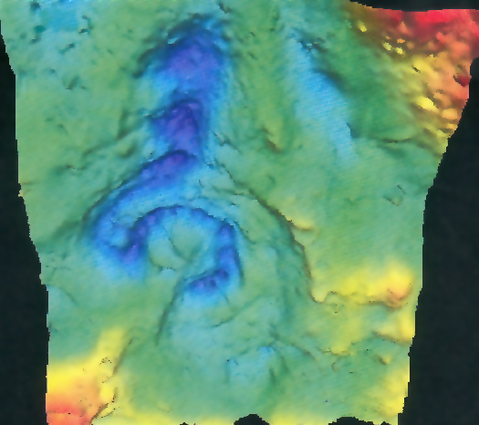{#bld-3}\
Bildo 3: Gravimetria mapo de la kratero [Chicxulub]{.maldense}
([Grupo de Investigación del Cráter Chicxulub del Instituto de Geofisica
de la U.N.A.M.]{.maldense})

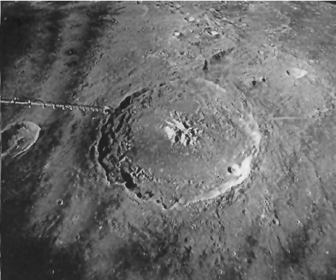{#bld-4}\
Bildo 4: Kratero Teofilo sur la Luno, NASA.

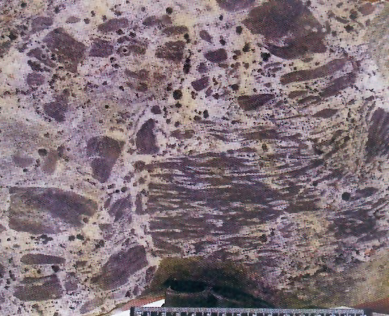{#bld-5}\
Bildo 5: Origina brekcieca pseŭdotaĥilit-vejno
(“granat"-roko de Taboro)

## Pseŭdotaĥilitoj

Tiuj ĉi rokaĵoj kreiĝis momente de la frapego kaj estas konataj kiel
pseŭdotaĥilit-vejnoj en la krateroj [Vredefort]{.maldense} kaj [Sudbury]{.maldense}. Por ilia
genezo necesis supersona rapideco de ŝoka ondo en frida stato
([Gumbach & Huajian]{.maldense}, 1999). Oni trovis ilin rekristaliĝintaj triloke.
La plej granda vejno atingas longecon de 3,5 km kaj dikecon de 60
m. Ĉiuj ĉi vejnoj kreiĝas en originaj argilsedimentoj metamorfe
rekristaliĝintaj en gnejsojn. La origine vitreca substanco kun klastoj
penetras laŭe kaj transverse de la folieco (Bildo [5](#bld-5)).

La konsisto de la rokaĵoj similas al la tipaj prasedimentoj de moldanubiko sur la trovlokoj Malenico kaj Tabora roko. Tiuj ĉi enhavas —
diference de Ĥraŝtano ([Chrdstany]{.maldense}) — pli da K~2~O (Bildo [6](#bld-6)). Kiel la
neosomo, tiel la paleosomo havas similan aŭ identan konsiston ankaŭ
laŭ la spurelementoj (Tab. [1](#tab-1)). La pseŭdotaĥilitoj estis pli poste deformitaj, ĉu jam dum la fazo kunprema, ĉu dum pli junaj orogenezoj,
plej intense sur la trovloko Malenico, kie la deformiĝo okazis samtempe, kiam kristaliĝis la granatoj. Ĉiuj ĉi rokaĵoj estas rekristaliĝintaj al novaj mineraloj. En Malenico kaj Tabora roko la neosomo
transformiĝis al kalifeldspato. La neosomo de la plej granda pseŭdotaĥilit-vejno en Ĥraŝtano rekristaliĝis al miksaĵo de kalifeldspato,
kvarco, silimanito, kordierito, plagioklazo kaj ilmenito. Laŭ la termometro granata-biotita, la pli juna rekristaliĝo pasis en la facio amfibolita.

## Ŝok-fenomenoj

### Diamantoj, TiO~2~-oksidoj, karbidoj

Al la ŝok-fenomenoj apartenas la diamant-troviĝo en la gnejsoj ĉe
la barlago Sejdenbaĥo ([Seidenbach]{.maldense}) apud Forĥhejmo ([Forchheim]{.maldense}) en
Ercmontaro ([Massonne]{.maldense}, 1998) kaj la TiO~2~-inkludaĵoj kun la
PbO~2~-strukturo en granatoj samgnejse ([Hwang]{.maldense} k.a., 2001). Diferencoj en la
formo de la limo Mohoroviĉiĉa interne kaj tutnajbare de la bohemia
masivo ne superas 10 km. Ĉar la spuroj de alta premo forme de diamantoj kaj titan-oksidoj troviĝas super la netuŝita limo, estas evidente, ke la mineraloj ne povis generiĝi merge en grandajn profundojn,
do okazis tio surface. La diamantoj de Sejdenbaĥo distancas ĉirkaŭ
16 km for de la permi-karbonia karbobaseneto ĉe Brandovo sur la
bohemia flanko de Ercmontaro. La baseneto ([Purkyně & Němejc]{.maldense},
1930) dokumentas relative fridan surfacon dum la tempoj post kiam
estiĝis la kratero.

Okaze de placerado de piropoj en Bohemia mezmontaro oni trovis
jam en 1869 apud Dlazkovico ([Dlažkovice]{.maldense}) la unuan bohemian diamanton ([Bouška]{.maldense} k.a., 1993) kaj inter 1900-1910 apud Ĥraŝtano la
duan. Ambaŭ montriĝis esceptaj pro la emisio de malpure oranĝa
koloro en UV-lumo. Tiu ĉi koloro estas tipa por la diamantoj impaktaj, sed ne por alidevenaj. Ambaŭ bohemiaj diamantoj do tre similas
al la impaktaj el la siberia Popigajo. Ili entenas nigrajn mikroskvametojn de karbohava substanco strukture nedifinita, kiu tamen troviĝas
kaj en diamantoj impaktaj kaj de tiuj el ĥondritoj de [Abee]{.maldense}
([Russel & Pillinger]{.maldense}, 1991). Proksime al la trovlokoj de la bohemiaj diamantoj
oni konstatis en vulkana brekcio heksagonajn kristalojn de moasanito
(silicia karbido SiC) ĝis nun trovita en neniu kimberlita vulkanaĵo,
male menciita jam pli supre ([Bouška]{.maldense} k.a., 1.c.).

## Deform-lameloj en kvarco

Tiujn mencias [MclIntyre]{.maldense} (1962) el abunde disvastiĝinta sekrecia
kvarco en moldanubiko kaj en la okcidenta Bohemio. Temas pri plua
ebla manifestiĝo de impakta proceso ([Rajlich]{.maldense}, presate). Glit-ebenoj
situas plejparte en la centro de klarkristala kvarco en kvarcolensoj,
kiuj atingas eĉ metrolongon. La lensoj aperas en svoroj (t.e. glimosĥistoj), filitoj kaj monotonaj paragnejsoj de la moldanubiko, okcidenta Bohemio, Slavkova arbaro kaj Ercmontaro, ĉio ĉi enkadre de la
bohemia masivo, eĉ ekster ĝia centro.

Mikroskope simptoma trajto de tiuj ĉi kvarcoj estas okulfrape densaj deform-lameloj tri- aŭ pli-direktaj. La lameloj konsistas el maldiafana laktokvarco, do ili kontrastas al la pli klara aŭ fumkolora kvarco
(Bildo [7](#bld-7)). La lameloj estas plejparte rektaj, tamen povas esti parte
fleksitaj, ĉar trafitaj de la pli posta misformiĝo. La randoj transiras
malakre, kvazaŭ araneaĵe, laŭ submilimetra distanco en la ĉirkaŭan
kvarcon diafanan.

La reciproka distanco de lameloj videblaj makroskope varias ekde
submikroskopa ĝis centimetra. La lameloj formas divers-larĝajn faskojn, en diversaj interspacoj, ekz. fasko de 3 - 4 lameloj distancas je 6
mm disde la fasko sekva kaj tiel plu. La faskolongeco dependas de
tio, kiom granda estas la specimeno; ĝi povas atingi ĝis 30 cm.

Iuj kvarcoj emas disfali laŭ la lameloj en poligonajn splitojn, kies
romp-surfacoj rebrilas. Verŝajne temas pri nova, pli posta apertiĝo de
pli aĝaj lameloj. Tion sugestus videbla rekristaliĝo aŭ foja enfluo de
fer-oksidoj. Mikroskope, la deform-lameloj aspektas kiel paralelaj
kampetoj interne de pli aŭ malpli optike individua grajno (Bildo [8a](#bld-8)).
La mozaiko estas pliesprimita aŭ per parta malregula ondeco de individuaj kampetoj, aŭ la lameloj enhavas vicojn da inkludaĵoj (Bildo
[8a](#bld-8)) unudirekte orientitaj. La plej eta lamel-interspaco varias ĉirkaŭ
0,1 mikrometro (Bildo [8b](#bld-8)). La surfaco de pli grandaj lensoj konsistas
plej ofte el etgrajna bruneta aŭ blanka laktokvarco kun milonita teksturo.

Estas evidente, ke post la kreiĝo de la deform-lameloj, la kvarco
suferis ankoraŭfojan transformon kaj rekristaliĝon, kiuj trafis ĝian
kontakton kun la ĉirkaŭaĵo. Mem la naturo de la najbaraj klara kaj
fumkolora kvarcoj indikas, ke la fumkvarcoj ne estis varmigitaj pli ol
325°C, ĉar aliokaze ili perdus sian koloron. Ĉeesto de la fumkvarco
eskludas ankaŭ duktilan kvarcodeformon en la glit-ebenoj *a* ĉe 275°C
kaj glit-ebeno *c* ĉe 400° - 600°C se partoprenas fluidoj, 700°C se ĉio
okazas en stato seka ([Trepmann & Stockhert]{.maldense}, 2003). Eblas supozi, ke
okaze de kataklaza fluo de seisme ŝarĝita materialo, la kvarco estus
pli forte pistita, do ne havus naturon pure diafanan, kiu ja aperas en
multaj specimenoj. La kvarcoj eble devenas el praaj pegmatit- kaj
solkvarc-vejnoj eĉ nuntempe kunasociitaj.

## Pistitaj granatoj, nestabila fazo de ties disfalo

Ĉiu pistita granato en rokaĵo preimpakta povas esti duspeca. Unue
temas pri almandino el gnejsoj, due pri piropo el ultrabazaĵoj. La
pistado liveris lamelitecon (Bildo [9](#bld-9)) aŭ etgrajnecon (Bildo [10](#bld-10)). Okaze de piropoj aliras randaĵo de la termo- kaj premo-disfalo (Bildo [11](#bld-11)).
En la kelifita randaĵo de la disfalinta piropo aperas krom spinelo,
ortopirokseno kaj kordierito ankaŭ safirino.

## Konusa splitiĝo

En la bohemia kratero oni trovis tian splitiĝon en rokaĵoj kun pseŭdotaĥilitoj (Bildo [12](#bld-12)). La rokaĵoj pli poste ankoraŭ rekristaliĝis kaj
nove kreiĝis biotito. Ĉar sur la konuspinto konstatiĝis grajnetoj iom
pli grandaj ([Dietz]{.maldense}, persona sciigo); estas evidente, ke la split-konusoj
aperas tie, kie disiĝas la ŝoka ondo. En la materialo pli etgrajna, la
konusoj estas mallarĝaj, altaj, en grand-era sabloŝtono pli apertaj. La
pint-angulo varias inter 20° kaj 30°. La konus-akso estas vertikala.
La konusoj situas en areo de proksimume 1 km^2^.

## Grandeco de la dumtempa kavo kaj la spuroj post ties detruiĝo

Jam surbaze de la unua interpretiĝo koncernanta la seismoprofilojn
en la bohemia masivo ([Beránek]{.maldense} k.a., 1978; [Bližkovský]{.maldense} k.a., 1986;
[Zátopek]{.maldense}, 1979) oni konstatis pli grandan dikecon de la terkrusto sub la
suda Bohemio. La plej freŝdata seisma profilado, plenumita 1999 —
2002, konfirmis la konkludojn antaŭajn, pli detale tradesegnante formon de la t.n. Moho-malkontinuo inklude la transiran altgradientan
tavolon kaj la surfacon inter la supra kaj suba krustoj ([Hrubcová]{.maldense},
2002) (vd. Bildon [13](#bld-13)). La profilo CEL-09, analoge al la profilo P-VI
([Bližkovský]{.maldense} k.a., 1.c.) kondukis precize tra la kavocentro en Moho sub
la bohemia masivo laŭ la gravimetrio. Kaj tiu ĉi kavo estas tre esprimiva inklude la mankantan altgradientan transir-tavolon inter la
mantelo kaj la krusto.

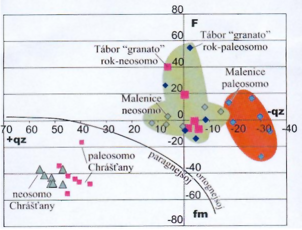{#bld-6}\
Bildo 6: Ĥemia konsisto de la pseŭdotaĥilit-vejnoj
(grafikaĵo laŭ [Köhler-Raaz]{.maldense}, 1951)

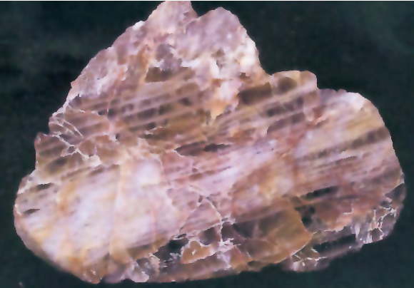{#bld-7}\
Bildo 7: Makroskope reliefigitaj ŝok-lameloj
en la fumkvarco de Biŝovo ([Býšov]{.maldense})

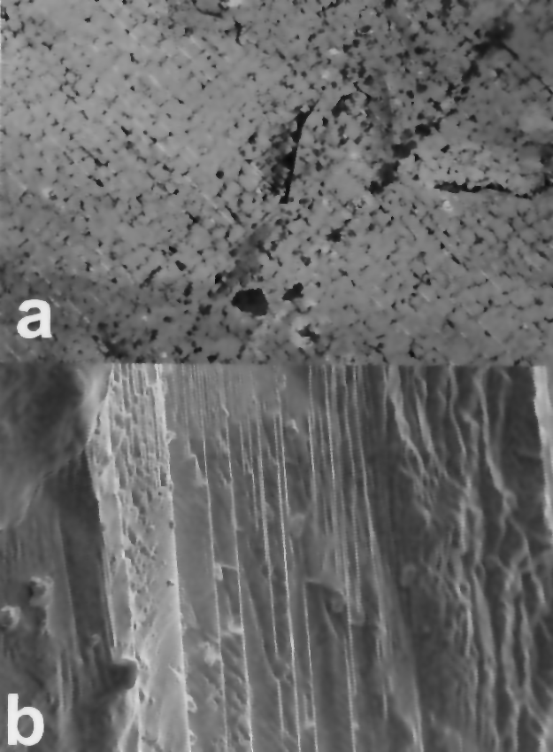{#bld-8}\
Bildo 8a: Ŝok-lameloj mikroskope (vidkampo ĉ. 4,5 mm). Biŝovo ([Býšov]{.maldense}).\
Bildo 8b: Ŝok-lameloj elektron-mikroskope, Udrazo (Údraž).


En la mantelo mem estas sub la kavo pli grandaj rapidecoj (interpretitaj helpe de tomografio) ol en la ĉirkaŭaĵo. La perpendikulara
profilo P-VII sur CEL-09 ([Bližkovský]{.maldense} k.a., 1.c.) traceita trans la meza
Bohemio, kaptis same nemiskompreneble la kavon en Moho, kiu tial
sin limigas al la teritorio sudbohemia. Inter la suba kaj supra krustoj
analoga malaltiĝo ne ekzistas.

La grandeco kaj situo de la dumtempa kavo respondas tre probable
al la menciita Moho-surfaco sub la centra ĝibo (Bildo [14](#bld-14)). La elprofundigita materialo (ultrabazaĵoj, eklogitoj) miksita kun la terkrusta
konsistigas aloĥtonan megabrekcion de moldanubiko (ree Bildo [14](#bld-14)).
Por la miksado de la mantela kaj krusta materialoj estis verŝajne
uzataj ĉefe la praaj dislokaĵoj nord-nord-orientaj — sud-sud-okcidentaj. La fragmentoj ultrabazaj havas malregulan formon je grandeco
ĝis kelkkilometra. Loke de plia amasiĝo, la unuopaj manteleroj plenigas “kavon“ en la gnejsoj. Oftas antofilita nemisformita randaĵo kaj
spuroj pri postaj metamorfaj reagoj inter la serpentinoj kaj la
najbargnejsoj. Tiujn reagojn la fragmentoj subiris loke post la penetro. La
vojoj de la profundiga movo kaj denova falego (faldislokaĵoj) videblas sur la refleksaj seismoprofiloj (Bildo 15). La ekstera periferio
estas borderita de cianit-troviĝoj (Bildo 16). Cianito aperas ĉi-loke
sur rando de la kvarcolensoj, povante enkreski parte internen kiel ne
tre misformitaj monokristaloj. Plejparte ĝi estas direktita laŭ la minerala linieco. Interne de la kvarco aŭ en parto de la cianit-vostoj surface de la kvarcolensoj ĝi estas neorientita. Ĝi asociiĝas kun kvarcolensoj, kiuj tenas en si deform-lamelojn kaj milonitan randoteksturon.
Embrioj de cianito kreiĝis verŝajne tiam, kiam estis faleganta la dumtempa kavo.

## Restaĵoj de la kratero, pritakso de la krater-aĝo

La evento, markita per la lamel-kvarcoj, povas uziĝi kiel tempopunkto por pli junaj geologiaj procesoj, nome por la metamorfaj.
Ekzemple la trovaĵo de la ŝokaj pegmatit-kvarcoj en gnejsoj de moldanubiko pruvas ilian tempon antaŭkrateran. Fragmentoj de la ŝokokvarcoj troviĝis en sedimentoj de proterozoiko (Bildo [17](#bld-17)). Por tio la
evento estas laŭtempe limigita kiel pli aĝa ol la antaŭspilita unuo proterozoika ([Kettner]{.maldense}, 1917). La cirkla pleniĝo de la norda interndiska
parto estas verŝajna restaĵo de la origina plenigita kratero (Bildo [17](#bld-17)).
Varmakva cirkulado tra sedimentoj, elvokita per la resta entalpio de
la kratero, dokumentiĝus laŭ silikaj termoŝtonoj kun fosiliaro de
proterozoikaj bakteri-kolonioj. La sediment-profundo povas atingi eĉ
8 km ([Chlupáč]{.maldense} k.a., 2002).
32

```{=html}
<style>
  table col:not(:first-child) {
    width: 5em !important;
  }  
  td:not(:first-child),
  th:not(:first-child) {
    width: 5em !important;
    text-align: center;
  }
</style>
```

::: {.plenlargha}


|      |SiO~2~|Al~2~O~3~|TiO~2~|FeO|Fetot|MnO|MgO|CaO|Na~2~O|K~2~O|P~2~O~5~|
|------|------|---------|------|---|-----|---|---|---|------|-----|--------|
|**Malenice**|
|mezvalore neosomo |61,05|20,03|0,22||4,90|0,08|0,09|0,40|3,55|9.23|0,10|
|mezvalore paleosomo|58,55|21,87|0,37||4,12|0,09|0,34|0,89|3,94|9,24|0,19|
|**"granat-roko de [Tábor]{.maldense}**|
|mezvalore neosomo |59,95|18,80|0,28|0,69|3,85|0,08|0,32|0,83|1,92|11,07|0,17|
|mezvalore paleosomo|60,08|18,89|0,32|0,70|3,13|0,05|0,37|0,78|1,97|11,25|0,17|
|**[Chrášťany]{.maldense}**|
|mezvalore neosomo |61,95|20,28|1,02|3,65|2,93|0,07|1,56|0,75|1,39|3,47|0,14|
|mezvalore paleosomo|61,14|20,14|1,02|3,69|2,98|0,11|1,82|0,97|1,72|3,31|0,15|

**Tabelo 1**: Pseŭdoĥilit-analizoj de la bohemia kratero

||analiz-<br>nombro|SiO~2~|TiO~2~|Al~2~O~3~|Fe~2~O~3~|FeO|MnO|MgO|CaO|Na~2~O|K~2~O|P~2~O~5~|H~2~O^+^|H~2~O^-^|sume|
|---|------|------|---------|------|---|-----|---|---|---|------|-----|--------|-----|-----|-----|
|%|18|56,68|0,95|13,52|1,02|5,02|0,14|6,52|4,20|2,24|6,42|0,98|0,61|0,22|98,89|

||analiz-<br>nombro|B|Ba|Be|Co|Cr|Cs|Cu|Ga|Li|Ni|Pb|Rb|Sn|Sr|V|Zn|Zr|
|---|------|------|---------|------|---|-----|---|---|---|------|-----|--------|-----|-----|-----|---|---|---|
|ppm|2|6|6400|5|8|280|40|8|11|62|130|47|350|1|430|120|80|290|

**Tabelo 2**: Analizoj de ebla krater-fandaĵo (tabora sienito), makroelementoj laŭ [Jakeš]{.maldense} (1968), mikroelementoj laŭ [Vejnar]{.maldense}  (1974)
:::

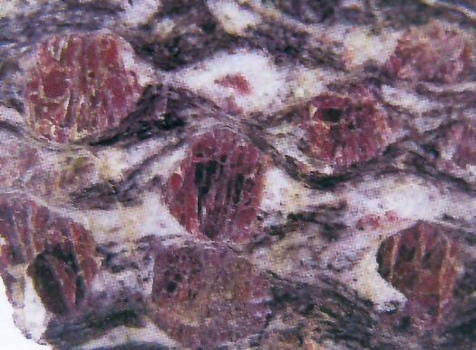{#bld-9}\
Bildo 9: Pistitaj granatoj el la zono lchenica ([Lhenice]{.maldense})
(la kampograndeco 3 x 2 cm).

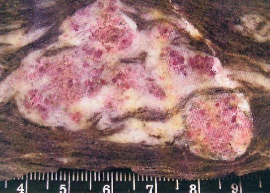{#bld-10}\
Bildo 10: Pistitaj granatoj de Starkoĉo ([Starkoč]{.maldense})
(la kampograndeco 5,3 x 4 cm).

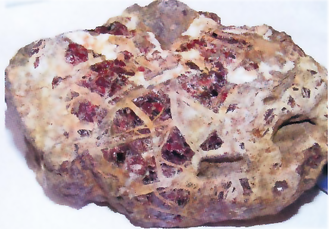{#bld-11}\
Bildo 11: Kelifit-randoj kun fibreca spinelo, safirino kaj pirokseno
(specimeno 3 x 4 cm).

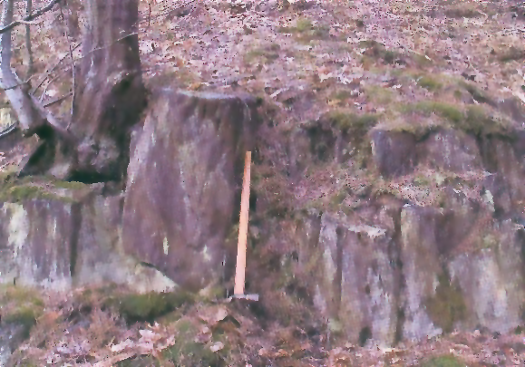{#bld-12}\
Bildo 12: Ebla trovo de konusa splitiĝo, Sobeŝovico ([Soběšovice]{.maldense}).

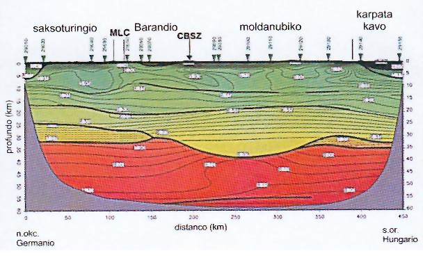{#bld-13}\
Bildo 13: Seisma profilo Celebration 09 laŭ [Hrubcová]{.maldense} k.a. (2002).
MLC = mariabana komplekso, CBSZ = centrabohemia glitzono.

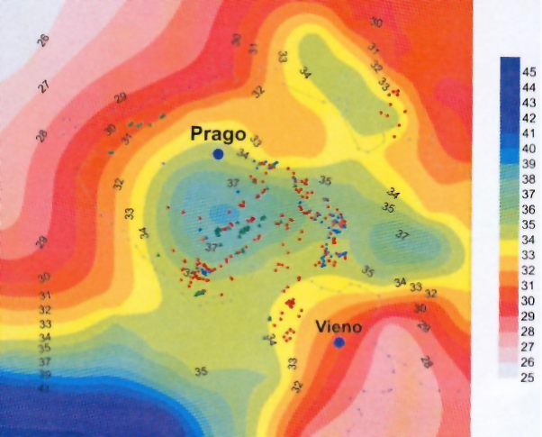{#bld-14}\
Bildo 14: Kavo en la Moho-surfaco laŭ [Beránek]{.maldense} (1979)
kaj disvastiĝo de ultrabazaĵoj, eklogitoj kaj granulit-korpetoj en moldanubiko
laŭ [Machart]{.maldense} (1982) kaj [Vrána]{.maldense} k.a. (1995).

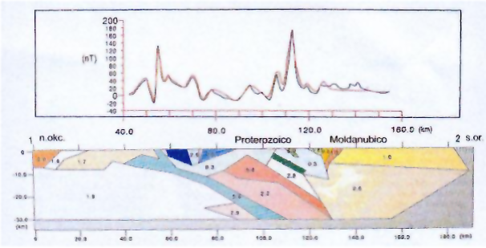{#bld-15}\
Bildo 15: Klino de la struktur-direktoj sur la n.okc. krater-rando
laŭ la magnetometria modelo: ruĝe valoroj kalkulitaj, blue mezuritaj.
Laŭ [Pokorný & Beneš]{.maldense} (1997).

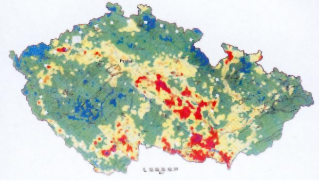{#bld-16}\
Bildo 16: Cianit-troviĝoj rande kaj interne de la origina kratero
estas manifestiĝo de pli juna hidroterma fazo,
laŭ la dokumentoj de Geomin (2002).

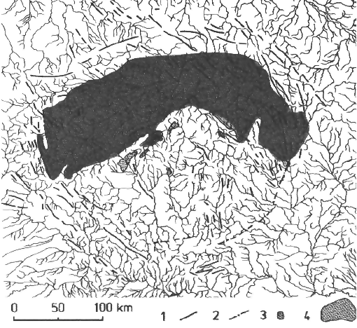{#bld-17}\
Bildo 17: Pleniĝo en la proterozoiko de la origina kratero.

## Postaj ŝanĝoj

La origina kratero spertis pluajn deformiĝojn dum la postaj orogenaj epokoj, t.e. precipe dum la kadomia kaj variscia orogenezoj. La
tektonika stilo de tiuj deformiĝoj estis imitata eksperimente kun aranĝo konforma al la litosferaj dimensioj ([Rajlich]{.maldense} k.a., 1996). La eksperimentoj montras, ke la deformiĝo pasis en diversaj temperaturkondiĉoj. Por intensa deformiĝo en la travarmigita litosfero estas tipe, ke
kreiĝis hufferecaj formoj ĉirkaŭ la interna ĝibocirklo (Bildo [18a](#bld-18)) kaj
la ekstera cirklo. La simetri-akso de tiu ĉi strukturo direktas sin nordoriente-sudokcidente (Bildo [19](#bld-19)). Konsidere la nuntempan faltigitecon
de Barandio kaj la pli aĝan faltigitecon de proterozoiko, temas verŝajne pri manifestiĝo de la orogenezoj variscia (frasnia) kaj kaledonia.

Dum kondiĉoj de pli frida litosfero kreiĝas unue tanĝantaj dislokaĵoj rande de la ekstera cirklo, kiuj pli poste disvolviĝis al kompleta
rombo (Bildo [18b](#bld-18)). La strukturo de la ekstera rombo ([Rajlich]{.maldense}, 1994)
Bildo [19](#bld-19) respondas unuavice al efikanta streĉo nordokcidenta-sudorienta en permio kaj paleoceno, pli poste nordorienta-sudokcidenta
en eoceno. Tial, la ekstera romba strukturo rezultas el reciproke metitaj, tempe apartigitaj tektonikaj procesoj. Evoluado de la sole tanĝantaj dislokaĵoj sugestas, ke la tektonika movo laŭ la masiv-randoj ne
superis ĉirkaŭ 20 km.

La strukturo de la bohemia masivo, imitita eksperimente, montras,
ke la refaltiĝoj de impaktaj trajtoj ne okazas nepre; simile, kiel la ŝokokvarcoj trovitaj en krateroj eĉ jarmiliarde aĝaj, same la konturo de
origina kratero restas konservita. Do, la nuntempa aspekto rezultas el
vico da kraterŝanĝoj; la ĉirkaŭmontaro prezentas sumon de pli junaj
orogenezoj. La ĉefan rolon en ĝia genezo ludis okazaĵoj terciaraj.

Sekvaj ŝanĝoj de la kratero ligiĝis kun entrudaĵoj de la kadomiaj
kaj varisciaj granit-masivoj. Dispozicio de tiuj masivoj senpere dependas kun la ĉefaj tektonikaj zonoj rande al la origina cirkla ĝibo kaj
rande al la ekstera cirklo. Krom tio, ĉi-loke estiĝis sediment-basenoj
de karbonio kaj kretaceo. La junaj vulkanaĵoj de terciaro situas sur la
tanĝanta dislokaĵo de la norda arko.

## Diskuto

La originan rekristaliĝintan krater-fandaĵon plej eble prezentas la
t.n. tabora sienito. La rokaĵo, tipa pro la malfruaj fenokristaloj de la
poikiliteca biotito elmontras altajn enhavojn de ĥromo kaj magnezio
apud konsiderinda kalio (Tabelo [2](#tab-2)). Tio memorigas miksaĵon, kiu
povas generiĝi el meteorit-ĥondritoj kun rokaĵoj terkrustaj. Entenataj
estas ankaŭ dispecigitaj zirkonoj ([Johanová]{.maldense}, 1969).

Pluaj dokumentoj de altenergetika procesaro estas la deformitaj
granitoj de moldanubiko, la metamorfaj manifestiĝoj kun okulfrapa
dekarboniĝo en gnejsoj, la struktur-aranĝo kun duktilaj deformoj. En
tiu ĉi esplorad-fazo ne apartiĝas entalpie metamorfaj-hidrotermaj
procesoj disde la pli posta restanta krater-entalpio. Ankaŭ ĝis nun oni
ne sukcses eltrovi suevitojn nek krater-eligaĵojn, nome pro la potenca
kovro per pli juna tavolaro.

## Konkludo

La cirkla aranĝo en la interna baseno de la bohemia masivo prezentas malnovan, paleoproterozoikan krateron kun rezidua strukturo. El
la senpera indicaro pri altenergetikaj procesoj oni ĝis nun sukcesis
determini -- krom la cirkla aranĝo -- la pseŭdotaĥilitojn, ŝokokvarcojn,
aloĥton-brekciojn kaj la situon de la nuntempa kavo kun la centra
ĝibo. El la indicaro minerala, konsiderindan gravecon havas la diamant-trovoj en Bohemia mezmontaro kaj Ercmontaro. Simileco de la
diamantoj el Bohemia mezmontaro kun tiuj de la impakta kratero
Popigajo kaj ilia malsameco disde komberlit-diamantoj, komune kun
la moasanit-trovo en la proksimaĵo malebligas ekspliki ilian genezon
en la profundego de la Tero kaj elporto surfacen kun la najbara bazalto. La ercmontar-diamantoj generiĝis dum premo plia ol 6 Gpa, kiu
regus en profundoj pliaj ol 160 km. Tio signifus, ke la originaj sedimentoj estus tiom mergitaj, sed pli poste relevitaj surfacen. Tio povus
generiĝi eĉ ne dum la variscia orogenezo.

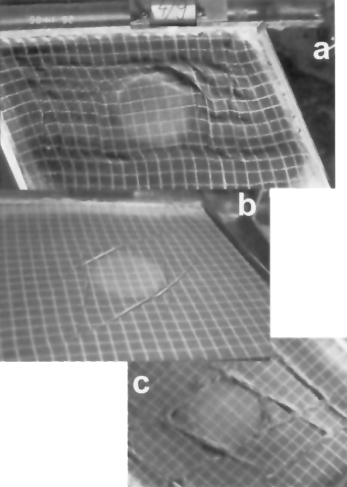{#bld-18}\
Bildo 18: Analoga modelo kiel formiĝas huffereca strukturo
ĉirkaŭ solidigitaj diskoj de la origina kratero,\
a = formiĝo de huffero en mallarĝa glitzono ĉirkaŭ solida disko,\
b, c = formiĝo de rombo en pli larĝa glitzono ĉirkaŭ solida disko.

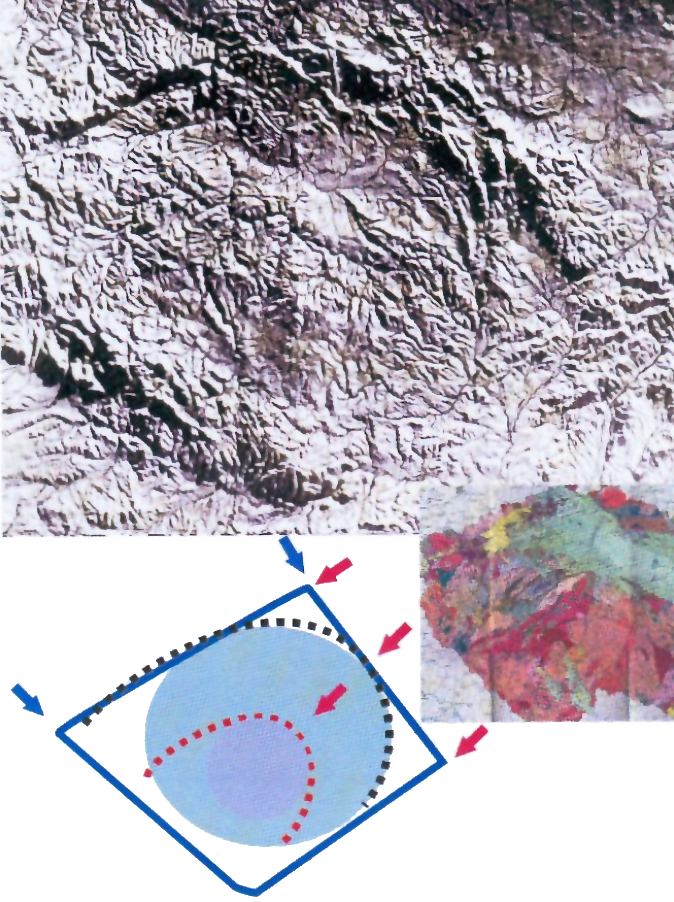{#bld-19}\
Bildo 19: Nuntempa neopalcozoika ĝis terciara strukturo romba
kaj huffera ĉirkaŭ la interna kaj ekstera krater-cirkloj.

Multon de plua nerekta geologia indicaro prezentas la dispozicio de
junaj granit-masivoj, bazalt-elverŝoj dum la terciara vulkanismo, erctrovejoj, mineralakvo-fontoj, sedimentoj.

## Referencoj

[Beránek B.]{.maldense} (1979). Results of deep seismic sounding measurements in Czechoslovakia
and their contribution to solution of deep contact of Alpine system with European
platform. p.245-255. En: M. Mahel ed. Czechoslovak geology and global tectonics. —
Strukturní schéma povrchu Mohorovičićony diskontinuity v oblasti Českého masivu
podle seismických měřeni. — Sbornik konference Československá geológia a globálna
tektonika SAV Bratislava.

[Bližkovský M.]{.maldense} k.a. (1986). Geofyzikálni model litosféry. — Závěrečná zpráva úkolu
OFTR-ČGÚ Brno Geofyzika n.p.

[Bouška V.]{.maldense} (1990). Mohou být Čechy starým obrovským meteoritovým kráterem? —
Vesmír 69 č.9.

[Bouška V., Skála R. & Frýda J.]{.maldense} (1993). České diamanty. — Geolog. Průzkum č.1, 6-10.

[Dallmayer R.D., Franke W. & Weber K.]{.maldense} (1995). Pre-Permian Geology of Central and
Eastern Europe. — Springer Verlag. New York-Heidelberg-Berlin, 1-604.

[Geomin]{.maldense} (2002). Regional heavy mineral prospecting in the territory of the Czech
Republic Atlas of maps. — Jihlava.

Grupo de Investigación del Cráter de Chicxulub del Instituo de Geofisica de la
U.S.A.M.

[Gumbsch P. & Gao H.]{.maldense} (1999), Dislocations Faster than the Speed of Sound. — Science
Vol 283, Issue 5404, 965-968.

[Hrubcová P., Špičák A., Švancara J., Růžek B., Hubatka F., Tomášková A. & Brož M.]{.maldense}
(2002. Výzkum hluboké stavby Českého masivu CELEBRATION 2000; MS MŽP ČR.

[Hwang S., L.Shen P., Chu H. & Yui T-F.]{.maldense} (2000). Nanometer-Size-PbO2-Type TiO2 in
Garnet. A Thermobarometer for Ultrahigh-Presssure Metamorphism. — Science, Vol. 288,
Issue 5464, 321-324.

[Chlupáč I.]{.maldense} k.a. (2002). Geologická minulost České republiky. — Academia, 436 pp.

[Jakeš P.]{.maldense} (1968). Variace chemického a modélniho složení táborského syenitu. — Čas.
mineral. geol., 13, 1, 36-37. Praha.

[Johanová V.]{.maldense} (1969). Akcesorické minerély v horninách středočeského plutonu. — MS
GÚ AvČR.

[Kalenda P. & Rajlich P.]{.maldense} (presota). Krater Bohemia. — Vesmír.

[Kettner R.]{.maldense} (1917). Versuch einer stratigraphischen Gliederung des böhmischen
Algonkiums. — Geol. Rdsch. 8, 169-188. Leipzig.

[Köhler A. & Raaz F.]{.maldense} (1951). Über eine neue Berechnung und graphische Darstellung
von Gesteinsanalysen. — N. Jb. Min., Monatsh., 247-263. Stuttgart.

[Machart J.]{.maldense} (1982). Ultramafické horniny středočeské větve Moldanubika. — Disertace
PřFUK. Praha.

[Massonne H.J.]{.maldense} (1998). A new occurrence of microdiamonds in quarthofeldspathic rocks
of the Saxonian Erzgebirge Germany and their metamorphic evolution. — En: Proceedings
of the 7th International Kimberlite Conference (eds. _Gurney J.J., Gurney J.L., Pascoe
M.D. & Richardson S.H._) pp. 533-539. Red Roof Design cc Cape Town.

[Massonne H.J.]{.maldense} (2001). Origin of microdiamond-bearing quartzofeldspathic rocks
(saidenbachites) from the Erzgebirge Germany, a progress report. Ultra-High-Pressure
Metamorphism Workshop. Session LA03 11-15. Waseda University. Tokyo.

[Massonne H.J. & Nasdala L.]{.maldense} (2003). Characterization of an early metamorphic stage
through inclusions in zircon of a diamnodiferous quartzofeldspathic rock from the
Erzgebirge Germany. American Mineralogist, Vol. 88, pages 883-889.

[McIntyre D.B.]{.maldense} (1962). Impact metamorphism at Clearwater Lake Quebec. — J. Geophys.
Res. 67, 1647-1653.

[Papagiannis M.D. & El-Bas F.]{.maldense} (1988). Praha Basin. Abstr. 52nd Ann. Meet. Meteor.
Soc. p.19, Vienna.

[Plomerová J.]{.maldense} k.a. (2003). BOHEMA 2001-2993. Passive seismic experiment to study
lithosphere-astenosphere system in the Western part of the Bohemian Massif. — Stud.
Geophys. Geod. 47, 691-701.

[Pokorný L. & Beneš L.]{.maldense} (1997). Magnetic field s. 38-42. — En: S.Vrána, V. Štědrá (Eds.).
Geological model of Western Bohemia related to the KTB borehole in Germany. —
Sborník geologických věd Geologie 47.

[Purkyně C. & Nemejc F.]{.maldense} (1930). Brandovská kamenouhelná (antracitová) pánev v
Rudohoři. — Paleontographica Bohemiae XIV/1930, 123s.

[Rajlich P.]{.maldense} (presate). Výskyt šokových křemenů Českém masívu. — Zprávy o geologických výzkumech, ČGS.

[Rajlich P.]{.maldense} (1992). Bohemian cirkular structure. Czechoslovakia. Search for the impact evidence. Large meteorite impacts and planetary
evolution. — Sudbury. LPI Contribution No. 79, 57-59.

[Rajlich P.]{.maldense} (1994), Circular and Lozenge Structure of the Bohemian
Massif. — Jb. Geol. B.-A., 137, 4, 647-660. Wien.

[Rajlich P.]{.maldense} (2004). Geologie mezi rozpínáním Zeměkoule a Čechami. 234 pp. (c) Rajlich.

[Rajlich P.]{.maldense} (2005a). Rekrystalizovaný pseudotachylit táborské „granátové“ skály. —
Sborník Jihočeskẃho muzea v Českých Budějovicích, Přirodní vědy 45, 13-24.

[Rajlich P.]{.maldense} (2005b). Český kráter. — Abstrakty referátů přednesených v rámci 2. sjezdu
České geologické společnosti ve Slavonicích 19.-21.10.2005.

[Rajlich P., Benes M. & Cobbold P.]{.maldense} (1996). Wrencing of a continental lithosphere
containing a circular resistant inclusion. Physical model experiments. — Jahrbuch Geol.
Bund. — A. 139 2 215-232.

[Russel S.S. & Pillinger C.T.]{.maldense} (1991). Abstracts 54th Ann. Meet. Meteor. Soc. p.200,
Monterey.

[Sakamoto M., Gucsik A., Ninagawa K., Nishido J., Shichi R., Toyoda S., Bidló A. & Brezsnyánszky K.]{.maldense} (2005), Mt. Oikeyama structure — first impact structure in Japan? Lunar
and Planetar Science XXXVI (2005) 1242.pdf.

[Sedlák J.]{.maldense} (1996). Gravity maps of the Czech Republic.- EGRSE III 2/96 17-19.

[Shyh-Lung Hwang Pouyan Shen]{.maldense}; [Hao-Tsu Chu Tzen-Fu Yui Chung-Cherng Lin]{.maldense} (2001).
Genesis of microdiamonds from melt and associated multiphase inclusions in garnet of
ultrahigh-pressure gneiss from Erzgebirge Germany. — Earth and Planetary Science
Letters 188 9-15.

[Šalanský K.]{.maldense} (1984). Regionální magnetické mapy. — Učební text PGS. PřF UK Praha.

[Trepmann C.A. & Stockhert B.]{.maldense} (2003). Quartz microstructures developed during non-steady state plastic flow at rapidly decaying stress an strain rate. — Journal of Structural
Geology v.25.

[Vavrdová M.]{.maldense} (1999). Benthic microfossils from the Teplá-Barrandian Late Proterozoic
(Blovice Formation Czech Republic). — Jour. Czech Geol. Soc. 44, 1-2.

[Vejnar Z.]{.maldense} (1974). Trace elements in rocks of the Central Bohemian Pluton. — Věst. Ústř.
Úst. Geol. 49, 149-165. Praha.

[Vrána S., Blümel P. & Petrakakis K.]{.maldense} (1995). Chapter VIL.C.4 s. 453-466 Metamorphic
evolution. En: [Dallmayer]{.maldense} k.a. (Eds.). Pre-Permian Geology of Central and Eastern
Europe. — Springer Verlag Berlin-Heidelberg.

[Zátopek A.]{.maldense} (1979). On Geodynamical Aspects of Geophysical Synthesis in Central
Europe. Geodynamic Investigations in Czechoslovakia. Bratiswlava Slovakia. — p. 91-104. VEDA SAV.
