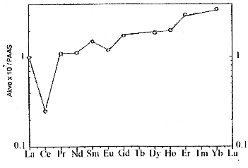
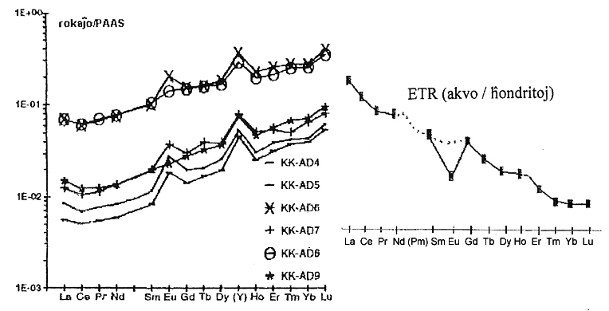
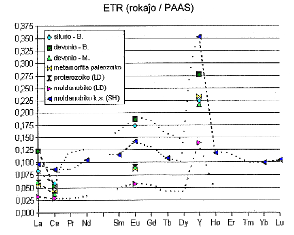

<!--

Fonto: Scienca Revuo 1/2007 pp. 44-61.
origina paĝo: http://sweb.cz/ospraha/geologie/gint.htm
STEB: https://www.eventoj.hu/isae/scienca-revuo/

-->

<!--
## Resumo ĉeĥlingva

***Prvky vzácných zemin v moøských usazeninách***

*Èlánek
shrnuje význam prvkù vzácných zemin (lanthanidù) ve vápencích i dalších
horninách, které mohou zachovat
vzájemné* *pomìry
tìchto prvkù v moøské vodì. Z literatury vyplývá znaèný význam nega­tivní
cerové anomálie jako indikátoru oxidaèního prostøedí, který mùže být
zachován i ve znaènì pøemìnìných horninách. Na pøíkladu Èeského masívu
je ukázáno, že mnoho publikovaných i archivo­vaných prací s analýzami
vzácných zemin, jejichž autoøi se cerovou anomálií pøímo nezabývali, má
znaèný potenciál pro rekonstrukci prostøedí vzniku tìchto hornin i pro
stratigrafické
korelace.*

-->

<blockquote>
La traktaĵo resumas la gravecon de ETR
(lantanidoj) en kalkoŝtonoj kaj aliaj rokaĵoj, kiuj kapablas konservi la
reciprokajn rilatojn inter tiuj ĉi ele­mentoj en la mara akvo. El la
literaturo rezultas konsider­inda signifo de la negativa *Ce*-anomalio
kiel indikilo pri la koncerna oksidada medio. Tiu ĉi indikilo povas esti
konservita eĉ en la tre forte metamorfitaj rokaĵoj. Per la ekzemplo de
la bohemia masivo estas demonstrate, ke multo da publikigita kaj arĥiva
literaturoj, enhavantaj ETR-analizojn, posedas konsiderindan potencialon
por rekonstruado, en kia medio la rokaĵoj estis kreiĝintaj, do por
stratigrafia korelativ-eco, eĉ se la aŭtoroj ne okupis sin senpere pri
la *Ce*-anomalio.
</blockquote>

## Enkonduko

La titole prezentita akronimo ETR por
"elementoj de teroj raraj" (la­tine "[terrae rarae]{.maldense}" = TR) havas en la
ĥemia nomenklaturo sian nomon *lantanidoj*. Temas pri la 15 elementoj
ekde lantano (sim­bole *La*, atomnumero 57) ĝis lutecio (simbole *Lu*,
atomnumero 71). Ili ĉiuj, geoĥemie konsiderate, estas ne tre
moviĝemaj.

Aparte specifa trajto de tiu ĉi
element-vico konsistas en la t.n. *lan­tanida kuntiriĝo*, t.e. la tre
proksima jon-grandeco de du naj­baraj ETR. Konsekvence, aŭ ĉiuj ETR, aŭ
almenaŭ konsiderinda ties aro, kondutas tre simile. La kurbo de la
ETR-enhavoj en difi­nita materi­alo, normigitaj ekz. al tiuj de ĥondritoj
(Tab. [1](#tab-1), Fig. [1](#bld-1)) pasas glate, do ajna deviacio povas alporti gravan
geoĥemian in­formon.

Kun ETR oni ofte esploras ankaŭ itrion
(simbole *Y*, atomnumero 39), kiu en medio akvomalriĉa kondutas pli aŭ
malpli simile al hol­mio (simbole *Ho*, atomnumero 67), kiu ja apartenas
al ETR.

## ETR en marakvo

Eŭropio (simbole *Eu*, atomnumero 63),
la unusola el ETR, tro­viĝas terkruste kaj trivalenta, kaj duvalenta,
precipe en plagio­klazo. La rokaĵoj de la terkrusto supra vidigas
negativan anoma­lion (Fig. [1](#bld-1)). Male, akumulaĵoj de plagioklazo havas
anomalion pozitivan. Tiu ĉi fenomeno gravas ne nur en la petrologio
magmo­rokaĵa ([Michard]{.maldense} k.a., 1983). Tamen, ĉar en marakvo dominas ETR
rezultantaj el konti­nenta efloreskado, la marakvo montras -- rilate al
la ĥondritoj -- la *Eu*-anomalion iomete
negativan.

::: {.plenlargha}
[Tabelo 1]{#tab-1}: Listo de ETR kaj ties enhavoj en meteoritoj
(k.ĥ. = karbonhavaj ĥondritoj) en ppb (10 --9)\
laŭ [McDonough & Sun]{.maldense}, 1995. La t.n. malpezaj
ETR = *La* ĝis *Gd,* pezaj ETR = *Tb* ĝis *Lu*.

|elemento|lantano|cerio|prazeodimo|neodimo|samario|eŭropio|gadolinio|
|---|:---:|:---:|:---:|:---:|:---:|:---:|:---:|
|simbolo|$\ce{La}$|$\ce{Ce}$|$\ce{Pr}$|$\ce{Nd}$|$\ce{Sm}$|$\ce{Eu}$|$\ce{Gd}$|
|enhavo en k.ĥ.|237|613|92,8|457|148|56,3|199|

|elemento|terbio|disprozio|holmio|erbio|tulio|iterbio|lutecio|
|---|:---:|:---:|:---:|:---:|:---:|:---:|:---:|
|simbolo|$\ce{Tb}$|$\ce{Dy}$|$\ce{Ho}$|$\ce{Er}$|$\ce{Tm}$|$\ce{Yb}$|$\ce{Lu}$|
|enhavo en k.ĥ.|36,1|246|54,6|160|24,7|161|24,6|
:::

{#bld-1}\
**Fig. 1**: Mezvaloraj ETR-enhavoj en la aŭstralia ardezo (PAAS), normigitaj al la ĥondritoj, ambaŭ valoroj laŭ
[Taylor & McLennan]{.maldense}, 1985. La normigo al la enhavoj en la ĥondrit-meteoritoj
baziĝas sur la prava supozo, ke la reciprokaj proporcioj
de la pez-elementoj en la ĥondritoj estas la samaj, kiaj sur la
Tero.

Nuntempe, ETR en marakvo partoprenas
ekstreme malmulte, pri sia sorbiĝo al oksidoj kaj hidroksidoj de *Fe*
kaj *Mn*. Ilia koncentr­iteco plejparte varias ekde dekonoj ĝis 5 ppt 
(10 - 12) ([Elderfield & Greaven]{.maldense}, 1982). Kontraste al la izotopoj de
stroncio (simbole *Sr*, atomnumero 38), ETR-enhavoj marakvaj ne estas
tutmonde egalig­itaj, ĉar ilia restad-tempo ([Taylor & McLennan]{.maldense}, 1985)
malpli daŭ­ras ol la ocean-miksiĝado.

En arĥeozoiko, ekde difinita profundo
reduktiĝis fero al la du­valenta (multe pli solvebla). Sub tiu ĉi
profundo ne okazis efika ETR-sorbiĝo al fer-hidroksidoj, do la
koncentritecoj en akvo estis multoble pli altaj, ofte ili montris eĉ
pozitivan *Eu*-anomalion pro konsiderinda alporto de *Eu*^2+^ el
hidrotermaj fontoj marfundaj ([Bau & Möller]{.maldense}, 1993). Male, ne tiom
profunde, samkiel en la nuntempa oceano, ilia fero oksidiĝis al la
trivalenta, kio kondukis al estiĝo de laminitaj fer-ercoj. Tiuj ofte
havas *Eu*-anomalion po­zitivan ([Barret]{.maldense} k.a., 1988; [Bau & Dulski]{.maldense},
1996; [Kato]{.maldense} k.a.,
2002b).

Dum efloreskado okazas oksidiĝo de
cerio *Ce*^3+^ ĝis *Ce*^4+^, kiu en surfac-akvoj estas nesolvebla. Solan
escepton prezentas akvoj alkalo­riĉaj, ekz. en la lago [Van Gölü]{.maldense},
Turkio, kun pH = 9,6 kaj kun solvitaj karbonatoj: tie montriĝas la
*Ce*-anomalio pozitiva ([Möller & Bau]{.maldense}, 1993). La surfaca akvo do havas
*Ce*-anomalion negativan. Kontraste, *Ce*-riĉiĝo, kompare kun la ceteraj
ETR, en efloreskaĵoj nenecese povas perceptiĝi, ĉar akven kutime venadas
nur eta kvanto de ETR; la pozitiva *Ce*-anomalio estas perceptebla
nur en la supra parto de la efloreska
profilo kaj en la grundo ([Taunton]{.maldense} k.a.,
2000).

Do, negativan *Ce*-anomalion havas
ankaŭ marakvo ([Masuda & Ikeuchi]{.maldense}, 1979), (Fig. 2). Konsidere al la
nehomogeneco de oceanoj, *Ce*-anomalio mankas ekz. en Nigra maro
([German]{.maldense} k.a., 1991). Dum la reduktanta atmosfero en arĥeozoiko tamen
ne okazadis -- almenaŭ ne konsiderinde -- oksidado al la trivalenta
*Ce*, do ne ek­zistis *Ce*-ano­malio (Fig.
3).

Tutmonda kresko de oksigen-kvanto ĝis
la nivelo bezona por oksi­dado de *Ce* verŝajne estis subita (*Bau* k.a.,
1999). Jen logika konsek­venco de rapida atmosfer-miksiĝo. De post tiam
sedi­mentoj precipit­iĝantaj al marakvo devus havi *Ce*-anomalion
negati­van, la fosiliaj grundoj male la
pozitivan.

Regis­tro en rokaĵoj metas tiun ĉi eventon en la malsupran prote­rozoikon,
eble ankaŭ en la supran arĥeozoikon: pli poste ol ĉirkaŭ
2,5 - 2,3 Ga antaŭ la nuntempo ([Bau & Dulski]{.maldense}, 1996), pli frue ol 2,4
Ga ([Bau]{.maldense} k.a., 1999), pli frue ol 1,85 Ga ([Pan & Stauffer]{.maldense}, 2000), pli
poste ol 2,45 Ga ([Murakami]{.maldense} k.a., 2001), pli frue ol 2,7--2,9 Ga
([Kato]{.maldense} k.a., 2002b), pli poste ol 2,6 Ga ([Bau & Blanckenburg]{.maldense},
2004).

Preskaŭ certas, ke nova esplorado ne
kapablos pluŝovi la limon de (ne)ekzisto *Ce*-anomalia tro fore de frua
proterozoiko, kio ja ne eks­kludas lokan troviĝon eĉ pli fruan.
Analogecon eblas observi okaze de lamenitaj fer-ercoj, kiuj -- spite al
sia disvastiĝo en la neoarĥeo­zoiko -- rare ekzistas jam en [Isue]{.maldense}
(Gronlando). Egale zirkonoj aĝaj ĝis 4 270 Ma havas tre frapantan
*Ce*-anoma­lion po­zitivan ([Maas]{.maldense} k.a., 1992). Tio atestas, ke la
kvarvalenta *Ce* et­kvante povas ekzisti eĉ en medio
re­duktanta.

Foresto de pozitiva *Ce*-anomalio en
arĥeozoikaj sedimentoj precipi­tiĝintaj el marakvo refutas ekziston de
"natria oceano" kun alta pH en la tempo de la sedimentiĝo
([Bau & Dulski]{.maldense}, 1996)
(Fig. [2](#bld-2)).

La distribuiĝon de ETR en mara akvo
bone redonas ĉefe kalkoŝto­noj, sed ankaŭ evaporitoj. Kalcito koncentras
la malpezajn ETR pli ol la pezajn, sed estigas neniujn anomaliojn
([Zhong & Mucci]{.maldense}, 1995); sen influo restas, eĉ se ETR venas en
sedimenton per sor­biĝo al oksi­doj kaj hidroksidoj de *Fe, Al* kaj *Mn*
([Liu]{.maldense} k.a., 1988).

Kiel reprezen­tiva por marakvo ofte
konsideriĝis ETR en biogenaj fosfatoj ([Grandjean]{.maldense} k.a., 1987), spite la
cirkonstancon, ke la plej­parto de la ETR-enhavo tien venas nur dum
diagenezo ([Grandjean]{.maldense} k.a., 1987), kio ja ofte kaŭzas neniigon de la
origina *Ce*-anomalio ([Shields & Webb]{.maldense},
2004).

Negativa *Ce*-anomalio estis
dokumentita en profund­akvaj korno­ŝtonoj de Pacifiko ([Shimizu & Ma­suda]{.maldense},
1977) kaj en aŭ­tigenaj mine­raloj de marsedimentoj ([Piper]{.maldense},
1974).

Preskaŭ ĉiuj kalkoŝtonoj de la
fanerozoiko, kvankam ili ne havas nepre dominantan kvanton de klastaj
ETR (kio ja indikiĝus pro gran­daj *Th, Zr*-enhavoj aŭ pro eta proporcio
*Y/Ho*), samkiel sedimentoj konservantaj ETR-distribuiĝon el akvo, havas
*Ce*-anomalion ne­gati­van rilate al la ĥondritoj kaj rilate al la
ardezo (*Ce*/*Ce*\*\<1) ([Kawabe]{.maldense} k.a.,
1991).

{#bld-2}\
**Fig. 2**: ETR-enhavoj (obligite per 10 7, normigite al la ardezo) en la akvo de
Atlantiko, el la profundo de 900 m ([Elderfield & Greaves]{.maldense}, 1982).
Videblas la frapanta negativa *Ce*-anomalio.

{#bld-3}\
**Fig. 3**: Live: La normigitaj ETR kaj *Y* en iuj lamenitaj fer-ercoj
el la norda Afriko proksime al la limo arĥeozoika-proterozoika, kun
la pozitivaj anomalioj de *La, Eu, Y* ([Bau & Dulski]{.maldense}, 1996).
Dekstre: Sĥema demonstro de la tetrad-efiko W;
ĉi-okaze la kurbo sinkas ekde *La* ĝis *Lu* kun la negativa
*Eu-*anomalio.

Diversaj okazoj povas estiĝi tiu­loke, kie
subite ŝanĝiĝas la potenci­alo oksidada-reduktanta.
La plejparto
de la nuntempaj feromanganolitoj kaj *Fe-Mn*-krustoj pro tio havas
*Ce*-anomalion pozitivan (*Ce/Ce*\* \>1) ([Elderfield]{.maldense}, 1988). La valoro
*Ce*\* akiriĝas per interpolo inter normigitaj enhavoj de *La* kaj *Pr*
aŭ de *La* kaj *Nd*.

Se la ETR-distribuiĝo eĉ en puraj
kalkoŝtonoj havas nur malpli frapantan *Ce*-anomalion, povas esti, ke
temas fakte pri alia mal­regul­eco ([Bau & Dulski]{.maldense}, 1996). Marakvo
([Masuda & Ikeuchi]{.maldense}, 1979), ofte eĉ kalkoŝtonoj ([Kawabe]{.maldense} k.a., 1991),
havas la tetrad-efikon de la tipo *W* (Fig. 3), kiu tamen ne malhelpas
distingi la *Ce*-anomalion (kutime ĝi frakcias ETR multe
malpli).

Pli grandan komplikon povas kaŭzi
*La*-anomalio en mara akvo ([De Baar]{.maldense} k.a., 1991; [Bau & Dulski]{.maldense}, 1996),
kiu evidente estas en konekso kun la fakto, ke lantano aparte­nas al la
d-elementoj, dum la ceteraj lanta­nidoj (krom *Gd*) al la f-elementoj.
Tial precipe en puraj karbo­natoj de arĥeozoiko eĉ la valo­roj *Ce/Ce*\*
inter 0,65 kaj 0,70 ofte ne signifas *Ce*-anomalion
negati­van.

Sed por tia ĉi decido necesas unua­loke
disponi pri precize difin­itaj enhavoj de ĉiuj ETR (aŭ minimume ĉiuj ekde
*La* ĝis *Nd*). Ankaŭ estas rekomendinde apliki por la enhav-normigo la
ardezon (PAAS aŭ [NASC]{.maldense}), en kiu la ETR-koncentritecoj ŝarĝus malpli
granda svageco. Cele al ekzogena geoĥemio la ardezo estas pli
reprezentiva ol la
ĥon­dritoj.

La tetrad-efiko *W* en mara akvo kaj en
iuj sedimentoj -- inklude kalko­ŝtonojn -- estas akompanata de la pli
granda proporcio *Y/Ho* ([Ka­wabe]{.maldense} k.a., 1991), dum en la ceteraj rokaĵoj
okazas frakciiĝo de la ĥondrita proporcio *Y/Ho* (proksimume 28) nur
post forta fluidigo ([Bau]{.maldense}, 1996).

## Fidindeco de ETR-registrado en rokaĵoj

La ekzisto de negativa *Ce*-anomalio
kaj ties profundeco povas servi kiel atesto pri aerumiĝoj de la marakvo
kaj atmosfero dum la sedi­mentado ([Liu]{.maldense} k.a., 1988). La supozo, ke la
*Ce*-anomalio ne konside­rinde ŝanĝiĝis, memkomprene apenaŭ validas
tutcerte.

En ne­meta­morfitaj kalkoŝtonoj la
reciprokaj ETR-proporcioj povas esti konsi­derinde ŝanĝitaj proksime al
areoj de tektonika
solviĝado kaj re­kristaliĝado
([Pili]{.maldense} k.a., 2001). Tiun ĉi problemon tamen eblas fa­cile venki per
sufiĉa nombro da
specimenoj.

Ĝenerale, ETR oni konside­ras kiel tre
nemoviĝemajn ĝis la facio amfibolita, sed
eĉ dum pli forta
metamorfado restas la demando pri la distanco, ĝis kiu ili kapablas
migradi ([Grauch]{.maldense}, 1990). La oksiditaj fluidoj povas for­porti aŭ, male,
alporti trivalentajn ETR, malriĉigitajn je *Ce*, kaj tia­maniere
plialtigi, respektive malplialtigi la valorojn *Ce/Ce*\*. [Hayashi]{.maldense} k.a.
(2004) dokumentas (surbaze de la izotopoj *La, Ce, Sm, Nd*) se­kundaran
genezon de la *Ce*-anomalio en laminita fer­erco kaj ardezo aĝaj ĉirkaŭ
3,2 Ga; tiu ĉi falsa anomalio ja povis ekesti eĉ 2 jarmili­ardojn pli
poste.

En klastosedimentoj tia feno­meno oftas
dum diage­nezo ([Murray]{.maldense} k.a., 1991); en la malbone permeablaj
kalkoŝtonoj ne eblas atendi ties realiĝon vastarean. Sed se en la
kalkoŝtonojn estus alportita granda ETR-kvanto el aliaj rokaĵoj, kiu la
negativan *Ce*-anomalion ne pose­das, la anomalio origina estus en la
kalkoŝtono kaŝmaskita. Tiu ĉi risko estas reala ĉefe en intertavoletoj
kalkoŝtonaj en klastosedimen­toj. [Boulvais]{.maldense} k.a. (2000) priskribas
kelkoblan meta­somatan kreskon de ETR- enhavoj, ligitan kun *Eu*-anomalio
en mar­moroj, metamorfi­taj laŭ la facio granulita. Kontakte kun
piroksenito, alteraci-efikoj estis regulaj en zono malpli larĝa ol 1,0
m, malregulaj tamen penetrin­taj tra la tuta korpo, kie la ETR-enhavoj
tre variis.

La plej ordinara ĥemia transformo de
kalkoŝtonoj estas ties do­lo­mitigo. Laŭ la rezultoj de [Jarvis]{.maldense} k.a.
(1975) dum dolomitiĝo povus okazi *La*-forportado, tamen multe da aliaj
indikoj pli eble montras, ke la ETR-distribuiĝon sola dolomitigo ne
influas ([Bau]{.maldense} k.a., 1999; [Hou­zar]{.maldense}, 2004). Plua ofta proceso estas
kalkoŝton-sili­ciĝo.

La bastempe­ratura kvarciĝo en la
sudafrika dolomito [Mooi­draai]{.maldense} evi­dente ne in­fluis sur ETR ([Bau]{.maldense} k.a.,
1999). Ekz. en la mol­danubiko (la kristalin­ika unuo de la bohemia
masivo, probable malsupra prote­rozoiko, poste metamor­fita), kie
kvarciĝis sole do­lomitiĝintaj kalko­ŝtonoj ([Houzar]{.maldense}, 2004), foje
okazadis alporto de la precipe malpezaj ETR (ree [Houzar]{.maldense}, l.c.); la
fakton, ke en tiuj ĉi specime­noj ne ŝanĝiĝis la proporcioj *Ce/Ce*\*,
eblas konsideri kiel nerektan pruvon, ke la ori­gi­naj kalkoŝtonoj ne
posedis *Ce*-anoma­lion.

La gradon de ĥemia ŝanĝo de kalkoŝtonoj
oni povas taksi ankaŭ el aliaj elementoj. Dum la *Sr*-enhavo kutime tre
malpliiĝas ([Veizer]{.maldense} k.a., 1989, esceptojn vd. sube), la *Mn*-enhavo
povas fariĝi pli alta ([Veizer]{.maldense} k.a., 1989). Sed oni me­mortenu, ke
partopreno de tiuj ĉi elementoj en arĥeozoikaj,
eventuale malsupraprotero­zoikaj kalkoŝtonoj estis
frapante malsimilaj ol en la pli junaj. La kal­koŝtonoj de arĥeozoiko kaj
malsupra protero­zoiko havas kutime grandan enhavon de *Mn*, *Fe* kaj
*Sr* en la kar­bonata parto ([Veizer]{.maldense} k.a., l.c.; [Bau & Blanckenburg]{.maldense},
2004). Altan koncentrit­econ de *Fe* kaj *Mn* en akvo kaj eĉ kalkoŝtonoj
kaŭzis ree la redukt­anta medio, en kiu troviĝ­adas pli bone solveblaj
*Mn*- kaj *Fe*-katjonoj (kp. ankaŭ la *Fe*- kaj *Mn*-riĉajn
karbonatitojn).

Altan *Sr*-enhavon tiam kaŭzas la
kristaliĝo de aragonito (kiu stron­cion kon­centras multe pli ol kalcito);
tio estas en konekso kun pli alta ak­votemperaturo (en arĥeozoiko 55° --
85°C laŭ [Knauth]{.maldense}, 2005). Laŭ [Veizer]{.maldense} k.a. (1989), la origina mezvalora
*Sr*-enha­vo en kalkoŝtonoj de arĥeozoiko povis atingi 9000
ppm.

La forte metamorfitaj kalkoŝtonoj povas
tre simili al la metakarbo­natitoj. La karbonatitoj tamen posedas
konsiderinde altan ETR-enha­von: *La*, *Ce*, *Nd* povas transiri ĝis
*Lu*, sen la *Eu*-anomalio (*Le Bas* k.a., 2002, 2004), memkomprene
mankas eĉ la *Ce*-anomalio. La kar­bonatitoj krome distingiĝas de la
kalkoŝtonoj per la tre granda *Sr*-en­havo (\>0,5% de *SrO*), ofte eĉ
*Nb* ([Le Bas]{.maldense} k.a., 2002).

Dum en la hindia regiono [Ghats]{.maldense} ĉi
tiuj diferencoj inter karbonati­toj kaj meta­se­dimentaj marmoroj
konserviĝis eĉ post la metamor­fo ([Le Bas]{.maldense} k.a., l.c.), pli komplika
situacio estas konstatita en iuj karbonatit-vejnoj de Mongolio kaj
Jemeno ([Chao]{.maldense} k.a., 1997; [Le Bas]{.maldense} k.a., 2004), kie oka­zis pli posta
hidroterma riĉiĝo je *Sr, Nb, Th,* ETR (+*Ba, Fe*), eĉ pli granda ol en
karbonatitoj ordinaraj. La sekundara riĉiĝo je multaj el la ĵus nomitaj
elementoj estas tipa ankaŭ por multaj skarnoj ([Boulvais]{.maldense} k.a.,
2000).

Plua komplikiĝo povas esti kaŭzita de
tio, ke kreiĝas karbonatit-magmoj eĉ el fanditaj sedimentoj, kiuj ja
ĥemie diferencas disde kar­bonatitoj derivitaj el la mantel-fandaĵo
([Le Bas]{.maldense} k.a., 2004).

Same kelkaj mar­moroj tro­viĝantaj en la
bohemia masivo estis sekundare riĉigitaj je spur­elementoj tipaj por
karbonatitoj. Tio estis malprave interpretata kvazaŭ almiksaĵo el alkala
vulka­nismo (prok­simiĝanta al la kar­bonatita) en la origi­na kalkoŝtono
([Drábek]{.maldense} k.a., 1999; [Houzar & Novák]{.maldense}, 2002). Tiu ĉi ekspliko estas
geologie ne­fidinda jam tial, ke neniu alia spuro post alkala kaj eĉ
karbonatita vulkanismo tiuregione konstatiĝas (do man­kas pruvo, ke tio
troviĝas sole en negravaj
kal­k­oŝton-inter­tavoletoj).

Same, la konsisto de amfibolitoj
similas pli eble al toleit-bazaltoj ([Patoèka]{.maldense}, 1991). Interese, ke la
menciitaj mar­moroj riĉ­igitaj je *Sr*, ETR, *Th, Nb, Mo* faras sole
tavoletojn tre maldi­kajn (\< 1,0 m), sed laŭ areo relative vastajn.
Kvankam la molibden-abundo kun la plej tipaj sulfidoj atestas pri
evidente hidroterma mine­raliĝo, ŝajnas, ke la plej konvena medio por
sol­vaĵmigrado povas esti tavol­limoj en la originaj kalkoŝtonoj: do la
mineraliĝo uzis la tavol­pasojn. La *Sr*-en­havo atingis eĉ 1650 ppm,
okaze de ETR-distribuiĝo aper­igis ano­maliojn nek de *Eu*, nek de *Ce*
([Drábek]{.maldense} k.a., 1999).

Aŭtor-opinie, la konsisto-ŝanĝoj de la
kalkoŝtonoj povas resum­iĝi jene: forta metamorfozo aŭ alteracio povas
konduki al gran­daj enha­voŝanĝoj de ETR, sed en absoluta plejparto de la
okazoj nur mallarĝ-zone. En sufiĉe reprezentiva specimenaro alteraciitan
ma­terialon oni facile distingas disde la kompletaj ETR, eĉ
aliele­ment-enhavoj. Pri la *Ce*-anomalia konserviĝo en biogenaj
mar-apatitoj (osteroj, dentoj) okupis sin ekz. [Lécuyer]{.maldense} k.a. (2004),
ekskludinte alteraciitajn specimenojn, kie estis tro eta proporcio
*La/Sm* (norm­igita rilate al la nordamerika ardezo \<0,3), ĉar dum
diagenezo os­tosplitoj riĉ­iĝas per la mezaj ETR (t.s. ankaŭ
*Sm*).

## Evoluado de la *Ce*-anomalio en mara akvo

La *Ce*-anomalio verŝajne ekaperis
proksimume antaŭ 2,4--2,2 jar­miliardoj (vd. p.47), t.e. en la frua
proterozoiko. Diference de tiu ĉi dislima temp-intervalo preskaŭ mankas
indikoj pri la cetera protero­zoiko. Multe pli da donitaĵoj devenas nur
el protero­zoiko tre malfrua, ĉirkaŭ ekde 700 Ma antaŭ la
nuntempo.

En la kalko­ŝtonoj konstatiĝis la
valoroj *Ce/Ce\** grandparte inter 0,5 kaj 1,0 (Mongolio, [Shields]{.maldense}
k.a., 2002). Modere negativan *Ce/Ce\** ĉirkaŭ 0,5 havas ankaŭ la
kor­noŝtonoj el Kokšino en la protero­zoiko de la bohemia masivo
(Ba­randio), kiuj eble reprezentas kvarciĝ­in­tajn stromatolitojn ([Johan]{.maldense}
k.a., 1995); malgraŭ ke ĉi tiuj
rokaĵoj hidro­terme riĉiĝis
je ETR plus aliaj elementoj, la proceso estas evi­dente koneksa kun
aktivado de la proksima vulkano dum la sedimen­tiĝo, do la *Ce*-anomalio
devenas el la proterozoika mar­akvo ([Johan]{.maldense} k.a., l.c.).

Eĉ el fanerozoiko, donitaĵoj ne kovras
la tutan historion, kvan­kam oni preterlasas nehomogenecon marakvan kaj
aplikas indi­kojn el diversaj regionoj. Laŭ iuj pli frapantaj
*Ce*-anomalioj (*Ce/Ce\** \< 0,5) povis aperi jam en kambrio ([Mazumdar]{.maldense}
k.a., 1999). Multe oni esplo­ris ŝanĝojn de la ETR-distribuiĝo okaze de
gravaj eventoj en la evo­luado de
biosfero.

Fine de permio oni dokumen­tis -- tute
sendepende -- malaperon de *Ce*-anomalioj
en kalkoŝto­noj de Slovenio ([Dolenec]{.maldense} k.a., 2001) kaj en silicitoj de
Japanio ([Kato]{.maldense} k.a., 2002a). Per tio kon­firmiĝas, ke la plej granda
formort­ado en la terhistorio ligiĝas al drasta tutmonda evento
senoksigena. Tiukonekse, je la komenco de la japana limprofilo en la
"pli suba supra" permio de la "neterdevena" parto konstatiĝis la valoroj
*Ce/Ce\** ĉirkaŭ 0,2, do kvinono de la va­loro *Ce/Ce\** fine de permio
([Kato]{.maldense} k.a., 2002a).

Iom enigma estas la evidente kurtatempa
devio en maldika tavoleto rekte sur la limo P/T (t.e. permio/triaso),
per­ceptebla ĉefe en la donit­aĵoj el Slovenio ([Do­lenec]{.maldense} k.a., 2001),
kiam multoble pligrandiĝis la koncentritecoj de pluraj elementoj, sed la
valoro *Ce/Ce\** sinkis ĝis proksimume 0,4. (Tamen, konsi­dere al ebla
malrapidiĝo sediment­ada, ne estas certe, ke tiu ĉi segmento reprezentas
vere kurtan
temp-intervalon.)

Tre valora kaj kontinua estas la
registro el borsondaĵoj en la Paci­fika oceano, kie oni detale specimenis
([Liu & Schmitt]{.maldense}, 1996); en­tute oni publikigis la ETR-distribuiĝojn ekde
66,24 Ma antaŭ la nuntempo ĝis la supra pleistoceno. Precipe oni
specimenis sur la limo kreta­ceo/terciaro. Entute temis pri 340
specimenoj, ĉe kio la aĝ-intervalo de du specimenoj ne transiris 2-3 Ma.
Ĉiuj posedas frapante negati­van *Ce*-anomalion, eĉ se la ETR-enhavoj
estas kon­siderinde
altaj.

Dum la eventoj senoksidigaj (aŭ
malaltiĝo de p/H en akvo) la ano­malio estis malpli forta, sed daŭre
frapanta; neniu el ĉi-eventoj okazis rekte sur la limo K/T
(kretaceo/terciaro), sed unu daŭris pli ol 2 Ma ĉirkaŭ 750 000 jarojn
post ĝi. Ankaŭ 5 se­diment-specimenoj aĝaj 94 - 115 Ma posedas similan
ETR-distri­buiĝon kun la frapanta *Ce*-anoma­lio. La tutmondaj eventoj
senoksid­aj kontribuis al moderigo de la *Ce*-anomalio ankaŭ per
la p/H-malaltigo (kaŭzita de pli altaj CO~2~-enha­voj).

{#bld-4}\
**Fig. 4**: Mezvaloraj enhavoj de ETR kaj *Y* en pli puraj kalkoŝtonoj kaj marmoroj de la bohemia masivo. Ebla paso de iuj kurboj por ETR, kie mankas
sufiĉaj donitaĵoj, estas punktita. B = Barandio, M = moravia
devonio, LD = [Èadková]{.maldense} k.a. (1964), SH = [Houzar]{.maldense} (2004).

::: {.plenlargha}
|geologia unuo|moldan- ubiko|proterozoiko precipe supra|paleozoiko metamorfita|Barandio silurio|Barandio devonio|Moravio devonio|
|---|:---:|:---:|:---:|:---:|:---:|:---:|
|analizoj utiligitaj|20|20|21|11|25|18|
|el ili tiuj kun *Ga* 1ppm|0|8|7|0|0|0|
:::

**[Tabelo 2]{#tab-2}**: Analiz-nombro de la datenbazo ([Èadková]{.maldense} k.a., 1984), el kiuj
prilaboriĝis la ETR-enhavoj kadre de tiu ĉi traktaĵo.
Temas pri diversaj geologiaj unuoj en la bohemia masivo.

[Lécuyer]{.maldense} k.a. (2004) resumas la ETR-donitaĵojn en la bio­genaj fos­fatoj;
plej­parte uziĝis fragmentoj de fiŝdentoj, pli rare ostosplitoj aŭ
konkoj, sed ankaŭ koprolitoj, el paleozoiko ankaŭ ko­no­dontoj (tamen ne
masivaj fosforitoj). Frapanta pliiĝo de la *Ce*-anoma­lioj okazis -- laŭ
la aŭtor-opi­nio -- almenaŭ en la regiono de Tetido, resp. Meditera­neo,
antaŭ 80-100 Ma.

Tion ĉi oni eksplikas per la malfermo
de Atlantiko, kio po­vis esence plibonigi la miksiĝon kaj serumiĝon de la
marakvo. Ekde la supra kretaceo, la valoroj *Ce/Ce\** laŭ la pli
longtempa skalo estas egaliĝintaj. Absoluta grandparto de la donit­aĵoj
el la pli aĝaj tempoj inklude paleozoikon, tamen distingiĝas per tre
altaj ETR-enhavoj, kiuj estas fakte pli junaj, kovrinte la originajn
*Ce*-anomaliojn. [Shields & Webb]{.maldense} (2004) konsideras la *Ce*-anomaliojn
kiel egaligitajn pli aŭ malpli en la kompleta fane­rozoiko; ili ambaŭ
atentigas, ke la negati­van *Ce*-ano­malion pose­das la fosfat-havaj
restaĵoj jam el kambrio ([Mazum­dar]{.maldense} k.a.,
1999).

Pri konsiderinda sentiveco de la
proporcio *Ce/Ce\** al klasta konta­miniĝo (malpuriĝo) atentigas 
[Olivier & Boyet]{.maldense} (2006); en la de ili es­ploritaj rif-kalkoŝtonoj de la ĵurasa
aĝo, la valoroj *Ce/Ce\** variantaj en la plej puraj specimenoj ĉirkaŭ
0,15, atingis preskaŭ 1,0 jam ĉe 4% de *SiO 2*, resp. 1,0-1,5% de *Al 2O
3*, sed ĉiam ĉe tre malaltaj enha­voj de *Zr* kaj *Th* (profunde sub 1
ppm).

Ĉi tiuj kalkoŝtonoj (la duon­insulo
[Chay]{.maldense}, Francio) tamen havas same tre malaltajn proporciojn *Y/Ho*, kiuj
ĝis nun ne estas kompren­igitaj; tial eblas, ke la *Ce*-ano­malion ĉi-loke
influis kromaj
faktoroj.

Tamen oni ne preterlasu, ke en multaj
kalkoŝtonoj perceptebla *Ce*-anomalio forestas, kvankam ili kreiĝis en
la tempo, kiam ĝi devus jam vaste ekzisti; la kaŭzo de la foresto
ĉi-okaze evidente ne estas konsiderinda klasta malpuriĝo aŭ alteracio.
Temas ekzemple pri nordame­rikaj kalkoŝtonoj el karbonio ([Lead­ville]{.maldense}),
esploritaj de [Jarvis]{.maldense} k.a.
(1975).

## Utiligo de arĥiv-donitaĵoj el la bohemia masivo

Dum la sistema ĥemia mapado de rokaĵoj
el la bohemia masivo, kiu formas grandan parton de la ĉeĥia teritorio,
transirante eĉ la teritori­ojn de Germanio, Pollando kaj Aŭstrio, oni
plenumis multe da spur-elementaj analizoj,
kiuj estas resumitaj en la litogeoĥemia
datenbazo ([Èadková]{.maldense} k.a., 1984).

En la kalkoŝtonoj el la analizitaj ETR
estas krom itrio mezureblaj nur *La, Ce* kaj *Eu*. Tio ebligas nur
krudan pri­takson de *Ce*-anomali­oj, ĉar oni
konsideru *Eu*-ano­malion. Aŭtor­opinie tamen fidinda estas tio, ke
*Eu*-anomalio en kal­koŝtonoj (es­cepte de arĥeozoikaj) relative
ekvilibras -- tre mal­forte ili pozitivas rilate al la ardezo (PAAS)
kaj negativas rilate al la ĥondritoj (vd. an­kaŭ ekz. [Bau]{.maldense} k.a., 1999;
[Houzar]{.maldense}, 2004).

Por ĉi tiu traktaĵo prilaboriĝis
specimenoj kun la enhavoj *Ce* \< 6,5 ppm, kiuj ne estu tro influitaj de
klasta malpuriĝo aŭ sekundare riĉig­itaj je ETR. Prilabor­itaj estis ankaŭ
ne la specimenoj, kie *La* kaj *Ce* troviĝis sub la detek­tolimo (1
ppm).

Montriĝis gravaj diferencoj (Fig. 4).
La kalkoŝtonoj el la baran­dia silurio, sed precipe la devoniaj el
Barandio kaj el Moravio havas frapante negativan *Ce*-anomalion. La
kalkoŝtonoj, ĉu meta­morfitaj, ĉu ne, el la plejparte supra proterozoiko,
samkiel la me­tamorfitaj kalkoŝtonoj de paleozoiko (ĉe kiuj tamen ne
eblas ekskludi pli gran­dan aĝon), havas la proporcion *Ce/La* iom pli
al­tan. Aŭtor-opinie, la *Ce*-anomalio en multaj specimenoj estas
signifo­plena.

Male, preskaŭ certe eblas ekskludi
troviĝon de *Ce*-anomalio en moldanubiko, kiu konsistas el forte
metamorfitaj rokaĵoj, aŭtor-opi­nie malsupraprotero­zoikaj. Al Fig. 4
necesas rimarkigi, ke en la spe­cimenoj el moldanu­biko kaj el la moravia
devonio tre ofte sub la detektolimo troviĝis *Eu* kaj *Y*; la
nemezur­eblaj valoroj anstataŭiĝis per duono de la detekto­limo, sed eĉ
tiel ili povas esti pli eble
super­taksitaj.

En Tab. 2 oni komparas *Ga*-troviĝon
kiel el la menciitaj geologiaj unuoj (oni selektis la galion kiel
reprezentanton de klast-malpuriĝo). La kalko­ŝtonoj de la supra
proterozoiko kaj de la metamorfita paleo­zoiko havas malpli grandan
*Ce*-anomalion ol tiuj el Barandio kaj la moravia devonio, male ne eblas
tiamaniere interpreti la man­kantan *Ce*-ano­malion en la marmoroj de
moldanubiko.

Pri la mankanta *Ce*-anomalio en
moldanubiko kaj verŝajne en pluaj unuoj de la proterozoika aĝo en la
s.or. parto de la bohemia masivo atestas ankaŭ la donitaĵoj de [Houzar]{.maldense}
(2004). En la mez­valorojn de­monstritajn sur Fig. 4 inkludiĝas specimenoj
kun di­versa grado de klasta almiksaĵo, eliminiĝis nur 3 kvarciĝintaj
spe­cimenoj forte riĉig­itaj je ETR. Pri la
foresto de *Ce*-anomalio atestas ankaŭ tio, ke la valoro *Ce*/Ce\*
montras gravan korelativ­econ nek kun eblaj indikiloj de klasta
kontaminiĝo, nek kun mani­festiĝoj de ĥemia alteracio. Male, la donitaĵoj
el Barandio, kie disponeblas eĉ analizoj ĉef-ele­mentaj ([Èadková]{.maldense},
1989), prezentas vualiĝon, eĉ malaperon de *Ce*-anomalio kun kreskanta
klast-almik­saĵo.

La foresto de *Ce*-anomalio en
moldanubikaj karbonatoj estas forta argumento por la
malsupraproterozoika aĝo de la protolitoj el tiu ĉi geologia unuo.
Krome, multajn skarnojn en la teritorio, kiuj havas la pozitivan
*Eu*-anomalion, devenantan certe jam el la ori­gina sedimen­to ([Pertold]{.maldense}
k.a., 1997), eblas kompari al la lamenitaj fer-ercoj el la dislimo
arĥeozoika-proterozoika (vd. ankaŭ Fig.
2).

## Konkludo

La potencialo de ETR-distribuiĝo en
marsedimentoj ĝis nun tute ne estas utiligita. Interesa defio estas
realigo de "ceria stratigrafio" (kiu memkomprene inkludu kromajn ĥemiajn
indikilojn), kiu re­flektus ŝanĝojn de atmosfera kaj marakva oksidiĝoj,
kvankam por plejparto de la tempointervaloj ne eblus krei tian ĉi
stratigrafion uni­versale validan. La arĥivaj ETR-analizoj, kvankam
nekompletaj, konfirmis, ke oportuna teritorio -- evidente tamen nur unu
el mul­taj -- estas an­kaŭ la malsupra paleozoiko de Barandio, kie la
rok­aĵoj konservas tre valoran paleontologian registron kaj ke ĉi tie
estas lokita eĉ la tut­monda stratitipo (tavolara tipo) siluria-devonia.
La *Ce*-anoma­lio ŝaj­nas esti multe malpli sentiva al la pli postaj
alteracioj ol la *Sr*-izoto­poj. Probable temas pri indikilo almenaŭ
parte aplikebla eĉ en forte metamorfitaj geologiaj unuoj, kia estas la
moldanu­biko. En rokaĵoj tre aĝaj, similan gravecon povas havi ankaŭ la
*Eu*-anomalio.

## Literaturo

*Barrett T.J., Fralick P.W. & Jarvis
I.* (1988). Rare-earth-element geochemistry of some Archean iron
formations north of Lake Superior, Ontario. -- Can.J.Earth Sci., 25,
570-580.

*Bau M.* (1996). Controls on the
fractionation of isovalent trace elements in mag­matic and aqueous
systems: evidence from Y/Ho, Zr/Hf, and lanthanide tetrad effect. --
Contrib.Min.Petrol. 123,
323-333.

*Bau M. & Dulski P.* (1996).
Distribution of yttrium and rare-earth elements in the Penge and Kuruman
iron formations, Transvaal Supergroup, South Africa. -- Pre­cam­brian Res.
79, 37-55.

*Bau M. & Möller P.* (1993). Rare earth
element systematics of the chemically precipitated component in Early
Precambrian iron formations and the evolution of the terrestrial
atmosphere-hydrosphere-lithosphere system. -- Geo­chim.Cosmochim.Acta,
57, 2239-2249.

*Bau M., Romer R.L., Lüders V. & Beukes N.J.* (1999). Pb, O,
and C isotopes in silicified Mooidraai dolomite (Transvaal Supergroup,
South Africa): implications for the composition of Paleoproterozoic
seawater and 'dating' the increase of oxygen in the Precambrian
atmosphere. -- Earth Planet.Sci.Lett. 174,
43-57.

*Bau M. & von Blanckenburg F.* (2004).
Low redox-level of Neoarchean surface-seawater: Evidence from Fe
isotopes and rare earth elements. -- Geo­chim.Cosmochim.Acta 68/S11,
A785.

*Boulvais P., Fourcade S., Moine B., Gruau G. & Cuney M.* (2000). Rare-earth elements distribution in
granulite-facies marbles: a witness of fluid-rock interaction. -- Lithos
53, 117-126

*Èadková Z.* (1989). Katalog
geochemických dat základni regionální sítì -- sedi­menty. -- MS ÚÚG,
Praha.

*Èadková Z., Jakeš P., Haková M. & Mrázek P.* (1984).
Katalog geochemických dat základni regionální sítì. -- MS
ÚÚG.

*Chao E.C.T., Back J.M., Minkin J.A., Tatsumoto M., Wang J., Conrad J.E. & McKee J.H.* (1997). The sedimentary
carbonate-hosted Giant Bayan Obo REE-Fe-Nb ore deposit of hydrothermal
origin. -- U.S.Geol.Surv.Bull. 2143,
1-65.

*De Baar H.J.W., Schijf J. & Byrne R.H.* (1991). Solution chemistry of the rare earth elements in seawater.
-- Eur.J.Solid State Inorg.Chem. 28,
357-373.

*Dolenec T., Lojen S. & Ramovš A.*
(2001). The Permian-Triassic boundary in Western Slovenia (Idrijca
Valley section): magnetostratigraphy, stable isotopes, and elemental
variations. -- Chem. Geol. 175,
175-190.

*Drábek M., Frýda J. & Janoušek V.*
(1999). Regionally metamorphosed carbona­tite-like marbles from the
Varied Group, Moldanubian Unit, Bohemian Massif, Czech Republic, and
their Mo-Th-Nb-REE mineralization. -- Proc.5.biennial SGA meeting and
10.quadrennial IAGOD meeting, London,
635-638.

*Elderfield H.* (1988). The oceanic
chemistry of the rare-earth elements. -- Phil.Trans.R.Soc.London A 3325.
105-126.

*Elderfield H. & Greaves M.J.* (1982).
The rare earth elements in seawater. -- Na­ture 296,
214-219.

*German C.R., Holliday B.P. & Elderfield H.* (1991). Redox cycling of rare earth elements in the
suboxic zone of the Black Sea. -- Geochim.Cosmochim.Acta 55,
3553-3558.

*Grandjean P., Cappetta H., Michard A. & Albarède F.* (1987). The assessment of REE patterns and 143Nd/ 144Nd
ratios in fish remains.- Earth Planet.Sci.Lett. 84,
181-196.

*Grauch R.I.* (1990). Rare Earth
elements in metamorphic rocks. -- In: Lipin B.R. & McKay G.A. (eds.),
Geochimistry and mineralogy of Rare Earth elements. Reviews in
mineralogy 21, 201-225.

*Hayashi T., Tanimizu M. & Tanaka T.*
(2004). Origin of negative Ce anomalies in Barberton sedimentary rocks,
deduced from La-Ce and Sm-Nd isotope systematics. -- Precamb. Research
135/4, 345-357.

*Houzar S.* (2004). Metamorfované
karbonátové horminy v geologické stavbì a vývoji jihovýchodní èásti
Èeského masivu. -- MS, Disertaèní práce, Ústav geol. Vìd. MU v Brnì, 200
p.

*Houzar S. & Novák M.* (2002).
Metacarbonates with carbonatite-like geochemical signature from
variegated units of the Bohemian Massif, Czech Republic and their
geological significance. -- J. Czech Geol. Soc. 47/3-4,
103-109.

*Jarvis J.C., Wildeman T.R. & Banks N.G.* (1975). Rare earths in the Leadville Limestone and its marble
derivatives. -- Chem. Geol. 16,
27-37.

*Johan Z., Johanová V., Scharm B. & Pouba Z.* (1995).
Minéralogie et géochimie des terres rares et du chrome dans les cherts
protérozoiques de Kokšin, République tchéque. -- C.R.Acad.Sci.Ila, 321,
1127-1138.

*Kato Y., Nakao K. & Isozaki Y.*
(2002a). Geochemistry of Late Permian to Early Triassic pelagic cherts
from southwest Japan: implications for an oceanic redox change. -- Chem.
Geol. 182, 15-34.

*Kato Y., Kano T. & Kunugiza K. (2002b).* Negative
Ce anomaly in the Indian banded iron formations: Evidence for the
emergence of oxygenated deep-sea at 2,9 similar to 2,7 Ga. -- Resource
Geology 52/2, 101-110.

*Kawabe I., Kitahara Y. & Naito K.*
(1991). Non-chondritic Yttrium Holmium ratio and Lanthanide Tetrad
effect observed in pre-cenozoic Limestones. -- Geochemical Journal 25/1,
31-34.

*Knauth L.P.* (2005). Temperature and
salinity history of the Precambrian ocean: implications for the course
of microbial evolution. -- Palaeogeography, Palaeo­cli­matology,
Palaeoecology, 219,
53-69.

*Le Bas M.J., Ba-bttat M.A.O., Taylor R.N., Milton J.A., Windley B.F. & Evins P.M.* (2004). The
carbonatite-marble dykes of Abyan province, Yemen Republic: the mixing
of mantle and crustal carbonate materials revealed by isotope and trace
ele­ment analysis. -- Mineral. Petrol. 82,
105-135.

*Le Bas M.J., Subbarao K.V. & Walsh J.N.* (2002). Metacarbonatite or marble? -- the case of the carbonate,
pyroxenite, calcite-apatite rock at Borra, eastern Ghats, India. --
J.Asian Earth Sci. 20,
127-140.

*Lécuyer C., Reynard B. & Grandjean P.*
(2004). Rare earth element evolution of Phanerozoic seawater recorded in
biogenic apatites. -- Chem.Geol. 204,
63-102.

*Liu Y.G., Miah M.R.U. & Schmitt R.A.*
(1988). Cerium: a chemical tracer for paleo-oceanic redox conditions. --
Geochim.Cosmochim.Acta 52/6,
1361-1371.

*Liu Y.G. & Schmitt R.A.* (1996). Cretaceous Tertiary
phenomena in the context of seafloor rearrangements and P(CO2)
fluctuations over the past 100 m.y. -- Geo­chim.Cosmochim.Acta 60/6,
973-994,

*Maas R., Kinni P.D., Williams I.S., Forude D.O. & Compston W.* (1992). The Earth's oldest known crust: a
geochronological and geochemical study of 3900-4200 Ma old detrital
zircons from Mt. Narryer and Jack Hills, Western Australia.-
Geo­chim.Cosmochim.Acta 56,
1281-1300.

*Masuda A. & Ikeuchi Y.* (1979).
Lanthanide tetrad effect observed in marine envi­ronment. -- Geochem.J.
13, 19-22.

*Mazumdar A., Banerjee D.M., Schidlowski M. & Balaram V.* (1999). Rare-earth elements and stable
isotope geochemistry of early Cambrian chert-phosphorite as­semblages
from the Lower Tal Formation of the Krol belt (Lesser Himalaya, India).
-- Chem Geol. 156,
275-297.

*McDonough W.F. & Sun S.* (1995). The
composition of the Earth. -- Chem Geol. 120,
223-253.

*Michard A., Albarède F., Michard G., Minster J.F. & Charlou J.L.* (1983). Rare-earth elements and uranium in
high-temperature solutions from East Pacific rise hydrothermal vent
field (13° N). -- Nature 303,
795-797.

*Möller P. & Bau M.* (1993). Rare-earth
patterns with positive cerium anomaly in alkaline waters from Lake Van,
Turkey. -- Earth Planet.Sci.Lett., 117/3-4,
671-676.

*Murakami T., Utsunomiya S., Imazu Y. & Prasad N.* (2001).
Direct evidence of late Archean to early Proterozoic anoxic atmosphere
from a product of 2.5 Ga aold weathering. -- Earth Planet.Sci.Lett.
184/2, 523-528.

*Murray R.W., Buchholtz-tenBrink M.R., Brumsack H.J., Gerlach D.C. & Russ
G.P.* (1991). Rare
earth elements in Japan Sea sediments and diagenetic behaviour of
Ce/Ce\*: Results from ODP Leg 127. -- Geochim.Cosmochim.Acta 55/9,
2453-2466-

*Olivier N & Boyet M.* (2006). Rare
earth and trace elements of microbialites in Upper Jurassic coral- and
sponge-microbialite reefs. -- Chem. Geol. 230,
105-123.

*Pan Y.M. & Stauffer M.R.* (2000).
Cerium anomaly and Th/U fractionation in the 1.85 Ga Flin Flon Paleosol:
Clues from REE- and U-rich accessory minerals and implications for
paleoatmospheric reconstruction. -- Am. Min. 85/7-8,
898-911.

*Patoèka F.* (1991). Geochemistry and
primary tectonic environment of the amphi­bolites from the Èeský Kromlov
Varied Group (Bohemian Massif, Moldanubicum). -- Jb. Geol. Bundesanst.
134, 117-133.

*Pertold Z., Pertoldová J. & Pudilová M.* (1997). Metamorphic history of skarn in the Gföhl unit Moldanubicum,
Bohemian Massif, and implications for their origin. -- Acta Univ. Carol.
Geol. 41/1, 157-166.

*Pili E., Poitrasson F. & Gratier J.P.*
(2001). Carbon-oxygen isotope and trace element constraints on how
fluids percolate faulted limestones from the San Andreas Fault system:
partitioning of fluid sources and pathways. -- Chem. Geol. 190,
231-150.

*Piper D.Z.* (1974). Rare earth
elements in the sedimentary cycle: a summary. -- Chem. Geol. 14,
285-304.

*Shields G.A. & Webb G.E.* (2004). Has
the REE composition of seawater changed over geological time? -- Chem.
Geol. 204, 103-107.

*Shields G.A., Prasier M.D., Stille P. & Dorjnamjaa D.* (2002). Factors contributing to the high δ 13C valves
in cryogenian limestones of western Mongolia. -- Earth Planet Sci. Lett.
196, 96-111.

*Shimizu H. & Masuda A.* (1977). Cerium
in chert as an indication of marine envi­ronment of its formation. --
Nature 266, 346-348.

*Taunton A.E., Welch S.A. & Banfield J.F.* (2000). Microbial controls on phosphate and lanthanide
distributions during granite weathering and soil formation. -- Chem .
Geol. 169/3-4, 371-382.

*Taylor S.R. & McLennan S.M.* (1985).
The continental crust: its composition and evolution. -- Blackwell,
Oxford, 312 s.

*Veizer J., Hoefs J., Lowe D.R. & Thurston P.C.* (1989). Geochemistry of Precam­brian carbonates: II.
Archean greenstone belts and Archean sea water. --
Geo­chim.Cosmochim.Acta 53 (1989),
859-871.

*Zhong S. & Mucci A.* (1995).
Partitioning of rare earth elements (REEs) between calcite and seawater
solutions at 25°C and 1 atm, and high dissolved REE concen­trations. --
Geochim.Cosmochim.Acta 59/3,
443-453.

## Rimarko

en tia artikolo ĉefe literaturo facile atingebla al mi (aŭtoron), kaj
facile trovebla en interneto, estis uzita, t.e. ĉefe artikoloj el
anglolingvaj ĵurnaloj kaj literaturo el Ĉeĥio. Sed tio ne signifas, ke
mi ne interesiĝas pri aliaj fontojn - male! Ni planas resumi datumojn
(aŭ almenaŭ metadatumojn) de spur-elementojn en prekambriaj karbonatoj,
silicitoj ktp. el la tuta mondo. Ĉiu sciigo pri fontojn de informoj en
aliaj landoj, kaj kunlaboro de specialistoj kiuj fariĝis similajn
esploradojn, estas tre bonvena!

<!--

------------------------------------------------------------------------

*Adreso de la
aŭtoro**

Mgr. Václav Procházka        

Pøírodovìdecká fakulta Karlovy Univerzity,
Albertov 6*

CZ -- 1284 Praha2*
Ĉeĥio \<vprochaska@seznam.cz\>

*Priaŭtora informo**

Magistro
de geologiaj sciencoj, geoĥemiisto, postgrada studento de Karola
universitato de Prago.

Poznámka:

Tento èlánek byl napsán s využitím literatury mnì jako autorovi snadno
dostupné a snadno vyhledatelné na internetu, to znamená pøedevším
anglicky psané èasopisy a zdroje z Èeské republiky. To ovšem neznamená,
že mì nezajímají i informace z jiných zdrojù. Pøipravujeme databázi
stopových prvkù v prekambrických vápencích, silicitech apod., a velmi
uvítáme informace o dalších zdrojích informací v rùzných zemích a
spolupráci autorù, kteøí provádìli podobné výzkumy.

Comment:

in this article, mainly the literature easy accessible for me as the
author has been used; i.e. mainly articles in english-written journals
and Czech literature. This doesn\'t mean, however, that I\'m not
interested in other information resources - the reversal is true! We are
planning to summarize data (or metadata at least) of trace elements from
Precambrian carbonates, silicites etc. in all the world. Any information
about usable data sources in foreign countries, as well as cooperation
of specialists who perform(ed) such research, is very welcome!

Bemerkung:

in diesem Artikel wurde vorwiegend die Literatur für mich als den Autor
leicht erreichbare benutzt, das heiβt hauptsächlich Artikel in
englischsprächigen Zeitschriften (die man leicht im Internet findet) und
die Literatur von Tschechien. Das heiβt aber nicht, daβ ich mich nicht
für andere Auskunftsquellen nicht interessiere - verkehrt! Wir plannen,
die Spurelementendaten (oder wenigstens Metadaten) von präkambrischen
Karbonate, Siliziten usw. aus der ganzen Welt zusammenfassen. Jede
Nachricht über Auskunftsquellen in anderen Länder, als auch Mitarbeit
der Fachleute, die sich mit solchen Forschungen beobachte(te)n, ist sehr
willkommen!

Comentario:

en este artículo se ha usado ante todo la literatura, qué ha sido
fácilamente accesible para mí, el autoro (y fácilamente encontrarla en
el Internet). Principalmente artículos en las revistas inglesas y la
literatura de la República Checa. Pero esto no significa, que yo no me
interese por otras fuentes de información - al revés! Nosotros
planificamos hacer un resumen de datos (o al menos metadatos) de los
elementos vestigiales en précambricas carbonatos, silicitos etc. de todo
el mundo. Cada información de fuentes de información en otros países, y
cooperación de especialistos, que hacen (o hacían) tal investigación, es
muy agradable!

-->