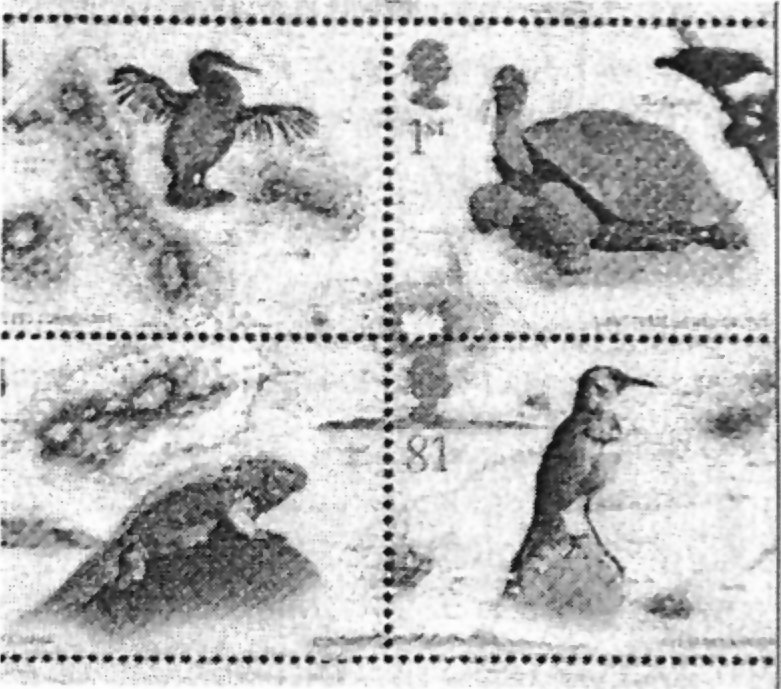

[Charles Darwin]{.maldense} malkovris la kaŭzon, kial kelkaj specioj similas unu al
la alia. La evolu-teoriulo naskiĝis antaŭ 200 jaroj.

Se paroli pri la brita naturesploristo [Charles Darwin]{.maldense}, tiam neeviteblas superlativoj. “Li pli forte estis ŝanĝinta nian intelektan mondon
ol iu ajn alia sciencisto“ ekzemple lin laŭdas la renoma prisciencaŭtoro kaj evolu-esploristo [Stephen Iay Gould]{.maldense} en la antaŭparolo de
sia libro (eldonita kun Darvinaj leteroj), kiu portas la titolon “Nenio
estas pli seninterrompe konstanta ol la ŝanĝiĝado“. Ne senkaŭze
[Gould]{.maldense} venas al tiu ĉi juĝo. Ĉar ja estis Darvino, kiu asignis novan
pozicion al la homo enkadre de la pli granda tutaĵo. For de la iama
“krono de la diaj kreitaĵoj“ li fariĝis simpla produkto de evolue determinitaj naturaj leĝoj — kaj ankaŭ de hazardaj okazaĵoj.

Por la jaro 2009 ni fakte festas duoblan Darvin-jaron. Lia naskiĝdatreveno ducentjariĝas (12-an de februaro), kaj la publikigo de lia
ĉefverko “Pri la estiĝo de la specioj per natura bredoselekto“ (22-an
de novembro) antaŭ 150 jaroj. Por la sciencaj librosocietoj kaŭzo,
nove presi kaj komentarii la unuan germanan eldonon. Hodiaŭ ni ja
scias pli multe pri la evolu-teorio ol ties “patro“ mem. En kelkaj
punktoj oni korektis aŭ almenaŭ precizigis Darvinon.

[Ernst Peter Fischer]{.maldense} resumas, en facile komprenebla lingvaĵo, la aktualan esplorstaton en sia “Granda libro pri la Evoluo“. Ĉiam denove
li montras, kiel oni miskomprenis kaj eĉ fiuzis Darvinon. Oni ekzemple laŭdire tordis el liaj formuloj pri “batalo por pluekzistado“
(“[struggle for existence]{.maldense}“) kaj “postvivado de la plej kapablulo“ (“[survival of the fittest]{.maldense}“), ke la vivo estas ĉiamdaŭra kontraŭeco kaj konflikto de ĉiuj kontraŭ ĉiuj, ĉe kio postvivas nur la plej fortaj individuoj. Tio tamen estas miskompreno, kiun [Fischer]{.maldense} lasas korekti Darvinon mem: “Oni prave povas diri, ke du hundecaj rabobestoj batalas,
en tempo de malsato, pri nutraĵo kaj ekzistado. Sed oni ankaŭ povas
diri, ke iu planto batalas rande de la dezerto pri sia pluekzistado —
kvankam oni same bone povus tion esprimi per: ĝi dependas de humideco“.

Do estas tre profitige ĉerpi el la Darvinaj originalaj tekstoj, des pli
ke li postlasis en siaj leteroj kaj libroj kelkajn el la plej plaĉaj prinaturaj vojaĝraportoj. De tio profitas ankaŭ la teksto-elekto “Darvino
por infanoj kaj plenkreskuloj“ kaj la pridarvina libro “La aventuro de
la vivo“, en kiu la aŭtoro [Jürgen Neffe]{.maldense} detalas, kiel Darvino dum sia
ĉirkaŭvelado de la mondo 1831 ĝis 1836 malkovris la fundamenton
por siaj pioniraj novaj pensoj.

{#bld-1}\
Bildo 1: Por la 200-a naskiĝdatreveno de [Charles Darwin]{.maldense}
la brita poŝto eldonis specialajn poŝtmarkojn

Jam antaŭ tio Darvino malkovris ion tute alian, nome specialan formon de malrapideco. “Oni diris al mi“, legiĝas en lia vivopriskribo,
“ke mi estis dum la lernado multe pli malrapida ol mia fratino
Katarino“. Bonŝance la juna [Charles Robert]{.maldense}, naskiĝinta en la angla
[Shrewsbury]{.maldense} la 12-an de februaro 1809, devenis el bonstata, liberala
familio — kaj ankaŭ lia patro devis havi grandan indulgon al la posta
studento. Sed la malrapideco de la juna Darvino kaj lia sencela lernado certe iel estis ligita kun lia emo sorbiĝi kaj revi en la propraj
pensoj.

Tion rimarkis ankaŭ liaj profesoroj, kaj pro tio la botanikisto
[Jon Steven Henslow]{.maldense} instigis la studenton, dungiĝi sur la mezurad-ŝipo
“[Beagle]{.maldense}“, kiu 1831 ekveturis por plurjara esplorvojaĝo. En la sekvaj
jaroj Darvino veladis tra la Magelan-markolo, travagadis la pampojn
kaj montarojn de Sudameriko, esploris vulkanojn kaj koralinsulojn.
Dum tio li kolektis kaj preparis tiom da preparitaj bestoj kaj plantoj,
ke hejme tuta aro da esploristoj por jaroj estis okupitaj identigi la
materialon.

La tutan amplekson de la vivo antaŭ siaj okuloj, Darvino rimarkis,
ke la diversaj specioj estas distribuitaj laŭ karakteriza maniero. Sur la
Galapago-insulo, tre malproksima antaŭ la marbordo de Sudameriko,
li kaptis kelkajn fringojn, kiuj tiom diferencis inter si kaj de siaj parencoj sur la firma tero, ke oni poste klasifikis ilin kiel memstaran
specion. La plej revolucia penso de Darvino estis, ke la tiom granda
speciomulteco ne povis esti la rezulto de ununura kreado, sed ke la
diversaj specioj alkonformiĝis al sia medio kaj al novaj situacioj kaj
vivokondiĉoj. Tion li nomis “natura bredoselektado“. Al Darvino
estis klare, ke li per tiu teorio ŝokus ne nur la fakulan mondon sed
precipe la diversajn ekleziojn, ĉar validis ja tiam aŭtoritate la biblia
kreadhistorio. Pro tio li prokrastis la publikigon de sia jam en 1844
skizita teorio ĝis la jaro 1859, kaj kolektadis ĝis tiam faktojn — kaj,
perletere, aliancanojn.

Tre amuze tion priskribas [Gould]{.maldense} en la supre menciita antaŭparolo
por sia leteroelektaĵo, kiel la esploristo helpopete kaj penetre pridemandis siajn kolegojn — kaj poste tion prezentis kiel komplezan
amikaĵon. Se komence kelkuloj estis reagintaj iom ĉagrene pro tiu ĉi
altrudiĝemo, poste tiuj leterricevantoj certe estis prudentaj rimarkigi,
ke ili estis kvazaŭ kunlaborantoj ĉe la Darvinaj esploroj. La aventuro
de la legado pri Darvino ankoraŭ nuntempe donas al ni la eblon partopreni en la interesa vivo de fama esploristo. (Fonto: [buchjournal]{.maldense} 4/2008)

## Kontribue al la evolu-teorio kaj ĝiaj kritikantoj

### Pro la libereco de la scienco!

Baze min, kiel pensantan homon, ne konvinkas la evolubiologio.
Miaj ĉiutagaj vivospertoj estas la plej forta argumento por tio. Nenie
mi malkovras blindajn hazardaĵojn laŭ genieco, planado aŭ kreiveco.
En la arĥitekturo, la natursciencoj kaj la medicino oni povas konkludi, konsidere ordon kaj kompleksecon, pli facile certan inteligentan
agadon ol hazardon.

La esenca problemaro ja estas, ke la evolubiologio estas same dogmeca kiel oni tion ĉiam riproĉas al ĝiaj fanatikaj malamikoj, la usonaj
kreadismanoj. Ke Darvino antaŭ malpli ol 200 jaroj povis publike
prezenti siajn tezojn pri la evoluado de la vivo, estas nur atribuebla al
la libereco de la scienco.

Post la tempo de Galilejo la socio kaj scienco fariĝis pli malfermaj
kaj allasis novajn ideojn. Sed la tempoj dume ŝajne draste ŝanĝiĝis al
malbono — se hodiaŭ sciencistoj ne akceptas la darvinan teorion kiel
absolutan veron, ili estas rigardataj kiel religie erarkondukitaj pseŭdobiologoj. [Charles Darwin]{.maldense} tiam ĝuis — kaj tute ne kontraŭbatalis —
la liberecon de la scienco.